# Owner Material 037 — Star Wars D20 Drive folder (Core, Revised Core and Saga Edition): Sourcebooks/The New Jedi Order Sourcebook.pdf [Star Wars Roleplaying Game (d20, 2000)] (scan pages 1–60)

- **Source:** Wizards of the Coast Star Wars Roleplaying Game books, web enhancements, Living Force campaign modules and articles (2000–2010), from the owner's "Star Wars D20" Drive folder (only the three edition subfolders; "General" was not read, as instructed). Secondary source (licensed Legends reference). Scan OCR'd on the box; the scan stays box-only and is **not** published.
- **Method:** every scanned page was OCR'd and machine-screened sentence by sentence for power-relevant statements (fights, kills, defeats, Force feats, rankings, superweapons) that name a character on our roster; each kept sentence is quoted verbatim from the OCR text and has a crop of the printed passage directly under it. Pages with nothing power-relevant are still listed with what is on them.
- **Citation:** "*The New Jedi Order Sourcebook* (SWRPG d20), p.X" by printed page ("scan p.X" where no printed number applies). **Weight:** Licensed RPG material: a secondary source. Narrative text sums up Legends lore; game statistics are rules for players, not canon power levels, and rank lowest.

## scan p.1 (scan page 1)

Page contents: 11 words, 3 paragraphs | headings/entries: THE NEW JEDI ORDER SOURCEBOOK; JD WIKER witTH STEVE MILLER

## scan p.2 (scan page 2)

Page contents: 9 words, 3 paragraphs | headings/entries: ROLEPLAYING GAME; THE NEW JEDI ORDER SOURCEBOOK

## scan p.3 (scan page 3)

Page contents: 445 words, 45 paragraphs | headings/entries: DESIGNERS; LUCAS LICENSING EDITOR; MICHELLE VUCHOVICH; MANAGING EDITOR; HIM MOHAN; STAR WARS RPG CREATIVE DIRECTOR; CHRISTOPHER PERHING; ART DIRECTOR; SEAN GLEAN; LUCAS LICENSING ART EDITOR; IAIN MORRIS; CARTOGRAPHER; RICH ACHBERGER; GRAPHIC DESIGN; MAR! HOLHOWSKY, RICK ACHBERGER; TYPESETTER; BRIN DORRIBS, SONVA PERCIVAL; COVER ARTIST; ASHLEY WOOD; INTERIOR ARTISTS; VICE-PRESIDENT AND DIRECTOR OF RPG R&D; BILL SLAVIESBH; BUSINESS MANAGER; DAVID WISE; PROJECT MANAGER; DOUGLAS STEVES; PRODUCTION MANAGER; CHAS DELONG; U.S,, CANADA ASIA, PACIFIC, & LATIN AMERICA; EUROPEAN HEADQUARTERS Wizards of the Coast, Belgium; Questions? 1-800-324-6496 +32-70-23-32-77

## scan p.4 (scan page 4)

Page contents: 648 words, 30 paragraphs | headings/entries: Knight 51; Colonel Gavin Darklighter, Rogue; Squadron Commander 52

## scan p.5 (scan page 5)

Page contents: 723 words, 58 paragraphs | headings/entries: Kos; Yuuzhan Vong Lav Peq Netting; Yuuzhan Vong Yorik-stronha; Chapter Seven: Star by Star; Saba Sebatyne, Barabel Jedi; XJ3 X-Wing New Starship Tactics; Yuuzhan Vong Psychological; Chapter Bight: Epilogue; Coruscant Lost

## scan p.6 (scan page 6)

Page contents: 910 words, 17 paragraphs | headings/entries: Introduction; How to Use This Book; O fh Z

- **Mara Jade Skywalker; Luke Skywalker** — entry/section: Introduction (The New Jedi Order Sourcebook): "Luke Skywalker is the master of the Jedi academy on Yavin 4; Mara Jade Skywalker is not only his wife, but his most powerful supporter and ally," Source: *The New Jedi Order Sourcebook* (SWRPG d20), scan p.6
  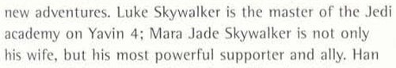
- **Luke Skywalker; Mara Jade Skywalker; Han Solo; Leia Organa Solo**: "Luke Skywalker is the master of the Jedi academy on Yavin 4; Mara Jade Skywalker is not only his wife, but his most powerful supporter and ally, Han Solo and Leia Organa Solo fight the Yuuzhan Vong in their own way, on their own battlefields, while learning to cope with the changes the invasion brings to their family." Source: *The New Jedi Order Sourcebook* (SWRPG d20), scan p.6
  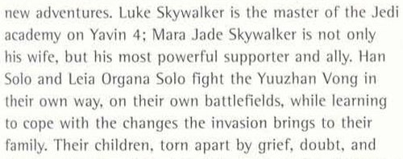

## scan p.7 (scan page 7)

Page contents: 848 words, 21 paragraphs | headings/entries: Siset ="S29; Species in The New Jedi; Order Era; Dantari, Agamarians, Grans, Dugs, Vors,

- **Luke Skywalker**: "Force-Users in The New Jedi Order Era Although the Emperor did everything in his power to eradicate the Jedi, enough of the noble guardians of the Old Republic survived the Emperor's Purge to train the first member of a new generation of Jedi: Luke Skywalker." Source: *The New Jedi Order Sourcebook* (SWRPG d20), scan p.7
  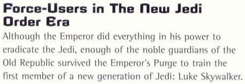

## scan p.8 (scan page 8)

Page contents: 419 words, 16 paragraphs | headings/entries: For the Gamemaster Only

## scan p.9 (scan page 9)

Page contents: 654 words, 19 paragraphs | headings/entries: Cultural Overview; Brief History; The Yuuzhan Vong survived, however. The gods

## scan p.10 (scan page 10)

Page contents: 724 words, 35 paragraphs | headings/entries: Beliefs

- **Nom Anor** — entry/section: Yuuzhan Vong advance agents (The New Jedi Order Sourcebook, Ch1): "The most successful of these advance agents, Nom Anor, destroyed a number of visionary leaders who could have rallied beings to fight against the invasion fleet." Source: *The New Jedi Order Sourcebook* (SWRPG d20), scan p.10
  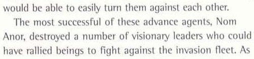

## scan p.11 (scan page 11)

Page contents: 845 words, 23 paragraphs | headings/entries: NOISVAN! GE; The Great Doctrine

## scan p.12 (scan page 12)

Page contents: 914 words, 20 paragraphs | headings/entries: RION; The Castes

## scan p.13 (scan page 13)

Page contents: 465 words, 10 paragraphs | headings/entries: AjO0 Wrs,0F

## scan p.14 (scan page 14)

Page contents: 956 words, 18 paragraphs | headings/entries: BoN

## scan p.15 (scan page 15)

Page contents: 851 words, 30 paragraphs | headings/entries: A100 OF +08; WO BZidvH?; Multiclass Options; Beginning Caste * Class; Warrior Soldier Noble; Shaper - Expert Noble; Shamed One Commoner

## scan p.16 (scan page 16)

Page contents: 817 words, 23 paragraphs | headings/entries: Early Yuuzhan Vong incursions; Zonama Sekot; Bimmiel; BON; State of the Galaxy; Non-Humans in Power; The Anti-Jedi Sentiment

## scan p.17 (scan page 17)

Page contents: 478 words, 10 paragraphs | headings/entries: Agho 074.0); The Jedi

- **Luke Skywalker; Mara Jade Skywalker** — entry/section: Luke Skywalker's Traditionalists (The New Jedi Order Sourcebook, Ch1): "As Mara Jade explained to him, Luke had always overcompensated, using the Force like a heavy club, rather than a light tap." Source: *The New Jedi Order Sourcebook* (SWRPG d20), scan p.17
  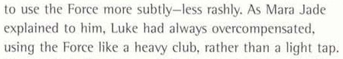
- **Luke Skywalker** — entry/section: Luke Skywalker's Traditionalists (The New Jedi Order Sourcebook, Ch1): "Once Luke had gotten past that realization, he settled into a greater understanding of the Force than he had ever had." Source: *The New Jedi Order Sourcebook* (SWRPG d20), scan p.17
  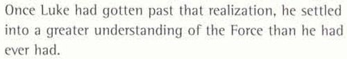
- **Luke Skywalker; Darth Vader (Anakin Skywalker)**: "As it was, they taught Luke what he needed to know to defeat Vader and stop the Emperor." Source: *The New Jedi Order Sourcebook* (SWRPG d20), scan p.17
  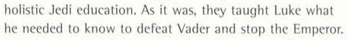

## scan p.18 (scan page 18)

Page contents: Kyp Durron's Radicals: Kyp "the first to fall so deeply to the dark side"; Luke came close to "creating a new Darth Vader"; Radical followers Ganner Rhysode, Wurth Skidder, Saba Sebatyne, Daeshara'cor. (hand-read)

## scan p.19 (scan page 19)

Page contents: 847 words, 23 paragraphs | headings/entries: OL ANDO; Z < > ay 0 Z; Coruscant; Borsk Fey'lya, New Republic Chief; The Imperial Remnant; Grand Admiral Gilad Pellaeon

## scan p.20 (scan page 20)

Page contents: 459 words, 10 paragraphs | headings/entries: The ExGal Society

### Stat block notes (game mechanics, not feats)

- Gilad Pellaeon: Soldier 4/Noble 2/Officer 8. Other blocks: p.35 Lando Scoundrel 8/Noble 6; p.112 Talon Karrde Scoundrel 8/Noble 4/Crime Lord 5; p.136 Wedge Soldier 7/Starfighter Ace 9/Officer 2, Garm Bel Iblis Noble 2/Soldier 4/Officer 10; p.92 Prince Isolder (Source: *The New Jedi Order Sourcebook* (SWRPG d20), scan p.20)

## scan p.21 (scan page 21)

Page contents: 768 words, 24 paragraphs | headings/entries: Revised Yuuzhan Vong Equipment; Weapons; Amphistaff; Blorash Jelly; Magma Pebble; Plaeryin Bol

## scan p.22 (scan page 22)

Page contents: 717 words, 27 paragraphs | headings/entries: Range; Piercing, slashing; Bludgeoning; Piercing, slashing; Slashing; Piercing, slashing; Razorbug; Thud Bug; Tsaisi; Armor; INVA

## scan p.23 (scan page 23)

Page contents: 680 words, 26 paragraphs | headings/entries: Armor Damage Check Penalty Reduction Speed Weight; Every Yuuzhan Vong, with the exception of; Equipment; Chilab; Goullith; Ooglith Cloaker

## scan p.24 (scan page 24)

Page contents: 555 words, 19 paragraphs | headings/entries: Ooglith Masquer; Villip; CHAPTER ONE

## scan p.25 (scan page 25)

Page contents: 642 words, 21 paragraphs | headings/entries: CHAPTER TWO; Rhommamool and Osarian; Belkadan; Redcrested Cougar

## scan p.26 (scan page 26)

Page contents: 496 words, 47 paragraphs | headings/entries: VECTOR PRIME; Bilbringi OM Arkania A; Muunilinst( Vesetion Aa; Yaga © Minor C)bubriltio; Agamar )) ithor; Bimmiel O)Myrkre; Kuat; Commenor; Fondor; Corellia; Cron Drift ashyyyk; Chalacta; Toydaria; ExGal-4; Two; CHAPTER

## scan p.27 (scan page 27)

Page contents: 865 words, 20 paragraphs | headings/entries: Yomin Carr, Yuuzhan Vong Scout; Helska

## scan p.28 (scan page 28)

Page contents: 426 words, 8 paragraphs | headings/entries: The Praetorite Vong

## scan p.29 (scan page 29)

Page contents: 879 words, 18 paragraphs | headings/entries: Archetype: Yuuzhan Vong Warrior

## scan p.30 (scan page 30)

Page contents: 593 words, 47 paragraphs | headings/entries: Soldier 1 Soldier 2; Initiative: +0 +0; Defense: 14 (+4 armor) 14 (+4 armor); Speed: 10m 10m; VP/WP: 11/12 18/12; Size: M M; Force Points: 0 (0); Dark Side Points: 2 4; Reputation: 0 2; Pilot +4, Survival +4; Equipment: Amphistaff, coufee, Amphistaff, coufee,; Soldier 4; Amphistaff 1d6+1/1d6+0 Coufee 1d4+1; Amphistaff, coufee, vonduun crab armor,; Archetype: Yuuzhan Vong Priest; Prefect Da'Gara

## scan p.31 (scan page 31)

Page contents: 603 words, 57 paragraphs | headings/entries: Initiative: Defense:; Speed:; VP/WP:; Attacks:; Damage:; Special Qualities:; Saves:; Challenge Code: Size:; Force Points: Dark Side Points: Reputation: Abilities:; Skills:; Feats:; Equipment:; Soldier 1/Noble 1; Fort +5, Ref +1, Will +1; NS+OCz >; Str 10, Dex 10, Con 12,; Soldier 1/Noble 2; Str 10, Dex 10, Con 12,; Tsaisi, coufee, 2 villips; Soldier 1/Noble 3; Str 10, Dex 10, Con 12,; Tsaisi, coufee, multiple villips

## scan p.32 (scan page 32)

Page contents: 448 words, 12 paragraphs | headings/entries: Yuuzhan Vong Yorik-et Coralskipper; CHAPTER T

## scan p.33 (scan page 33)

Page contents: 842 words, 23 paragraphs | headings/entries: Yuuzhan Vong Advantages; HOM OT TOLL THE ERDES

## scan p.34 (scan page 34)

Page contents: 721 words, 43 paragraphs | headings/entries: Yuuzhan Vong Shield Point Cost; Ship's Maneuvers Shield Point Cost; O PORTIA YOUZHAN WOME GLOSSHBY; Jeedai "edi."; Kanabar "Fellow low-caste person."; Change speed (three categories) 10; Establish or break pursuit 10; Tractor Huge target 400

## scan p.35 (scan page 35)

Page contents: 874 words, 20 paragraphs | headings/entries: Mow#o5; Dubrillion; The Belt

- **Lando Calrissian**: "Acquiring Belt-Runner I, a space station capable of extending its shields around other ships, and tweaking the safety features of a small squadron of modified Imperialsurplus TIE starfighters, Lando launched his profit center." Source: *The New Jedi Order Sourcebook* (SWRPG d20), scan p.35
  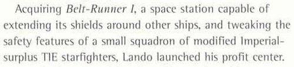

### Stat block notes (game mechanics, not feats)

- Lando Calrissian: Male Human Scoundrel 8/Noble 6; Init +1; Defense 22 (+11 class, +1 Dex); Spd 10 m; VP/WP 64/12; Atk +11/+6 melee (1d3+1, unarmed) or +11/+6 ranged (3d6, blaster pistol); SQ Illicit barter, better lucky than good, sneak attack +2d6, bonus class skill (Bluff), call in a favor x3, inspire confidence +2, command +2; SV Fort +5, Ref +10, Will +9; SZ M; FP 4; DSP 2 (Source: *The New Jedi Order Sourcebook* (SWRPG d20), scan p.35)

## scan p.36 (scan page 36)

Page contents: 433 words, 9 paragraphs | headings/entries: 

## scan p.37 (scan page 37)

Page contents: 749 words, 30 paragraphs | headings/entries: T os < m; The Dozen-and-Two Avengers; HJ K-Wing; Prestige Class: Jedi Ace

## scan p.38 (scan page 38)

Page contents: 455 words, 19 paragraphs | headings/entries: Class Skills; Class Features

## scan p.39 (scan page 39)

Page contents: 913 words, 23 paragraphs | headings/entries: Kyp Durron, Jedi Master

### Stat block notes (game mechanics, not feats)

- Kyp Durron (NJO): Jedi Guardian 9/Fringer 2/Jedi Ace 4; VP/WP 110/15; Def 25; lightsaber +16/+11/+6 (4d8+2/19-20); Fort +13 Ref +13 Will +7; FP 6 DSP 6 Rep 15; CC F (Source: *The New Jedi Order Sourcebook* (SWRPG d20), scan p.39)

## scan p.40 (scan page 40)

Page contents: 408 words, 13 paragraphs | headings/entries: Yo'Gand's Core; Grutchin

## scan p.41 (scan page 41)

Page contents: 469 words, 11 paragraphs | headings/entries: 

## scan p.42 (scan page 42)

Page contents: 840 words, 25 paragraphs | headings/entries: The Battle of Dubrillion; The First Casualty; N; Adventure ideas; The Outer Rim; Getting the Heroes Involved

- **Chewbacca**: "Twenty years ago, Chewbacca helped defeat the Empire." Source: *The New Jedi Order Sourcebook* (SWRPG d20), scan p.42
  

## scan p.43 (scan page 43)

Page contents: 930 words, 16 paragraphs | headings/entries: The Skies above Belkadan; The Poisoned Forests

## scan p.44 (scan page 44)

Page contents: 702 words, 14 paragraphs | headings/entries: Return to Dubrillion

## scan p.45 (scan page 45)

Page contents: 267 words, 39 paragraphs | headings/entries: ASGS te, OF; CHAPTER THREE; BARE TIDE; ONSLAUGHT; Vortex; Bilbringi Arkania; Ya Minor C)dubritis Ord Mantell GarqiC)bdantooine Anobis; Agamar Ithor; Caamas; Coruscant; Alderaan; Kuat; Dathomir; Wayland()E 1mm. e; Myrkr; Obroa-Skai; Commenor; Corellia; Yag'Dhul Gyndine; Osarian Tynna Aridus Malastare; Umgul Kothlis; Naboo Bothawui; Roon; Tatooine; Hapes Consortium; Cron Drift; Kashyyyk Ossus; Tholatin Bimmisaari; Chalacta; Toydaria Nal Hutta; Ylesia; Gamorr

- **Chewbacca** — entry/section: Dark Tide (The New Jedi Order Sourcebook, Ch2): "It's been two months since the mighty Chewbacca fell, crushed beneath Sernpidal’s moon." Source: *The New Jedi Order Sourcebook* (SWRPG d20), scan p.45
  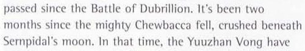

## scan p.46 (scan page 46)

Page contents: 878 words, 35 paragraphs | headings/entries: Automatic Languages: Basic, Caamasi. :::; New Republic must open communications channels witl

## scan p.47 (scan page 47)

Page contents: 435 words, 10 paragraphs | headings/entries: 

## scan p.48 (scan page 48)

Page contents: 703 words, 30 paragraphs | headings/entries: The Jedi Academy; Archetype: Jedi Student; TIDE; Va < a); Jedi Guardian 1; Jedi Consular 1; Force Adept 1/Jedi Guardian 1 -1; Knife 1d4—1; None; Fort +1, Ref +1, Will +2; A; Str 8, Dex 9, Con 9,; Int 9, Wis 10, Cha 9

## scan p.49 (scan page 49)

Page contents: 850 words, 24 paragraphs | headings/entries: Hvd; Z a 0 m; Belkadan under the Yuuzhan Vong; Dovin Basal Fields; Thralls; Implanter

## scan p.50 (scan page 50)

Page contents: 974 words, 17 paragraphs | headings/entries: Minshal

## scan p.51 (scan page 51)

Page contents: 400 words, 11 paragraphs | headings/entries: Ngdin

## scan p.52 (scan page 52)

Page contents: 834 words, 25 paragraphs | headings/entries: Corran Horn, Jedi Knight; AGE PEAT: RUSOOD GNEREY; Ganner Rhysode, Jedi Knight

- **Corran Horn** — entry/section: Corran Horn, Jedi Knight (The New Jedi Order Sourcebook, Ch2): "He became one of the first formal students at Luke Skywalker’s Jedi academy, While training, he realized that he was virtually incapable of moving objects with the Force—telekinesis was beyond his abilities except with the most taxing effort." Source: *The New Jedi Order Sourcebook* (SWRPG d20), scan p.52
  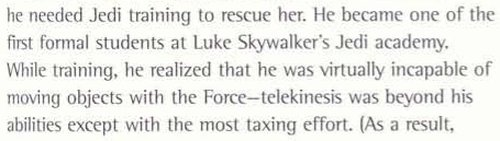
- **Corran Horn** — entry/section: Corran Horn, Jedi Knight (The New Jedi Order Sourcebook, Ch2): "Now, with the Yuuzhan Vong invasion just beginning, Corran Horn prepares to use his Jedi skills to defend the galaxy, but he’s also keenly aware that the alien warriors are immune to his strongest and most useful ability." Source: *The New Jedi Order Sourcebook* (SWRPG d20), scan p.52
  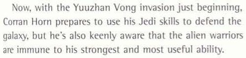
- **Corran Horn** — entry/section: Corran Horn, Jedi Knight: "(As a result, Corran Horn can only use telekinetic Force abilities when he expends a Force Point to do so.)" Source: *The New Jedi Order Sourcebook* (SWRPG d20), scan p.52
  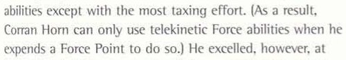

### Stat block notes (game mechanics, not feats)

- Corran Horn (NJO): Jedi Guardian 8/Scoundrel 1/Soldier 6/Starfighter Ace 4; VP/WP 145/14; Def 29; lightsaber +19/+14/+9/+4 (3d8+1/19-20, dual-phase); Fort +15 Ref +17 Will +9; FP 9 DSP 3; CC F; telekinesis only by spending a Force Point (Source: *The New Jedi Order Sourcebook* (SWRPG d20), scan p.52)

## scan p.53 (scan page 53)

Page contents: 861 words, 26 paragraphs | headings/entries: Feats: Dodge, Exotic Weapon Proficiency (lightsaber),; Rogue Squadron

## scan p.54 (scan page 54)

Page contents: 832 words, 25 paragraphs | headings/entries: Jaina Solo, Jedi Student/Rogue Squadron Pilot; New Starship Tactics; Improved Sensor Database

### Stat block notes (game mechanics, not feats)

- Jaina Solo (Dark Tide): Jedi Guardian 6/Soldier 1/Jedi Ace 2; VP/WP 60/13; lightsaber +10/+5 (3d8); CC B (Source: *The New Jedi Order Sourcebook* (SWRPG d20), scan p.54)

## scan p.55 (scan page 55)

Page contents: 413 words, 16 paragraphs | headings/entries: Splinter Shots; Inertial Compensators; Because inertial compensators negate gravity fields and

## scan p.56 (scan page 56)

Page contents: 842 words, 28 paragraphs | headings/entries: CHAPTER THREE; NEW SPECIES: DANTARI; The Battle of Dantooine; Automatic Languages: Dantari (speak only). «; AvDO Off

- **Mara Jade Skywalker**: "They know only that the Yuuzhan Vong are actively searching for them and have already destroyed Mara's Jade Sabre, their only means of getting offplanet." Source: *The New Jedi Order Sourcebook* (SWRPG d20), scan p.56
  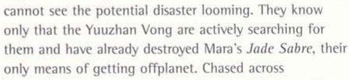

## scan p.57 (scan page 57)

Page contents: 722 words, 21 paragraphs | headings/entries: A; DANTOOINE: REFUGEE BASE; SHI; AND MEDICAL FACILITI; AAAAAA AA 9 60 9; Scrambling aboard their freighters—for now, their losses

## scan p.58 (scan page 58)

Page contents: 880 words, 25 paragraphs | headings/entries: Corusca Fire; DARK; TIDE

## scan p.59 (scan page 59)

Page contents: 806 words, 21 paragraphs | headings/entries: Class Skills; Class Features

## scan p.60 (scan page 60)

Page contents: 837 words, 17 paragraphs | headings/entries: Table 3-1: The Moghri Bodyguard; Bolpuhr, Noghri Bodyguard

