# Owner Material 037 — Star Wars D20 Drive folder (Core, Revised Core and Saga Edition): Sourcebooks/The New Jedi Order Sourcebook.pdf [Star Wars Roleplaying Game (d20, 2000)] (scan pages 61–120)

- **Source:** Wizards of the Coast Star Wars Roleplaying Game books, web enhancements, Living Force campaign modules and articles (2000–2010), from the owner's "Star Wars D20" Drive folder (only the three edition subfolders; "General" was not read, as instructed). Secondary source (licensed Legends reference). Scan OCR'd on the box; the scan stays box-only and is **not** published.
- **Method:** every scanned page was OCR'd and machine-screened sentence by sentence for power-relevant statements (fights, kills, defeats, Force feats, rankings, superweapons) that name a character on our roster; each kept sentence is quoted verbatim from the OCR text and has a crop of the printed passage directly under it. Pages with nothing power-relevant are still listed with what is on them.
- **Citation:** "*The New Jedi Order Sourcebook* (SWRPG d20), p.X" by printed page ("scan p.X" where no printed number applies). **Weight:** Licensed RPG material: a secondary source. Narrative text sums up Legends lore; game statistics are rules for players, not canon power levels, and rank lowest.

## scan p.61 (scan page 61)

Page contents: 889 words, 24 paragraphs | headings/entries: Z 0 m; Yuuzhan Vong Forces; Chazrach

## scan p.62 (scan page 62)

Page contents: 866 words, 24 paragraphs | headings/entries: Yuuzhan Vong Thrall Herder; Yuuzhan Vong Warkeeper; Losses on the Rim; Agamar; Wayland

## scan p.63 (scan page 63)

Page contents: 640 words, 21 paragraphs | headings/entries: Belkadan; Alderaan broa-Skai; Okuat 7 » Commenor; OP) Hapes Consorti )Corellia; Cron Drift; Yag'Dhul 4 O)Gyndine; Kashyyyk Tholatin; Tynna @ Bimmisaari; DAridus; Naboo ©) Bothawui @user

- **Corran Horn**: "Reluctantly, Corran Horn orders the bafforr tree grove commandos goes with them. , 5 zal ' ; ee : destroyed, along with the rest of the gardens, By accident, The situation on Garqi proves more grim than expected. eee ra ; ; ; : the reconnaissance mission has uncovered a fatal weak- The Yuuzhan Vong have implanted surge-coral to 5 ; : s ' ?" Source: *The New Jedi Order Sourcebook* (SWRPG d20), scan p.63
  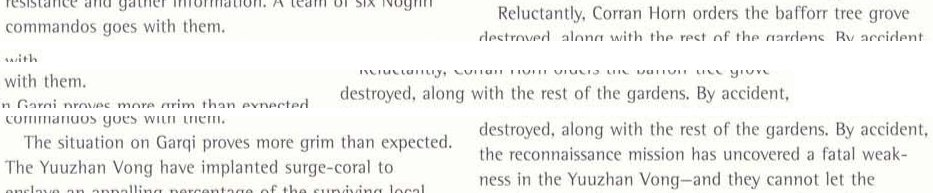

## scan p.64 (scan page 64)

Page contents: 856 words, 27 paragraphs | headings/entries: The Battle of Ithor

## scan p.65 (scan page 65)

Page contents: 651 words, 14 paragraphs | headings/entries: The Ground Defense; Wurth Skidder, Jedi Knight

- **Anakin Solo; Corran Horn**: "Though they suffer heavy casualties—including the Jedi Daeshara'cor, who is killed protecting Anakin Solo—the ground forces survive long enough for Corran Horn to find the Yuuzhan Vong communication center." Source: *The New Jedi Order Sourcebook* (SWRPG d20), scan p.65
  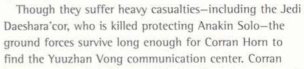

## scan p.66 (scan page 66)

Page contents: 364 words, 24 paragraphs | headings/entries: Corusca Rainbow; Ht) O. ell; CHAPTER

## scan p.67 (scan page 67)

Page contents: 865 words, 20 paragraphs | headings/entries: Eva

- **Shedao Shai** — entry/section: Shedao Shai, Yuuzhan Vong Commander (The New Jedi Order Sourcebook, Ch3): "Lean and fierce, he is a frightening figure, deadly in combat and nigh invincible in battle." Source: *The New Jedi Order Sourcebook* (SWRPG d20), scan p.67
  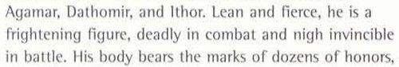
- **Corran Horn**: "Corran Horn negotiates a temporary truce with Shedao Shai: a week's cease-fire, at the end of which Shedao Shai and Corran Horn would duel to the death." Source: *The New Jedi Order Sourcebook* (SWRPG d20), scan p.67
  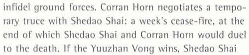

### Stat block notes (game mechanics, not feats)

- Shedao Shai: Soldier 12/Noble 2/Officer 5 — Yuuzhan Vong commander at Ithor (block on p.67) (Source: *The New Jedi Order Sourcebook* (SWRPG d20), scan p.67)

## scan p.68 (scan page 68)

Page contents: 801 words, 26 paragraphs | headings/entries: Legacy of Torment

- **Corran Horn**: "After Shedao Shai's death in his duel with the Jedi Knight Corran Horn, the Yuuzhan Vong warrior Deign Lian seizes command of Legacy of Torment, using it to deliver lethal bioweapons that destroy the jungles of Ithor." Source: *The New Jedi Order Sourcebook* (SWRPG d20), scan p.68
  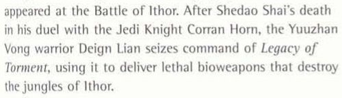

## scan p.69 (scan page 69)

Page contents: 885 words, 22 paragraphs | headings/entries: Hvd; Z a 5 m; Adventure Ideas

- **Corran Horn; Shedao Shai; Mara Jade Skywalker** — entry/section: Duel, Betrayal, and Blame (The New Jedi Order Sourcebook, Ch3): "Meeting no resistance to his attack, Shedao Shai falls temporarily off balance—just long enough for Corran to press his lightsaber hilt to the Yuuzhan Vong’s abdomen and switch it on." Source: *The New Jedi Order Sourcebook* (SWRPG d20), scan p.69
  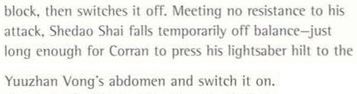
- **Corran Horn; Shedao Shai** — entry/section: Duel, Betrayal, and Blame (The New Jedi Order Sourcebook, Ch3): "Though Corran Horn defeated Shedao Shai, the Jedi Master had, for a brief time, surrendered to the dark side." Source: *The New Jedi Order Sourcebook* (SWRPG d20), scan p.69
  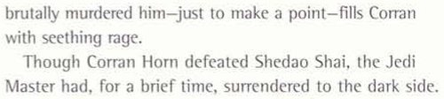
- **Corran Horn; Darth Vader (Anakin Skywalker); Kyp Durron** — entry/section: Duel, Betrayal, and Blame (The New Jedi Order Sourcebook, Ch3): "Soon, Horn is vilified as the most recent in a line of “world-killing Jedi” that includes Darth Vader and Kyp Durron." Source: *The New Jedi Order Sourcebook* (SWRPG d20), scan p.69
  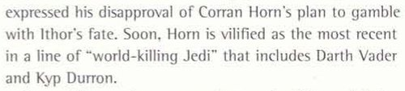
- **Corran Horn; Mara Jade Skywalker**: "Duel, Betrayal, and Blame The Battle of Ithor ends when Corran Horn and Mara Jade Skywalker locate the Yuuzhan Vong command post and contact Shedao Shai, the Yuuzhan Vong commander." Source: *The New Jedi Order Sourcebook* (SWRPG d20), scan p.69
  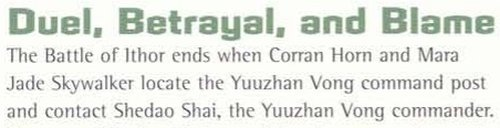
- **Corran Horn**: "Corran and Shedao Shai agreed to a temporary truce—at the end of which, the two engage in a duel to decide Ithor's fate." Source: *The New Jedi Order Sourcebook* (SWRPG d20), scan p.69
  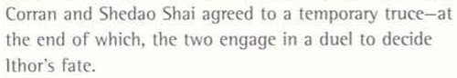
- **Luke Skywalker; Corran Horn**: "The duel takes place a week later, with Luke Skywalker as Corran Horn's witness, and Deign Lian as Shedao Shai's." Source: *The New Jedi Order Sourcebook* (SWRPG d20), scan p.69
  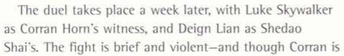
- **Corran Horn**: "To help disassociate the public image of "Corran Horn, destroyer of Ithor," from the rest of the Jedi, Corran exiles himself from the Jedi to seek his own peace." Source: *The New Jedi Order Sourcebook* (SWRPG d20), scan p.69
  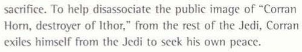
- **Corran Horn**: "Though he has convinced himself that the duel with Shedao Shai was over the fate of Ithor, what Corran had really wanted was revenge—revenge for the gentle Caamasi senator Elegos A'Kla, one of Corran's dearest friends." Source: *The New Jedi Order Sourcebook* (SWRPG d20), scan p.69
  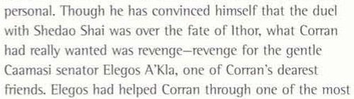

## scan p.70 (scan page 70)

Page contents: 660 words, 28 paragraphs | headings/entries: Falling Back; The Evacuation of Dubrillion; CHAPTER THREE; DUBRILLION: LANDO'S FOLL; The Ones Left Behind

- **Lando Calrissian**: "After the defeat of the Yuuzhan Vong at the Battle of Dubrillion, Administrator Lando Calrissian is all too willing to pay for repairs to the heroes' space transport or starfighters, but only if the heroes can pitch in and help rebuild his facility at Lando's Folly." Source: *The New Jedi Order Sourcebook* (SWRPG d20), scan p.70
  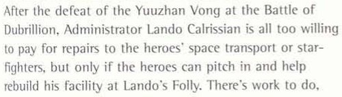

## scan p.71 (scan page 71)

Page contents: 693 words, 16 paragraphs | headings/entries: Ayod 06.07; LOWER LEVEL; YUUZHAN VONG; The Fighting at Gargi

## scan p.72 (scan page 72)

Page contents: 662 words, 12 paragraphs | headings/entries: THREE

## scan p.73 (scan page 73)

Page contents: 722 words, 22 paragraphs | headings/entries: I Na5Vv; L > 0 Hy); BNOd BBLdvHO; CHAPTER FOUR; State of the New Republic; AGENTS OFC

## scan p.74 (scan page 74)

Page contents: 471 words, 44 paragraphs | headings/entries: HERO'S TRIAL; Dp Arkania ©) Anabis; Caamas ) Coruscant; Alderaan; Commenor; Yag'Dhul Gyndine; Osarian =) Tynna; Umgut PKothlis Rodia Naboo Bothawui; New Republic's decision-makers,; Hapes Consortium; Cron Drift Kasayyy< )Ossus Tholatin; Bimmisaari; Chalacta; Toydaria Nal Hutta; Ylesia; Corel

## scan p.75 (scan page 75)

Page contents: 687 words, 13 paragraphs | headings/entries: Roa, Former Smuggler

- **Darth Vader (Anakin Skywalker); Chewbacca**: "To Han's mind, Anakin killed Chewie by abandoning him." Source: *The New Jedi Order Sourcebook* (SWRPG d20), scan p.75
  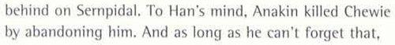

## scan p.76 (scan page 76)

Page contents: 779 words, 24 paragraphs | headings/entries: Obroa-skai; Ao 5; The Yuuzhan Vong Defector

## scan p.77 (scan page 77)

Page contents: 504 words, 17 paragraphs | headings/entries: NOs BBidvH?; Aygo ury my; Initial Damage 2d6+6 Con; Secondary; Type Inhaled DC 18

## scan p.78 (scan page 78)

Page contents: 832 words, 32 paragraphs | headings/entries: CHAPTER FOUR; Elan, Yuuzhan Vong Priestess; Weapon Group Proficiency (simple weapons)

- **Vergere** — entry/section: Vergere's Tears sidebar (The New Jedi Order Sourcebook, Ch4): "Vergere’s tear glands contain a potent curative agent vastly more powerful than bacta." Source: *The New Jedi Order Sourcebook* (SWRPG d20), scan p.78
  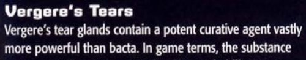

## scan p.79 (scan page 79)

Page contents: 855 words, 17 paragraphs | headings/entries: Wayland; New Republic Intelligence; Archetype: NARI Officer; Colonel Belindi Kalenda

## scan p.80 (scan page 80)

Page contents: 534 words, 12 paragraphs | headings/entries: AD S

## scan p.81 (scan page 81)

Page contents: 603 words, 20 paragraphs | headings/entries: Major Showolter; Ord Mantell

## scan p.82 (scan page 82)

Page contents: 471 words, 11 paragraphs | headings/entries: The Jubilee Wheel; Brigade operatives bent on preventing her "defection."

## scan p.83 (scan page 83)

Page contents: 679 words, 19 paragraphs | headings/entries: 

## scan p.84 (scan page 84)

Page contents: 526 words, 39 paragraphs | headings/entries: The Peace Brigade; Equipment:; Weapons, blast vest; Ship, weapons; Commander; Soldier 2/Scoundrel 4; Vibrodagger +6 melee; Blaster pistol +8 ranged Vibrodagger 2d4+1; Blaster pistol 3d6; Cc; Str 12, Dex 15, Con 12,; Int 12, Wis 8, Cha 13; GHAOS; AGENRS GF; Qa

## scan p.85 (scan page 85)

Page contents: 961 words, 21 paragraphs | headings/entries: Archetype: Peace Brigader; Reck Desh, Mercenary

## scan p.86 (scan page 86)

Page contents: 910 words, 28 paragraphs | headings/entries: T O . re. 0; Z; LJ

## scan p.87 (scan page 87)

Page contents: 887 words, 21 paragraphs | headings/entries: Queen of Empire; Gundine

## scan p.88 (scan page 88)

Page contents: 443 words, 12 paragraphs | headings/entries: Z LJ 0 <

## scan p.89 (scan page 89)

Page contents: 402 words, 14 paragraphs | headings/entries: AsUO Ue .o1; Nas Choka, Yuuzhan Vong Supreme Commander

### Stat block notes (game mechanics, not feats)

- Nas Choka (OCR "Mas Choka"): Soldier 12/Officer 6; VP/WP 115/19; DR 15; immune to Force, Rep 20; CC F (Source: *The New Jedi Order Sourcebook* (SWRPG d20), scan p.89)

## scan p.90 (scan page 90)

Page contents: 635 words, 16 paragraphs | headings/entries: Tynna; Fondor

## scan p.91 (scan page 91)

Page contents: 625 words, 16 paragraphs | headings/entries: Yuuzhan Vong A-vek liluunu Fighter Carrier; Corellia

## scan p.92 (scan page 92)

Page contents: 896 words, 19 paragraphs | headings/entries: The Hapan Fleet; AO S; Prince Isolder, Hapan Ruler; Swirls of Chaos

## scan p.93 (scan page 93)

Page contents: 456 words, 38 paragraphs | headings/entries: A100 Ore it; Vortex; Bilbringi Arkania; Coruscant; Byss Khomm; Kuat; Alderaan; Yavin; Commenor; Corellia; Duro : Gyndine; Aleen Os . Antar bah ttich-; Aridus; Malastare; Umgul Kothlis Rodia Naboo Bothawui; Ando; Tatooine; Cron Drift; Ossus; Chalacta; Toydaria Nal Hutta; Adventure Ideas; The Refugee Trail; Encounter at Wayland

## scan p.94 (scan page 94)

Page contents: 1003 words, 16 paragraphs | headings/entries: Alone and Unwanted

## scan p.95 (scan page 95)

Page contents: 943 words, 24 paragraphs | headings/entries: RANAT; The Value of Life

## scan p.96 (scan page 96)

Page contents: 948 words, 24 paragraphs | headings/entries: Vigor; Blunt Force; Ao S

## scan p.97 (scan page 97)

Page contents: 681 words, 15 paragraphs | headings/entries: Z 1; GHAPTER FIVE '; State of the New Republic

## scan p.98 (scan page 98)

Page contents: 672 words, 26 paragraphs | headings/entries: Diplomat 6; Blaster pistol 3d6; None; Fort +2, Ref +2, Will +6 B; Progress of the Invasion

## scan p.99 (scan page 99)

Page contents: 412 words, 32 paragraphs | headings/entries: BALANCE POINT; Arkania; Coruscant; Alderaan; Kuat; Commenor; Corellia; Yag'Dhul Osarian; Aridus; Malastare; Umgul Kothlis; Naboo )Bothawui; Hapes Consortium; Cron Drift; Chalacta; Tatooine; The Bloody Push to Coruscant

### Stat block notes (game mechanics, not feats)

- Tsavong Lah: Soldier 8/Noble 4/Officer 6; VP/WP 185/19; DR 18 (vonduun crab armor); amphistaff +17/+12/+7 (1d6+3); immune to Control, Sense, Alter; CC not legible (Source: *The New Jedi Order Sourcebook* (SWRPG d20), scan p.99)

## scan p.100 (scan page 100)

Page contents: 374 words, 15 paragraphs | headings/entries: Kalarba; Sriluur; Druckenwell; Rodia

## scan p.101 (scan page 101)

Page contents: 874 words, 25 paragraphs | headings/entries: Z i m v . Z |; Falleen; Kubindi; Viesia; Nal Hutta; Hutt Collusion

## scan p.102 (scan page 102)

Page contents: 877 words, 18 paragraphs | headings/entries: Borga Besadii Diori, Hutt Ruler; Duro

## scan p.103 (scan page 103)

Page contents: 881 words, 19 paragraphs | headings/entries: Z m v v Z |; SELCORE Domes; The Battle of Duro; New Yuuzhan Vong Equipment; Yuuzhan Vong Lizard Mount

## scan p.104 (scan page 104)

Page contents: 648 words, 21 paragraphs | headings/entries: Yuuzhan Vong Fighting Claws; The implantation of retractable bone spurs—permanent,; Yuuzhan Vong Tkun Strangler; Yuuzhan Vong Cuffs; The Rescue of Leia Organa Solo

## scan p.105 (scan page 105)

Page contents: 710 words, 20 paragraphs | headings/entries: A00 07a, Ut; Jacen Solo, Reluctant Jedi

- **Jacen Solo (Darth Caedus)** — entry/section: Balance Point (The New Jedi Order Sourcebook, Ch5): "Jacen unleashes the full, raw power of the Force against the Yuuzhan Vong." Source: *The New Jedi Order Sourcebook* (SWRPG d20), scan p.105
  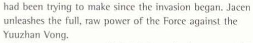
- **Leia Organa Solo**: "The Yuuzhan Vong simply want Leia and every other infidel to either submit to their domination or die with some modicum of honor, courage, or, at the very least, dignity." Source: *The New Jedi Order Sourcebook* (SWRPG d20), scan p.105
  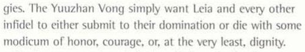
- **Leia Organa Solo**: "Tsavong Lah himself is hurled out the window after being struck with Leia's heavy desk." Source: *The New Jedi Order Sourcebook* (SWRPG d20), scan p.105
  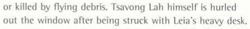

## scan p.106 (scan page 106)

Page contents: 801 words, 22 paragraphs | headings/entries: The Fall of Duro

- **Jacen Solo (Darth Caedus); Tsavong Lah** — entry/section: The Fall of Duro (The New Jedi Order Sourcebook, Ch5): "His ankle crushed by Jacen Solo’s Force-powered assault, Warmaster Tsavong Lah is not in good humor as he returns to his command ship above Duro." Source: *The New Jedi Order Sourcebook* (SWRPG d20), scan p.106
  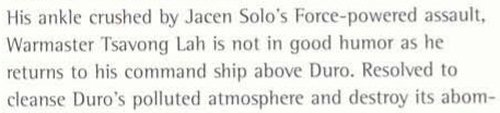

## scan p.107 (scan page 107)

Page contents: 721 words, 20 paragraphs | headings/entries: CHAPTBRES!Xx; State of the New Republic; The New Jedi Purge; Progress of the Invasion

## scan p.108 (scan page 108)

Page contents: 716 words, 16 paragraphs | headings/entries: CONQUEST; Coruscant; Alderaan 2 C)i; C)8i; Malastare OM Toydaria; MD Umgul HKothlis; Naboo @ Bothawui

## scan p.109 (scan page 109)

Page contents: 844 words, 34 paragraphs | headings/entries: Jedi Master Ikrit; Listen +10, Pilot; Automatic Language: Kushiba

### Stat block notes (game mechanics, not feats)

- Tahiri Veila: Female Human Jedi Guardian 4; Init +1; Defense 17 (+6 class, +1 Dex); Spd 10 m; VP/WP 30/12; Atk +5 melee* (2d8/19-20, lightsaber) or +5 ranged (3d6, blaster pistol); SV Fort +5, Ref +5, Will +3; SZ M; FP 2; DSP 0; Rep 3; Str 10, Dex 12, Con 12, Int 13, Wis 13, Cha 13. Challenge Code: A. (Source: *The New Jedi Order Sourcebook* (SWRPG d20), scan p.109)

## scan p.110 (scan page 110)

Page contents: 657 words, 23 paragraphs | headings/entries: Remis Vehn, Peace Brigade Pilot; TORY \

## scan p.111 (scan page 111)

Page contents: 674 words, 17 paragraphs | headings/entries: Talon Karrde's Ruse; Talon Harrde

## scan p.112 (scan page 112)

Page contents: 693 words, 13 paragraphs | headings/entries: YAVIN U: SHAPER COMPOUND

- **Darth Vader (Anakin Skywalker)**: "Even as Talon Karrde takes his ships to the edge of the Yavin system, awaiting an opportunity to rescue Anakin and his fellow students, Yuuzhan Vong warships drop gigantic pods to the surface of Yavin 4—obliterating all traces of the Jedi academy with organic structures." Source: *The New Jedi Order Sourcebook* (SWRPG d20), scan p.112
  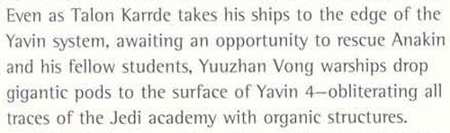

### Stat block notes (game mechanics, not feats)

- Talon Karrde: Male Human Scoundrel 8/Noble 4/Crime Lord 5; Init +2; Defense 25 (+13 class, +2 Dex); Spd 10 m; VP/WP. 100/14; Atk +12/+7/+2 melee (1d3+1, unarmed) or +13/+8/+3 ranged (3d6, blaster pistol); SQ Illicit barter, better lucky than good, sneak attack +2d6, call in a favor x2, inspire confidence +1, command +2, contacts x2, resource access, inspire fear -2, minions; SV Fort +6 (Source: *The New Jedi Order Sourcebook* (SWRPG d20), scan p.112)

## scan p.113 (scan page 113)

Page contents: 637 words, 18 paragraphs | headings/entries: Yuuzhan Vong Tsik Vai Flier; Anakin among the Yuuzhan Vong

### Stat block notes (game mechanics, not feats)

- Vua Rapuung: Soldier 10/Noble 2/Officer 2; VP/WP 130/16; immune to Force; CC E (Source: *The New Jedi Order Sourcebook* (SWRPG d20), scan p.113)

## scan p.114 (scan page 114)

Page contents: 665 words, 14 paragraphs | headings/entries: Meditating on the Yuuzhan Vong

## scan p.115 (scan page 115)

Page contents: 906 words, 21 paragraphs | headings/entries: Mezhan Rwaad: Female Yuuzhan Vong Expert

- **Kyp Durron**: "They don't need exterminating, as Kyp Durron plainly believed; they simply need to be stopped—without anger, and without hatred—before their religious fervor wipes out or enslaves the entire galaxy." Source: *The New Jedi Order Sourcebook* (SWRPG d20), scan p.115
  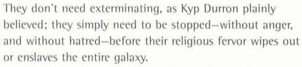

## scan p.116 (scan page 116)

Page contents: 930 words, 18 paragraphs | headings/entries: Escape from Yavin 4; O :

- **Anakin Solo** — entry/section: Escape from Yavin 4 (The New Jedi Order Sourcebook, Ch6): "Together, Ikrit had said, Anakin and Tahiri were stronger than the sum of their parts." Source: *The New Jedi Order Sourcebook* (SWRPG d20), scan p.116
  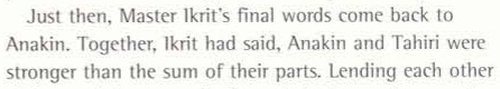

## scan p.117 (scan page 117)

Page contents: 696 words, 16 paragraphs | headings/entries: B 3505; Booster Terrik

- **Darth Vader (Anakin Skywalker)**: "Even as the realization hits Talon Karrde that Wild Karrde is the only thing left between the Yuuzhan Vong and the imminent destruction of Anakin's beleaguered transport, a massive, red Imperial Star Destroyer drops out of hyperspace almost on top of them." Source: *The New Jedi Order Sourcebook* (SWRPG d20), scan p.117
  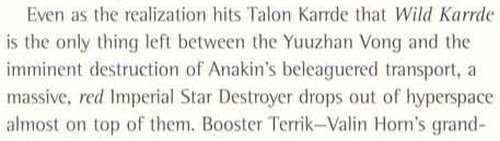
- **Corran Horn**: "Booster reveals even more surprises: Not only does he transport his son-in-law, the expatriate Jedi Corran Horn, but, somehow Booster has picked up most of the Array's crew and Shada D'ukal, who got to an escape pod before Idiot's Array exploded." Source: *The New Jedi Order Sourcebook* (SWRPG d20), scan p.117
  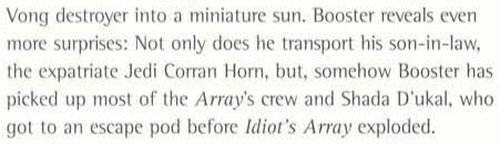

## scan p.118 (scan page 118)

Page contents: 899 words, 24 paragraphs | headings/entries: Errant Venture; Mara Jade's Pregnancy

## scan p.119 (scan page 119)

Page contents: 879 words, 22 paragraphs | headings/entries: Shelter; Luke Skywalker's "Great River"; Yuuzhan Vong Vua'spar Interdictor; Interested Parties

## scan p.120 (scan page 120)

Page contents: 506 words, 35 paragraphs | headings/entries: REBIRTH; Bilbringi; Arkania; Caamas; Coruscant; Alderaan; Kuat; Wayland( )f mm et; Commenor; Yag'Dhul; Aridus; Malastare; Umgul KothLlis; Naboo Bothawui; Ando; One; Hapes Consortium; Cron Drift; Ossus; O; Chalacta; Toydaria; Gamorr

