# Owner Material 037 — Star Wars D20 Drive folder (Core, Revised Core and Saga Edition): Sourcebooks/The New Jedi Order Sourcebook.pdf [Star Wars Roleplaying Game (d20, 2000)] (scan pages 121–162)

- **Source:** Wizards of the Coast Star Wars Roleplaying Game books, web enhancements, Living Force campaign modules and articles (2000–2010), from the owner's "Star Wars D20" Drive folder (only the three edition subfolders; "General" was not read, as instructed). Secondary source (licensed Legends reference). Scan OCR'd on the box; the scan stays box-only and is **not** published.
- **Method:** every scanned page was OCR'd and machine-screened sentence by sentence for power-relevant statements (fights, kills, defeats, Force feats, rankings, superweapons) that name a character on our roster; each kept sentence is quoted verbatim from the OCR text and has a crop of the printed passage directly under it. Pages with nothing power-relevant are still listed with what is on them.
- **Citation:** "*The New Jedi Order Sourcebook* (SWRPG d20), p.X" by printed page ("scan p.X" where no printed number applies). **Weight:** Licensed RPG material: a secondary source. Narrative text sums up Legends lore; game statistics are rules for players, not canon power levels, and rank lowest.

## scan p.121 (scan page 121)

Page contents: 875 words, 25 paragraphs | headings/entries: Numa Rar, Twi'lek Jedi; Opeli Mors, War Profiteer; Kyp Durron's Dozen

## scan p.122 (scan page 122)

Page contents: 948 words, 20 paragraphs | headings/entries: The Truce Unravels; TORY \; Princess of Blood; Leia is not amused,

- **Kyp Durron** — entry/section: Kyp Durron's Dozen: "The ship being grown at Sernpidal is bigger than the Death Star— and capable of pulling solar energy to itself from the surface of Sernpidal's sun across 115,000 kilometers." Source: *The New Jedi Order Sourcebook* (SWRPG d20), scan p.122
  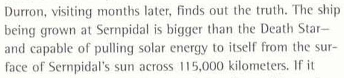

## scan p.123 (scan page 123)

Page contents: 958 words, 18 paragraphs | headings/entries: Has; Yuuzhan Vong Sunulok Flagship Interdictor; The Spy Ship

- **Jacen Solo (Darth Caedus)**: "Jacen, always eager for the least destructive solution, offers to climb into one of the Falcon's escape pods and go to the Yuuzhan Vong ship, where he hopes Tsavong Lah might consent to a duel." Source: *The New Jedi Order Sourcebook* (SWRPG d20), scan p.123
  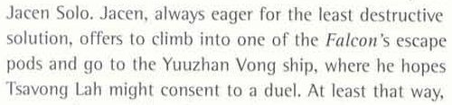
- **Corran Horn**: "Fortunately, Corran Horn, working from Errant Venture, concludes that taking the galaxy's only blood-red Star Destroyer into an inhabited system to pick up supplies is not the best way to keep its location a secret." Source: *The New Jedi Order Sourcebook* (SWRPG d20), scan p.123
  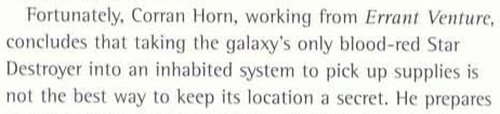

## scan p.124 (scan page 124)

Page contents: 909 words, 23 paragraphs | headings/entries: 

## scan p.125 (scan page 125)

Page contents: 845 words, 27 paragraphs | headings/entries: Taan, Shamed One Collaborator; The Battle of Yag'Dhul

## scan p.126 (scan page 126)

Page contents: Anakin Solo vs Executor (Nom Anor turns down the duel, p.127); Corran's lightsaber cuts the ship hull; p.123 Jacen offers to duel Tsavong Lah. p.112-116 Anakin alone on Yavin 4 with grenade fungi and the Force; repairs lightsaber with lambent crystal. (hand-read)

## scan p.127 (scan page 127)

Page contents: 884 words, 16 paragraphs | headings/entries: 

- **Anakin Solo**: "Rather than have word of his dishonor reach Tsavong Lah, the Executor treacherously slays all of the warriors who saw him turn down the duel with Anakin Solo." Source: *The New Jedi Order Sourcebook* (SWRPG d20), scan p.127
  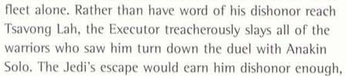

## scan p.128 (scan page 128)

Page contents: 981 words, 18 paragraphs | headings/entries: The Birth of Ben Skywalker; TORY y

- **Luke Skywalker; Mara Jade Skywalker** — entry/section: Mara's illness (The New Jedi Order Sourcebook, Ch6): "The most powerful Jedi Master in the galaxy can only stand by and watch his wife die." Source: *The New Jedi Order Sourcebook* (SWRPG d20), scan p.128
  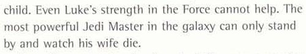

## scan p.129 (scan page 129)

Page contents: 705 words, 11 paragraphs | headings/entries: 

## scan p.130 (scan page 130)

Page contents: 892 words, 19 paragraphs | headings/entries: The Secret of Yuuzhan Vong Biotech; Adventure Ideas; The Jedi Bounty; D > Le O (5 0 i); TORY '

## scan p.131 (scan page 131)

Page contents: 675 words, 18 paragraphs | headings/entries: ALOD Os; Bounty Hunters; Harsh Lessons

## scan p.132 (scan page 132)

Page contents: 978 words, 16 paragraphs | headings/entries: Lo 0 Lu 0 'a Ww; TORY \; Vic

## scan p.133 (scan page 133)

Page contents: 716 words, 15 paragraphs | headings/entries: State of the Mew Republic; Pro-Jedi/Anti-Jedi Split

- **Tsavong Lah** — entry/section: Star by Star (The New Jedi Order Sourcebook, Ch7): "Throughout the galaxy, the invaders have systematically hunted down their stiffest opposition—the Jedi Knights— and killed or captured an alarming number of the guardians of peace and justice." Source: *The New Jedi Order Sourcebook* (SWRPG d20), scan p.133
  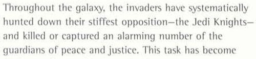

## scan p.134 (scan page 134)

Page contents: 668 words, 15 paragraphs | headings/entries: STAR BY STAR; Minor Ce Of; Wayland( )Bimmis Alderaan 5 ( \is n; Arkania; Hapes Consortium; Cron Drift Yag'Dhul Oss Antar; C)B inn; Chalacta; Or} Malastare Toydaria Umgul; Naboo Bothawui; Gamorr; Tatooine; Progress of the Invasion

## scan p.135 (scan page 135)

Page contents: 852 words, 21 paragraphs | headings/entries: Vornskr Cloning Project; The Return of Vergere; Cilghal

### Stat block notes (game mechanics, not feats)

- Cilghal: Noble 2/Jedi Consular 13; VP/WP 69/12; lightsaber +10/+5 (4d8) (Source: *The New Jedi Order Sourcebook* (SWRPG d20), scan p.135)

## scan p.136 (scan page 136)

Page contents: 808 words, 24 paragraphs | headings/entries: General Wedge Antilles; General Garm Bel Iblis; STA R

- **Wedge Antilles** — entry/section: Wedge Antilles (The New Jedi Order Sourcebook, Ch7): "A veteran of not one but two Death Star assaults, Wedge led Rogue Squadron for years, through some of the deadliest battles in the history of the Rebellion and the New Republic combined." Source: *The New Jedi Order Sourcebook* (SWRPG d20), scan p.136
  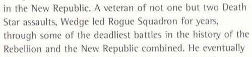

## scan p.137 (scan page 137)

Page contents: 916 words, 25 paragraphs | headings/entries: Ht < a > A; Mara Jade; Jade Shadow; Refugee Ships; Alema Rar, Twi'lek Jedi

- **Alema Rar**: "Numa is killed, and Alema is burned and temporarily deafened." Source: *The New Jedi Order Sourcebook* (SWRPG d20), scan p.137
  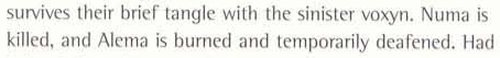
- **Alema Rar**: "Fortunately for the Jedi, the Yuuzhan Vong are too busy destroying Nebula Chaser to notice Jade Shadow flitting in to pick up Alema's pod before fleeing to hyperspace." Source: *The New Jedi Order Sourcebook* (SWRPG d20), scan p.137
  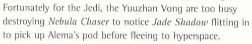
- **Alema Rar** — entry/section: Alema Rar, Twi'lek Jedi: "She had grieved when her master was killed at the Battle of Ithor, but that tragedy also left her with an angry focus that would not dissipate." Source: *The New Jedi Order Sourcebook* (SWRPG d20), scan p.137
  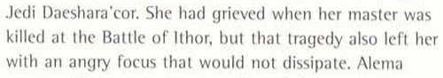
- **Alema Rar** — entry/section: Alema Rar, Twi'lek Jedi: "Alema recovered her composure over time with her sister's help— but when Numa was slain by a voxyn aboard Nebula Chaser, Alema's journey to the dark side had begun." Source: *The New Jedi Order Sourcebook* (SWRPG d20), scan p.137
  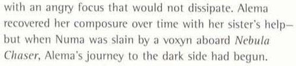

### Stat block notes (game mechanics, not feats)

- Alema Rar: Female Twi'lek Jedi Consular 6; Init +1; Defense 17 (+5 class, +2 Dex); Spd 10 m; VP/WP 36/12: Atk +5 melee* (3d8/19-20, lightsaber) or +6 ranged (3d6, blaster pistol); SQ Low-light vision; SV Fort +7, Ref +7, Will +5; SZ M; FP 4; DSP 4; Rep 5; Str 11, Dex 14, Con 12, Int 12, Wis 10, Cha 14. Challenge Code: C. Equipment: Lightsaber*, blaster pistol, comlink, (Source: *The New Jedi Order Sourcebook* (SWRPG d20), scan p.137)

## scan p.138 (scan page 138)

Page contents: 659 words, 17 paragraphs | headings/entries: A Delivery to Coruscant; Voxyn

## scan p.139 (scan page 139)

Page contents: 469 words, 13 paragraphs | headings/entries: Trouble in the Senate

## scan p.140 (scan page 140)

Page contents: 924 words, 18 paragraphs | headings/entries: Jedi Radicals; STA R; BY; Y < ee U)

## scan p.141 (scan page 141)

Page contents: 805 words, 23 paragraphs | headings/entries: Saba Sebatyne, Barabel Jedi; Shadow Bomb

- **Kyp Durron** — entry/section: Shadow Bomb (The New Jedi Order Sourcebook, Ch7): "Shadow Bomb Realizing that Yuuzhan Vong pilots can detect and avoid standard torpedoes by their bright propellant trails, Kyp Durron develops a new way of delivering missiles to their targets: the Force." Source: *The New Jedi Order Sourcebook* (SWRPG d20), scan p.141
  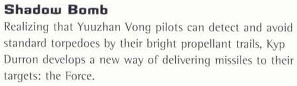

### Stat block notes (game mechanics, not feats)

- Saba Sebatyne: Soldier 2/Jedi Guardian 7; VP/WP 94/17; bite +16/+11 (1d6+4); lightsaber +11/+6 (3d8) (Source: *The New Jedi Order Sourcebook* (SWRPG d20), scan p.141)

## scan p.142 (scan page 142)

Page contents: 646 words, 17 paragraphs | headings/entries: Yuuzhan Vong Hunter War Droids; YUH 1-1A: A Qualified Success; STA R

## scan p.143 (scan page 143)

Page contents: 913 words, 20 paragraphs | headings/entries: Q < iy | > A; Arkania; Anakin's Strike Force

- **Anakin Solo**: "Anakin Solo, in typically impulsive fashion, decides that the best way to end the attacks on the Jedi Knights is to find the original voxyn—the template for the others—and destroy it." Source: *The New Jedi Order Sourcebook* (SWRPG d20), scan p.143
  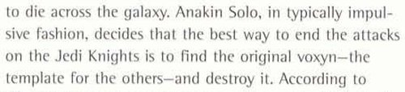
- **Darth Vader (Anakin Skywalker)** — entry/section: Anakin's Strike Force: "The Jedi must then capture a Yuuzhan Vong vessel and use it to infiltrate enemy territory, where they will locate and destroy the voxyn queen." Source: *The New Jedi Order Sourcebook* (SWRPG d20), scan p.143
  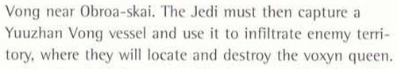

## scan p.144 (scan page 144)

Page contents: 457 words, 11 paragraphs | headings/entries: Tenel Ka, Jedi Noble

### Stat block notes (game mechanics, not feats)

- Tenel Ka: Jedi Guardian 7/Fringer 1/Noble 2; VP/WP 78/14; lightsaber +11/+6 (3d8+2); CC D. Also p.145 Lowbacca Jedi Guardian 8, Zekk Jedi Guardian 5/Scout 4; p.146 Raynar Thul Jedi Consular 7; p.148 Tesar Sebatyne Jedi Guardian 6 (Source: *The New Jedi Order Sourcebook* (SWRPG d20), scan p.144)

## scan p.145 (scan page 145)

Page contents: 856 words, 28 paragraphs | headings/entries: Lowbacca, Wookiee Jedi; Ulaha Hore, Bith Jedi

## scan p.146 (scan page 146)

Page contents: 913 words, 30 paragraphs | headings/entries: Raynar Thul, Young Jedi Knight; STA R

## scan p.147 (scan page 147)

Page contents: Battle meld: in a meld with Jacen, Jaina and Lowbacca, Anakin "could add +2 to each skill check, attack roll, and saving throw". p.155 Luke and Mara fight off a horde of Vong ships over Coruscant. p.160 Jaina's rage opens her to the dark side. (hand-read)

- **Darth Vader (Anakin Skywalker)**: "In fact, their ability to perform the same kind of group link the battle meld—convinces Anakin that his strike team can endure the inevitable Yuuzhan Vong torture long enough to reach Myrkr and destroy the voxyn queen." Source: *The New Jedi Order Sourcebook* (SWRPG d20), scan p.147
  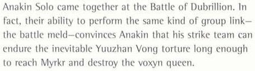

## scan p.148 (scan page 148)

Page contents: 821 words, 29 paragraphs | headings/entries: Tekli, Chadra-Fan Jedi

- **Saba Sebatyne; Luke Skywalker**: "Tesar Sebatyne, Barabel Jedi The oldest and strongest of the three Barabels that Saba Sebatyne brought to Luke Skywalker at Eclipse, Tesar Sebatyne is Saba's son and a Jedi in training." Source: *The New Jedi Order Sourcebook* (SWRPG d20), scan p.148
  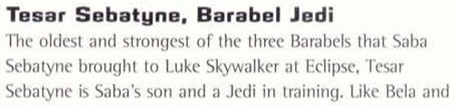

## scan p.149 (scan page 149)

Page contents: 910 words, 22 paragraphs | headings/entries: W3A2S BsidvHD; Although Yuuzhan Vong shapers have; The Breaking; Murkr; The Worldship Baanu Rass

## scan p.150 (scan page 150)

Page contents: 681 words, 24 paragraphs | headings/entries: Welk, Dark Jedi; Feats: Armor Proficiency (light), Exotic Weapon; Force Feats: Alter, Control, Deflect Blasters, Knight; Lomi Plo, Nightsister

- **Anakin Solo**: "Of all the Jedi and other Force-users captured, only Welk and Lomi survived long enough to be rescued by Anakin Solo's strike team." Source: *The New Jedi Order Sourcebook* (SWRPG d20), scan p.150
  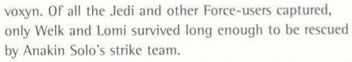

## scan p.151 (scan page 151)

Page contents: 911 words, 25 paragraphs | headings/entries: The Training Labyrinth; The Voxyn Queen

### Stat block notes (game mechanics, not feats)

- Lomi Plo (Star by Star): Force Adept 3/Dark Force Witch 5; VP/WP 47/13; inspire fear -2; CC D. Welk p.150 Jedi Guardian 8, VP/WP 65/14, CC D (Source: *The New Jedi Order Sourcebook* (SWRPG d20), scan p.151)

## scan p.152 (scan page 152)

Page contents: 925 words, 18 paragraphs | headings/entries: STA R; The Battle of Borleias; The Battle of Reecee

- **Luke Skywalker** — entry/section: The Battle of Borleias (The New Jedi Order Sourcebook, Ch7): "With all the Jedi working toward a common purpose— saving the lives of thousands of innocent beings—Luke can sense that the Force has focused in them and through them in a way he has never before experienced." Source: *The New Jedi Order Sourcebook* (SWRPG d20), scan p.152
  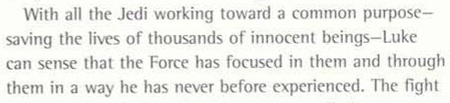
- **Cilghal**: "Guessing that the Jedi (in this case Danni Quee and Cilghal) have deduced how Yuuzhan Vong yammosks communicate with dovin basals, Tsavong Lah orders the Yuuzhan Vong to provide additional protection for all yammosks in future engagements—and to destroy them if it appears they are in danger of capture." Source: *The New Jedi Order Sourcebook* (SWRPG d20), scan p.152
  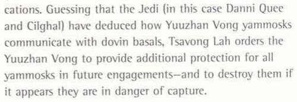

## scan p.153 (scan page 153)

Page contents: 946 words, 16 paragraphs | headings/entries: The Fate of Anakin Solo; Jaina's Team

- **Anakin Solo** — entry/section: The Fate of Anakin Solo (The New Jedi Order Sourcebook, Ch7): "All across the galaxy, Jedi feel Anakin’s death through the Force like a physical blow to their hearts." Source: *The New Jedi Order Sourcebook* (SWRPG d20), scan p.153
  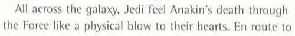
- **Jacen Solo (Darth Caedus); Jaina Solo**: "Only Jacen and Jaina remain behind, watching their brother first beat back the Yuuzhan Vong warriors sent against him, then slowly become more and more overwhelmed." Source: *The New Jedi Order Sourcebook* (SWRPG d20), scan p.153
  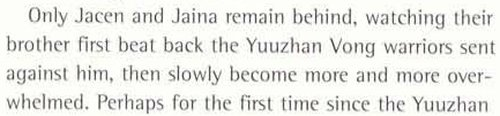

## scan p.154 (scan page 154)

Page contents: 929 words, 18 paragraphs | headings/entries: Jacen's Team; The Battle of Coruscant; The Treachery of Vigi Shesh

- **Jaina Solo; Darth Vader (Anakin Skywalker)** — entry/section: Jaina's Team: "Jaina, pushed past her breaking point, explodes at her twin brother, blaming him for dragging her away when Anakin died." Source: *The New Jedi Order Sourcebook* (SWRPG d20), scan p.154
  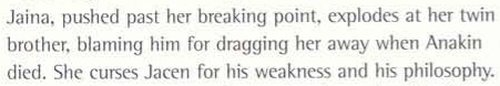
- **Jaina Solo** — entry/section: Jaina's Team: "To Jaina, the only important thing now is to locate the vermin who poisoned her aunt, crushed her father's dearest friend, and murdered her brother." Source: *The New Jedi Order Sourcebook* (SWRPG d20), scan p.154
  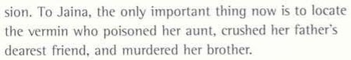

## scan p.155 (scan page 155)

Page contents: 453 words, 12 paragraphs | headings/entries: The Fall of Coruscant; CORUSCANIT: IMPERIAL; PALACE AND ENVIRONS; The Fate of Ben Skywalker

## scan p.156 (scan page 156)

Page contents: 856 words, 22 paragraphs | headings/entries: The YUH Droid; Borsk Fey'lya's Sacrifice; The Yammosk Jammer

## scan p.157 (scan page 157)

Page contents: 928 words, 22 paragraphs | headings/entries: The Twins Divided; Adventure Ideas; The Epitome of Feral; Flight to Coruscant

- **Jacen Solo (Darth Caedus); Vergere; Nom Anor** — entry/section: Star by Star (The New Jedi Order Sourcebook, Ch7): "With Vergere’s help, Jacen slays the voxyn queen—but the battle is long and terrible and leaves Jacen too weak to escape." Source: *The New Jedi Order Sourcebook* (SWRPG d20), scan p.157
  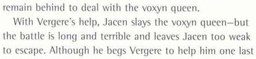
- **Jacen Solo (Darth Caedus)**: "Jacen creates a diversion by attacking the voxyn queen single-handedly, allowing Vergere, Tenel Ka, and the other Jedi to capture the enemy cruiser." Source: *The New Jedi Order Sourcebook* (SWRPG d20), scan p.157
  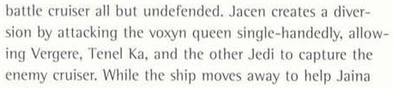

## scan p.158 (scan page 158)

Page contents: 684 words, 26 paragraphs | headings/entries: The Defense of Coruscant; Axon OFe.0

## scan p.159 (scan page 159)

Page contents: 693 words, 16 paragraphs | headings/entries: CHAPTER EIGHT; Republic Senate has splintered, the military fragmented; Coruscant Lost

## scan p.160 (scan page 160)

Page contents: 877 words, 20 paragraphs | headings/entries: The Solo Twins; Tsavong Lah's Victory; New Hopes

## scan p.161 (scan page 161)

Page contents: 130 words, 15 paragraphs | headings/entries: 

## scan p.162 (scan page 162)

Page contents: 190 words, 11 paragraphs | headings/entries: Oo occuces. BS eS

