# Owner Material 037 — Star Wars D20 Drive folder (Core, Revised Core and Saga Edition): Star Wars Gamer/Star Wars Gamer 01.pdf [Star Wars Roleplaying Game (d20, 2000)] (scan pages 1–60)

- **Source:** Wizards of the Coast Star Wars Roleplaying Game books, web enhancements, Living Force campaign modules and articles (2000–2010), from the owner's "Star Wars D20" Drive folder (only the three edition subfolders; "General" was not read, as instructed). Secondary source (licensed Legends reference). Scan OCR'd on the box; the scan stays box-only and is **not** published.
- **Method:** every scanned page was OCR'd and machine-screened sentence by sentence for power-relevant statements (fights, kills, defeats, Force feats, rankings, superweapons) that name a character on our roster; each kept sentence is quoted verbatim from the OCR text and has a crop of the printed passage directly under it. Pages with nothing power-relevant are still listed with what is on them.
- **Citation:** "*Star Wars Gamer 01* (SWRPG d20), p.X" by printed page ("scan p.X" where no printed number applies). **Weight:** Licensed RPG material: a secondary source. Narrative text sums up Legends lore; game statistics are rules for players, not canon power levels, and rank lowest.

## scan p.1 (scan page 1)

Page contents: 64 words, 11 paragraphs | headings/entries: THE FORCE In STAR WARS GAMING; Marvelous :; ALIENS, © The Jedi ie Tn (; PREMIERE ' PREMIERE ISSUE. |

## scan p.2 (scan page 2)

Page contents: 0 words, 0 paragraphs | headings/entries: 

## scan p.3 (scan page 3)

Page contents: 663 words, 30 paragraphs | headings/entries: Production Manager; Northeastern Advertiting £2 '; PTION QUESTIONS ye | '-; Senior Editor; STAR. WARS: :p; iconacrarny:; NATIONAL ANO INTERMATIONAL OLS TRIBUTION ROLEPLAYING GAME; Wisaria ed the Coast with authorisation

## scan p.4 (scan page 4)

Page contents: 423 words, 61 paragraphs | headings/entries: Fiction; THE STARFIGHTER TRAP ey strive aemiee; Fain Prey; RPG; UNDERSTANDING THE JEDI Cove ey sp were; DUEL OF THE FATES BY ANDY COLLINS; SHIPBUILDING SECRETS BY THOMAS At FTID; TATOOINE GrupGce MatcH er © were; ONE WITH THE Toe GaminG Force Universe; TECHNICAL; Data; VOLUME |. NUMBER I; THe ANZaAT!; Oy JD were; Adventures; PERIL IN THE IONOSPHERE; OY STEVE MinLER; RENDEZVOUS AT ORD MANTELL; Rulepheying Cove; Deck Plans; Custorezable Cad Care; THis is Some Rescutl; SY MAOTN DLACKMAN

## scan p.5 (scan page 5)

Page contents: 491 words, 24 paragraphs | headings/entries: Now. On with the letters; Jeff O. Your Hurnble Editor; Darth Mail:; Get Out OF My Brain!; Greetings,

## scan p.6 (scan page 6)

Page contents: 737 words, 37 paragraphs | headings/entries: I'm looking forward to your magazine!; Thanks, Paul Lansdowne; Best, Abel Pena; James Thomas; Chesapeake, VA; Richard James Scott Cramlington Northumberland United Kingdom; Straight to the Source; Hi Wizards,

## scan p.7 (scan page 7)

Page contents: Gamer errata: Crime Lord Inspire Fear penalty -2 at 3rd, -4 at 6th, -6 at 9th level to anyone of equal or lower level acting directly against the crime lord (hand-read)

## scan p.8 (scan page 8)

Page contents: 24 words, 9 paragraphs | headings/entries: Ml STARFIGHTER Ble ; —— 'py stTeEVEMTLER; ILLUSTRATED BY COREY macoumer

## scan p.9 (scan page 9)

Page contents: 1010 words, 32 paragraphs | headings/entries: Betrayal above Naboo; STAR WARS GAMeR 15

## scan p.10 (scan page 10)

Page contents: 1022 words, 32 paragraphs | headings/entries: Essara vaulted into the

## scan p.11 (scan page 11)

Page contents: 1137 words, 25 paragraphs | headings/entries: STAR WARS GAMER 17

- **Essara Till** — entry/section: The Starfighter Trap: "in her thirteen years as a fighter pilot for hire, she had never felt so vital and significant. Her horneworld needed her." Source: *Star Wars Gamer 01* (SWRPG d20), scan p.11
  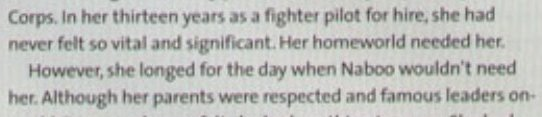

## scan p.12 (scan page 12)

Page contents: 1055 words, 33 paragraphs | headings/entries: 

## scan p.13 (scan page 13)

Page contents: 978 words, 41 paragraphs | headings/entries: TORPEDOES READY,; Two."I don't know where—"; STAR WARS GAMER 19

## scan p.14 (scan page 14)

Page contents: 1015 words, 37 paragraphs | headings/entries: The droid beeped again,

## scan p.15 (scan page 15)

Page contents: Essara Till: told Dren she was a better dogfighter ("You're a better dogfighter than I am"—Dren Meine); Xi Char droid starfighters (Agamar, Governor Challep) outpaced N-1 targeting sensors (hand-read)

## scan p.16 (scan page 16)

Page contents: 1040 words, 44 paragraphs | headings/entries: WE'RE GOING TO COLLIDE!; HE'S ENGAGING THE REMAINING ECHO FLIGHT SHIPS,

- **Essara Till** — entry/section: The Starfighter Trap: "The droid starfighter fired its lasers. Essara held her course as Ell-one beeped urgently and her fighter rocked. Essara bit her lower lip, struggling to steady her nerves and to stick with her desperate plan, The droid starfighter changed course again, attempting to avoid collision. She put herself in its path again. A collision alert chimed. She spotted a scratch on the fighter's left fin, and she could see the muzzles on both of its lasers glowing. She fired her torpedoes and banked sharply left. Her gamble paid off—the enemy didn't have time to avoid the torpedoes, and they impacted squarely on its fuselage." Source: *Star Wars Gamer 01* (SWRPG d20), scan p.16
  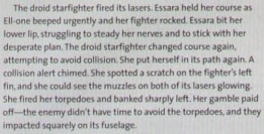

## scan p.17 (scan page 17)

Page contents: 987 words, 39 paragraphs | headings/entries: STAR WARS GAMER 23

- **Essara Till** — entry/section: The Starfighter Trap: "Once Essara was under the carrier's defensive barrage, the capital ship's matte-gray hull spread out before her like a vast desert. its weapons spewed death like erupting volcanoes, but she flew too close for most of the weapons to target her." Source: *Star Wars Gamer 01* (SWRPG d20), scan p.17
  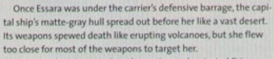
- **Essara Till** — entry/section: The Starfighter Trap: "Echo Five and Essara fired their torpedoes as if their launchers were synchronized. Both fighters spun away from the carrier as explosions started to spread across its hull, The carrier's power plant overloaded, and the ship was consumed by the explosion. For an instant the carrier burned like a sun, and then as quickly the darkness consumed it." Source: *Star Wars Gamer 01* (SWRPG d20), scan p.17
  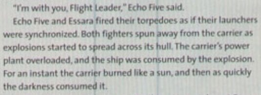

## scan p.18 (scan page 18)

Page contents: Essara deliberately flew into a missile swarm to save Dren, shooting down four before being hit; Dren killed by eight concussion missiles from the Velumina (hand-read)

## scan p.19 (scan page 19)

Page contents: 1023 words, 32 paragraphs | headings/entries: STAR WARS GAMER 25

## scan p.20 (scan page 20)

Page contents: 5 words, 3 paragraphs | headings/entries: 

## scan p.21 (scan page 21)

Page contents: 602 words, 16 paragraphs | headings/entries: BY DANIEL WALLACE ILLUSTRATED BY STAN SHAW; STAR WARS GAMER 27

## scan p.22 (scan page 22)

Page contents: 1067 words, 29 paragraphs | headings/entries: FAIR

## scan p.23 (scan page 23)

Page contents: Hapan Gun of Command rifle prototype: trance lasts ~40 min on a Houk, an hour+ for humans, 2-3 hours for Ugnaughts (hand-read)

## scan p.24 (scan page 24)

Page contents: 1010 words, 29 paragraphs | headings/entries: BO vo.wMe t NUMBER!

## scan p.25 (scan page 25)

Page contents: 1107 words, 26 paragraphs | headings/entries: STAR WARG GAMER 31

## scan p.26 (scan page 26)

Page contents: 1082 words, 27 paragraphs | headings/entries: B2 vowMme | NUMBER!

## scan p.27 (scan page 27)

Page contents: 1000 words, 25 paragraphs | headings/entries: STAR WARS GAMeR 33

## scan p.28 (scan page 28)

Page contents: 1019 words, 34 paragraphs | headings/entries: FAIR; BY vo.wMe | NUMBER!

## scan p.29 (scan page 29)

Page contents: Fair Prey: Krish hunter Tyro Viveca wrestled a six-meter Florn lamproid barehanded, budged his rifle free and blew its head off; later caught in Dawson's detonite blast that flattened four hectares of bambooi (hand-read)

## scan p.30 (scan page 30)

Page contents: 1071 words, 33 paragraphs | headings/entries: Noone looked around. "Where'd Dawson go?"

## scan p.31 (scan page 31)

Page contents: 953 words, 30 paragraphs | headings/entries: STAR WARS GAMER 37

## scan p.32 (scan page 32)

Page contents: 279 words, 24 paragraphs | headings/entries: THERE IS NO; DEATH; THERE IS THE FORCE."; THE TDI COD; NYO voLUME i. NUMBER!; ERSTAND; Bb; EDI DE «

## scan p.33 (scan page 33)

Page contents: Understanding the Jedi Code (no crop): 'SO BEGINS THE FAMOUS COMMENTARY UPON THE Jed! Code by Master Odan-Urr, writ ten almost four thousand years ago. His musings on the proper behavior of a Jedi have formed the foundation of today's Jeai Ordcr' (hand-read)

## scan p.34 (scan page 34)

Page contents: 525 words, 28 paragraphs | headings/entries: UNDERSTANDING; CODE; Training; Loyalty; Y2 VOLUME | NUMBER I; REMEMBER THAT BRAVERY ITSELI; IS AN EMOTION, AND; EDI; OF WAR. ~; From a certain point of view; Do not confuse this with

- **Yoda** — entry/section: Understanding the Jedi Code: "As Mas ter Yoda once said: "The Jedi who heeds not the counsel of the Force, to the dark side lis tens."" Source: *Star Wars Gamer 01* (SWRPG d20), scan p.34
  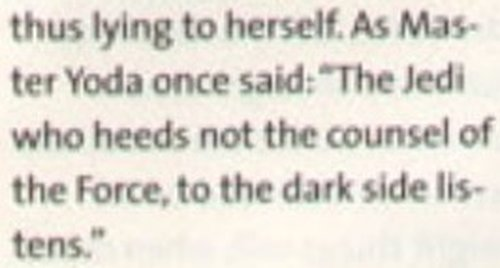
- **Vodo-Siosk Baas** — entry/section: Understanding the Jedi Code: "Master Vodo said: "A Jedi's training in the Force never ends."" Source: *Star Wars Gamer 01* (SWRPG d20), scan p.34
  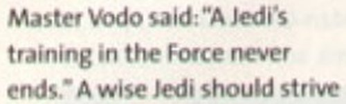

## scan p.35 (scan page 35)

Page contents: 824 words, 22 paragraphs | headings/entries: Discretion; When fighting, is it neces-; STAR WARS GAMER NB

- **Odan-Urr** — entry/section: Understanding the Jedi Code: "Master Odan-Urr said: "If a Jedi ignites his lightsaber, he must be ready to take a life. If he ts not so prepared, he must keep his weapon at his side."" Source: *Star Wars Gamer 01* (SWRPG d20), scan p.35
  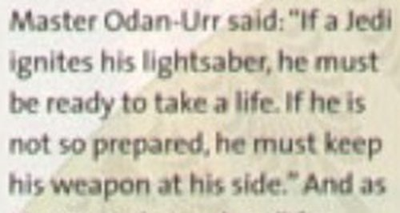
- **Yoda** — entry/section: Understanding the Jedi Code: "Master Yoda has often said that, should the Republic ever challenge the Jedi Order's right to exist, the support of the common citizen will see us through: "tf fear us they do, help us they will not. If hate us they do, hunt us they will"" Source: *Star Wars Gamer 01* (SWRPG d20), scan p.35
  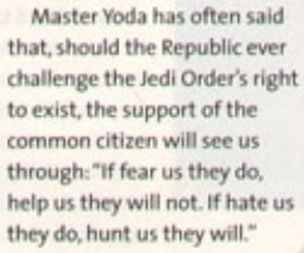

## scan p.36 (scan page 36)

Page contents: 510 words, 33 paragraphs | headings/entries: EDS ayy VOLUME |. NUMMER |; Round 2: Continuing his assault, Obi-Wan

- **Darth Maul** — entry/section: Duel of the Fates: "Darth Maul takes a 2-meter adjustment backward and activates his Battlemind skill. This costs 8 vitality points and grants him a +6 Force bonus to his attacks" Source: *Star Wars Gamer 01* (SWRPG d20), scan p.36
  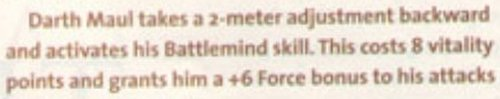

## scan p.37 (scan page 37)

Page contents: 460 words, 58 paragraphs | headings/entries: Wan elec; Bnd Rives t; Defense for one round. This raises; Defense: lightsaber); Vitality Points: Wound Points: Force Points: Altacks:; Lightsaber 346 or Unarmed id3; Damage:; OBI-WAN KENOBI Jedi Guardian 6; Round Bs Realizing that he can't; Pras ; mS; Knockdown attack; DARTH MAUL Jedi Guardian 12; Damage +2; STAR WARS GamMen UG

### Stat block notes (game mechanics, not feats)

- Obi-Wan Kenobi: Duel of the Fates (TPM): Jedi Guardian, Str 15(+2), Dex 16(+3), Con 14(+2), Int 13, Wis 12, Cha 13; lightsaber 3d6; split Maul's double-bladed lightsaber with a 12-point hit (Source: *Star Wars Gamer 01* (SWRPG d20), scan p.37)
- Darth Maul: Duel of the Fates (TPM): level 12, Defense 24 (26 in melee with lightsaber), VP 120 (63 at start of final duel), WP 16, Str 17(+3), Dex 19(+4), Con 16(+3); double-bladed lightsaber +13/+9; Battlemind +6 for 5 rounds; Force Push knocked Obi-Wan 4 m into the shaft; no ranks in Sense Motive (Source: *Star Wars Gamer 01* (SWRPG d20), scan p.37)

## scan p.38 (scan page 38)

Page contents: 401 words, 24 paragraphs | headings/entries: NG vo.me t numpeR |; Round 7: Obi-Wan then leaps over his; Round p: Pressing his advantage; Round q: Momentarily shaken by Maul's; Round if): Obi-Wan resumes his all-out

## scan p.39 (scan page 39)

Page contents: 506 words, 22 paragraphs | headings/entries: Round II: Obi-Wan continues to press; Maul selects the Total Defense option; Round I: After parrying another pair of; Non-Combat: While the ledi dangles; Surprise: Obi-Wan uses the Force to; STAR WARS GAMER "47

- **Obi-Wan Kenobi; Darth Maul** — entry/section: Duel of the Fates: "Obi-Wan spends a Force point (gaining a +6 bonus to all actions for one round). He jumps out of the pit and over Darth Maul using his Turnble skill to move through (over Maul's space. He then attacks the flat-footed Maul, scoring a critical hit and rofling max mum damage (18 points). This is enough to reduce Maul to zero wound points," Source: *Star Wars Gamer 01* (SWRPG d20), scan p.39
  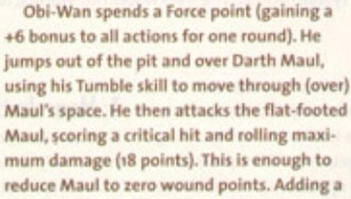
- **Obi-Wan Kenobi; Darth Maul** — entry/section: Surprise: Obi-Wan uses the Force to: "Landing behind the surprised Sith Lord, Obi-Wan delivers a deadly slash with his ightsaber, severing Darth Maul in two and sending the body down the shaft + Obi-Wan and Darth Mau! roll initiative as combat begins again." Source: *Star Wars Gamer 01* (SWRPG d20), scan p.39
  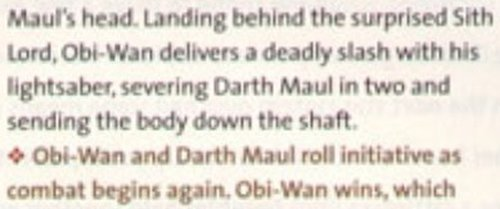

## scan p.40 (scan page 40)

Page contents: 509 words, 22 paragraphs | headings/entries: SHIPRYILANS; The Mystic Burn: Your Transport To Adventure; NB VOLUME |. NUMBER 1; Han SOLO ant Oe Wan Kience:

## scan p.41 (scan page 41)

Page contents: 282 words, 22 paragraphs | headings/entries: Hit Hypers yle; OF iar HATCH; CARGO BAY; ACCESS TO BOOM; STORAGE; ESCAPE POD; TAaATISerTiics; STARA WRASSE APO; MYSTIC BURN Length; Small Light Freighter-class starship 35 meters; Passengers and crew 8; Short; Damage; Maximum Range; STAR WARS GamMeR NB

## scan p.42 (scan page 42)

Page contents: 646 words, 27 paragraphs | headings/entries: 

## scan p.43 (scan page 43)

Page contents: 752 words, 10 paragraphs | headings/entries: MILITARY SHIPS; STAR WARS GAMER §1

## scan p.44 (scan page 44)

Page contents: Shipbuilding Secrets: Mystic Burn YT-1200 example ship (35 m, 8 crew/passengers); Han's "twelve parsecs" and Falcon lines quoted as sidebar (hand-read)

## scan p.45 (scan page 45)

Page contents: Em'liy Spirit of Battle (+2 Str/+2 Dex/+2 VP per level in battle); Jedi historians thought it an unexplored extension of the Force (hand-read)

- **Lumiya** — entry/section: UoS Guide: Em'liy: "On Shalyvane, the dominant species, the Em'liy, were driven out of their cities, including the capital city of Chenshassa by imperial forces led by double agent Shira Brie." Source: *Star Wars Gamer 01* (SWRPG d20), scan p.45
  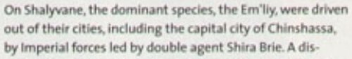

## scan p.46 (scan page 46)

Page contents: 748 words, 23 paragraphs | headings/entries: Aliens from the Marvel Comics; TECHNOLOGY LeveL; Em'Li¥ IN THE GALAXY; PERsONALiTyY NoTEs; NOTABLE PERSONALITIES; STAR WARS GAMerR 5S

## scan p.47 (scan page 47)

Page contents: 809 words, 34 paragraphs | headings/entries: THE UOS GUIDE TO INTELLIGENT LIFE; ISKALONIAN; APPEARANCE AND BioLocy; AND WITH NATURE; TEMPERAMENT; History AND CutTuRe; SB vo.me | wUuMBER I; Em'liy Homeworld: Shalyvane; Languages: Em'liy, Basic (sans pronouns); Example Names: G'hinji, Pilba, Mar'holt

## scan p.48 (scan page 48)

Page contents: 775 words, 29 paragraphs | headings/entries: ISKALONIAN; Noman/ Em'ty Species TRAITS; Swim, and the; Nomad COMMONER; STAR WARS GAMER 5&7

## scan p.49 (scan page 49)

Page contents: 729 words, 40 paragraphs | headings/entries: THE UOS GUIDE TO INTELLIGENT LIFE; Iskalonians (Chuhkyvi); Personality: Peaceful, friendly, selfless, and helpful, although; SB vowMme | NuMBER |; ISKALONIANS IN THE GALAXY; Personauity NoTEs; NOTABLE PERSONALITIES; IskaLonian (CHUNK YY!) Species TRAITS

## scan p.50 (scan page 50)

Page contents: 725 words, 34 paragraphs | headings/entries: TEMPERAMENT; TO: _—_'Hissa, Bertroff, Grand Moff. Kessel System; FROM: Matrin, Quorl, Governor, Stenos (4160-897-615-857"); Greetings!; ISKALONIAN (CHUHKYV!) COMMONER; Equipment: Rebreather gear, variety of personal belongings; Feats: Exotic Weapon Proficiency (stinger); Stenaxes; STAR WARS GAMER 5D

## scan p.51 (scan page 51)

Page contents: Stenax Massacres ten months after Endor reduced Kadril to rubble; Stenaxes defeated by New Republic at Tharkos; compared to the Yevetha (hand-read)

## scan p.52 (scan page 52)

Page contents: 845 words, 42 paragraphs | headings/entries: STEMAXES IN THE GALAXY; NOTABLE PERSONALITIES; S KY LRI; APPEARANCE AND BIOLOGY; TEMPERAMENT; History AND CULTURE; Winged People, their governing seat, is; STENAX SOLDIER; STAR WARS GAMeR 61

## scan p.53 (scan page 53)

Page contents: S'kytri: Luke Skywalker implied as "the One", son of one of the three Clone Wars Jedi who saved Skye, known by the weapon he wore; Majestrix Kharys deposed (hand-read)

- **Darth Vader (Anakin Skywalker)** — entry/section: UoS Guide: S'kytri: ""Years ago, during what humans called the Clone Wars, three Jedi Knights saved Skye from destruction. in gratitude, we swore eternal friendship and fealty to them, Much later, one Jedi returned and told us that all the other Jedi were destroyed—by his hand—including his two comrades, He was much darker, in spirit and in dress, than when we last saw him. He invoked our oath and made Skye an imperial satrapy to be ruled by Kharys." Source: *Star Wars Gamer 01* (SWRPG d20), scan p.53
  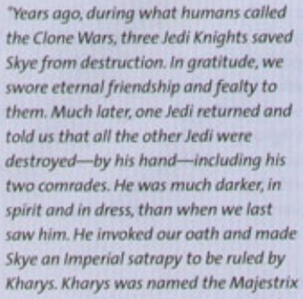

## scan p.54 (scan page 54)

Page contents: 882 words, 44 paragraphs | headings/entries: TecHnoLocy Levet; TRADE AND TECHNOLOGY; S'KYTRI IN THE GALAXY; NOTABLE PERSONALITIES; APPEARANCE AND BioLocy; Nacar Species Traits; TEMPERAMENT; STAR WARS GaMer 6B

## scan p.55 (scan page 55)

Page contents: Nagai: Bey (half-Nagai son of Krai H'voc) traitor at Endor battle with Maccabree cyborg warriors; Fenn Shysa's Mandalorian resistance; Tof Prince Sereno defeated at Saijo (hand-read)

- **Lumiya** — entry/section: UoS Guide: Nagai: "The Nagai found an ally in Lumiya, the self-styled "Dark Lady of the Sith," who was given a Nagai aide, Den Siva." Source: *Star Wars Gamer 01* (SWRPG d20), scan p.55
  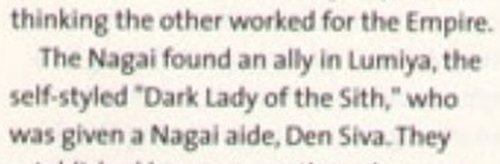
- **Lumiya** — entry/section: UoS Guide: Nagai: "Lumiya and Siva killed twenty captured Rebels on Kinooine, a barren world on the fringe of the galactic perimeter." Source: *Star Wars Gamer 01* (SWRPG d20), scan p.55
  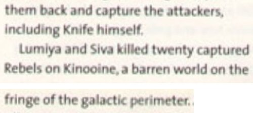
- **Lumiya**: "The Maccabrees were destroyed, and Lumiya's forces retreated." Source: *Star Wars Gamer 01* (SWRPG d20), scan p.55
  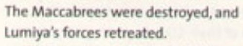

## scan p.56 (scan page 56)

Page contents: 745 words, 29 paragraphs | headings/entries: Pourics; Nagai society, before the Tofs invaded, was; ZELTRONS Species TRAITS; ZELTRON COMMONER; STAR WARS GAMER 65

## scan p.57 (scan page 57)

Page contents: Nagai: Bey revealed as double agent for Admiral Ackbar against the Tofs; Knife (Ozrel N'takkilomandrife) forged truce with Alliance (hand-read)

- **Admiral Ackbar**: "Bey was eventually revealed be a double agent working for Admiral Ackbar to defeat the Tofs from within." Source: *Star Wars Gamer 01* (SWRPG d20), scan p.57
  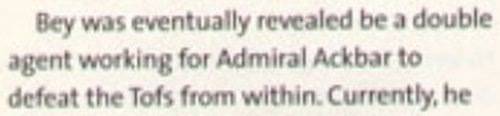

## scan p.58 (scan page 58)

Page contents: Zeltros invaded 12 times in six centuries; Nagai and Tofs immune to Zeltron pheromones; King Arno and Queen Leonie's two-month celebration (hand-read)

## scan p.59 (scan page 59)

Page contents: 371 words, 17 paragraphs | headings/entries: Sebulba nr threw a dark; Piet

## scan p.60 (scan page 60)

Page contents: 343 words, 20 paragraphs | headings/entries: A Podracing Game for 2 Players G; Rolling the Dice; SITUATION MODIFIER; Racing Actions; STAR WARS GAmMeR 69

