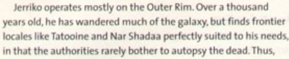
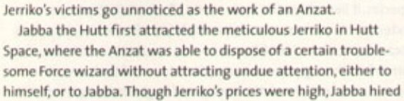
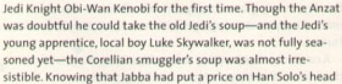
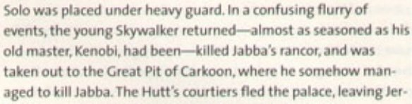
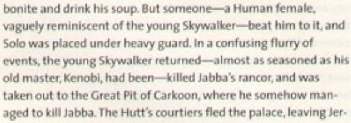
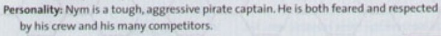
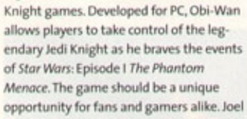

# Owner Material 037 — Star Wars D20 Drive folder (Core, Revised Core and Saga Edition): Star Wars Gamer/Star Wars Gamer 01.pdf [Star Wars Roleplaying Game (d20, 2000)] (scan pages 61–100)

- **Source:** Wizards of the Coast Star Wars Roleplaying Game books, web enhancements, Living Force campaign modules and articles (2000–2010), from the owner's "Star Wars D20" Drive folder (only the three edition subfolders; "General" was not read, as instructed). Secondary source (licensed Legends reference). Scan OCR'd on the box; the scan stays box-only and is **not** published.
- **Method:** every scanned page was OCR'd and machine-screened sentence by sentence for power-relevant statements (fights, kills, defeats, Force feats, rankings, superweapons) that name a character on our roster; each kept sentence is quoted verbatim from the OCR text and has a crop of the printed passage directly under it. Pages with nothing power-relevant are still listed with what is on them.
- **Citation:** "*Star Wars Gamer 01* (SWRPG d20), p.X" by printed page ("scan p.X" where no printed number applies). **Weight:** Licensed RPG material: a secondary source. Narrative text sums up Legends lore; game statistics are rules for players, not canon power levels, and rank lowest.

## scan p.61 (scan page 61)

Page contents: 790 words, 35 paragraphs | headings/entries: ATT® actions, the; Life Podracer continues; ROUND SEQUENCE; Accelerate: This action is an attempt to; Decelerate: This action slows a vehicle; Maintain Speed: This is fairly easy, but; Bump: You move your Podracer close to; Damage

## scan p.62 (scan page 62)

Page contents: 373 words, 18 paragraphs | headings/entries: Special Rules; Boonta Training Course; SE i; THE BOONTA TRAINING COURSE; STAR WARS GAMER 71

## scan p.63 (scan page 63)

Page contents: 806 words, 28 paragraphs | headings/entries: Ready for More?

## scan p.64 (scan page 64)

Page contents: Tatooine Grudge Match: Anakin Skywalker Initiative +3, Pilot +9, Repair +3, Force once per race; Sebulba flame jets 10 damage once per race (hand-read)

## scan p.65 (scan page 65)

Page contents: 5 words, 2 paragraphs | headings/entries: VOLUME |, NUMBER |

## scan p.66 (scan page 66)

Page contents: Peril in the Ionosphere: Ithorian Captain Worlohp driven homicidal by Kyvalon-4 gas leak on SST-67 shuttle (hand-read)

## scan p.67 (scan page 67)

Page contents: 565 words, 16 paragraphs | headings/entries: ADOARD THE SHUTTLE; Friendly and talkative, Kharl's favorite

## scan p.68 (scan page 68)

Page contents: 687 words, 35 paragraphs | headings/entries: WEAPONS LOCKER; The Fair Gale; GANGPLANK; Wor.one's CABIN t (normal +2)/418; Hyperdrive None; Maximum Speed Defense; Shield Points None; Weapons None; Worlohp. (See below for how to handle; Repairing the Gas Leaks section below

## scan p.69 (scan page 69)

Page contents: 612 words, 29 paragraphs | headings/entries: BERIL IN; THE IONOSPHERE; Wortohp's and other characters' actions; After that, characters must succeed at a

## scan p.70 (scan page 70)

Page contents: 872 words, 51 paragraphs | headings/entries: Biaster SHOTS THAT Miss; LANDING THE SHUTTLE; SKILL CHECK; Wor.onp, ITHORIAN SOLDIER; Level; 2; Initiative: 10; Vitality Points: 16; Wound Points: 10; Speed: 5 spaces; Defense: 14; Melee Attack: 1d20++ (fists); Melee Damage: 13 | fists); Saves: Fortitude 142042, Reflex 1d20+2,; Will sd2o#1; Skills: Computer Use (1d20+4), Pilot; Note: When exposed to Kyvalon-4 gas,; Worlohp flies into an uncontrolled, homici

## scan p.71 (scan page 71)

Page contents: 620 words, 59 paragraphs | headings/entries: CAPT WORLOHP; ABOVE AND GEYOND; Skills: Astrogate +7, Computer Use +7,; KHARL VENNEB AND SAKME KELENE, HUMAN ScouTs; Level: 1; Vitality Points: o; Wound Points: 9; Speed: § spaces; Defense: 13; Melee Attack: nizo [ fists); Melee Damage: 143 ( fists); Saves: Fortitude :d20+1, Reflex sz0+1, Will 1d20+0; Knowledge (nature) +4, Pilot +10,; Read/Write (Basic, Ithorese), Repair +10,; Speak (Basic, Ithorese), Spot +2, Survival +5,; Krag. VANNEB, Mace HUMAN Exe 4:; Proressor HALLeEM CELAar, HUMAN SCOUT Level: 2; Initiative: 12; Vitality Points: o; Wound Points: 9; Speed: 5 spaces; Defense: 14; Melee Attack: ni2z0++ (fists); Melee Damage: 1d3 (fists); Saves: Fortitude 1d20+2, Reflex 1d20+2, Will id20+1; Feats: Gearhead, Skill Emphasis (Profession: technician, Repair),; Proressor Hatem Ceiaar,; Mae Human Exe 8:

## scan p.72 (scan page 72)

Page contents: Rendezvous at Ord Mantell: Rebel agent Renci Tosh crash-landed her Z-95 Headhunter near Great Rock; offers 500-750 credits each (hand-read)

## scan p.73 (scan page 73)

Page contents: 390 words, 18 paragraphs | headings/entries: STAR WARS GAMER BS

## scan p.74 (scan page 74)

Page contents: 917 words, 47 paragraphs | headings/entries: A Fateful Meeting; What If They Don't Take The Bait?; BSG vo.wume | NUMBER |; Assuming the heroes are inter; Interrupted!; Renci targets the heroes. This might; FENC! TOSH; Equipment: none; Language (Basic, Rodian), Search +6,; Don't get too heavy-handed with this

## scan p.75 (scan page 75)

Page contents: 826 words, 24 paragraphs | headings/entries: Into the Wilderness

## scan p.76 (scan page 76)

Page contents: 835 words, 23 paragraphs | headings/entries: GIDOA LUROON; Equipment: Sporting blaster rifle, vibrodag; BB vo.Mme i NUMBER!; The Crash Site

## scan p.77 (scan page 77)

Page contents: 583 words, 22 paragraphs | headings/entries: The Sunken Mesa with extensive wilder; Like most planets; STAR WARS Gamer 8S

## scan p.78 (scan page 78)

Page contents: 536 words, 31 paragraphs | headings/entries: Toco Camacs; Despite its jury-rigged nature, the crane; VOLUME |. NUMBER i; THE SUNKEN; The Sunken Crater

## scan p.79 (scan page 79)

Page contents: Yarroq, Trandoshan raider leader (Sct 3) on Ord Mantell; Renci Tosh recruits heroes for the Rebellion (hand-read)

## scan p.80 (scan page 80)

Page contents: 258 words, 15 paragraphs | headings/entries: BY JD WIKER ILLUSTRATED BY MATTHEW HATTON; DLUME |. NUMBER I

## scan p.81 (scan page 81)

Page contents: Anzati feed on "Luck" ("soup"); drain two character levels per round; an Anzat would need a dozen average sentients a day; can live for millennia; victims do not become Anzati (hand-read)

## scan p.82 (scan page 82)

Page contents: 799 words, 25 paragraphs | headings/entries: SY VOLUME | NUMBER I; Dannik Jerriko; Equipment: Pipe; Force Skills: Empathy +14, See Force +17; Force Feats: Alter, Control, Sense

- **Dannik Jerriko** — entry/section: Anzati: Dannik Jerriko: "lerriko operates mostly on the Outer Rim. Over a thousand years old, he has wandered much of the galaxy, but finds frontier locales like Tatooine and Nar Shadaa perfectly suited to his needs in that the authorities rarely bother to autopsy the dead." Source: *Star Wars Gamer 01* (SWRPG d20), scan p.82
  
- **Dannik Jerriko; Jabba the Hutt** — entry/section: Anzati: Dannik Jerriko: "Jabba the Hutt first attracted the meticulous Jerriko in Hutt Space, where the Anzat was able to dispose of a certain trouble some Force wizard without attracting undue attention, either to" Source: *Star Wars Gamer 01* (SWRPG d20), scan p.82
  
- **Dannik Jerriko; Obi-Wan Kenobi; Han Solo** — entry/section: Anzati: Dannik Jerriko: "Though the Anzat was doubtful he could take the old Jedi's soup—and the Jedi's young apprentice, local boy Luke Skywalker, was not fully sea soned yet—the Corellian smuggler's soup was almost irre sistible." Source: *Star Wars Gamer 01* (SWRPG d20), scan p.82
  
- **Dannik Jerriko; Luke Skywalker** — entry/section: Anzati: Dannik Jerriko: "In a confusing flurry of events, the young Skywalker returned—almost as seasoned as his old master, Kenobi, had been—killed Jabba's rancor, and was taken out to the Great Pit of Carkoon, where he somehow man aged to kill Jabba." Source: *Star Wars Gamer 01* (SWRPG d20), scan p.82
  
- **Obi-Wan Kenobi**: "But someone—a Human female, vaguely reminiscent of the young Skywalker—beat him to it, and Solo was placed under heavy guard, In a confusing flurry of events, the young Skywalker returned—almost as seasoned as his old master, Kenobi, had been—killed Jabba's rancor, and was taken out to the Great Pit of Carkoon, where he somehow man aged to kill Jabba." Source: *Star Wars Gamer 01* (SWRPG d20), scan p.82
  

### Stat block notes (game mechanics, not feats)

- Dannik Jerriko: Male Anzat Force Adept 4/Scoundrel 5/Bounty Hunter 5; Init +5; Def 20; VP/WP 88/12; Atk +14/+9/+4 melee, +12/+7/+2 ranged; level drain, sneak attack; FP 7; DSP 2; Rep 7; Str 17, Dex 12, Con 12, Int 15, Wis 13, Cha 10; Hide +17, Move Silently +17, Empathy +14, See Force +17; Force Feats Alter, Control, Sense; employed on-and-off by Jabba for fifty years (Source: *Star Wars Gamer 01* (SWRPG d20), scan p.82)

## scan p.83 (scan page 83)

Page contents: 422 words, 19 paragraphs | headings/entries: DECK PLANS; Biker Surprise; The Shaft: Endor's Game; BY CORY HERNDON; Changing Gears

## scan p.84 (scan page 84)

Page contents: CCG decks: Endor Operations biker-scout deck with Accuser, Chimaera, Executor; Rescue the Princess/Prisoner 2187 deck (hand-read)

## scan p.85 (scan page 85)

Page contents: 837 words, 23 paragraphs | headings/entries: A Few Stormtroopers; Short Of A Squad; Then Something; Wonderful Happened; This is Some Rescue!; BY MICHAEL MIKAELIAN; Your Reward

## scan p.86 (scan page 86)

Page contents: 50 words, 9 paragraphs | headings/entries: BD8 to Docking Bay 327.0; Plans next tur; STAR WARS Gamer 101

## scan p.87 (scan page 87)

Page contents: Starfighter preview: Rhys Dallows (Bravo Flight hopeful), Vana Sage (mercenary, sensor tag), Nym (Feeorin pirate, bomber Havoc); Reti the Toydarian engineer (hand-read)

## scan p.88 (scan page 88)

Page contents: 716 words, 19 paragraphs | headings/entries: A Trade Federation lander on Naboo; STAR WARS GAMeR 103

## scan p.89 (scan page 89)

Page contents: 683 words, 36 paragraphs | headings/entries: Nym; Feeorin; FEeorin Species TRAITS; Creating such massive environments

- **Nym** — entry/section: Starfighter: Nym: "Personality: Nym is a tough, aggressive pirate captain, He is both feared and respected by his crew and his many competitors" Source: *Star Wars Gamer 01* (SWRPG d20), scan p.89
  

### Stat block notes (game mechanics, not feats)

- Nym: Male Feeorin Soldier 7; Init +6; Defense 16; ranged +9/+4 heavy blaster or +10/+5 thermal detonator (8d6/4d6); SV Fort +10, Ref +4, Will +3; Astrogate +7, Demolitions +9, Intimidate +10, Knowledge (Lok) +5, Pilot +10, Repair +7; Feats incl. Frightful Presence, Starship Combat, Starfighter Dodge, Weapon Focus (thermal detonator); flies the bomber Havoc from Lok (Source: *Star Wars Gamer 01* (SWRPG d20), scan p.89)

## scan p.90 (scan page 90)

Page contents: 728 words, 20 paragraphs | headings/entries: The PlayStation 2 is widely recognized as; STAR WARS GAMer 105

## scan p.91 (scan page 91)

Page contents: 713 words, 22 paragraphs | headings/entries: However, the tearm was careful not to; A Nyrn's bomber flanked by several Trade; Federation landing craft

## scan p.92 (scan page 92)

Page contents: Demolition: Jabba's illegal vehicular combat tournament between ESB and ROTJ; Boba Fett reigning champion; Lando as Tamtel Skreej; Malakili rides the rancor (hand-read)

## scan p.93 (scan page 93)

Page contents: 715 words, 24 paragraphs | headings/entries: Despite the number of companies; Padawan Power:

- **Obi-Wan Kenobi**: "Developed for PC, Obi-Wan allows players to take control of the legendary Jedi Knight as he braves the events of Star Wars: Episode | The Phantom Menace, The game should be a unique opportunity for fans and gamers alike." Source: *Star Wars Gamer 01* (SWRPG d20), scan p.93
  

## scan p.94 (scan page 94)

Page contents: Battle for Naboo: RSF officer Gavyn Sykes and mentor Captain Kael; joins Bravo Flight attack on the Droid Control Ship (hand-read)

## scan p.95 (scan page 95)

Page contents: 545 words, 34 paragraphs | headings/entries: Cracking the Whip:

## scan p.96 (scan page 96)

Page contents: 670 words, 31 paragraphs | headings/entries: A Evil lair designers never consider ergonomics; SWG: Any tips for players?; STAR WARS GAMER IL1)

## scan p.97 (scan page 97)

Page contents: 657 words, 33 paragraphs | headings/entries: Monkey Island:; And Now for Something Completely Different; Star Wars Gamer: First off; A Guybrush Threepwood wears a; Sean & Mike (in unision): Uhh; Sean: ! don't know. We've tried before; SWG: So, this isn't a prequel?

## scan p.98 (scan page 98)

Page contents: 901 words, 43 paragraphs | headings/entries: SWG: What about Murray the talking skull?; Mike: They both wear white shirts; Sean: They're both bald; Sean: An elemental; Mike: And the Yoda cloud formation; Mike: And fans will crucify you,; SWG: Any thoughts about the next Monkey?; STAR WARS GAMER 113

## scan p.99 (scan page 99)

Page contents: 0 words, 0 paragraphs | headings/entries: 

## scan p.100 (scan page 100)

Page contents: 17 words, 2 paragraphs | headings/entries: Temporary Tattoo (see directions on back)

