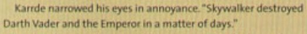
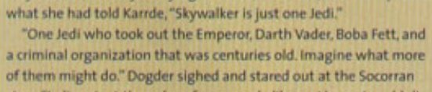

# Owner Material 037 — Star Wars D20 Drive folder (Core, Revised Core and Saga Edition): Star Wars Gamer/Star Wars Gamer 02.pdf [Star Wars Roleplaying Game (d20, 2000)] (scan pages 1–60)

- **Source:** Wizards of the Coast Star Wars Roleplaying Game books, web enhancements, Living Force campaign modules and articles (2000–2010), from the owner's "Star Wars D20" Drive folder (only the three edition subfolders; "General" was not read, as instructed). Secondary source (licensed Legends reference). Scan OCR'd on the box; the scan stays box-only and is **not** published.
- **Method:** every scanned page was OCR'd and machine-screened sentence by sentence for power-relevant statements (fights, kills, defeats, Force feats, rankings, superweapons) that name a character on our roster; each kept sentence is quoted verbatim from the OCR text and has a crop of the printed passage directly under it. Pages with nothing power-relevant are still listed with what is on them.
- **Citation:** "*Star Wars Gamer 02* (SWRPG d20), p.X" by printed page ("scan p.X" where no printed number applies). **Weight:** Licensed RPG material: a secondary source. Narrative text sums up Legends lore; game statistics are rules for players, not canon power levels, and rank lowest.

## scan p.1 (scan page 1)

Page contents: 36 words, 8 paragraphs | headings/entries: STAR VARS GAMING; BER 2; Maximum iY pencrivyc 3S PS 2 Starfighter=>; I2 Custom Freighters 6O Smuggler's Secrets; XCLUSIVE! =

## scan p.2 (scan page 2)

Page contents: 62 words, 2 paragraphs | headings/entries: N ME COVES

## scan p.3 (scan page 3)

Page contents: 113 words, 38 paragraphs | headings/entries: SO; Fiction; BY DAN WALLACE; RPG; BY OWEN 4.C. STTPWENS; OY GART APALSTRONG; SY OWEN &.C. STEPHENS; ONE WITH THE Tae GAMING; Force Univeest; TECHNICAL DATA; VOLUME |. NUMBER 2; BY MACMALL MMALLIAN ANO BART ARMSTIONG; Adventures; SY GOAN KAUIMAN; Deck Plans; OY MICHALL MIMALLIAN; State of the Arts; Autn AcTeRMaTe; HO@user Dimensions

## scan p.4 (scan page 4)

Page contents: 536 words, 58 paragraphs | headings/entries: Editorial Aysintance; Lucas Licensing Editor: Ben be; Lucas Licensing Art Editor: |; Art Director; Designer: Matthew Steve; Senior Production Manager joer Production Manager; Northeastern Advertising; Representatrees; Rorewaytor T 0685); Bier Wwers Ow ial Wet) Gar; Fer general formation abrowt the; SUBSCRIPTION QUESTIONS; HATIONAL AND INTERNATIONAL OF TRY TION; We joke, my friends and!; So Chris Perkins,; The Really Cool Kids

## scan p.5 (scan page 5)

Page contents: 536 words, 18 paragraphs | headings/entries: Anybody Out There?; Brian Isikoff

## scan p.6 (scan page 6)

Page contents: 559 words, 19 paragraphs | headings/entries: STAR WARS GAMER

## scan p.7 (scan page 7)

Page contents: 399 words, 14 paragraphs | headings/entries: Falling on Defel Ears; Dear Gamer,; Jason Dean via internet

## scan p.8 (scan page 8)

Page contents: 923 words, 33 paragraphs | headings/entries: Replace the last sentence with the follow-; Page 131, left column, replaces; Page 131, right column,; O Vitatity Points; Faricuro; Page 131, right column,; Continued Next Issue; STAR WARS Gamer Gets You Connected!; STAR WARS GAMER I1

## scan p.9 (scan page 9)

Page contents: 82 words, 5 paragraphs | headings/entries: Series O11: Pilots; ILLUSTRATED BY VINOD RAMS

## scan p.10 (scan page 10)

Page contents: 2 words, 2 paragraphs | headings/entries: 

## scan p.11 (scan page 11)

Page contents: Fiction "Fen Nabon" (Tish Eggleston Pahl & Chris Cassidy): smuggler Fenig Nabon (33, adopted by Corellian smuggler Jett, flies YT Star Lady) meets Talon Karrde at the Black Dust Tavern, Socorro, just after Endor; Karrde hires her to find a Jedi-proof base (hand-read)

## scan p.12 (scan page 12)

Page contents: 1011 words, 43 paragraphs | headings/entries: HNOUSINTS. "Sn

## scan p.13 (scan page 13)

Page contents: Fen Nabon fiction: Karrde on the Jedi (no crop): '“And how long do you think it will take Skywalker to start reestablishing a Jedi Order?” Karrde pressed. “And once he does that, how long before they turn their attention to us, with or without a new Senate?”' (hand-read)

- **Talon Karrde; Luke Skywalker** — entry/section: Fen Nabon fiction: Karrde on Skywalker: "Karrde narrowed his eyes in annoyance. “Skywalker destroyed Darth Vader and the Emperor in a matter of days.”" Source: *Star Wars Gamer 02* (SWRPG d20), scan p.13
  

## scan p.14 (scan page 14)

Page contents: Karrde's new man Aves; Coruscanti con Ghitsa Dogder; bar brawl with Gran Gecee, Gotal Hrdinah, Duros Radek (hand-read)

## scan p.15 (scan page 15)

Page contents: 1122 words, 32 paragraphs | headings/entries: He shook his head. "Not even close."; STAR WARS GAMER 18

## scan p.16 (scan page 16)

Page contents: 1079 words, 43 paragraphs | headings/entries: The port's exterior anding pacts were

## scan p.17 (scan page 17)

Page contents: 941 words, 46 paragraphs | headings/entries: Fen nodded,; STAR WARS GAMER 21

## scan p.18 (scan page 18)

Page contents: 973 words, 33 paragraphs | headings/entries: 

## scan p.19 (scan page 19)

Page contents: Dogder's lead: an old Corellian smuggler and his ysalamiri, the rodent that repels Jedi; Fen and Dogder split 60/40 (Karrde's Myrkr base origin) (hand-read)

- **Luke Skywalker** — entry/section: Fen Nabon fiction: Ghitsa Dogder on Skywalker: "“One Jedi who took out the Emperor, Darth Vader, Boba Fett, and a criminal organization that was centuries old. Imagine what more of them might do.”" Source: *Star Wars Gamer 02* (SWRPG d20), scan p.19
  

## scan p.20 (scan page 20)

Page contents: 0 words, 0 paragraphs | headings/entries: 

## scan p.21 (scan page 21)

Page contents: Fiction "The Monster" (Dan Wallace): young Lt. Panaka (Royal Security Force, trained at the Tracker's Guild on Tolan; Captain Magneta; King Veruna) arrests Gungan Kroke Modbom; a beached sando aqua monster exposes a secret tunnel complex with Human and Gungan corpses near Port Landien (hand-read)

## scan p.22 (scan page 22)

Page contents: 1099 words, 26 paragraphs | headings/entries: RK "Panakal | see him!"; THE MONSTER

## scan p.23 (scan page 23)

Page contents: 997 words, 35 paragraphs | headings/entries: Panaka scowtled. "Is that a threat?"; Scrip scrip scrip; STAR WARS GAMER 27

## scan p.24 (scan page 24)

Page contents: Sate Pestage, special advisor to Senator Palpatine, takes Kroke offworld; Pestage shoots radical Veermok dead in the tunnels and removes a lockbox; an N-1 starfighter destroys the site ("It's all being taken care of") (hand-read)

## scan p.25 (scan page 25)

Page contents: 992 words, 33 paragraphs | headings/entries: STAR WARS Gamer 28

## scan p.26 (scan page 26)

Page contents: 1133 words, 28 paragraphs | headings/entries: MONSTER; BO vOLWME |, NUMBER 2

## scan p.27 (scan page 27)

Page contents: 982 words, 33 paragraphs | headings/entries: Panaka did as he was ordered,; STAR WARS GAMER 31

## scan p.28 (scan page 28)

Page contents: 1001 words, 35 paragraphs | headings/entries: B2 vowjwme |. NUMBER 2

## scan p.29 (scan page 29)

Page contents: 1134 words, 23 paragraphs | headings/entries: A vacant-eyed rictus grinned back at him,; STAR WARS Gamer 33

## scan p.30 (scan page 30)

Page contents: 1138 words, 27 paragraphs | headings/entries: BN vo.uMe |. NUMOER &

## scan p.31 (scan page 31)

Page contents: 890 words, 36 paragraphs | headings/entries: Panaka gave a clenched-jaw scowl; STAR WARS GAMER 35

## scan p.32 (scan page 32)

Page contents: A Legacy of Starships (Corellian Engineering): YG/YU/YT/YV/YZ series stats; Aeon Ranger, Courageous (Valorum-era YT-1300), Emerald Lance, YV-929, YZ-775, White Wing (hand-read)

## scan p.33 (scan page 33)

Page contents: 379 words, 63 paragraphs | headings/entries: YU Series; Shortly after the; YU-410 Lig Transport Small com ore; Class: Cost: Size:; Crew: 444 QUNMESS Norma! vs; Double laser cannons (4); Weapon: Fire are:; Bonus:; Range modifiers:; YU-410 Light Freighter; Almo; With only a limited market appeal; STAR WARS GAMER

## scan p.34 (scan page 34)

Page contents: 341 words, 56 paragraphs | headings/entries: Courageous; SB vo.wme | wuMeER 2; COMM off the assemt = t 3; Class: Cost:; Nebulon-B frigate, the massive capacit; Attack Bonus:; Modified YT-1300 Transport; Likely valued at 150,000; PB 40,540,M-2,b-4; Double laser cannon Turret

## scan p.35 (scan page 35)

Page contents: 319 words, 43 paragraphs | headings/entries: Craft: Class:; Size: Crew:; Passengers:; Consumables; Hyperdrive: Max Speed:; Defense: ~~ Shield Points: Hull Points:; OR:; Fire are:; Attack Bonus:; Range modifiers:; The YT 1760 is; Modified YT 1760 Transport; Small roms 1 OF 2 Normal «; Ramming; The design of the 1760 was; J at overcoming; J yt-17; Small Transport; STAR WARS GAmMerR 39

## scan p.36 (scan page 36)

Page contents: 306 words, 13 paragraphs | headings/entries: YO voLUMEe | NUMBER 2

## scan p.37 (scan page 37)

Page contents: 258 words, 29 paragraphs | headings/entries: Craft: Modified YV-330 freighter; Class: Transport Cost: Size:; Crew: +4 gunners; SSR SETS Pisses CE OS Te Tee; Emerald Lance; Small; Cargo Capacity: § metric tons; Consumables: 1 month; DOR:; Weapon: Concussion missile launchers; Range modifiers:; STAR WARS GAMER

## scan p.38 (scan page 38)

Page contents: 299 words, 8 paragraphs | headings/entries: Craft: YV-929 Armed Freighter; Double turbolaser cannnons; YV-8295 Armed Freighter; PB +0, S/M/L n/a; U2 VOLUME | NUMOER 2

## scan p.39 (scan page 39)

Page contents: 362 words, 43 paragraphs | headings/entries: YZ-775 Transport; YZ Series; Craft: Class:; YZ-775 Transport; Consumables: 6 month; Hyperdrive: x1 the; Defense: Shield Points:; Hull Points:; DR:; Weapon: Fire are:; Proton torpedo tubes; Front; Partial turret rent; Attack Bonus: #10 «4; Weapon: Damage: §dt0 x5 ss; PB 40,5 4+0,M-2,L-4; Se SE Attack Bonus: +6; Range modifiers: Fire arc:; Weapon: Twin laser cannons (2); Damage: todw x2; Fire are: Turret Range modifiers: P8+0,5/M/L n/a; Range modifiers:

## scan p.40 (scan page 40)

Page contents: 258 words, 28 paragraphs | headings/entries: Craft: Modified ¥Z-goo Class: Transport; Damage: Range modifiers:; Weapom Twin laser cannons (2); Range modifiers: PB +0,5+40,M-2,L n/a

## scan p.41 (scan page 41)

Page contents: 362 words, 29 paragraphs | headings/entries: PtSsEse; VCX-350 Freighter; VCX Series; Craft:; Class:; Weapon:; Five arc: Attack Bonus:; Damage:

## scan p.42 (scan page 42)

Page contents: 310 words, 27 paragraphs | headings/entries: Craft VCX-7oo Heavy Courler; Fire arc:; Attack Bonus: Damage: 300 x2; Range modifiers: PB +0,5 +0, M/Ln/a; Range modifiers:; VCX-700 Heavy Courier; Weapon: Concussion; Range modifiers: PB+0,5/M/Ln/a; NG vowmei NuM@user

## scan p.43 (scan page 43)

Page contents: 330 words, 44 paragraphs | headings/entries: REVIT TSvIisisey Ty eF; Craft: VCX-B20 Escort Freighter Class: Cost:; Transport '; Sizer; Crew:; Consumables: 6 month; Twin heavy laser cannons (2); Weapon:; Fire are:; Attack Bonus: +9> 1a crew, 64 fe; Weapon: Proton torpedo launcher; Damage: 6dvo x2; PB -2,540,M/Loa/a Front; Five arc:; Range modifiers:; Autoblasters (8) Partial turret '; Weapon:; Fire are:

## scan p.44 (scan page 44)

Page contents: Privateer prestige class (Letter of Marque, Beholden, Hyperspace Track, Enforce Blockade) (hand-read)

## scan p.45 (scan page 45)

Page contents: 579 words, 39 paragraphs | headings/entries: The Privateer; HALF REPAIRS; A The steadfast crow; Class Features; REQUIREMENTS; Must have cornmitted an act of unusual; LIMITATIONS; CLASS SKILLS:; Fut Repairs; Enrorce Biocxave; STAR WARS GAMER "OQ

## scan p.46 (scan page 46)

Page contents: Fast-play game "The Predators" (Naboo): Padawan Rann I-Kanu (student of Master Ali-Vor), Arani Korden, Rorworr, Galak vs. a veermok, smugglers and mercenary Saidle Frex; rescue Prof. Tasrach Boh (hand-read)

## scan p.47 (scan page 47)

Page contents: 732 words, 25 paragraphs | headings/entries: THe GAME SESSION; GAMEMASTER ADVICE; The Predators; Read the following text to the players:

## scan p.48 (scan page 48)

Page contents: 912 words, 30 paragraphs | headings/entries: STAR. WARS; Feet Perey Seue; Watk Up AND Loox AT THE Spetorr; LEAVE; HANDLING THE FIGHT; SS; EXAMINE THE SPEEOER

## scan p.49 (scan page 49)

Page contents: 436 words, 21 paragraphs | headings/entries: The Jungle; LOCATE THE SHRINE; From here the heroes have no difficulty; Area 2 Clearing; Area 2: The Shrine Entrance; STAR WARS Gamer SB

## scan p.50 (scan page 50)

Page contents: 452 words, 25 paragraphs | headings/entries: STAR. WARS The Shrine THE PREDATORS; Sharh Car; Area 3: The Guard Room; HANDUNG THE FiGHT; Damage: If the attack hits, determine how; SM VOLUME | NUMBER 2

## scan p.51 (scan page 51)

Page contents: 734 words, 29 paragraphs | headings/entries: EXAMINE THE SMUGGLERS; Check THE HoLocame Tass; CHeck THE Comminor; Area 4: The Power Generator; CHECKING THE COMPUTER; CHECKING THE Doors; Area 5: The Storage Room; HANDUNG THE FicHT; Proceed through the combat by taking

## scan p.52 (scan page 52)

Page contents: 735 words, 31 paragraphs | headings/entries: STAR. WARS; Free Tasrach BOH; Here are some questions characters might ask:; WW est hii an]; At the end of the conversation, Tasrach; LOOKING AT THE BLAsTeR Rirtes; Area 6: The Barracks; SNEAK Away; Cross THE Crevice; ATTACKING FROM THE LEDGE

## scan p.53 (scan page 53)

Page contents: 847 words, 31 paragraphs | headings/entries: HANDLING TME FIGHT; Proceed through the combat by taking; SmuGcGciER Boss; SAIOLE Frex; Wounos: 18; CHECK THE COMPUTER; CHECK THE SMUGGLER; Now What?; STAR WARS GAMER —B7

## scan p.54 (scan page 54)

Page contents: 554 words, 39 paragraphs | headings/entries: Combat; DAMAGt; Push: +2 bonus; Strategy; Force Powers; Combat; Actions eeeeceaeoecoaaoeoacoa a Strategy; Push: +0 bonus

## scan p.55 (scan page 55)

Page contents: 472 words, 41 paragraphs | headings/entries: Rorworr; Woonite Scour; DAMAGE (with bowcaster); Derense; WOUNDS:; Actions; Disable Device: -10 penalty; Jump: +3 bonus; Push: +3 bonus; Repair: +5 bonus; Survival: +4 bonus; Computer Use: +1 bonus; Strategy; DAMAGE: 3 six-sided dice; DEFENSE:; Wounds; Actions; STAR WARS GAMeR 5B

## scan p.56 (scan page 56)

Page contents: Adventure "The Lambda Heist": Twi'lek mechanic Jela'han (Scoundrel 6 stats), junkyard dealer Shellar, Imperial scout training outpost on Moorja (hand-read)

## scan p.57 (scan page 57)

Page contents: 854 words, 33 paragraphs | headings/entries: JELAHAN; Cee C7; The scout troopers occupy the center of; Equipment: Comlink, datapad, hold-out; Are You the Gamemaster?7

## scan p.58 (scan page 58)

Page contents: 784 words, 21 paragraphs | headings/entries: IMPERIAL FORCES; Feats: Skill Emphasis (Spot), Track

## scan p.59 (scan page 59)

Page contents: 842 words, 33 paragraphs | headings/entries: STORM DAMAGES; Part 2: Shellar's Junkyard; VEHICLE DATA; Imperial Shuttle; Class; Transport; Size; Ramming; Deferse: 16 (+1 size, +5 armor);; Shellar's Junkyard

## scan p.60 (scan page 60)

Page contents: 766 words, 33 paragraphs | headings/entries: Docking Bay 18; GY VOLUME | NUMBER 2; SMHELLAR; Emphasis (Gather Information), Spacer,

