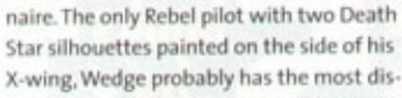
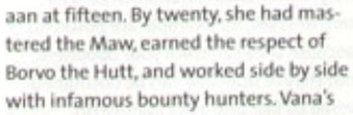
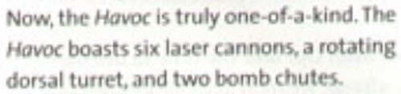
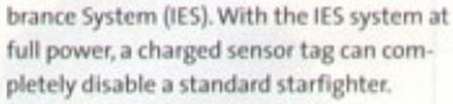

# Owner Material 037 — Star Wars D20 Drive folder (Core, Revised Core and Saga Edition): Star Wars Gamer/Star Wars Gamer 02.pdf [Star Wars Roleplaying Game (d20, 2000)] (scan pages 61–89)

- **Source:** Wizards of the Coast Star Wars Roleplaying Game books, web enhancements, Living Force campaign modules and articles (2000–2010), from the owner's "Star Wars D20" Drive folder (only the three edition subfolders; "General" was not read, as instructed). Secondary source (licensed Legends reference). Scan OCR'd on the box; the scan stays box-only and is **not** published.
- **Method:** every scanned page was OCR'd and machine-screened sentence by sentence for power-relevant statements (fights, kills, defeats, Force feats, rankings, superweapons) that name a character on our roster; each kept sentence is quoted verbatim from the OCR text and has a crop of the printed passage directly under it. Pages with nothing power-relevant are still listed with what is on them.
- **Citation:** "*Star Wars Gamer 02* (SWRPG d20), p.X" by printed page ("scan p.X" where no printed number applies). **Weight:** Licensed RPG material: a secondary source. Narrative text sums up Legends lore; game statistics are rules for players, not canon power levels, and rank lowest.

## scan p.61 (scan page 61)

Page contents: Lambda Heist villain Colonel Dyrra (Male Human Scout 7) and Shellar (Scoundrel 4) stats (hand-read)

## scan p.62 (scan page 62)

Page contents: Adventure "Snow Job" (Ando Prime Overland podrace): Desilijic-planted Twi'lek Jer Blankuna, Twi'lek scout Ree, CSA crime lord Kaeline Ungasan, Dug Benkudi, Vonium mining (hand-read)

## scan p.63 (scan page 63)

Page contents: 1037 words, 30 paragraphs | headings/entries: Expect a Cold Reception G; BACKGROUND CHecKs; Meeting Jer Blankune; STAR WARS Gamer G7

## scan p.64 (scan page 64)

Page contents: 1088 words, 33 paragraphs | headings/entries: Blankunas cue; BSB vo.uMme | NUMBER 2; Arriving on Tatooine; THE INVESTIGATION; Gather information check (DC 15), Contin

## scan p.65 (scan page 65)

Page contents: 853 words, 30 paragraphs | headings/entries: Kacline Ungasan; Podrace on Ando Prime; STAR WARS GAMER GOD

## scan p.66 (scan page 66)

Page contents: 1118 words, 28 paragraphs | headings/entries: Tatxince To THe Murrs; Hutts' audience chamber; ASKING QUESTIONS; CONFRONTING GEON Justic

## scan p.67 (scan page 67)

Page contents: Snow Job stat blocks: Jer Blankuna (Twi'lek Noble), Ree (Twi'lek Scout 3, Force Sensitive), Kaeline Ungasan (Noble 2/Soldier 2/Scoundrel 2), Geon Justic; Talid species traits (Ando Prime) (hand-read)

## scan p.68 (scan page 68)

Page contents: 827 words, 30 paragraphs | headings/entries: STOW; FinoiInG Out AsourT TALIOS; LATE ARRIVALS

## scan p.69 (scan page 69)

Page contents: 774 words, 25 paragraphs | headings/entries: Entering the Canyon; PooRAcer WRECKS :; TAUd SNIPERS; UNGASAN's Arnrvat; Juaka Canyon; STAR WARS GAMER 73

## scan p.70 (scan page 70)

Page contents: 838 words, 29 paragraphs | headings/entries: STOW; Wrapping Things Up; Homeworld: Ando Prime,; TALID SPECIES TRAITS: =

## scan p.71 (scan page 71)

Page contents: UoS Guide: The Duros — Queen Rana Mas Trehalt, Duchess Geneer, Imperial ruin of Duro; NJO: Leia Organa Solo's refugee efforts, Admiral Darez Wuht, CorDuro VP Durgard Brarun, Vong dovin basal drags orbital cities down (Orr-Om first); notable Duros list (hand-read)

## scan p.72 (scan page 72)

Page contents: 896 words, 18 paragraphs | headings/entries: History and Culture; Aah aan; STAR WARS GAMER 77

## scan p.73 (scan page 73)

Page contents: 450 words, 18 paragraphs | headings/entries: Notable Duros; Locations of Interest; VALLEY OF ROvALTY; RANADAAST, THE CiTy OF ASHES

## scan p.74 (scan page 74)

Page contents: Duro locations: Bburru City, Tayana, Glydus drilling platforms, Trercan Dam, Vydat Stardock (Elav Feen, Dulse Tethin), Pri-Andylan Shipyard (Niya Giedan) (hand-read)

## scan p.75 (scan page 75)

Page contents: 507 words, 16 paragraphs | headings/entries: Puerre; BO volume | NUMBER 2; Vyoar STARDOCK; Pat-ANDYLAN SHIPYARD

## scan p.76 (scan page 76)

Page contents: Chance Cube random cargo tables (hand-read)

## scan p.77 (scan page 77)

Page contents: CCG "Squad & Deliver" Rebel squadrons deck: Wedge, Biggs, Hobbie, Karie Neth, Keir Santage, Kin Kian, Tycho Celchu, Zev Senesca; CCG Jedi training deck (Daughter of Skywalker, Yoda) (hand-read)

- **Wedge Antilles** — entry/section: The Shaft: Rebel Squadrons (CCG): "The only Rebel pilot with two Death Star silhouettes painted on the side of his X-wing" Source: *Star Wars Gamer 02* (SWRPG d20), scan p.77
  

## scan p.78 (scan page 78)

Page contents: 359 words, 13 paragraphs | headings/entries: 

## scan p.79 (scan page 79)

Page contents: 836 words, 19 paragraphs | headings/entries: BY MICHAEL MIKAELIAN; STAR WARS Gaver 87

## scan p.80 (scan page 80)

Page contents: 568 words, 23 paragraphs | headings/entries: Five Tests in Seven Turns; Tuan Ome; Activate at least 3; Force. Search your deck; Liowt Sept Tumw Five; Daex Sioe Tuen THeee; BB voL_LUMEe lt NUMBER ®

## scan p.81 (scan page 81)

Page contents: Super Bombad Racing preview: power moves (Maul throws lightsaber, Yoda inverts all racers), Yoda's souped-up Jedi Council chair (hand-read)

## scan p.82 (scan page 82)

Page contents: 917 words, 18 paragraphs | headings/entries: Big Head Racing; STAR WARS GAMER G1

## scan p.83 (scan page 83)

Page contents: Jedi Power Battles Dreamcast interview: Ki-Adi-Mundi unlockable (mesmerize, cloak, Force blasts); "many on the team feel Ki-Adi-Mundi has the most powerful lightsaber attacks in the game" (hand-read)

## scan p.84 (scan page 84)

Page contents: 827 words, 30 paragraphs | headings/entries: SWG: How big was the core tearn?; EM TE; STAR Waes Gamen OS

## scan p.85 (scan page 85)

Page contents: 686 words, 29 paragraphs | headings/entries: A Port in the Storm; SYN VOLUME | NUMBER 2?; Reeve: And use the Force

## scan p.86 (scan page 86)

Page contents: Demolition tips and cheat codes; unlock Darth Maul (Sith Infiltrator), Lobot, Boushh (hand-read)

## scan p.87 (scan page 87)

Page contents: 589 words, 50 paragraphs | headings/entries: STARSIGAIEY; Nym's Havoc; The Havoc; Nubian Bomber; Weapon Front; Fire arc; Class: Starfighter; Not for sale 5010 KZ vache; PB +0, 5 +0, M/L n/a; Damage: Small — bestest Range modifiers: Unique; Weapon: Rotating laser turret; Passengers: 3 Fire arc: Turret; Attack Bonus: +7+ 6d10; PB +0,540,M/L n/a; Cargo Capacity: 10 metric tons; Consumables: 2 weeks; Damage: Hyperdrive: x1¥ Range modifiers:; Max Speed: Attack; Bomb chute; Ventral; Weapon Defense: 21; Shield Points; PB +0,5 /M/L n/a; Damage:; Nhed thee ev wrate attact

- **Vana Sage** — entry/section: Starfighter Aces: Vana Sage: "By twenty, she had mastered the Maw, earned the respect of Borvo the Hutt, and worked side by side with infamous bounty hunters." Source: *Star Wars Gamer 02* (SWRPG d20), scan p.87
  
- **Nym** — entry/section: Starfighter Aces: Nym's Havoc: "Now, the Havoc is truly one-of-a-kind, The Havoc boasts six laser cannons, a rotating dorsal turret, and two bomb chutes" Source: *Star Wars Gamer 02* (SWRPG d20), scan p.87
  

## scan p.88 (scan page 88)

Page contents: 565 words, 63 paragraphs | headings/entries: Dex): Defense +0 [+7 class, +2; Wis 11. Cha 16; Equipment: Personal starship (Guardian; Mantis), blaster pistol, knife, comlink,; Skills: Astrogate +13, Bluff +12, Computer Use; The Guardian Mantis; Modified Prototype Nubian Bomber; Starfighter \s Not for sale Small x; Crew: Unique; Passengers: 3 Cargo Capacity: Consumables:; Attack Bonus:; Range modifiers:; Vana's Guardian Mantis; Even at first glance, the Guardian Mantis; The Guardian Mantis is armed mnons; Weapon: Laser Cannons 6 fire; Front; PB +0,5 40, M/Liai/a; Fire are:; Weapon: Rotatinf laser turret; Turret; PB 40,5 40, M/L n/a; Fire arc: Attack Bonus: Damage:; Range modifiers:; Bomb chute; Ventral; Weapon:; Fire arc: Attack Bon; Damage:; STAR WARS GAMER 7

- **Vana Sage** — entry/section: Starfighter Aces: Guardian Mantis: "With the IES system at full power, a charged sensor tag can completely disable a standard starfighter" Source: *Star Wars Gamer 02* (SWRPG d20), scan p.88
  

### Stat block notes (game mechanics, not feats)

- Vana Sage: Female Human Scoundrel 6; VP/WP 32/12; +6 ranged blaster pistol (3d6); sneak attack +2d6; Ref +7; Astrogate +13, Bluff +12, Pilot +9 (Skill Emphasis Pilot), Starship Dodge; flies the Guardian Mantis (hardwired R2 "Mod-3"); former bodyguard/pilot of King Veruna (Source: *Star Wars Gamer 02* (SWRPG d20), scan p.88)

## scan p.89 (scan page 89)

Page contents: Star Wars Galaxies update (Galactic Civil War era, Jedi to play a role) (hand-read)

### Stat block notes (game mechanics, not feats)

- Rhys Dallows: Male Human Soldier 3; Init +3; Defense 16; Pilot +9, Astrogation +6; Ambidexterity, Starship Dodge; Naboo Echo Flight rookie flying an N-1 with astromech Wrench (Source: *Star Wars Gamer 02* (SWRPG d20), scan p.89)
