# Owner Material 037 — Star Wars D20 Drive folder (Core, Revised Core and Saga Edition): Star Wars Gamer/Star Wars Gamer 03.pdf [Star Wars Roleplaying Game (d20, 2000)] (scan pages 1–60)

- **Source:** Wizards of the Coast Star Wars Roleplaying Game books, web enhancements, Living Force campaign modules and articles (2000–2010), from the owner's "Star Wars D20" Drive folder (only the three edition subfolders; "General" was not read, as instructed). Secondary source (licensed Legends reference). Scan OCR'd on the box; the scan stays box-only and is **not** published.
- **Method:** every scanned page was OCR'd and machine-screened sentence by sentence for power-relevant statements (fights, kills, defeats, Force feats, rankings, superweapons) that name a character on our roster; each kept sentence is quoted verbatim from the OCR text and has a crop of the printed passage directly under it. Pages with nothing power-relevant are still listed with what is on them.
- **Citation:** "*Star Wars Gamer 03* (SWRPG d20), p.X" by printed page ("scan p.X" where no printed number applies). **Weight:** Licensed RPG material: a secondary source. Narrative text sums up Legends lore; game statistics are rules for players, not canon power levels, and rank lowest.

## scan p.1 (scan page 1)

Page contents: 44 words, 7 paragraphs | headings/entries: FREE! SILENT DEATH STARFIGHTER ee; THE Force ff = tll; DARTH BANE eo BY KEVIN J. ANDERSON

## scan p.2 (scan page 2)

Page contents: 38 words, 5 paragraphs | headings/entries: Ig , t

## scan p.3 (scan page 3)

Page contents: Gamer 03 contents: "Bane of the Sith" fiction (Darth Bane after Ruusan), Conquest excerpt (Talon Karrde, NJO), Smugglers' Alliance, C-3PX Most Wanted, Cloud Cover adventure (hand-read)

## scan p.4 (scan page 4)

Page contents: 776 words, 10 paragraphs | headings/entries: Associate Editon \' Contributing Editor |

## scan p.5 (scan page 5)

Page contents: 579 words, 25 paragraphs | headings/entries: Brutally Honest; Dear Mr. Editor,; Adam Kieffer Zanesville, OH; That's More Like It!; A Huge "We're Sorry

## scan p.6 (scan page 6)

Page contents: 727 words, 31 paragraphs | headings/entries: Jin Choung; Canon Fodder; Hi there; STAR WARS Gamer 8

## scan p.7 (scan page 7)

Page contents: Letters: Lucasfilm's Ben Harper on Marvel comics — "We have never disavowed the existence of the Marvel comics"; non-contradicting Marvel elements being integrated into official canon (Lady Lumiya stats first in Star Wars Galaxy Magazine #3) (hand-read)

## scan p.8 (scan page 8)

Page contents: 719 words, 37 paragraphs | headings/entries: STABRIZATION AND RECOVERY; Chris Hallman; Houston, TX; CONTINUED ON NEXT PAGE; Assisreo HtAUNG; Equemint HEALinc; Page 182, under Engine Wash; Continued Next Issue; STAR WARS GAMER I

## scan p.9 (scan page 9)

Page contents: 905 words, 41 paragraphs | headings/entries: New Product Tie-Ins Free Online!; Tatooine, Check out; NUMBER 3; He Really Likes Us; Dear Friends at Stare Wares Gamer; CORRECTION; A huge fan Tim Barrera; Especially the girts part; Thanks, Shaun Shuey Wonder Lake, IL

## scan p.10 (scan page 10)

Page contents: 825 words, 25 paragraphs | headings/entries: Thanx Robert Redhead Halifax, Nova Scotia; Sorry. Next letter; Dear Stare Wars Gamer; Jamian Nace Rochelle Park, NJ; Product Previews; Alien Anthology; Starships of the Galaxy; Available in December 2001; STAR WARS GAMeR 13

## scan p.11 (scan page 11)

Page contents: 344 words, 18 paragraphs | headings/entries: Interview: lan McDiarmid on Palpatine; Exclusive Preview: The Essential Guide To Aliens; On Sale in 2 Weeks!; COMING ATTRACTIONS STAR WARS GAMER #4; Secrets of Kashyyyk: The Wookiee Homeworld; Guide To Intelligent Life: The Advosec; Modelmaking 101: Tatooine and Beyond; Ithorians in Space: Ecology of a Herdship; Special Preview: Wildlife of Star Wars

## scan p.12 (scan page 12)

Page contents: Holonet Transmission rules Q&A (JD Wiker): Jedi guardian vs consular rationale; a dark-sider is not a Sith unless trained — "'Sith,' like 'Jedi,' describes a specific school of philosophy—not just the state of being evil" (hand-read)

## scan p.13 (scan page 13)

Page contents: 1014 words, 28 paragraphs | headings/entries: You can certainly play someone who; My favorite characters in the Stare Wass; You could also simply choose a droid; Got rules questions? Send ther toa:; HoloNet Transmission, c/o Srar Wars Gamer; P.0. Box 707 Renton, WA 88057

## scan p.14 (scan page 14)

Page contents: 91 words, 7 paragraphs | headings/entries: ILLUSTRATED BY JOE CORROWNEY

## scan p.15 (scan page 15)

Page contents: 0 words, 0 paragraphs | headings/entries: 

## scan p.16 (scan page 16)

Page contents: 714 words, 24 paragraphs | headings/entries: The Righteous Hand of Darkness; BANE OF THE SITH; BY KEVIN J. ANDERSON; Except for Darth Bane,; STAR WARS GAMER 21

- **Lord Kaan** — entry/section: Bane of the Sith: "The insidious "thought bomb" set off in a glorious suicidal gesture by Sith Lord Kaan had also obliterated all of the Jedi Knights under Lord Hoth's command." Source: *Star Wars Gamer 03* (SWRPG d20), scan p.16
  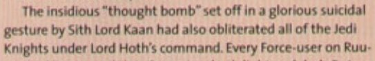
- **Lord Kaan; Lord Hoth**: "The insidious "thought bomb" set off in a glorious suicidal gesture by Sith Lord Kaan had also obliterated alll of the Jedi Knights under Lord Hoth's command." Source: *Star Wars Gamer 03* (SWRPG d20), scan p.16
  

## scan p.17 (scan page 17)

Page contents: Bane of the Sith: avatar of Lord Qordis (dead Sith Master) torments Bane and sabotages the Valcyn over Dxun; "You were always a disappointment as a student, Bane" (hand-read)

- **Darth Bane** — entry/section: Bane of the Sith: "The dark side energies buoyed his failing craft just enough so that it crashed into the treetops with slightly less than lethal force." Source: *Star Wars Gamer 03* (SWRPG d20), scan p.17
  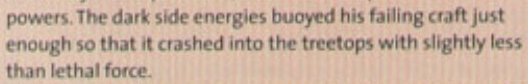

## scan p.18 (scan page 18)

Page contents: 1087 words, 23 paragraphs | headings/entries: STAR WARS GAMER 2B

- **Freedon Nadd** — entry/section: Star Wars Gamer 03: "He had heard of this place, knew it to be a focus of dark side power: the tomb of Freedon Nadd, a hidden structure meant to hold the evil energies that had infected the bodies of legendary dark Force-users." Source: *Star Wars Gamer 03* (SWRPG d20), scan p.18
  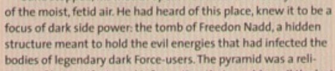
- **Darth Bane** — entry/section: Bane of the Sith: "He eviscerated the monster, splitting it open between its twin poisonous tails and curving sideways so that the smoking blade came out of the panther-thing's powerful shoulder," Source: *Star Wars Gamer 03* (SWRPG d20), scan p.18
  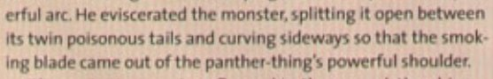
- **Exar Kun; Freedon Nadd**: "Years later Exar Kun, the Dark Lord of the Sith who had first resurrected the Sith Brotherhood, also came to Dxun, raiding Nadd's ancient tomb in search of dark side secrets." Source: *Star Wars Gamer 03* (SWRPG d20), scan p.18
  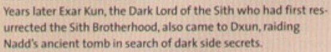
- **Lord Kaan**: "Now, Bane had no choice but to teach himself, and he had the incentive to achieve Sith skills, He hoped Kaan's avatar would assist him, but even without its sinister aid, Bane would do everything possible to resurrect the Sith Brotherhood." Source: *Star Wars Gamer 03* (SWRPG d20), scan p.18
  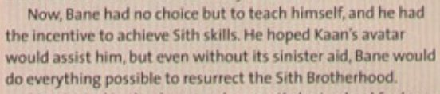

## scan p.19 (scan page 19)

Page contents: Bane finds Freedon Nadd's tomb and a Sith holocron guided by Kaan's avatar; gharzr (Dxunian stalker) stats (hand-read)

## scan p.20 (scan page 20)

Page contents: 1030 words, 25 paragraphs | headings/entries: The agony was indescribable,; STAR WARS GAMER 25

- **Darth Bane** — entry/section: Bane of the Sith: orbalisks: "Though the barnacle-like creatures were feeding on him, growing to cover more of his skin surface, the parasites were also pumping him with adrenaline and strength," Source: *Star Wars Gamer 03* (SWRPG d20), scan p.20
  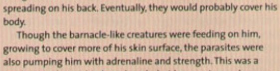
- **Darth Bane**: "Though the barnacle-like creatures were feeding on him, growing to cover more of his skin surface, the parasites were also pumping him with adrenaline and strength, This was a symbiotic relationship based on dark side energies, and now— after he had absorbed the knowledge within the Sith holocron—Darth Bane knew there would be enough dark side power for them all." Source: *Star Wars Gamer 03* (SWRPG d20), scan p.20
  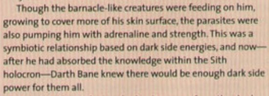

## scan p.21 (scan page 21)

Page contents: Bane dominates a skreev (Dxunian raptor) by the Force and rides it; plans to nudge Dxun toward Onderon to find his apprentice (hand-read)

- **Darth Bane** — entry/section: Bane of the Sith: Rule of Two: "There must be only two Sith at any one time: a master and apprentice." Source: *Star Wars Gamer 03* (SWRPG d20), scan p.21
  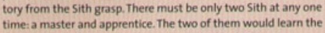
- **Darth Bane** — entry/section: Bane of the Sith: "The claws scored across Darth Bane's chest, a move that would have torn any other victim to shreds. Though Bane was sent sprawling to the ground, the clustered orbalisks gave him enough strength and armor so that the flying monster caused him no harm" Source: *Star Wars Gamer 03* (SWRPG d20), scan p.21
  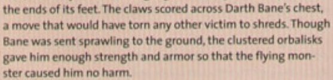
- **Darth Bane** — entry/section: Bane of the Sith: "Now that he understood the depths of Sith powers, he thought he might even have control over worlds and moons" Source: *Star Wars Gamer 03* (SWRPG d20), scan p.21
  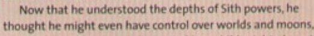

## scan p.22 (scan page 22)

Page contents: 0 words, 0 paragraphs | headings/entries: 

## scan p.23 (scan page 23)

Page contents: 188 words, 14 paragraphs | headings/entries: Karrde ... Talon Karrde; AN EXCERPT FROM; CONQUEST; ILLUSTRATION BY THERESE NIELSEN; STAR WARS GAMER 29

## scan p.24 (scan page 24)

Page contents: 519 words, 30 paragraphs | headings/entries: How long before we can

- **Talon Karrde; Shada D'ukal** — entry/section: Conquest excerpt: ""Shada, when will you learn to trust my instincts? When have I ever gotten you killed?"" Source: *Star Wars Gamer 03* (SWRPG d20), scan p.24
  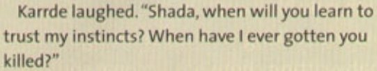

## scan p.25 (scan page 25)

Page contents: Conquest excerpt: Karrde bluffs Peace Brigade Captain Imsatad (served with Thrawn at Wayland) at Yavin 4 to protect the Jedi children, posing as a bounty seeker wanting Vong passage (hand-read)

- **Talon Karrde** — entry/section: Conquest excerpt: ""Better sensors than you have, for one thing. Detailed knowledge of Yavin 4 that I believe you lack. A crew that is very, very good at finding things. Certain special defenses against Jedi—and the means of finding them."" Source: *Star Wars Gamer 03* (SWRPG d20), scan p.25
  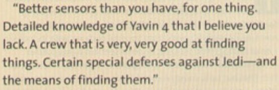

## scan p.26 (scan page 26)

Page contents: UoS Guide: Jawas (Pablo Hidalgo) — Melinea Arnthout first contact (droid 2PO), name "Tatooine" from Jawa "Tah-doo-ine"; ionization blasters (hand-read)

## scan p.27 (scan page 27)

Page contents: 870 words, 20 paragraphs | headings/entries: History and Culture; Jawa Commonte; Politics; STAR WARS GAMER 33

- **Wittin** — entry/section: UoS Guide: Jawas: "One Jawa clan, headed by the barbaric chief Wittin, is the most feared on Tatooine." Source: *Star Wars Gamer 03* (SWRPG d20), scan p.27
  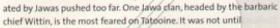

## scan p.28 (scan page 28)

Page contents: 504 words, 13 paragraphs | headings/entries: Technology Level; Trade and Technology

## scan p.29 (scan page 29)

Page contents: 489 words, 32 paragraphs | headings/entries: Jawas in the Galaxy; Credits: 2¢; Ability Scores: 5; Buyer Beware!; Table |: Oroids; The droid's Constitution suffers a <4; Table 2: Energy/ Vibro Weapons; STAR WARS GAMER 35

## scan p.30 (scan page 30)

Page contents: Scouting Report: Spaceports & Landing Pads — urban commercial facility, aquatic launch platform, fringe spaceport, tethered orbital shipyard, concealed crater base; docking tractor beam stats (hand-read)

## scan p.31 (scan page 31)

Page contents: 417 words, 18 paragraphs | headings/entries: Urban Commercial Facility; Aquatic Launch Platform; THe SicuTs; TRANSPARASTERL Canopy; THe Law; STAR WARS GAMER 37

## scan p.32 (scan page 32)

Page contents: 400 words, 18 paragraphs | headings/entries: Aquatic Launch Platform; Typical Fringe Spaceport; THE SIGHTS; Beyond that lie undeveloped lands serving a; Toe Law

## scan p.33 (scan page 33)

Page contents: 386 words, 14 paragraphs | headings/entries: Typical Fringe Starport; HD paleedes's ahs; Toe Sicwrs; STAR WARS GAMeR 39

## scan p.34 (scan page 34)

Page contents: 435 words, 33 paragraphs | headings/entries: Tethered Orbital Shipyards My ee; Tetwer Cone; OETNAT NTRP; THE Law; NO VOLUME | NUMBER 3; Larect wicw SPEED ELEVATOR |; PRENGHTER Bas; LARGE sper MOORAGE UNDER STATION; STARPICHTER BAYS; Concealed Crater Base; THE SIGHTS; POSITIONING THRUSTERS; TETHER EXTENDS TO GROUND FACILITY; Fut STATION PROFILE; Chaseial TTT icoredsedllers—

## scan p.35 (scan page 35)

Page contents: 400 words, 38 paragraphs | headings/entries: Concealed Crater Base; Guaeo Tents; THe Law; Looxour st; TThevarto CATWALK; O; Gy sail ern eeete >; Concealed crater bases used by covert; Casco Ceamt Cave '; Os; Srorace |; PROFILE VIEW >; STAR WARS GAMeR 41

## scan p.36 (scan page 36)

Page contents: "Droids!" — droid hero rules (Cory Herndon) (hand-read)

## scan p.37 (scan page 37)

Page contents: 863 words, 23 paragraphs | headings/entries: Tree Famaity Droio; Ie "; Dorp INDEPENDENCE; Building a Droid Hero; Drorp Herots And Classes

- **IG-88** — entry/section: Droids!: independence: "(According to uncorroborated reports, the famed bounty hunter, IG-88, killed its creators upon activation simply because those creators had inadvertently instilled the unit with an utter disregard—some would say disdain—for sentient life.)" Source: *Star Wars Gamer 03* (SWRPG d20), scan p.37
  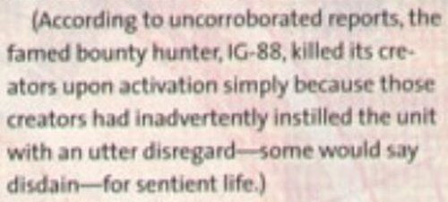

## scan p.38 (scan page 38)

Page contents: 931 words, 38 paragraphs | headings/entries: LOOK SIR;; DROIDS!; Deoros ey Decaee; Ability Modifiers: 1st-degree droid; Ability modifiers: and-degree droid heroes; Second-Degree Droids; What's Different About Droids Heroes; Third-Degree Droids; What's the Same About Droids; MM VOLUME L NUMB@user 3

## scan p.39 (scan page 39)

Page contents: 619 words, 33 paragraphs | headings/entries: Fifth- Droids; Fourth-Degree Droids; Crassis Types; SIZE AND STRENGTH SCORES; Droid Size and; Size Strength Mu; Mediurn (3Po unit); Droid Manufacturers; Strength

## scan p.40 (scan page 40)

Page contents: 882 words, 27 paragraphs | headings/entries: LOOK SIR; DROIDS!; The Traditionalist:; Playing a Ready-Made Droid; MB yo .uMe | NUMBER 3; Used droids can be purchased and modi-; GM Notes: Droids in Your Game

## scan p.41 (scan page 41)

Page contents: 894 words, 41 paragraphs | headings/entries: ACCUTRONICS; Rim. Accutronics' headquarters are based; ARAKYD INDUSTRIES; Some in the New Republic gov-; The company produced a high; Droid Creation in 10 Easy Steps

## scan p.42 (scan page 42)

Page contents: 905 words, 45 paragraphs | headings/entries: COOK SIR;; DROIDS!; Repair Drotd, the specialized PD Lurrian, and; Though protocol droids and servant models; Death and the Droid; GEENTECH; Almost a footnote in droid his-; Among Genetech's alleged grievances were; GENETECH CORPORATION; The maker of the 3D-4X; Administrative droid is; WIN droid-making bu . thi; THANKS FOR THE Memory Wire; VOLUME | NUMBER 3

## scan p.43 (scan page 43)

Page contents: 859 words, 30 paragraphs | headings/entries: Bu i —_; Les TECH; This small, exploration-ori-; Galactica's hostile takeover; Palpatine's robe, sold more product to the; Rebels once the Emperor cut the explo-; Explorer models, in particular, saw heavy

## scan p.44 (scan page 44)

Page contents: Droids!: manufacturers — Blue Max built by MerenData; Serv-O-Droid CZ joke ('Rebels would have won in time to save Alderaan'); Loronar Synthdroid ~9 ABY failure (hand-read)

## scan p.45 (scan page 45)

Page contents: 856 words, 42 paragraphs | headings/entries: Uioan Arms; Once an subsidiary of; LeisureMech Enterprises in; Arms has spread beyond; Hi i; UPGRADES, PARTS, AND ATTACHMENTS; Fire Extinguisher; Cost: 50 credits; Requires Empty Tool Mount; Flamethrower; Cost: 400 credits; Requires Empty Tool Mount; Humanoid Digital Manipulator Arm; Cost: 400 credits; Requires empty tool mount; TAR WARS GAMER »51

## scan p.46 (scan page 46)

Page contents: 758 words, 51 paragraphs | headings/entries: COOK SIR; DROIDS!; Repulsortift Unit; Weight: n/a; No problem for the droid using repulsor-; Droid Quirks Table; G2 vo.vume i, numBer 3; Ireilesploioneenrraphapeippecaeienteae; Droid Repuleartlift Cost; Sire PA cil tiga liane; Fine (Fly eye) Bianca); Satan) at Medium (3Po unit); Security Protocols Package; Cost: 400 credits; Weight: 4 kg; Spring-loaded Internal Storage; Cost: 150 credits (per kg); Weight: .5 kg; Verbobrain; Cost: $00 credits; Weight: 5 kg; Feats in the Core Rulebook)

## scan p.47 (scan page 47)

Page contents: 662 words, 25 paragraphs | headings/entries: Welding Laser; Cost: 300 credits; Weight: 1.5 kg; Requires Empty Tool Mount; Wry Quirks? Way Now?

## scan p.48 (scan page 48)

Page contents: Mad Gass'kin's Used DroidNet catalog (MD, R3, R4, LOM, M-3PO ...) (hand-read)

## scan p.49 (scan page 49)

Page contents: 792 words, 39 paragraphs | headings/entries: MD Medical Specialist: Walking medical; Wis 12, Cha po; MD Medical; Specialist; Unspent Skill Points: 18; Feats: Starship Operation (capital), Skill Emphasis (Diplomacy); Cost: 4,500 credits; Unspent Skill Points: 15; Feats: Toughness, Skill Emphasis (Repair); Cost: 2,400 credits

## scan p.50 (scan page 50)

Page contents: 777 words, 38 paragraphs | headings/entries: LOOK SIR,; DROIDS!; LOM Series: Walking protocol droid,; M-3P0 Military; Protocol Droid; SG vo.UuUMEt NUMBER 3; Unspent Skill Points: 20; Cost: 3,000 credits; M-3Po Military Protocol Droid; Unspent Skill Points: 19; Cost: 3,700 credits; EV Supervisor Droid; At

- **4-LOM** — entry/section: Droids!: LOM series: "LOMs became infamous after one unit stationed on a cruise liner went rogue, becoming the notorious bounty hunter 4-LOM, partner of Gand bounty hunter Zuckuss" Source: *Star Wars Gamer 03* (SWRPG d20), scan p.50
  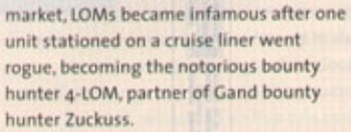

## scan p.51 (scan page 51)

Page contents: 672 words, 45 paragraphs | headings/entries: Unspent Skill Points: 26; Cost: 10,000 credits (used); Unspent Skill Points: 22; Feats: Skill Emphasis (Profession: law officer); Cost: 10,000 credits (used); Stw-Deceree Deoins; Jo Worker Drone; Int 16, Wis :0, Chag; Unspent Skill Points; 16; Feats: Skill Emphasis (Diplomacy); Cost: 1,200 credits; J8 Worker Drone

## scan p.52 (scan page 52)

Page contents: 502 words, 21 paragraphs | headings/entries: GALAXY'S MOST WANTED; MR,X; C-3PX: AssassinDroid; SB vo.uMme | NUMBER B; After a series of unsuccessful scams,

- **C-3PX; Darth Maul** — entry/section: Star Wars Gamer 03: "Maul defeated the Bartokks and demolished their fortress, but was unable to retrieve C-3PX before doing so." Source: *Star Wars Gamer 03* (SWRPG d20), scan p.52
  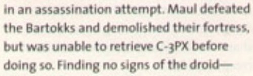
- **C-3PX; Darth Maul** — entry/section: Galaxy's Most Wanted: C-3PX: "Maul modified C-3PX to be a security droid for his Sith infiltrator, modifications included improved sensors, increased strength, and 83 different weapons" Source: *Star Wars Gamer 03* (SWRPG d20), scan p.52
  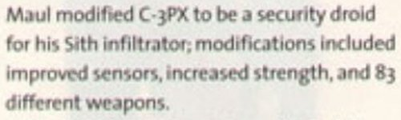
- **C-3PX; Olag Greck** — entry/section: Galaxy's Most Wanted: C-3PX: "in a short time C-3PX was wildly successful, Every job went off without a hitch" Source: *Star Wars Gamer 03* (SWRPG d20), scan p.52
  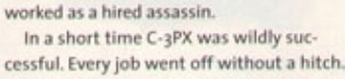
- **C-3PX**: "Once C-3PX learned of Olag's misfortunes, it realized it was finally free. tt overpowered its new master, quietly slipped out of the Kalarba system, and head for the Outer Rim." Source: *Star Wars Gamer 03* (SWRPG d20), scan p.52
  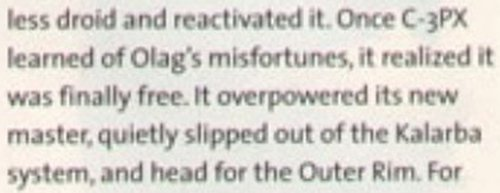

## scan p.53 (scan page 53)

Page contents: 329 words, 10 paragraphs | headings/entries: Unspent Skill Points: o; STAR WARS GAMER 5B

### Stat block notes (game mechanics, not feats)

- C-3PX: Walking Assassin Droid, Scn 6/Sol 2; Def 20; VP/WP 50/15; Atk +9/+4 melee or ranged (3d8 heavy blaster pistol); two concealed blaster pistols, concealed heavy blaster pistol, vibrodagger; sneak attack +2d6; Str 16 Dex 16 Con 15 Int 14 (Source: *Star Wars Gamer 03* (SWRPG d20), scan p.53)

## scan p.54 (scan page 54)

Page contents: 602 words, 9 paragraphs | headings/entries: BY JD WIKi ILLUSTRATED BY VINOD RAA; Grand Admiral Thrawn; TALON KARRDE, SMUGGLER

- **Talon Karrde; Grand Admiral Thrawn** — entry/section: Smugglers' Alliance: "When Karrde learned that Thrawn was after the long-lost Katana fleet (Old Republic dreadnaughts that Karrde had himself discovered some fifteen years before) he elected to sell their location to the New Republic instead," Source: *Star Wars Gamer 03* (SWRPG d20), scan p.54
  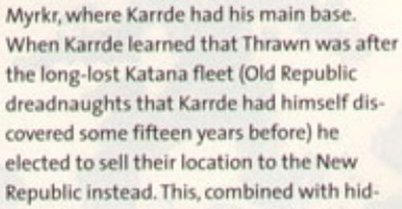
- **Talon Karrde** — entry/section: Smugglers' Alliance: "Over the years Talon Karrde's organization has grown to include well over 800 operatives and almost two dozen ships," Source: *Star Wars Gamer 03* (SWRPG d20), scan p.54
  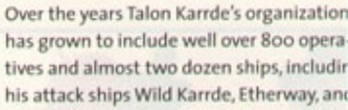

## scan p.55 (scan page 55)

Page contents: 998 words, 37 paragraphs | headings/entries: A distinguished, dark-haired man of mid-; STURM AND DRANG,; Kaneve's Pet VORNSKRS; Vornsxes (2): Jungle predator 8; Init +3; AVES, SMUGGLER

- **Talon Karrde** — entry/section: Smugglers' Alliance: "Karrde will deal in almost anything— especially information, the only cargo with no storage overhead—but he draws the line at slavery and kidnapping." Source: *Star Wars Gamer 03* (SWRPG d20), scan p.55
  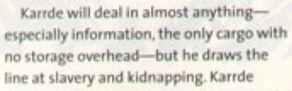

### Stat block notes (game mechanics, not feats)

- Talon Karrde: Male Human Scoundrel 8/Noble 2/Crimelord 5; Def 25; VP/WP 90/14; Bluff +23, Diplomacy +30, Gather Information +23; Fame, Iron Will, Trustworthy; ships Wild Karrde, Etherway, Starry Ice, yacht Uwana Buyer; Challenge Code G (Source: *Star Wars Gamer 03* (SWRPG d20), scan p.55)
- Sturm and Drang: Karrde's vornskrs: Jungle predator 8; See Force +12; Force-Sensitive, Sense; hunt Jedi and ysalamiri by the Force (Source: *Star Wars Gamer 03* (SWRPG d20), scan p.55)

## scan p.56 (scan page 56)

Page contents: 795 words, 40 paragraphs | headings/entries: Challenge Code C; Ghent, Master Suicen; FYNN Toeve: Male Human Scoundrel 7;; Equipment: Blaster pistol

- **Ghent** — entry/section: Smugglers' Alliance: "Barely more than a teenager, Ghent is one of the galaxy's foremost computer security experts. What he doesn't know about codes, droids, or computer networks probably isn't worth knowing." Source: *Star Wars Gamer 03* (SWRPG d20), scan p.56
  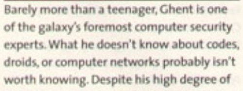

### Stat block notes (game mechanics, not feats)

- Aves: Male Human Expert 8; Knowledge (streetwise) +15, Knowledge (systems) +15, Pilot +10; Challenge Code C (Source: *Star Wars Gamer 03* (SWRPG d20), scan p.56)
- Ghent: Male Human Expert 10; Int 18; Computer Use +22, Disable Device +20, Craft (computer) +17, Repair +16; Challenge Code D (Source: *Star Wars Gamer 03* (SWRPG d20), scan p.56)
- Fynn Torve: Male Human Scoundrel 7; Pilot +17; Etherway pilot; Challenge Code D (Source: *Star Wars Gamer 03* (SWRPG d20), scan p.56)

## scan p.57 (scan page 57)

Page contents: 991 words, 22 paragraphs | headings/entries: MAZZICS GROUP

- **Mazzic** — entry/section: Smugglers' Alliance: "Mazzic has a legendary ability to evade Imperial customs frigates, and avoid the traps they occasionally set for him," Source: *Star Wars Gamer 03* (SWRPG d20), scan p.57
  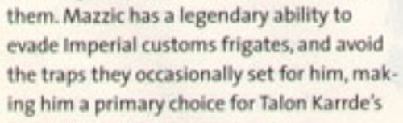
- **Shada D'ukal** — entry/section: Smugglers' Alliance: "If the rumors are true, Shada may be the single most deadly combatant in the smugglers' coalition;" Source: *Star Wars Gamer 03* (SWRPG d20), scan p.57
  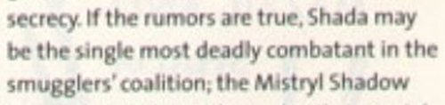
- **Shada D'ukal** — entry/section: Smugglers' Alliance: "The needles are not decorative; Shada uses them in combat, and has been known to hurl them with sufficient force to penetrate even Stormtrooper armor," Source: *Star Wars Gamer 03* (SWRPG d20), scan p.57
  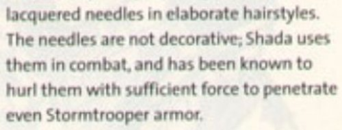
- **Fein; Talon Karrde** — entry/section: Smugglers' Alliance: "Karrde plainly trusts the weapons specialist with his life." Source: *Star Wars Gamer 03* (SWRPG d20), scan p.57
  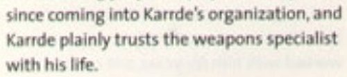

### Stat block notes (game mechanics, not feats)

- Fein: Male Human Fringer 4/Scoundrel 3/Soldier 1; Def 20; VP/WP 64/16; blaster rifle, Far Shot, Point Blank Shot; Challenge Code D (Source: *Star Wars Gamer 03* (SWRPG d20), scan p.57)
- Mazzic: Male Human Scoundrel 9/Noble 2/Crimelord 2; Def 24; VP/WP 73/14; Pilot +21, Repair +20; Challenge Code F (Source: *Star Wars Gamer 03* (SWRPG d20), scan p.57)

## scan p.58 (scan page 58)

Page contents: 690 words, 37 paragraphs | headings/entries: Smusslkers Alfzince; Code D; MAZZIC AND; GY VoCueer men; GILLESPEES CREW; BILLEY'S GROUP

### Stat block notes (game mechanics, not feats)

- Shada D'ukal: Female Human Scout 7; 15 zenji needles; Martial Arts, Spring Attack, Mobility, uncanny dodge; Challenge Code D (Source: *Star Wars Gamer 03* (SWRPG d20), scan p.58)
- Samuel Tomas Gillespee: Male Human Expert 6; Profession (merchant) +13; 20 freighters, Kern's Pride; Challenge Code C (Source: *Star Wars Gamer 03* (SWRPG d20), scan p.58)

## scan p.59 (scan page 59)

Page contents: 851 words, 26 paragraphs | headings/entries: Brey, SMUGGLER LEGEND; Equipment: Wheeled chair, comlink, datapad; Weapon Group Proficiency WS Ss; PAR'TAH

- **Billey** — entry/section: Smugglers' Alliance: "The aging Billey is a legend among smugglers. His career started some six decades ago," Source: *Star Wars Gamer 03* (SWRPG d20), scan p.59
  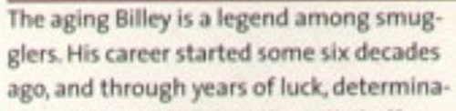

### Stat block notes (game mechanics, not feats)

- Billey: Male Human Noble 6/Scoundrel 3; VP/WP 26/8; Diplomacy +17, Intimidate +18, Knowledge (streetwise) +16; Challenge Code C (Source: *Star Wars Gamer 03* (SWRPG d20), scan p.59)
- Par'tah: Female Ho'Din Scoundrel 4/Fringer 3; Pilot +15, Repair +14; Challenge Code C (Source: *Star Wars Gamer 03* (SWRPG d20), scan p.59)

## scan p.60 (scan page 60)

Page contents: 800 words, 29 paragraphs | headings/entries: Extor, DuRO SMUGGLER; E.tor: Male Duro Diplomat 3/Expert 3; Init; Dravis, YOUNG SMUGGLER; Dravis: Male Human Scoundrel! 4; Init +2; VP/WP 28/14; Atk +5 melee (1é3+2, punch),

- **Ellor; Talon Karrde** — entry/section: Smugglers' Alliance: "Ambushed by an Interdictor cruiser—and facing a death penalty for smuggling spice—Karrde and Ellor desperately outmaneuvered the Interdictor until they made hyperspace." Source: *Star Wars Gamer 03* (SWRPG d20), scan p.60
  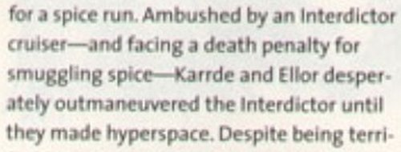
- **Brasck** — entry/section: Smugglers' Alliance: "the fact remains that Brasck is one of the most heartless and ruthless individuals in the smuggling business." Source: *Star Wars Gamer 03* (SWRPG d20), scan p.60
  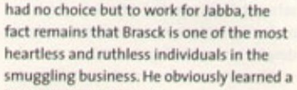

### Stat block notes (game mechanics, not feats)

- Ellor: Male Duro Diplomat 3/Expert 3; Profession (merchant) +14; Challenge Code B (Source: *Star Wars Gamer 03* (SWRPG d20), scan p.60)
- Dravis: Male Human Scoundrel 4; Pilot +14; ex-Imperial Academy pilot; Challenge Code C (Source: *Star Wars Gamer 03* (SWRPG d20), scan p.60)
