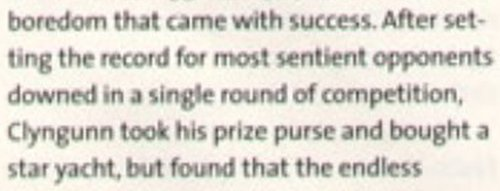
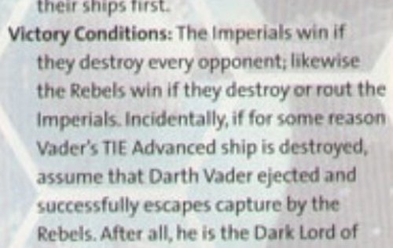
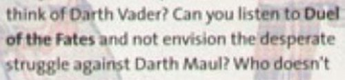
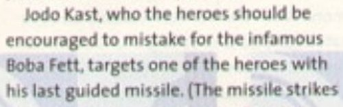
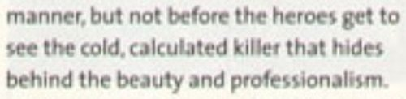
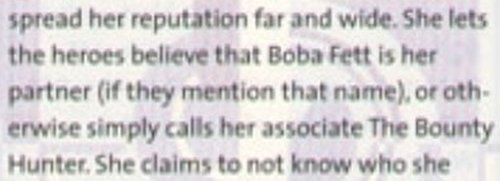
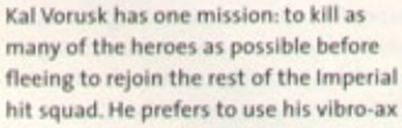

# Owner Material 037 — Star Wars D20 Drive folder (Core, Revised Core and Saga Edition): Star Wars Gamer/Star Wars Gamer 03.pdf [Star Wars Roleplaying Game (d20, 2000)] (scan pages 61–104)

- **Source:** Wizards of the Coast Star Wars Roleplaying Game books, web enhancements, Living Force campaign modules and articles (2000–2010), from the owner's "Star Wars D20" Drive folder (only the three edition subfolders; "General" was not read, as instructed). Secondary source (licensed Legends reference). Scan OCR'd on the box; the scan stays box-only and is **not** published.
- **Method:** every scanned page was OCR'd and machine-screened sentence by sentence for power-relevant statements (fights, kills, defeats, Force feats, rankings, superweapons) that name a character on our roster; each kept sentence is quoted verbatim from the OCR text and has a crop of the printed passage directly under it. Pages with nothing power-relevant are still listed with what is on them.
- **Citation:** "*Star Wars Gamer 03* (SWRPG d20), p.X" by printed page ("scan p.X" where no printed number applies). **Weight:** Licensed RPG material: a secondary source. Narrative text sums up Legends lore; game statistics are rules for players, not canon power levels, and rank lowest.

## scan p.61 (scan page 61)

Page contents: 783 words, 25 paragraphs | headings/entries: CLYNGUNN, ZEHETHBRA SMUGGLER; Deere. SPecias Aires:; Stinging Spray; Nices Ferrier, Suir PALMER; CLYNGUNN

- **Clyngunn** — entry/section: Smugglers' Alliance: "After setting the record for most sentient opponents downed in a single round of competition, Clyngunn took his prize purse and bought a star yacht," Source: *Star Wars Gamer 03* (SWRPG d20), scan p.61
  

### Stat block notes (game mechanics, not feats)

- Brasck: Male Brubb Scoundrel 4/Soldier 4; VP/WP 70/18; Str 18 Con 18; Martial Artist, Great Fortitude; Challenge Code D (Source: *Star Wars Gamer 03* (SWRPG d20), scan p.61)
- Clyngunn: Male ZeHethbra Soldier 5/Scoundrel 2/Noble 2; VP/WP 82/17; Martial Arts, stinging spray; Challenge Code E (Source: *Star Wars Gamer 03* (SWRPG d20), scan p.61)

## scan p.62 (scan page 62)

Page contents: 670 words, 27 paragraphs | headings/entries: Ultimately, though, his own overbearing; THE WRAITH; FERRIER AND THE WRAITH; The atmospheric con

### Stat block notes (game mechanics, not feats)

- Niles Ferrier: Male Human Scoundrel 7; VP/WP 45/14; Bluff +14, Disable Device +17; Challenge Code D (Source: *Star Wars Gamer 03* (SWRPG d20), scan p.62)
- The Wraith (Ferrier's Defel): Male Defel Fringer 4; Hide +15; darkvision, invisibility in low light; Challenge Code C (Source: *Star Wars Gamer 03* (SWRPG d20), scan p.62)

## scan p.63 (scan page 63)

Page contents: Star Wars Silent Death snub-fighter game rules (Erik Dewey), Rebellion-era ship displays (hand-read)

## scan p.64 (scan page 64)

Page contents: 872 words, 37 paragraphs | headings/entries: Rance IO; WEAPONS; Silent bu; STAR WARS Gamer 71

## scan p.65 (scan page 65)

Page contents: 782 words, 54 paragraphs | headings/entries: WARHEADS; Fwarmnple: The ¥Y-Wing ton; W; Eliminate a weapon system of the; There are two types of weapons: Cannon

## scan p.66 (scan page 66)

Page contents: 933 words, 41 paragraphs | headings/entries: Warhead Results Phase; Ships expend movement points to enter; Gamer 73; GTAR WARS

## scan p.67 (scan page 67)

Page contents: 402 words, 18 paragraphs | headings/entries: 

## scan p.68 (scan page 68)

Page contents: 254 words, 7 paragraphs | headings/entries: STAR WARS GAMER 75

## scan p.69 (scan page 69)

Page contents: 905 words, 37 paragraphs | headings/entries: Successful damage control restores the; Drive 0 Turns; DESTROYED SHiP Dears; Low attack; SIDESLIPS; Sideslip

## scan p.70 (scan page 70)

Page contents: Silent Death scenarios incl. 'Dark Lord of the Sith' (Dantooine): Vader's TIE Advanced — if destroyed assume Vader ejects and escapes (hand-read)

- **Darth Vader (Anakin Skywalker)**: "Victory Conditions: The imperials win if they destroy every opponent; likewise the Rebels win if they destroy or rout the imperials. incidentally, if for some reason Vader's TIE Advanced ship is destroyed, assume that Darth Vader ejected and successfully escapes capture by the Rebels." Source: *Star Wars Gamer 03* (SWRPG d20), scan p.70
  

## scan p.71 (scan page 71)

Page contents: 550 words, 15 paragraphs | headings/entries: VOLUME | NUMO@user 9; Carica Hits

## scan p.72 (scan page 72)

Page contents: 323 words, 35 paragraphs | headings/entries: Low+! or; Low+43; Rance: 3/9/10; DAMAGE; REDUCTION:; PROTON TorPEeDots:; Low+! j; Rance: 3/9/10 /; RAnGt: 2/5/9 vue ee \, Tiomt; Dam Con: 1-4 JAMMER: 1-2; DAMAGE; REDUCTION:; PROTON TORPEDOES:; Dam Con: 1-4 Jammer: 1-2; Critical Hits; Critical Hite

## scan p.73 (scan page 73)

Page contents: 310 words, 34 paragraphs | headings/entries: Rance: 3/9/10; Derensive VALUE: ob] /; Damact; REDUCTION:; CONCUSSION MUESssiLes:; OOOO; Dam Con: 1-2; DeFEensive VALUE: "4; CS Ticwt \ Turn Cost:; Jammer: 1-2; Damact; REDUCTION:; Pilot Weapon:; Rance: 2/6/10; Dam Con: 1-2 Jammer: 1-2; Critical Hits

## scan p.74 (scan page 74)

Page contents: 291 words, 15 paragraphs | headings/entries: Critical Hite; Low or 15 208+ +1 (x2) iene; Low+1 or 208+ +3 Controls unresponsive. Reduce; Low+3 DV by 2; Damage Control

## scan p.75 (scan page 75)

Page contents: 258 words, 19 paragraphs | headings/entries: LASER Cannon (F) 2D8+; Low 2 RANGE: 3/9/10; DEereNnsive DAMAGE; Damage Track; Twin Laser; CANNON (F) h 208+ (x2); Low or 16 3; Low-+t; Rance; 3/9/10; DEFEensive DAMAGE; VALUE: REDUCTION:; VALUE: REDUCTION:; Criticel Hits

## scan p.76 (scan page 76)

Page contents: 0 words, 0 paragraphs | headings/entries: 

## scan p.77 (scan page 77)

Page contents: 'The Force of Music' — scoring a game session with SW soundtracks (Peter Schweighofer) (hand-read)

- **Darth Maul**: "Can you listen to Duel Of the Fates and not envision the desperate struggle against Darth Maul?" Source: *Star Wars Gamer 03* (SWRPG d20), scan p.77
  

## scan p.78 (scan page 78)

Page contents: 927 words, 78 paragraphs | headings/entries: Fast Tracks; ALIEN ENCOUNTERS; Aliens are common elements iin Stake Wars; BLASTER FiGHTs AND GROUND BarTies; My Yoda Y-Y-Y-¥-Yoda; CANTINA VisiT; The heroes mingle with exotic cantina; Return of the Jedi soundtracks; CHASES; ENEMY ENTANGLEMENTS; FANTASTIC VISTAS; The Empire Strikes Back, and Return; STAR WARS GAMER 8G&

## scan p.79 (scan page 79)

Page contents: 648 words, 48 paragraphs | headings/entries: THE FORCE OF Music; JE0t CONFRONTATION; Use this music's slicing strings, curt; Menoce, track) ys aa; CELEBRATION Music; When the heroes are rewarded for their; Other Soundtracks

## scan p.80 (scan page 80)

Page contents: 764 words, 38 paragraphs | headings/entries: Stake Waes soundtrack play itself out in; Sample Soundtrack Notes; Explore strange jungie, encounter i puny; Planet Core (The Phantom Menace,; Se Wares exciting. &

## scan p.81 (scan page 81)

Page contents: 586 words, 25 paragraphs | headings/entries: BB VOLUME! NUMBER 3; BY Bill; GETTING STRATED; BACKGROUND This adventure takes place sometime; SLAVICSEK « ILLUSTRATED BY MIKE VILARDI

## scan p.82 (scan page 82)

Page contents: Cloud Cover adventure (Bill Slavicsek): ISB Captain Govin Thane's hit squad (Zardra, Jodo Kast) hunts Rebel refugees on Cloud City between ESB and RotJ; Silver Fur (Bothan Garul) killed by Kast's missile; Tereez Tey'flah; slicer Spensor Kluub (hand-read)

## scan p.83 (scan page 83)

Page contents: 758 words, 35 paragraphs | headings/entries: THe ATTACK ON Sitver Fur; Have the heroes make initiative checks

## scan p.84 (scan page 84)

Page contents: 896 words, 39 paragraphs | headings/entries: Wrappinc Up tHe SCENE; Jodo Kast, Bounty Hunter; Feats: Armor Proficiency (light, medium,; Toughness, Track, Weapon Group Profi-; I; Zardra, foumty Henter; Feats: Armor Proficiency (light, medium),; Heroic Surge, Power Attack, Track,; Weapon Finesse (force pike), Weapon; Group Proficiency (blaster pistols,

- **Jodo Kast; Boba Fett** — entry/section: Cloud Cover: "Jodo Kast, who the heroes should be encouraged to mistake for the infamous Boba Fett, targets one of the heroes with his last guided missile," Source: *Star Wars Gamer 03* (SWRPG d20), scan p.84
  

### Stat block notes (game mechanics, not feats)

- Jodo Kast: Male Human Sol 6/BH 2; Def 20; VP/WP 62/16; Atk +12/+7 ranged (3d8 blaster rifle); missile launcher, jetpack, modified battle armor; Improved Initiative, Far Shot, Heroic Surge (Source: *Star Wars Gamer 03* (SWRPG d20), scan p.84)
- Zardra: Female Human Sct 4/Sol 2; Def 17; VP/WP 38/11; force pike +8 (2d8+2); Weapon Finesse (force pike), Power Attack, Tumble +7 (Source: *Star Wars Gamer 03* (SWRPG d20), scan p.84)

## scan p.85 (scan page 85)

Page contents: 1121 words, 17 paragraphs | headings/entries: Scene 2: Doing Some Leqwork

- **Zardra** — entry/section: Cloud Cover: "the heroes get to see the cold, calculated killer that hides behind the beauty and professionalism" Source: *Star Wars Gamer 03* (SWRPG d20), scan p.85
  
- **Zardra; Boba Fett** — entry/section: Cloud Cover: "She lets the heroes believe that Boba Fett is her partner (if they mention that name), or otherwise simply calls her associate The Bounty Hunter." Source: *Star Wars Gamer 03* (SWRPG d20), scan p.85
  

## scan p.86 (scan page 86)

Page contents: 1133 words, 23 paragraphs | headings/entries: Te Zero-G Ciue; LOCATING THE IMPERIALS

## scan p.87 (scan page 87)

Page contents: 1016 words, 23 paragraphs | headings/entries: The battle ends when both speeders; Justar Faerral, trooper Sergemt 1; MEETING With CarD CarToR; When the heroes meet Card Captor and

### Stat block notes (game mechanics, not feats)

- Justor Ferral (scout trooper sergeant): Male Human Thug 6/Sol 4; Def 21; VP/WP 40/17; Pilot +13; repulsorlift battle disk (Source: *Star Wars Gamer 03* (SWRPG d20), scan p.87)

## scan p.88 (scan page 88)

Page contents: Cloud Cover: Card Captor (Sullustan sabacc dealer) leads Cloud City Rebel cell >2 years; Doc Drase clinic; OX-2K2 ancient war droid with Thane (hand-read)

## scan p.89 (scan page 89)

Page contents: 674 words, 21 paragraphs | headings/entries: Kal Vorusk, Medme; Outcome

- **Kal Vorusk; Govin Thane** — entry/section: Cloud Cover: "Kal Vorusk has one mission: to kill as many of the heroes as possible before fleeing to rejoin the rest of the imperial hit squad." Source: *Star Wars Gamer 03* (SWRPG d20), scan p.89
  

### Stat block notes (game mechanics, not feats)

- Kal Vorusk: Male Human Sct 8; Def 19; VP/WP 62/18; vibro-ax +11/+6 (2d10+5); Str 20; Martial Artist, Power Attack (Source: *Star Wars Gamer 03* (SWRPG d20), scan p.89)

## scan p.90 (scan page 90)

Page contents: 784 words, 28 paragraphs | headings/entries: THE FLOATING PLATFOAMS; Device (DC 20) check; STAR WARS GAMER 87

## scan p.91 (scan page 91)

Page contents: 1058 words, 27 paragraphs | headings/entries: ACT Hi: ESCAPE FROM CLOUD CITY; Scene t face to the Cargo Bay; STEPPING INTO THE CLOUDS

## scan p.92 (scan page 92)

Page contents: 937 words, 47 paragraphs | headings/entries: OUTCOME; Gavin Thana. SH Agent; Feats: Heroic Surge, Point Blank Shot,; Skill Emphasis (Pilot), Skill Emphasis; Proficiency (blaster pistols, simple; Once the heroes and the refugees get; OX-2K 2. Wer Droid; VPYWP 71/06; Atk 410/45 melee (2d10+3,

### Stat block notes (game mechanics, not feats)

- Govin Thane (ISB agent): Male Human Scoundrel 8; Def 21; VP/WP 41/15; DSP 13; heavy blaster pistol +9/+4 (3d8); sneak attack +2d6; Pilot +10 (Source: *Star Wars Gamer 03* (SWRPG d20), scan p.92)
- OX-2K2 (war droid): Walking War Droid Sol 7; Def 20; two heavy repeating blasters +8/+3 (4d8), retractable vibro-ax; Cleave, Rapid Shot (Source: *Star Wars Gamer 03* (SWRPG d20), scan p.92)

## scan p.93 (scan page 93)

Page contents: The Shaft CCG deck (Cory Herndon): Jawas of Doom deck, Wittin; inspired by Marvel 'Jawas of Doom' (Fett escapes Sarlacc, amnesia, mistaken for droid by Jawas) (hand-read)

## scan p.94 (scan page 94)

Page contents: 570 words, 26 paragraphs | headings/entries: ABYSSIN ORNAMENT &; Wouwnoto Wooxitt; Mmmm, Reflections tI. This; Jawas of Doom; Jabba and ali his buddies I

## scan p.95 (scan page 95)

Page contents: CCG strategy: 'Disorder in the Court' Court of the Vile Gangster deck (Michael Mikaelian) (hand-read)

## scan p.96 (scan page 96)

Page contents: 822 words, 25 paragraphs | headings/entries: VOLUME |. NUMBER 2; It's ienportant that you

## scan p.97 (scan page 97)

Page contents: Star Wars: Battleground RTS preview (Haden Blackman / Garry Gaber): campaigns follow Attichitcuk, Leia, Vader Yavin->Hoth, OOM-9; EU heroes Mara Jade, Aurra Sing, Vilmarh Grahrk (hand-read)

## scan p.98 (scan page 98)

Page contents: 757 words, 26 paragraphs | headings/entries: STAR WARS: Battleground Field Reports; Force Commander II?; STAR WARS Gamer 107

## scan p.99 (scan page 99)

Page contents: Demolition cheat codes; Battle for Naboo gunboat RPG stats and N64 codes (hand-read)

## scan p.100 (scan page 100)

Page contents: 567 words, 45 paragraphs | headings/entries: Trade Federation Gunboat; Craft: Trade Federation; Gunbdoat Water; Cost: $18,000; Class: $9,000 Large; Normal; Passengers: 3 Cargo Capacity: 40 kilograms Speed:; Altitude:; Defense Hull Points DR; Weapon: Heavy Laser cannon; Fire Arc: Turret; Attack Bonus: +3; Damage: 5010; Range: 200m ene Weapom Energy bors; Fire Arc Rear - Attack Bonus: +3; Dam mage: com; Range: 50m; Vm = a=; N64 Secrets: Battle for Naboo N64 Codes; STAR WARS GAMER

## scan p.101 (scan page 101)

Page contents: Star Wars Galaxies update and concept art interview (Arnie Jorgensen): Shayl Le'tah Bothan Jedi investigator, Nogget Mon Cal, Twi'lek noble stat blocks (hand-read)

## scan p.102 (scan page 102)

Page contents: 818 words, 31 paragraphs | headings/entries: AJ: Yes; School of Graphic Art and Animation for; America and became a little more; The March To Victory; Battle for Naboo on PC:; STAR WARS Gaver

## scan p.103 (scan page 103)

Page contents: 777 words, 36 paragraphs | headings/entries: Also there's a real sense; A "A male Mon Calamari. We're try-

## scan p.104 (scan page 104)

Page contents: 772 words, 14 paragraphs | headings/entries: 

### Stat block notes (game mechanics, not feats)

- Krayt dragon (SWG concept art): desert predator 8; Def 8; VP/WP 150/320; claw +17 (2d8+15), bite +12 (4d6+16); Str 44, Con 40; SZ Colossal; Challenge Code G (Source: *Star Wars Gamer 03* (SWRPG d20), scan p.104)
