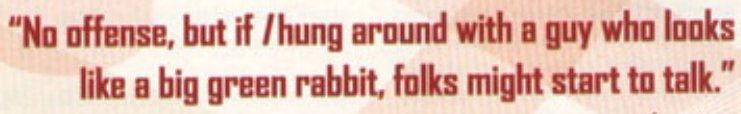
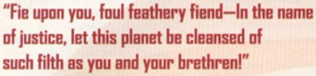
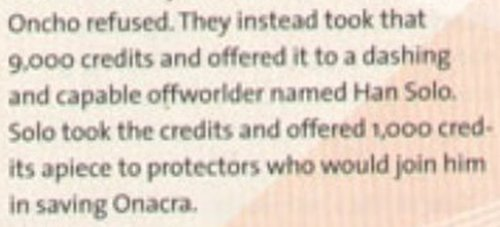
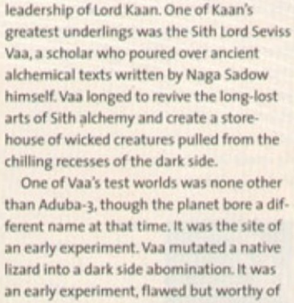
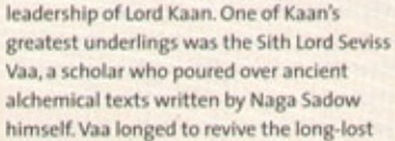
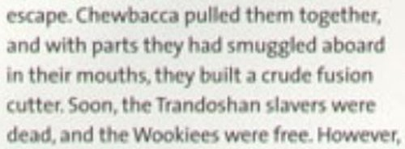

# Owner Material 037 — Star Wars D20 Drive folder (Core, Revised Core and Saga Edition): Star Wars Gamer/Star Wars Gamer 04.pdf [Star Wars Roleplaying Game (d20, 2000)] (scan pages 1–60)

- **Source:** Wizards of the Coast Star Wars Roleplaying Game books, web enhancements, Living Force campaign modules and articles (2000–2010), from the owner's "Star Wars D20" Drive folder (only the three edition subfolders; "General" was not read, as instructed). Secondary source (licensed Legends reference). Scan OCR'd on the box; the scan stays box-only and is **not** published.
- **Method:** every scanned page was OCR'd and machine-screened sentence by sentence for power-relevant statements (fights, kills, defeats, Force feats, rankings, superweapons) that name a character on our roster; each kept sentence is quoted verbatim from the OCR text and has a crop of the printed passage directly under it. Pages with nothing power-relevant are still listed with what is on them.
- **Citation:** "*Star Wars Gamer 04* (SWRPG d20), p.X" by printed page ("scan p.X" where no printed number applies). **Weight:** Licensed RPG material: a secondary source. Narrative text sums up Legends lore; game statistics are rules for players, not canon power levels, and rank lowest.

## scan p.1 (scan page 1)

Page contents: 44 words, 8 paragraphs | headings/entries: 

## scan p.2 (scan page 2)

Page contents: 13 words, 2 paragraphs | headings/entries: 

## scan p.3 (scan page 3)

Page contents: 445 words, 73 paragraphs | headings/entries: THE Force In STAR WARS GAMING; CONTENTS:; Fiction; DEEP SPOILERS ey avotr WINDY; Special Features; WILDLIFE OF STAR Wars; SY TERETE WHITLATCH AND 808 CARPAY; RPG Articles; STARHOPPERS OF AnUBA-3 SY PABLO WIOALCO; Outer fom dunttedl known at Auta a; STARFARING JUNGLES Oy Pree SChrWwrIGNOVIT®; Ont with Tre THE GAMING; Force Univeese; TECHNICAL; Speciat Ops: THE SHAMAN OY MSSt OECATE; University oF Sansra Guide To; RPG Adventure; KASHYYYK IN FLAMES ev sp wiete; Deck Plans; REFLECTIONS ISLAND er CORY 1 WIRNDOOW; Ih cormtened with a; Hewnian vacation; SMALL WorRio SY MACMALL AM ATLIAN; State of the Arts; Departments; Autn A.reenarte Ho@user DIMENSIONS

## scan p.4 (scan page 4)

Page contents: Editorial: Jaxxon (Marvel's green Lepus carnivorous rabbit) and Hoojibs; Lucas Licensing introduces 'Infinities' concept (official but not canonical) (hand-read)

## scan p.5 (scan page 5)

Page contents: 570 words, 23 paragraphs | headings/entries: Distributon Solution; We've Come Far!; But Issue #1 Will Be With Us; Craig C. Atkins Hastings, East Sussex, England

## scan p.6 (scan page 6)

Page contents: 889 words, 35 paragraphs | headings/entries: Mike Moran; Fayetteville, NC; The Last Issue #1 Letter; T p; A Font of Information; Eric Clark Via internet; Get 'Em Early; STAR WARS GAMER @

## scan p.7 (scan page 7)

Page contents: 668 words, 34 paragraphs | headings/entries: Seth Harris Monroe, LA; Imperial Dispatch: Game Errata; Page 22, Table 1-3:; Page 212, left column, under Class Fea-; Page 226, under Qui-Gon Jinn; Page 249, under Ewok Commoner entry,

### Stat block notes (game mechanics, not feats)

- Darth Sidious (RPG core errata): should have 32 Dark Side Points and 9 Force Points (not 2); Sebulba Great Shout bellow heard over 3,600 m; Luke Skywalker Will save +9 (Source: *Star Wars Gamer 04* (SWRPG d20), scan p.7)

## scan p.8 (scan page 8)

Page contents: 891 words, 31 paragraphs | headings/entries: HOLONET TRANSMISSION; Answers To Your; Star Wars RPG Dilemmas; BY JD WIKER

## scan p.9 (scan page 9)

Page contents: 1014 words, 19 paragraphs | headings/entries: Get rules questions?; Send ther ta

## scan p.10 (scan page 10)

Page contents: 101 words, 10 paragraphs | headings/entries: O13: Tree-Huggers; ILLUSTRATED BY DAN VEESENMEYVER

## scan p.11 (scan page 11)

Page contents: 11 words, 5 paragraphs | headings/entries: W!; Deep Spoilers; By RyvDER WINDHAM; ILLUSTRATED BY OLE S@user

## scan p.12 (scan page 12)

Page contents: 1000 words, 14 paragraphs | headings/entries: Kawa-BONGO Dude!; STAR WARS GAMER 17

## scan p.13 (scan page 13)

Page contents: 1013 words, 22 paragraphs | headings/entries: Tourists,

## scan p.14 (scan page 14)

Page contents: 953 words, 21 paragraphs | headings/entries: STAR WARS GAMER 19

## scan p.15 (scan page 15)

Page contents: Deep Spoilers (Ryder Windham fiction): Gungan bongo racers Spleed Nukkels and Neb Neb Goodrow; Major Fassa is Boss Nass's niece; Captain Tarpals is uneasy about off-world tourists in Otoh Gunga after the Battle of Naboo (hand-read)

## scan p.16 (scan page 16)

Page contents: 937 words, 29 paragraphs | headings/entries: With some satisfaction, they; STAR WARS GAMER 21

## scan p.17 (scan page 17)

Page contents: 993 words, 32 paragraphs | headings/entries: Neb Neb headed straight for it,

## scan p.18 (scan page 18)

Page contents: Deep Spoilers: Boss Nass's racing bongo uses the engine of his old heyblibber (wrecked by Jar Jar); Squidfella Quiglee steals a militia bongo, torpedoes Lob Dizz's lab and is banned; Monobubble Racing Bongo stats (hand-read)

## scan p.19 (scan page 19)

Page contents: 'What They Called Me' comic (Craig Thompson / Dave Land): a smug tourist 'civilizes' the Ewoks and patronizes Wookiees; Wookiee rite of passage of harvesting syren plant strands; ryyk blade passed down seven generations (hand-read)

## scan p.20 (scan page 20)

Page contents: 82 words, 8 paragraphs | headings/entries: 

## scan p.21 (scan page 21)

Page contents: 96 words, 10 paragraphs | headings/entries: La ~ s «tr iss; THE WONDER AND MAJESTY; OF (TS VIRGIN ¥ MH FORESTLAND, |

## scan p.22 (scan page 22)

Page contents: 72 words, 8 paragraphs | headings/entries: Pn wh NO /; INFINITELY WISE AND & RESPECTED, "A

## scan p.23 (scan page 23)

Page contents: 133 words, 16 paragraphs | headings/entries: SO WHATS THIS WE'RE ABOUT; THATS WHY iM HERE, ON THE JUNGLE; PLANET OF; XACHIBIK BROTH

## scan p.24 (scan page 24)

Page contents: 174 words, 12 paragraphs | headings/entries: WHAT ("mM '; SS; BO! vite 1 tatmmen >

## scan p.25 (scan page 25)

Page contents: 126 words, 16 paragraphs | headings/entries: DO / BECOME PART OF Silky Strandsé; SYREN PLANT."; Pt. Stee; J; THIS TRADITION MAKES ABSOLUTELY

## scan p.26 (scan page 26)

Page contents: 122 words, 11 paragraphs | headings/entries: TRANS JATE; Your presence iS YOURE; PAINFUL to our, MALFUNCTIONING/

## scan p.27 (scan page 27)

Page contents: Wildlife of Star Wars preview (Terryl Whitlatch / Bob Carrau): cupas, voorpaks (Naboo noblewomen's pets), narglatch, condor dragons (snatch Ewoks), Ewok ponies; a large black equine breed is ridden by the Dathomir witches (hand-read)

## scan p.28 (scan page 28)

Page contents: 65 words, 12 paragraphs | headings/entries: Tough hide covered with sparse, smooth hair; Thick foot pads broaden on impect; BM VOLUME |. NUMBER 4

## scan p.29 (scan page 29)

Page contents: 68 words, 6 paragraphs | headings/entries: Tatooine; STAR WARS Gamen 35

## scan p.30 (scan page 30)

Page contents: 109 words, 14 paragraphs | headings/entries: Lerge eyes for; SVaboo

## scan p.31 (scan page 31)

Page contents: 62 words, 9 paragraphs | headings/entries: Frightened voorpak; WNVabee queen; STAR WARS GAMER 37

## scan p.32 (scan page 32)

Page contents: 74 words, 9 paragraphs | headings/entries: NAQRGLATCH; SVeonretractable

## scan p.33 (scan page 33)

Page contents: 60 words, 10 paragraphs | headings/entries: St; Since young can hunt; Cubs hunt together until maturity, making; Female cub WMViale cub

## scan p.34 (scan page 34)

Page contents: 89 words, 11 paragraphs | headings/entries: Pram CONDORSDRAGONS ff =

## scan p.35 (scan page 35)

Page contents: 121 words, 9 paragraphs | headings/entries: Two adults fighting over hapless Ewok

## scan p.36 (scan page 36)

Page contents: Starhoppers of Aduba-3 (Pablo Hidalgo): Voren Na'al reconstructs Han and Chewbacca's stay on Aduba-3 after Crimson Jack (Marvel); TriNebula holo-doc; Tenloss Syndicate's chromium-salting scam; Verpine priest Pera; high-hound stats; the Cloud Riders under Serji-X Arrogantus (hand-read)

## scan p.37 (scan page 37)

Page contents: 891 words, 28 paragraphs | headings/entries: The Jaxxon Five; Pius Three; Aduba-3; Star; Length if Day Lengtn of Year; Sapient Spec es: |; Maj; Orbital Bodies Name; A human bartender sits behind the; STAR WARS GAMER "3B

## scan p.38 (scan page 38)

Page contents: 1026 words, 32 paragraphs | headings/entries: Researcher's Notes; Sg into the local Swoce; MY VOLUME | NUMBER 4; Skills: Spot +8, Survival +6; Feats: Flyby Attack, Track

### Stat block notes (game mechanics, not feats)

- Serji-X Arrogantus: Male Human Frg 3/Scn 3; Def 19; VP/WP 23/12; DSP 5; Pilot +14; ex-Caprioril swoop jockey ('the Arrogant One'), leader of the Cloud Riders; killed at Onacra, trampled by a mysterious creature (Source: *Star Wars Gamer 04* (SWRPG d20), scan p.38)

## scan p.39 (scan page 39)

Page contents: 981 words, 33 paragraphs | headings/entries: Warto; Waarrto: Male Boltrunian® Thug 6; Init +0;; Atk +9/+4 melee (1d3+3, punch) or +6/+1; SxysPreoers; Moorrito Agarech Perecrine-340 AlRsPrepER; The Star-Hoppers; STAR WARS GAMER 4S

## scan p.40 (scan page 40)

Page contents: 432 words, 7 paragraphs | headings/entries: What really happened at; Researcher's Notes

## scan p.41 (scan page 41)

Page contents: 895 words, 37 paragraphs | headings/entries: Ranart's Foor; Crart: Modified WUD-so0 star yacht;; Ciass: Starfighter; Cost: not available for; Crew: 1 pilot, 1 gunner (unique); Passen-; Gtes: 7; CARGO CAPACITY: 3 metric tons;; CONSUMABLES: 4 months; HYPERDRIVE: X0.5; MANEUVERS: +2 (+2 size}; Defense: 22 (+2; AMAIZA; STAR WARS GAMER 47

- **Amaiza** — entry/section: Amaiza on Jaxxon: "No offense, but if I hung around with a guy who looks like a big green rabbit, folks might start to talk." Source: *Star Wars Gamer 04* (SWRPG d20), scan p.41
  

### Stat block notes (game mechanics, not feats)

- Jaxxon: Male Lepi Scn 5/Sct 4; Init +4 (Dex); Def 22 (+4 Dex, +8 class}; Spd 10 m; VP/WP 41/10; Atk +10/+5 melee (1d6+2, kick), or +10/+5 ranged (38, 2 heavy blaster pistols); SQ Bonus feats (Alertness, Martial Artist, Weapon Finesse: kick), better lucky than good, feet of fury, illicit barter, sneak attack +206, trallblazing, uncanny dodge (Dex bonus to Def (Source: *Star Wars Gamer 04* (SWRPG d20), scan p.41)
- Jaxxon: Male Lepi Scn 5/Sct 4; Def 22; VP/WP 41/10; kick +10/+5 (1d6+2), two heavy blaster pistols +10/+5 (3d8); feet of fury; Pilot +19; FP 5, Rep 8; ship Rabbit's Foot (modified WUD-500 star yacht, quad lasers 6d10); born on Coachelle Prime, stole a freighter at 12 (Source: *Star Wars Gamer 04* (SWRPG d20), scan p.41)
- Amaiza: Female Human Nbl 2/Scn 6; Def 22; VP/WP 32/10; two blaster pistols +8 (3d6); Bluff +15, Tumble +15; Rep 9; ex-Ord Mantell dancer sold to the Black Hole pirates, shot chief Kayso and led the gang; wanted in six systems (Source: *Star Wars Gamer 04* (SWRPG d20), scan p.41)

## scan p.42 (scan page 42)

Page contents: 516 words, 17 paragraphs | headings/entries: Don-Wan Kihotay, to a high-hound; Heor

- **Don-Wan Kihotay** — entry/section: Don-Wan Kihotay to a high-hound: "Fie upon you, foul feathery fiend—In the name of justice, let this planet be cleansed of such filth as you and your brethren!" Source: *Star Wars Gamer 04* (SWRPG d20), scan p.42
  

### Stat block notes (game mechanics, not feats)

- Don-Wan Kihotay: Hess Korrin, Obroa-skai librarian; Force-sensitive; yellow lightsaber taken from the antiquities wing the ISB destroyed; Knowledge (Jedi lore) +13; Affect Mind +5; died when mercenaries destroyed the Telos-4 medical station (Source: *Star Wars Gamer 04* (SWRPG d20), scan p.42)

## scan p.43 (scan page 43)

Page contents: 888 words, 28 paragraphs | headings/entries: Feats: Alertness, Exotic Weapon (quills),; Weapon Group Proficiency (simple; The Onacra Village; Jim; FE-9Q; STAR WARS GAMER 4S

- **Han Solo**: "They instead took that 9,000 credits and offered it to a dashing and capable offworlder named Han Solo, Solo took the credits and offered 1,000 credits apiece to protectors who would join him in saving Onacra." Source: *Star Wars Gamer 04* (SWRPG d20), scan p.43
  

### Stat block notes (game mechanics, not feats)

- Hedji: Spiner (near-extinct species, homeworld consumed by a supernova); throws quills up to 10 m; refuses to carry a blaster; killed by a creature from the caverns under Onacra (Source: *Star Wars Gamer 04* (SWRPG d20), scan p.43)
- Jimm Doshun (the Starkiller Kid): Human Frg 1; VP/WP 12/12; 16-year-old Onacra farmboy, sling and harvesting knife; married Merri Shen, daughter Hanna; raised by tractor droid FE-9Q (Effie), destroyed fighting the Cloud Riders (Source: *Star Wars Gamer 04* (SWRPG d20), scan p.43)

## scan p.44 (scan page 44)

Page contents: Seviss Vaa (Brotherhood of Darkness) mutated a native lizard on Aduba-3 into a dark side abomination maddened by Jedi lightsabers that fires lightning from its head; left it in suspended animation; Vaa killed at Ruusan; Han Solo defeated it with an appropriated lightsaber (hand-read)

- **Naga Sadow; Lord Kaan** — entry/section: Star Wars Gamer 04: "One of Kaan’s greatest underlings was the Sith Lord Seviss Vaa, a scholar who poured over ancient alchemical texts written by Naga Sadow himself, Vaa longed to revive the long-tost arts of Sith aleherny and create a store house of wicked creatures pulled from the chilling recesses of the dark side One of Vaa's test worlds was none other than Aduba-3, though the planet bore a dif ferent name at that time, It was the site of an early experiment." Source: *Star Wars Gamer 04* (SWRPG d20), scan p.44
  
- **Seviss Vaa; Lord Kaan** — entry/section: Onacra's Secret: Seviss Vaa: "One of Kaan’s greatest underlings was the Sith Lord Seviss Vaa, a scholar who poured over ancient alchemical texts written by Naga Sadow himself." Source: *Star Wars Gamer 04* (SWRPG d20), scan p.44
  

### Stat block notes (game mechanics, not feats)

- Behemoth from Below (Vaa's Sith spawn): Predator 8; Def 16; VP/WP 168/140; punch +23 (1d8+15), energy beam 4d8; Str 40, Con 35; SZ Gargantuan; CL H; always attacks nearest lightsaber wielder, lightsabers ignore DR, on a lightsaber threat it must make a DC 35 Fort save or explode (2d8 within 20 m) (Source: *Star Wars Gamer 04* (SWRPG d20), scan p.44)

## scan p.45 (scan page 45)

Page contents: 456 words, 20 paragraphs | headings/entries: 

## scan p.46 (scan page 46)

Page contents: 885 words, 18 paragraphs | headings/entries: GEOGRAPHY o CLIMATE; THe Wrostve Forests; HISTORY

## scan p.47 (scan page 47)

Page contents: 467 words, 15 paragraphs | headings/entries: THe O.p Repusiic; ABR; Feats: improved initiative

## scan p.48 (scan page 48)

Page contents: 920 words, 19 paragraphs | headings/entries: Tue Rist OF THE Empire; Skills: Climb +n, Usten +6, Survival +8

## scan p.49 (scan page 49)

Page contents: 931 words, 37 paragraphs | headings/entries: Secrets of; KASHYYYK «sic; NEW EQUIPMENT; Kswry Vines; Ryv« Biapes; Wookiee supporters in the Senate; Cost Damact; NUMGER 4; Cermca, RANGtincnement Weicnt Tyee Size Group; Senate was powerless to stop the Emperor; SENATOR YARUA; Yarua is Kashyyyk's main representative to; Senator. A firm supporter of various senate

### Stat block notes (game mechanics, not feats)

- Yarua: Male Wookiee Frg 3/Nbl 10; Def 19; VP/WP 110/18; Diplomacy +16, Intimidate +16; Rep 20; senator for almost 100 years, became family patriarch at 120 (Source: *Star Wars Gamer 04* (SWRPG d20), scan p.49)

## scan p.50 (scan page 50)

Page contents: 757 words, 26 paragraphs | headings/entries: Attack, Trustworthy, Weapon Group Profi; Though Kashyyyk was under

## scan p.51 (scan page 51)

Page contents: 980 words, 41 paragraphs | headings/entries: Secrets of; KATARRA, FREEDOM FIGHTER; Most indigenous Kashyyyk creatures avoid angered gorryls; Feats: Multiattack; SA volume; NiMeden a; Skills: Climb +5, Hide +5, Search +3

- **Chewbacca** — entry/section: Chewbacca frees the slaver ship: "Chewbacca pulled them together, and with parts they had smuggied aboard in their mouths, they built a crude fusion cutter. Soon, the Trandoshan slavers were dead, and the Wookiees were free." Source: *Star Wars Gamer 04* (SWRPG d20), scan p.51
  

### Stat block notes (game mechanics, not feats)

- Katarra: Female Wookiee Sct 3/Nbl 2; VP/WP 40/15; leader of the Kashyyyk resistance under the Empire; carries the bowcaster her father Tarkazza made; traded captured stormtrooper armor to smugglers for arms (Source: *Star Wars Gamer 04* (SWRPG d20), scan p.51)

## scan p.52 (scan page 52)

Page contents: 796 words, 33 paragraphs | headings/entries: LOWBACKA, JEDI STUDENT; Challenge Code: 6; KV; Survival +3

### Stat block notes (game mechanics, not feats)

- Lowbacca: Male Wookiee Frg 1/JG 5; Def 18; lightsaber +9 (3d8+3); FP 4, DSP 1; Battlemind +7, Move Object +5; Deflect Blasters; built his own lightsaber; Chewbacca's nephew (Source: *Star Wars Gamer 04* (SWRPG d20), scan p.52)

## scan p.53 (scan page 53)

Page contents: Secrets of Kashyyyk: the Yuuzhan Vong spared Kashyyyk (NR strategists fear Vong webweavers implanted with surge coral); Wookiees can live over four centuries; kkekkrrg rro (shadow keepers) never attack adult Wookiees (hand-read)

## scan p.54 (scan page 54)

Page contents: 866 words, 37 paragraphs | headings/entries: Netcaster; Skills: Listen +9, Search +1, Survival +5; Feats: Great Fortitude

## scan p.55 (scan page 55)

Page contents: 811 words, 41 paragraphs | headings/entries: Secrets of in old age Wookiees are; KASHYYYK; They remember TIE; Phosflea; NUMBER 4; Survival +5; Skills: Hide +13, Listen +6, Survival +14; Feats: improved initiative, Weapon Focus (bite)

## scan p.56 (scan page 56)

Page contents: Webweaver (wyyyschokk) stats: Forest predator 12, VP/WP 189/128, Str 30, 16 m, webs that stop speeder bikes; syren plant, sureggi, orga root (Life Day; nearly sentient), phosflea (hand-read)

## scan p.57 (scan page 57)

Page contents: Starfaring Jungles (Peter Schweighofer): after Ithor's destruction the herd ships are arks for the survivors; Meet locations now kept secret for fear of a single extermination blow; named herds Ithor Wanderer, Mother Ithor, Bazaar, Errant Trader, Jungle Ghost; herd ship stats (1,800 m) (hand-read)

## scan p.58 (scan page 58)

Page contents: 933 words, 34 paragraphs | headings/entries: The Rebels frequently used the traveling; Fiying Fortresses of Serenity; Firebiree lerb nt; Ships that set ur predictable courses are; Wi whis; STAR WARS GAMG

## scan p.59 (scan page 59)

Page contents: 563 words, 46 paragraphs | headings/entries: A few herds hire mercenary units con; Dece-Br-Decs; OLUME L NUMBER 4; Small by galactic standards, these; Whee enclaves other aliens exist, the; Junere Lever

## scan p.60 (scan page 60)

Page contents: Herd ship Errant Trader: Chief Onuumu (Ithorian Nbl 7, Diplomacy +14) and Flight Plain Supervisor Umgiya (Sct 4); semi-intelligent Bafforr trees; Mother Jungle dome on the engineering deck (hand-read)

