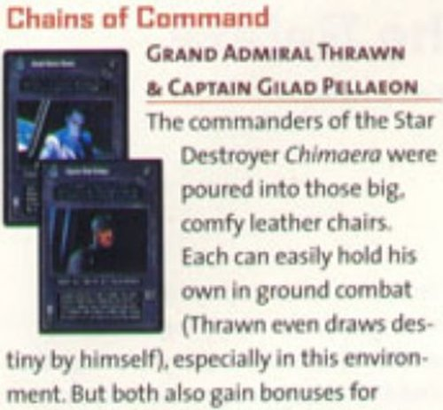
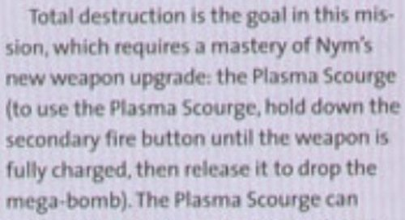

# Owner Material 037 — Star Wars D20 Drive folder (Core, Revised Core and Saga Edition): Star Wars Gamer/Star Wars Gamer 04.pdf [Star Wars Roleplaying Game (d20, 2000)] (scan pages 61–105)

- **Source:** Wizards of the Coast Star Wars Roleplaying Game books, web enhancements, Living Force campaign modules and articles (2000–2010), from the owner's "Star Wars D20" Drive folder (only the three edition subfolders; "General" was not read, as instructed). Secondary source (licensed Legends reference). Scan OCR'd on the box; the scan stays box-only and is **not** published.
- **Method:** every scanned page was OCR'd and machine-screened sentence by sentence for power-relevant statements (fights, kills, defeats, Force feats, rankings, superweapons) that name a character on our roster; each kept sentence is quoted verbatim from the OCR text and has a crop of the printed passage directly under it. Pages with nothing power-relevant are still listed with what is on them.
- **Citation:** "*Star Wars Gamer 04* (SWRPG d20), p.X" by printed page ("scan p.X" where no printed number applies). **Weight:** Licensed RPG material: a secondary source. Narrative text sums up Legends lore; game statistics are rules for players, not canon power levels, and rank lowest.

## scan p.61 (scan page 61)

Page contents: 845 words, 24 paragraphs | headings/entries: Vacraab es 2]; Tot Prize PLANT; MaeKert Viiiace InticuE; Lost Fuairive; Transit Levee

## scan p.62 (scan page 62)

Page contents: 518 words, 25 paragraphs | headings/entries: Jungle Ecology Great Atrium; Starship Landing Platforms Upper Observation Deck; Botanical Domes (environments vary); Main City; The Ithorian Herésnir: [aranda Bay *; Skyline Upper Observation Decks Platform/Flight Decks; Docking Tubes; Speeder Landing Bays; Weather Vane Lower Observation Decks Repulsorlift Banks; Lreeirecerine Lever; The engineering level also hosts &; STAR WARS GAME

## scan p.63 (scan page 63)

Page contents: Ships of the Smugglers' Alliance (JD Wiker): Wild Karrde (Action VI, sensor jamming -10), Dawn Beat/Amanda Fallow YZ-775s, Lastri's Ort star galleon bought from a desperate ex-moff, Uwana Buyer yacht; Mazzic's Distant Rainbow and Preybirds Raptor/Skyclaw (pilots Griv, Amber); Gillespee's Kern's Pride (30 years together, Rebel troop/refugee/medical ship); Billey's Goshyn Queen; Clyngunn's Lady Sunfire; Brasck's slave yacht Green Palace; Ferrier's The Gunship with a conner net (hand-read)

## scan p.64 (scan page 64)

Page contents: 518 words, 24 paragraphs | headings/entries: Lastri's Ort; Uwana Buyer; Ww Mats; Tl inreetaomant Cowtee 12. Wtaroms Stomace; Ship Shape; Z a>; Crew: 10; STAR WARS GAMER 71

## scan p.65 (scan page 65)

Page contents: 347 words, 20 paragraphs | headings/entries: STAR WARS GAMER 73

## scan p.66 (scan page 66)

Page contents: 588 words, 30 paragraphs | headings/entries: Lastri's Ort Craft: modified; Galleon: CLass: ¢; Auat Urive Yaras Star; Crew: 150 (Normal, +2): Passengers; Weapon: 1 concussion missile; Modifiers: PB 40,5; Star Galleon; Kuat Drive Yards "=; Th Ewrewtaewmeny Comtee 12. Wearoms Sroeace

## scan p.67 (scan page 67)

Page contents: 271 words, 39 paragraphs | headings/entries: Cmu gler's Alliance; Be Bs F; SoroSuub Luxury SOOO; NS o; Ty; Kry; Uwana Buyer; Weapon: 2 heavy laser can

## scan p.68 (scan page 68)

Page contents: 500 words, 19 paragraphs | headings/entries: Action V Transport; Goshyn Queen; Etherway and Starry ice; Action V trans; Craft: modified Corellia; Weapon front eft; STAR WARS GAMER 75

## scan p.69 (scan page 69)

Page contents: 551 words, 32 paragraphs | headings/entries: Sips of the Cmuqgier's; Raptor and Skyclaw; Green Palace

## scan p.70 (scan page 70)

Page contents: 110 words, 24 paragraphs | headings/entries: Corellian Corvette; Kern's Pride; Craft: modified Corellian Engineering Corporation Corvette; Size: Large (190 metersk Crew; Maxirmmemn Soeed: Attack: Defense 19 i<izre; Damage: speciah Range Modifiers: PB -6; LEVEL!; LEVEL 2; LEVELS; GTAM WARS GAMER

## scan p.71 (scan page 71)

Page contents: 577 words, 32 paragraphs | headings/entries: Chips o; the; Cmuggier's Altance; The Gunship's internal décor matches this; Among the various nominal "improve; THe GUNSHIP; Weapor: 8 double turbolaser cannons; Fire; Weapon: conner met; Fire Arc: rear; Attack; Damage: 310 x 2; Range Modifiers

## scan p.72 (scan page 72)

Page contents: 367 words, 16 paragraphs | headings/entries: STAR WARS GAMER 79

## scan p.73 (scan page 73)

Page contents: Kashyyyk in Flames adventure (JD Wiker): Trandoshan heroes never allowed on Kashyyyk; protocol droid K-27; Wookiee firefighter Rruurrfhurra; flame beetle swarms drawn by planted hatchling pheromone; Turren Lonarr of Temporary Droids (hand-read)

## scan p.74 (scan page 74)

Page contents: 662 words, 29 paragraphs | headings/entries: ES; A Wookiee Victim; SE Ceri; Dead Wookiee ee Window; Fire Bad; STAR WARS GAmMen 81

## scan p.75 (scan page 75)

Page contents: 866 words, 40 paragraphs | headings/entries: KASHYYYK IN FLAMES. the 'ookiee is also; B82 vo.ume!; NUMBER 4; The closest thing to the; ReUURRFHURRA, Wookier Firtricntee; SEARCHING For CLuts; RKRUURKFHURRA; Group Proficiency (simple weapons)

## scan p.76 (scan page 76)

Page contents: 990 words, 24 paragraphs | headings/entries: Mort QUESTIONS THAN ANSWERS; SIGNS OF FOUL PLAY; A )STAR WARS Gamer 83

## scan p.77 (scan page 77)

Page contents: 800 words, 29 paragraphs | headings/entries: KASHYYYK; Equipment: None; Skills: Climb +6, intimidate +8; Feats: Power Attack; W Wookiee Teamster tony Suspicious Cargo; BY voLUME; NUMBER 4

## scan p.78 (scan page 78)

Page contents: 570 words, 21 paragraphs | headings/entries: Powering Shields: Erecting the ship's; STaR WARS Gamer 8S

## scan p.79 (scan page 79)

Page contents: 638 words, 35 paragraphs | headings/entries: KASHYYYK; IN FLAMES reduced to one-half,; Feat: Skill Emphasis (Profession: janitor}; FIRM EVIDENCE; Unless the heroes were reckless or unlucky; Oeaoio Menten; Inguree Com Cerenvver; T Trandoshan Thug; BG volume! nuMBeER 4; Lonarr has a small enclave of Trandosharns

## scan p.80 (scan page 80)

Page contents: 947 words, 28 paragraphs | headings/entries: TRANDOSHAN SADOTEURS; Trandoshans, read the following aloud; AN INSIDIOUS DEVICE; TRANDOSHAN SAHOTEURS; Saboteurs, Male and Female Trandoshan; STAR WARS Gamer 87

## scan p.81 (scan page 81)

Page contents: 640 words, 29 paragraphs | headings/entries: KASHYYYK; IN FLAMES reach the nursery ring; TURREN LONARR; VP/WP 22/1: Atk 44 melee (by attack; HH VOLUME | NUMBER 4; ExPreRience Points; L Turren Lonarr

### Stat block notes (game mechanics, not feats)

- Turren Lonarr: Male Human Sct 4/Nbl 2; Init +6; Def 20; Bluff +12, Computer Use +16; FP 5, DSP 10; Rep 8; anti-Wookiee droid dealer from Dosha who smuggled Trandoshan saboteurs to Kashyyyk to force Senator Yarua home so the Trandoshan senator could push a logging bill (Source: *Star Wars Gamer 04* (SWRPG d20), scan p.81)

## scan p.82 (scan page 82)

Page contents: Archetypes: The Shaman (Jesse Decker) fringer/Force adept multiclass, outland rifle; Chance Cube: Critical Care optional hit-location and critical-hit tables (Michael Mikaelian) (hand-read)

## scan p.83 (scan page 83)

Page contents: 682 words, 42 paragraphs | headings/entries: The Shaman Ciass iwt Levees; Bast Ariace FoeT Bonus Save; Medium-sized, Slugthrower; Reriex wr Savi Savi; Srechat Annies; VARIANT 1: No JurY-aiG; VARIANT 2: MASTERFUL HEeALee; The Voodoo That You Do; REPUTATION Bonus; Oertnse Bonus; STAR WARS GAMen G1

## scan p.84 (scan page 84)

Page contents: 677 words, 22 paragraphs | headings/entries: Choose Your Target; BY MICHAEL MIKAELIAN; SEVERED AND Broken Limes; CHANCE CUBE; Critical Care; IMPALED OPPONENTS; Bieeoinc To Deate

## scan p.85 (scan page 85)

Page contents: 706 words, 24 paragraphs | headings/entries: Which Taste To Use; Critical Hit Tables (Optional); Lightsaber or Piercing Weapon Bludgeoning Weapon; STAR WARS GAMER

## scan p.86 (scan page 86)

Page contents: University of Sanbra Guide: the Advozsec of Riflor (Cory Herndon): pessimistic herbivore bureaucrats and spies, Catastrophe Corps, smugglers' city Dozu Lam on Tejrivozs, ruling families incl. the Bornmonde family (era text garbled in OCR); sentientologist Tam Eliss (hand-read)

## scan p.87 (scan page 87)

Page contents: 896 words, 22 paragraphs | headings/entries: BrMavior; Cutrure; Other Worlds in the System; STAR WARG Gamer OS

## scan p.88 (scan page 88)

Page contents: 819 words, 27 paragraphs | headings/entries: Eras of Play; Rise of the Empire Era; Rebellion Era; Oe the irnpet; Species Features: -2 Dex, +2 Con, +2; SSE vowwwme i wumeer 4

## scan p.89 (scan page 89)

Page contents: Building Tatooine terrain-model article (docking bay, scrap yard, prefect's office, hovels) (hand-read)

## scan p.90 (scan page 90)

Page contents: 688 words, 26 paragraphs | headings/entries: Model! #1: The Docking Bay; They Will Come; The Docking Bay Blast Doors

## scan p.91 (scan page 91)

Page contents: 429 words, 14 paragraphs | headings/entries: Model #2: The Scrap Yard; The Back Door

## scan p.92 (scan page 92)

Page contents: 461 words, 28 paragraphs | headings/entries: Soe ¢ tee aeeCRL Heid) 88 \%); Office Entry; Modal #4: Slaves' Hovels; STAR WARS GAmMerR 101

## scan p.93 (scan page 93)

Page contents: Deck Plans CCG: Reflections II sealed decks (Cory Herndon) and Endor/Death Star II Closed Environment (Michael Mikaelian) (hand-read)

## scan p.94 (scan page 94)

Page contents: 636 words, 47 paragraphs | headings/entries: Dasw Renpar; TALON KARRDE; Guri Goes Bananas; Locarions (8) Cloud City: Chasm Walkway; Cloud City:; Greeata Guri; Lobel Mosep; Rystall; Snoova; Cn ad; Vigo; Barquin D'an Bossk With Mortar Gun; Captain Gilad Pellaeon = =—'1_ Stinger; Corporal Prescott Darth Vader With Lightsaber; Dr. Evazan & Ponda Baba 1 Garindan; Grand Admiral Thrawn; Janus Greejatus; Sergeant Merril; StagsHips (4) 1 IG-88 In IG-2000; With You

- **Grand Admiral Thrawn**: "Chains of Command Grand ApmigaAt THRAWN & CAPTAIN GILAD PELLAEON The commanders of the Star Destroyer Chimaero were poured into those big comfy leather chairs Each can easily hold his own in ground combat (Thrawn even draws des tiny by himself), especially in this environ ment." Source: *Star Wars Gamer 04* (SWRPG d20), scan p.94
  

## scan p.95 (scan page 95)

Page contents: 584 words, 23 paragraphs | headings/entries: Dark Side) containing a balanced mix of; Dark Side of the Moon; Closed Environment Storms the Galaxy; BY MICHAEL; Force; Wedge Antilles, Red Sqadron Leader,; Moon Walker; Go WITH THE Flow; MIKAELIAN

## scan p.96 (scan page 96)

Page contents: 471 words, 36 paragraphs | headings/entries: Scout 1 of 2; Saber Rattling; Major Marquand Sim Aloo; StarsHips (13); Endor sites; Each one you; Force denial and; Weapons (2) 2 AT-ST Dual Cannon; Apminat's Onvers (2) 2 Battle Deployment; STAR WARS GamMeR 105

## scan p.97 (scan page 97)

Page contents: Starfighter mission walkthrough (Haden Blackman; Tim Longo, John Drake): Rhys Dallows, Essara Till (turns on Rhys if he attacks her or the Queen), Vana Sage, Nym, Reti the Toydarian; Reeve Dallows (Rhys's father) named after producer Reeve Thompson; 9 of 23 missions cut (hand-read)

## scan p.98 (scan page 98)

Page contents: 814 words, 36 paragraphs | headings/entries: Platinur Objectives:; Complete all missions while flying upside down; The New Resistance); Mission 6: Valuable Goods; STAR WARS GAmeR 107

## scan p.99 (scan page 99)

Page contents: 851 words, 26 paragraphs | headings/entries: Starfighter Easter Eggs; OurTiaws Art GALLERY; Jar Jan's Great Escape; Cowsoy Drop; BBO Drow

## scan p.100 (scan page 100)

Page contents: 795 words, 46 paragraphs | headings/entries: Weapons of War; Mastering a few weapons and under; Vana Sage's Guardian Mantis is equipped; T; According to Tim | Ngo Lead Level; The turrets posed some major problems; Nym's Turrer; WINGMEN; Nearly every mission provides the player ¥; STAR WARS Gamer 109

- **Lord Scourge**: "Total destruction is the goal in this mis sion, which requires a mastery of Nym's new weapon upgrade: the Plasma Scourge (to use the Plasma Scourge, hold down the secondary fire button until the weapon is fully charged, then release it to drop the mega-bomb)." Source: *Star Wars Gamer 04* (SWRPG d20), scan p.100
  

## scan p.101 (scan page 101)

Page contents: Starfighter: final boss mercenary leader Nolo; Jar Jar easter egg in Mission 12; Battle for Naboo Heavy STAP and Naboo Police Cruiser stats (hand-read)

## scan p.102 (scan page 102)

Page contents: 863 words, 23 paragraphs | headings/entries: Mission Debriefing; Easiest Missiore Mission 3 Hardest Mission Miss; Mission 7; Toughest Single Opponent: Nolo, the mercenary "boss; STAR WARS GAMER L121

## scan p.103 (scan page 103)

Page contents: 707 words, 37 paragraphs | headings/entries: Naboo military vehicles; Heavy STAP; Sng to Bertt Tout; RANGE: 100 Mm; Police Cruiser; A; Nasoo Po.ice Cauiser; Rolls the game credits; See the legendary "screen wave."

## scan p.104 (scan page 104)

Page contents: Letters/errata: core rulebook errata (stormtrooper Def 16, wound 10; 3PO Int 18); Dark Side Sourcebook preview incl. The Crypt of Saalo Morn web adventure and Emperor's Hand prestige class (hand-read)

## scan p.105 (scan page 105)

Page contents: 836 words, 41 paragraphs | headings/entries: Oh yeah, Thanks for praising Gamer,; He's Very Excited Greetings, fellow gamers!; No more pl iyers complaining about how; Get Ready for the Dark Side Crvlirve!; Andy Farrell Via Internet; Case in point

