# Owner Material 037 — Star Wars D20 Drive folder (Core, Revised Core and Saga Edition): Star Wars Gamer/Star Wars Gamer 05.pdf [Star Wars Roleplaying Game (d20, 2000)] (scan pages 1–60)

- **Source:** Wizards of the Coast Star Wars Roleplaying Game books, web enhancements, Living Force campaign modules and articles (2000–2010), from the owner's "Star Wars D20" Drive folder (only the three edition subfolders; "General" was not read, as instructed). Secondary source (licensed Legends reference). Scan OCR'd on the box; the scan stays box-only and is **not** published.
- **Method:** every scanned page was OCR'd and machine-screened sentence by sentence for power-relevant statements (fights, kills, defeats, Force feats, rankings, superweapons) that name a character on our roster; each kept sentence is quoted verbatim from the OCR text and has a crop of the printed passage directly under it. Pages with nothing power-relevant are still listed with what is on them.
- **Citation:** "*Star Wars Gamer 05* (SWRPG d20), p.X" by printed page ("scan p.X" where no printed number applies). **Weight:** Licensed RPG material: a secondary source. Narrative text sums up Legends lore; game statistics are rules for players, not canon power levels, and rank lowest.

## scan p.1 (scan page 1)

Page contents: 14 words, 3 paragraphs | headings/entries: Sees

## scan p.2 (scan page 2)

Page contents: 43 words, 2 paragraphs | headings/entries: On THE Cover

## scan p.3 (scan page 3)

Page contents: 453 words, 59 paragraphs | headings/entries: CONTENTS:; Fiction; THE CRYSTAL BY ELAINE CUNSIWONAM; DARKNESS SHARED; BY Pu SLAVE; Woros To Live By; Srar Wars Sitent DEATH—RISE OF; THE EMPIRE; RPG Articles; THe Emperor's PAWNS; SEEDS OF VILLAINY; Ov efe Geuee; THe SITH COMPENDIUM; CAMPAIGN GUIDE TO THE CENTRALITY; VOLUME |, NUMBER &; University OF SANBRA Guide To; INTELLIGENT Life: THe CHiss; OY PARLO HIDALGO; Special Ops: THE SLICER; OY PATRICE MCLAUCHIUIN; SPECIAL OPS: THE CHARLATAN; RPG Adventure; THe Hurt Hit; By are Cevee; TALNAR'S RESCUE; OY STERLING HERSHEY; State of the Arts; LucasArts GAME Previews & STRATEGY; BY HADEN PLACE MAN; Departments

## scan p.4 (scan page 4)

Page contents: Dark Side issue editorial: features Lumiya (Shira Brie survived Luke), Blackhole, Maarek Stele, Jeng Droga; August 2001 'Official Dark Side Month' with the Dark Side Sourcebook (hand-read)

## scan p.5 (scan page 5)

Page contents: 567 words, 22 paragraphs | headings/entries: Managing Editor; My 10-year-old son really likes Star Wars; Don't Stop Now!; We're Just Getting Started

## scan p.6 (scan page 6)

Page contents: 1032 words, 34 paragraphs | headings/entries: More, More, More!; Star Wars Gamer,; Keep up the amazing work!; Ben "Kloran" Wakefield Litchfield, OH; Dan Krouse; Ladies' Men Speaks; Wurzzup SWG,; Southern Discomfort Hey Y'all (yeah, I'm southern),; STAR WARS GAMER &

## scan p.7 (scan page 7)

Page contents: 386 words, 8 paragraphs | headings/entries: 

## scan p.8 (scan page 8)

Page contents: 912 words, 39 paragraphs | headings/entries: The Guerdian Mantis; Craft: Unique Xi Char creation; Class:; Starfighter; Cost: Not available for sale;; Result up to 20 21-30 5 lad; SaER; Short. Ths bor dort sof tfack; Page 94, Frightful Presence entry,; Continued Next Issue; STAR WARS GAMER 11

## scan p.9 (scan page 9)

Page contents: HoloNet Transmission Q&A (JD Wiker): Yoda/Yaddle species deliberately unrevealed ('Judge Yoda by his species, do you? Species matters not'); Sturm and Drang tails clipped (Karrde's vornskyrs) correction; Deflect Blasters errata (hand-read)

## scan p.10 (scan page 10)

Page contents: 952 words, 40 paragraphs | headings/entries: Observations & Clarifications; S; Game Mastering Advice; Why do stormtroopers, the ultra-elite of the; George Lucas isn't telling. It really isn't; Empire, have stats worse than an average; But if bigger, tougher, more dangerous; Judge Yoda by his species, do you?; Species matters not; The serious answer fs that Yoda's and; Yaddie's speci a Lt |; Got rules questions? Send them to; STAR WARS GAmen 16

## scan p.11 (scan page 11)

Page contents: 83 words, 4 paragraphs | headings/entries: OS: Darksiders ILLUSTRATED BY RAMON PEREZ

## scan p.12 (scan page 12)

Page contents: The Crystal (Elaine Cunningham): Jaina's Jedi graduation on Yavin 4; Jacen and Anakin apprenticed to Luke; ailing Mara takes Jaina as apprentice; Han gives her a modified Z-95 which she names Crystal; Bahalian Shipyards a Tenloss Syndicate front; stats for The Crystal (Z-95) (hand-read)

## scan p.13 (scan page 13)

Page contents: 927 words, 28 paragraphs | headings/entries: Or so Jaina assumed,; STAR WARS Gamer 18

- **Jacen Solo (Darth Caedus)** — entry/section: Jacen on what the Jedi are: "Those were different times. Master Luke became a Jedi during the Rebellion, and his path was shaped by necessity. We've always known the Jedi are more than warriors, but we don't know what that 'more' might be. Maybe it's our task to relearn what was lost." Source: *Star Wars Gamer 05* (SWRPG d20), scan p.13
  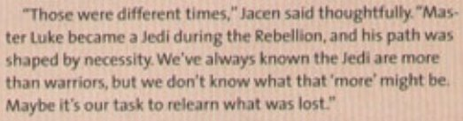

## scan p.14 (scan page 14)

Page contents: 978 words, 40 paragraphs | headings/entries: His grin broadened. "! wouldn't miss it."

- **Han Solo** — entry/section: Han on firepower: "Hey, better to have it and not need it, than need it and not have it." Source: *Star Wars Gamer 05* (SWRPG d20), scan p.14
  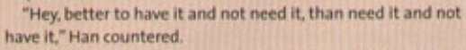
- **Jaina Solo**: "Jaina caught a whiff of her mother's concern, sad and subtle as the perfume of a crushed flower." Source: *Star Wars Gamer 05* (SWRPG d20), scan p.14
  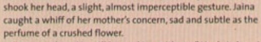

## scan p.15 (scan page 15)

Page contents: 882 words, 34 paragraphs | headings/entries: STAR WARS Gamer 21

- **Mara Jade Skywalker; Jaina Solo** — entry/section: Mara on growing lightsaber crystals: "I grew the crystals for my first lightsaber. It connects you, gives you a different feel altogether. You are, almost literally, part of the weapon." Source: *Star Wars Gamer 05* (SWRPG d20), scan p.15
  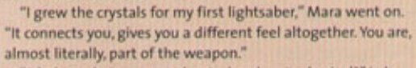

## scan p.16 (scan page 16)

Page contents: 1006 words, 33 paragraphs | headings/entries: 

- **Jaina Solo**: "Jaina exploded, "Subpro hasn't been building the Z-95 Headhunter for years." Source: *Star Wars Gamer 05* (SWRPG d20), scan p.16
  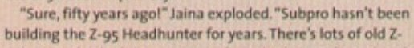
- **Jaina Solo**: "Pressure built in the cockpit from the rising G's until stars began to dance and explode at the periphery of Jaina's vision, More lights began to blink on the console, warning of possible system failure." Source: *Star Wars Gamer 05* (SWRPG d20), scan p.16
  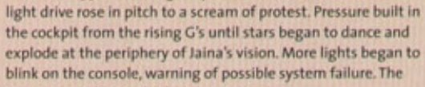

## scan p.17 (scan page 17)

Page contents: 962 words, 30 paragraphs | headings/entries: STAR WARS Gamer 23

- **Jaina Solo**: "Jaina had fewer problems with the idea of vaporizing a droid than reducing a living pilot to stardust." Source: *Star Wars Gamer 05* (SWRPG d20), scan p.17
  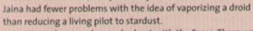

## scan p.18 (scan page 18)

Page contents: 966 words, 35 paragraphs | headings/entries: Ban Jumper

### Stat block notes (game mechanics, not feats)

- Bail Jumper cyborg pilot: Male Human Sol 6/Starfighter Ace 5; Init +8; Def 22; VP/WP 82/14; Pilot +20; FP 2, DSP 2; modified X-wing Bail Jumper with 5 fire-linked lasers in the astromech socket; Tenloss Syndicate repossessor suffering cybernetic psychosis (Source: *Star Wars Gamer 05* (SWRPG d20), scan p.18)

## scan p.19 (scan page 19)

Page contents: 1007 words, 42 paragraphs | headings/entries: But for how long?; S + S; Crystal; Toe Caverac; Craft: Modified Incom/Subpro 2-95 Headhunter; Class: Starfighter;; Points: 30; Hull Points: 150; DR: 10; STAR WARS GAMER 25

- **Jaina Solo** — entry/section: Jaina's lesson from her lightsaber crystal: "Sometimes you need to focus, and sometimes you need to be the focus," Source: *Star Wars Gamer 05* (SWRPG d20), scan p.19
  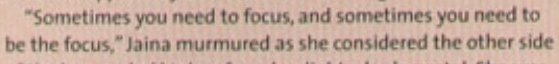

## scan p.20 (scan page 20)

Page contents: 0 words, 0 paragraphs | headings/entries: 

## scan p.21 (scan page 21)

Page contents: Darkness Shared (Bill Slavicsek), six months before Ruusan: Jedi Knight Crian Maru and her Rodian Padawan Dree Vandap (raised in the Temple, taught by Lord Hoth) hunt Kaox Krul 'the Marauder' of Kaan's Brotherhood, who massacred the Duros colony on Harpori and killed Jedi Karist Dem and Wookiee diplomat Rojarra; his lightsaber was taken from the first Jedi he killed, his armor imbued with Sith alchemy (hand-read)

## scan p.22 (scan page 22)

Page contents: 691 words, 24 paragraphs | headings/entries: CEE 7 —_ |; DORKOESS SOORED; By Bitt SLAVICSEK; ILLUSTRATED BY; Mare SASSO; He was coming; The Marauder; The Madman; Kaox Krul; STAR WARS GAMER 28

## scan p.23 (scan page 23)

Page contents: 862 words, 19 paragraphs | headings/entries: DORKOESS hate-fueled believers in the dark; GS BS &

## scan p.24 (scan page 24)

Page contents: 1013 words, 23 paragraphs | headings/entries: STAR WARS GAMER 31

## scan p.25 (scan page 25)

Page contents: 1030 words, 26 paragraphs | headings/entries: B2 vo.ume |. NUMBER S

## scan p.26 (scan page 26)

Page contents: Kaox Krul to Dree (no crop): 'Even Jedi whelps can surprise me, But in the end, it's always the same. The Jedi whelp is dead, and I score another kill.' (hand-read)

## scan p.27 (scan page 27)

Page contents: 839 words, 30 paragraphs | headings/entries: 

## scan p.28 (scan page 28)

Page contents: 959 words, 30 paragraphs | headings/entries: So S; Go Dd; G&S S&S; STAR WARS Gamer 35

- **Darth Krul** — entry/section: Star Wars Gamer 05: "Their survival would almost certainly fall to Crian, but she held secret doubts as to whether she was ready to face Kaox Krul, He was insane, powerful, full of the dark side, hungry for the kill." Source: *Star Wars Gamer 05* (SWRPG d20), scan p.28
  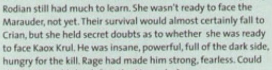

## scan p.29 (scan page 29)

Page contents: 982 words, 29 paragraphs | headings/entries: DORKOESS SVOGRED; G&S & &; G&S & &; Ss G; Sos SF

- **Crian Maru; Kaox Krul** — entry/section: Crian and Kaox before their duel: ""Your darkness betrays you, Kaox Krul," Crian said. "And you deny the darkness within you, Jedi," Kaox retorted." Source: *Star Wars Gamer 05* (SWRPG d20), scan p.29
  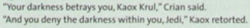

## scan p.30 (scan page 30)

Page contents: Darkness Shared ending: Kaox kills Dree; Crian gives in to rage and the dark side, and she and Kaox kill each other over the lake; Jedi Knight Salen Toth later finds Dree's body in a now-haunted swamp (hand-read)

## scan p.31 (scan page 31)

Page contents: 558 words, 25 paragraphs | headings/entries: Kaox Krul; Crian Maru; Dree Vandap; Equipment: ightsaber, comilink, Jedi robes, Rodian hunt; Battliemind 4+«; Force Skills; Feats: Exotic Weapon Proficiency (Cightsaber), Force-Sen 8; Weapon; Proficiencies (blaster pistols, simple weapons; BB vo.wMmeée i NUMeER G

### Stat block notes (game mechanics, not feats)

- Kaox Krul: Male Human Soldier 3/Dark Side Marauder; FP 6, DSP 16; dark padded armor (bonus vs light-side Force skills, DR 5); Force skills incl. Alchemy +8, Battlemind, Fear, Force Grip (Source: *Star Wars Gamer 05* (SWRPG d20), scan p.31)
- Crian Maru / Dree Vandap: Crian Maru: Female Human Jedi Guardian; Dree Vandap: Female Rodian Jedi Guardian 3, Def 17, VP/WP 22/10, Skill Emphasis (Pilot), Track (Source: *Star Wars Gamer 05* (SWRPG d20), scan p.31)

## scan p.32 (scan page 32)

Page contents: Words to Live By: Huttese excerpt from Ben Burtt's Beeps, Bleats & Boskas phrase book (Ebenn Q3 Baobab, Bocce trade language, Hutts count in base eight; ancient Huttese ransom notes on Varl's moons 1,000 years old) (hand-read)

## scan p.33 (scan page 33)

Page contents: 136 words, 14 paragraphs | headings/entries: 

## scan p.34 (scan page 34)

Page contents: 287 words, 43 paragraphs | headings/entries: Hogwa boska punyoo!; Hands up. Kopoa tonka; Tentacles up! Tonta tonka; You're in trouble now. Bona nai kachu; You disappoint me. Keel-ee calleya ku kah; When can | expect payment?; Wo wonne coe moulee rah?; Let's go. Boska; Take hin away. Yoche neechu; Bring her to me. Koose cheekta nei; My lord. Ma lorda; Hethu apenkee; Welcome. Chowbeso,; Good-bye. Mee jewz ku; Incredible! inkabunga!; Okay. Eniky; No, Nobata; Thank you. No equivalent in Huttese; Please No equivaient in Huttese

## scan p.35 (scan page 35)

Page contents: 254 words, 38 paragraphs | headings/entries: Imperial cruiser; Jee; D'emperiolo teesaw; Jeedai

## scan p.36 (scan page 36)

Page contents: The Emperor's Pawns (Abel G. Peña, Juan Schwartz, Pablo Hidalgo): Mara learns from Solo that Roganda Ismaren was another Emperor's Hand; Thrawn had called Mara a courier like 'the rest of the Emperor's Hands'; Mara's memory of Palpatine with the cyborg Lumiya; Hands drawn from disaffected Jedi such as Jerec and Brandl and from Palpatine's own dark side adepts (hand-read)

## scan p.37 (scan page 37)

Page contents: Blackhole: one of the Prophets of the Dark Side moved to head of Imperial Intelligence; given control of the HoloNet, appears as a starscape hologram with a cold chill; specialty fear; withered old man in a life-support orb on Neimoidian mechano-legs (gift of Palpatine); flagship Star Destroyer Singularity, 123rd Nightstalker Group, all-black stygian-triprismatic polymer; toppled before Isard's rise; possibly an ex-senatorial page or Jedi Temple librarian (hand-read)

### Stat block notes (game mechanics, not feats)

- Blackhole: Male Human FA 5/Dark Side Devotee 7/Emperor's Hand 3; Def 24; Fear +20, Control Mind +19, Drain Knowledge +19; Frightful Presence, High Force Mastery; Singularity (Imperial I) stats (Source: *Star Wars Gamer 05* (SWRPG d20), scan p.37)

## scan p.38 (scan page 38)

Page contents: 703 words, 44 paragraphs | headings/entries: THE SINGULARITY; Roganda Kbmaren: Human Female Nbi 6/EH 4; Honus class skill (Bluff), callina; Equipment: Sepisilk; Sails: Bluff +14; Force Feats: Alter, Control; VOLUME | NUMB@user 5; Hlomacy +t; Enhance A; Intelligence fell under the c apable steward; Mw

### Stat block notes (game mechanics, not feats)

- Roganda Ismaren: Human Female Noble 6/Emperor's Hand 4; Bluff +14 (Source: *Star Wars Gamer 05* (SWRPG d20), scan p.38)

## scan p.39 (scan page 39)

Page contents: Lumiya: Shira Brie born on Imperial Center, trained for Imperial Intelligence at Vader's direction, Echani and Noghri stava; shot down by Luke, rebuilt with cybernetics by Vader who offered her to Palpatine as a Hand; on Ziost built a lightwhip from Vader's Kaiburr crystal shard and Mandalorian iron; allied with Flint vs the Nagai; trained Carnor Jax; seed: Nom Anor approached Jax about a Sith alliance (hand-read)

## scan p.40 (scan page 40)

Page contents: Sarcev Quest: failed Jedi student, first darksider on the Imperial Ruling Council; backed Carnor Jax; bribed Palpatine's physician to sabotage the clones; betrayed councilors Sa-Di and Nefta; tortured and dumped on Nar Shaddaa after Jax's death; 100,000-credit bounty seed (hand-read)

### Stat block notes (game mechanics, not feats)

- Lumiya: Human Female Sco 1/EH 3/Sith Warrior 9/Sith Lord; Def 29; FP 9, DSP 15; lightwhip (+2 trip/disarm), Sith armor, Sith holocron; Battlemind +18 (Source: *Star Wars Gamer 05* (SWRPG d20), scan p.40)
- Sarcev Quest: Male Human Jedi Consular 7/Emperor's Hand 7; Diplomacy +25; short lightsaber (Source: *Star Wars Gamer 05* (SWRPG d20), scan p.40)

## scan p.41 (scan page 41)

Page contents: Arden Lyn: Follower of Palawa and teras kasi master, lover of Xendor in the First Great Schism; killed Jedi Master Awdrysta Pina, who stopped her heart with martichro; revived millennia later, injured Inquisitor Tremayne and killed Darys before Torbin cut off her arm; given an ancient war droid arm by Palpatine; tried to kidnap Palpatine for Grand Admiral Zaarin; seed Life After Death (Kashi Mer talisman) (hand-read)

- **Kir Kanos** — entry/section: Star Wars Gamer 05: "Jax was killed by Kir Kanos, The Imperial Ruling Council immediately moved against Sarcev, dumping him like refuse at Nar Shaddaa after a week-long torture session that prompted uncharacteristically inelegant screams from the Hand Adventure Seed; Unfinished Business Following his imprisonment and torture, Sarcev Quest disappeared ARDEN LYN The Followers of Palawa were intense contemplators of exis tence." Source: *Star Wars Gamer 05* (SWRPG d20), scan p.41
  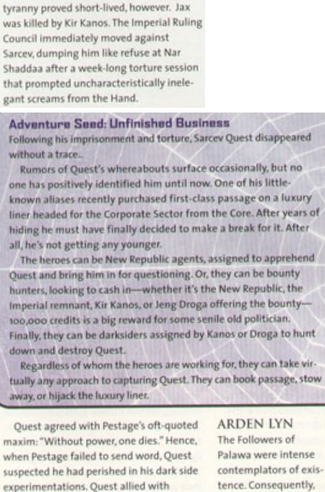
- **Sarcev Quest** — entry/section: Pestage's maxim adopted by Quest: "Quest agreed with Pestage's oft-quoted maxim: "Without power, one dies."" Source: *Star Wars Gamer 05* (SWRPG d20), scan p.41
  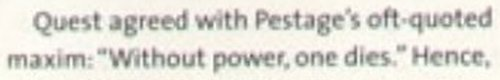
- **Palpatine (Darth Sidious)**: "Thus, when the first Death Star was destroyed and he entrusted her with eliminating key Rebels, Arden used the freedom to plot her escape, finding and training students to eventually turn against Palpatine." Source: *Star Wars Gamer 05* (SWRPG d20), scan p.41
  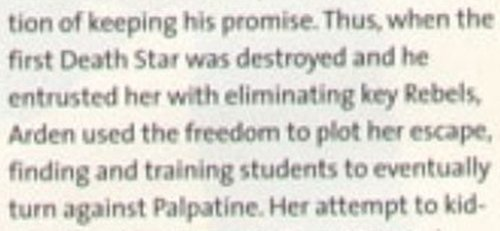

## scan p.42 (scan page 42)

Page contents: Maarek Stele: son of Kerek and Marina, conscripted from the Taroon system, saved Admiral Mordon, TIE ace, trained by the Secret Order of the Emperor, 'Hand' title-rank Tan; saved Palpatine from Zaarin's coup; joined Fel's 181st; seed In Too Deep (Yuuzhan Vong era) (hand-read)

### Stat block notes (game mechanics, not feats)

- Arden Lyn: Female Human FA 8/Dark Side Marauder/Emperor's Hand; juggernaut droid arm (with blaster), Martial Arts (Source: *Star Wars Gamer 05* (SWRPG d20), scan p.42)
- Maarek Stele: Male Fringer 8/Starfighter Ace 6/Force Adept 1; Pilot +22 (Source: *Star Wars Gamer 05* (SWRPG d20), scan p.42)

## scan p.43 (scan page 43)

Page contents: Jeng Droga: most loyal Hand, guarded the Emperor's Shadow; at Endor went mad and crashed it into Kaal's oceans; Palpatine's essence briefly lodged in his body until Pestage drew it out; seed Droga's Destiny (Third Battle of Yavin) (hand-read)

## scan p.44 (scan page 44)

Page contents: Seeds of Villainy (Jeff Grubb) GM article: villain archetypes - thugs, The One That Got Away, organized thugs, ringleader (Bib Fortuna 'not the hand that holds the blaster, but rather the eye that aims it'), good bad-guy (Boba Fett), bad good-guy (young Lando), bureaucrat (Watto) (hand-read)

## scan p.45 (scan page 45)

Page contents: 383 words, 11 paragraphs | headings/entries: GTAR WA GAMER

## scan p.46 (scan page 46)

Page contents: 896 words, 20 paragraphs | headings/entries: Organized Thugs; The Ringleader

## scan p.47 (scan page 47)

Page contents: 914 words, 21 paragraphs | headings/entries: The Good Bad-Guy; The Bad Good-Guy; STAR WARS Gawmen SS

## scan p.48 (scan page 48)

Page contents: 824 words, 17 paragraphs | headings/entries: NE, ;; The bureaucrat is a non-violent oppo-

## scan p.49 (scan page 49)

Page contents: Seeds of Villainy cont.: personal villain (Jabba vs Han), organization villain (Black Sun, Trade Federation), living weapon (Darth Maul), mastermind (Sidious, second Death Star deception), growing villains with the heroes, 'obscure death rule', 'Just remember two words: Clone Vats' (hand-read)

## scan p.50 (scan page 50)

Page contents: 791 words, 19 paragraphs | headings/entries: The Mastermind

- **Darth Maul; Palpatine (Darth Sidious)**: "The best known of such villains is Darth Maul, whose hatred of the Jedi has been carefully cultivated by Darth Sidious, such that he is an expert foe, capable of holding off two Jedi in a single combat." Source: *Star Wars Gamer 05* (SWRPG d20), scan p.50
  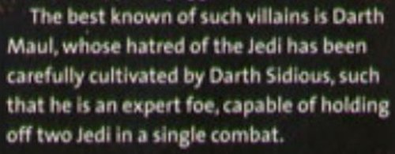
- **Palpatine (Darth Sidious); Darth Maul**: "Darth Sidious lives for the destruction of the Jedi, and has Darth Maul as his living weapon, The Emperor wishes nothing less than the domination of the universe itself under his iron grip." Source: *Star Wars Gamer 05* (SWRPG d20), scan p.50
  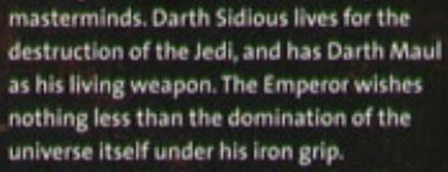

## scan p.51 (scan page 51)

Page contents: 806 words, 18 paragraphs | headings/entries: Growing Your Villains; Along Side Your Heroes; STAR WARS GAMeR 59

- **Darth Vader (Anakin Skywalker)** — entry/section: Star Wars Gamer 05: "The more powerful figures may often be defeated but not slain, They may flee, like Darth Vader after the destruction of the death star, to return more powerful on another day." Source: *Star Wars Gamer 05* (SWRPG d20), scan p.51
  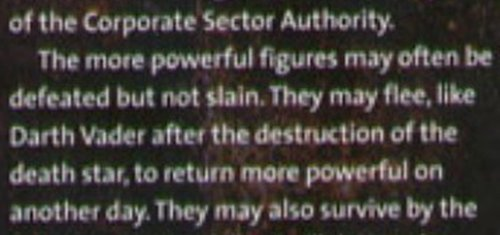

## scan p.52 (scan page 52)

Page contents: The Sith Compendium (Michael Mikaelian): Great Hyperspace War Sith personnel carrier (six drop containers, 60 troops or a Sith slayer each), Sith escort gunship (Naga Sadow and Ludo Kressh each fielded hundreds), Sith starfighter; droids: Sith sentry, Sith elite warbot, 12 m Sith slayer war machine with alchemical armor plating (hand-read)

## scan p.53 (scan page 53)

Page contents: 833 words, 33 paragraphs | headings/entries: Sith GUNSHIP; A Note About Eras of Play; SiTH STARFIGHTER; Secrets of the Sith Revealed; Points: 180; OR: 10; Droids; Sitm Sentey, Security Droiw ); STAR WARS Gamer] G1

## scan p.54 (scan page 54)

Page contents: 520 words, 29 paragraphs | headings/entries: Sith Sentry: Walking security droid, Thug; Wis 13, Cha 6. Challenge Code C; Unipent Skill Points: o; Cost: Not available for sale; Sitn Evite Warnor,; ANCIENT BaTTLE Daoio; Unspent Skill Points: 3; Cost: Not available for sale

## scan p.55 (scan page 55)

Page contents: Sith Compendium creatures and gear: corrupted snake (Sith-poison venom), Sith warbird mount with battle harness, alchemical Sith familiar (scavenger bird Force conduit, DC 20 Alchemy, 10,000 cr), meditation chamber (Vader's on the Executor; grants DSPs), focusing chamber amplification rules (hand-read)

## scan p.56 (scan page 56)

Page contents: 627 words, 19 paragraphs | headings/entries: Tite Sith | , Compendium; Force Feats: None; Equipment; MEDITATION CHAMBER

## scan p.57 (scan page 57)

Page contents: 732 words, 19 paragraphs | headings/entries: Focusine CHamate; STAR WARS GAMER

## scan p.58 (scan page 58)

Page contents: Sith Compendium artifacts: Sith sarcophagus (Freedon Nadd's tomb on Dxun; dark side spirit possession, Transfer Essence DC 40, sacrifices lower DC), Sith scrolls libraries (1d20 scrolls, Knowledge (Sith lore) DC 20) (hand-read)

## scan p.59 (scan page 59)

Page contents: Campaign Guide to the Centrality (Michael Rocco), based on L. Neil Smith's Lando Calrissian Adventures: Scrivinir head of state; Rise of Empire depression; allied to Empire in Rebellion era; NJO era: Fleet Admiral Sris Lebhett seizes power in a coup, ousting Scrivinir Ottdefa Tavell Geen; Oseon asteroid belt casinos, two laws; founder Gadfrey Oseon, ex-circus ringleader who fled the Hutts; the Flamewind (hand-read)

## scan p.60 (scan page 60)

Page contents: 793 words, 24 paragraphs | headings/entries: Tee RE@user; THE New Jeo Onver; Bese nn ott; Places of the Centrality; GADFREY AND THE FLAMEWIND

