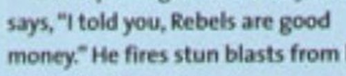
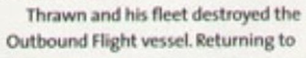
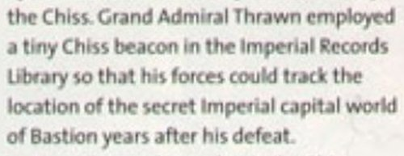
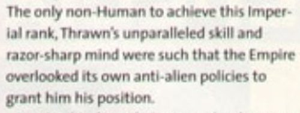
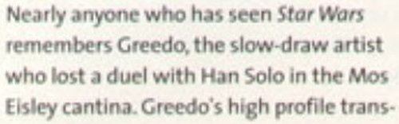

# Owner Material 037 — Star Wars D20 Drive folder (Core, Revised Core and Saga Edition): Star Wars Gamer/Star Wars Gamer 05.pdf [Star Wars Roleplaying Game (d20, 2000)] (scan pages 61–118)

- **Source:** Wizards of the Coast Star Wars Roleplaying Game books, web enhancements, Living Force campaign modules and articles (2000–2010), from the owner's "Star Wars D20" Drive folder (only the three edition subfolders; "General" was not read, as instructed). Secondary source (licensed Legends reference). Scan OCR'd on the box; the scan stays box-only and is **not** published.
- **Method:** every scanned page was OCR'd and machine-screened sentence by sentence for power-relevant statements (fights, kills, defeats, Force feats, rankings, superweapons) that name a character on our roster; each kept sentence is quoted verbatim from the OCR text and has a crop of the printed passage directly under it. Pages with nothing power-relevant are still listed with what is on them.
- **Citation:** "*Star Wars Gamer 05* (SWRPG d20), p.X" by printed page ("scan p.X" where no printed number applies). **Weight:** Licensed RPG material: a secondary source. Narrative text sums up Legends lore; game statistics are rules for players, not canon power levels, and rank lowest.

## scan p.61 (scan page 61)

Page contents: Centrality places: Oseon 6845 resort owned by Toydarian Drofo the Third (stats, keeps an Akroec strike cruiser); 8920 a miniature Nar Shaddaa; Ema Slake (Albinar singer) estate on 5631, former Bohhuah Mutdah residence; stingbeam stats; adventure hook with Advozse agent Sosten Freet and Twi'lek manager Phaldri Nex; Rafa life crystals table (hand-read)

### Stat block notes (game mechanics, not feats)

- Drofo the Third: Male Toydarian Expert 6; Diplomacy +8, Profession (hotel business) +10; owner of Oseon 6845 resort (Source: *Star Wars Gamer 05* (SWRPG d20), scan p.61)

## scan p.62 (scan page 62)

Page contents: Lando activated the Mindharp of Sharu a few years before Yavin; Sharu awakened, pyramids became cities; under Lebhett convict labor in the orchards; Sharu and Toka descriptions; hook with Bothan archaeologist Corask Slen'da (Obroan Institute) and Chief Supervisor Myle Jandler (hand-read)

## scan p.63 (scan page 63)

Page contents: 687 words, 17 paragraphs | headings/entries: The Sheru | / The Toke (pre-Sheru)

## scan p.64 (scan page 64)

Page contents: Centrality appendix: Antipose, Dela (Ulorins), Dilonexia, Douglas, Erilnar capital, Hosrel shield camouflage (+10 sensor DC), Lekua V (Professor Ottdefa), Paulking, Renatasia (Imperial 'forced redevelopment' destroyed Mathilde, two-thirds of population killed), Rigneldia, Scillal, ThonBoka StarCave (Oswaft, Cave of the Elders), Trammis Akorec, Tund (Sorcerers of Tund), Ua (Ouor'sav), Zebitrope (lesai) (hand-read)

## scan p.65 (scan page 65)

Page contents: 386 words, 33 paragraphs | headings/entries: Cewatt. As a result yuarter of th; ThonBoka

## scan p.66 (scan page 66)

Page contents: The Oswaft species writeup (Lehesu; organoelectronic, microwave hyperspace skip) with starship-scale combat notes (hand-read)

## scan p.67 (scan page 67)

Page contents: Silent Death: Rise of the Empire - Phantom Menace ships, cloaking device and gunboat rules (hand-read)

## scan p.68 (scan page 68)

Page contents: Silent Death scenarios: Patrol Around Naboo, The Sith Apprentice Arrives (Maul's Sith Infiltrator with cloak), Battle for Naboo (AATs), The Queen's Escape; Sith Infiltrator, Queen's transport, N-1 and droid starfighter ship displays and critical charts (hand-read)

## scan p.69 (scan page 69)

Page contents: 999 words, 26 paragraphs | headings/entries: Star Wars Silent Death Rules; Summar; Rolling the Dice; Turn Summary; Any ship being tracked by warheads; Cannon Fire Phase; The target ship subtracts its Damage; Damage Control Phase; Cunnery; Skil

## scan p.70 (scan page 70)

Page contents: 551 words, 28 paragraphs | headings/entries: THE SITH Aprremtice Areives TT; Location: Orbiting Naboo; Pilot Weapon:; Rance: 3/9/10; Damage Track; Trade Federation (225 points):; AAT B (Gunner 6); AAT C (Gunner 5); SITH INFILTRATOR; Critical Hits; STAR WARS Gamer 79

## scan p.71 (scan page 71)

Page contents: 562 words, 58 paragraphs | headings/entries: Getto Your: Ships!; THE QUEEN'S ESCAPE; Location: Near Naboo; Naboo Pilots (288 points):; Victory Conditions: Queen Amidala's Transport; When the Queen's transport; BPV: 155; Darensive; R ==, Ay \ Thont +3/; Critical Hite; FRONT (204); LEFT OR RIGHT (2D4); REAR (2D4)

## scan p.72 (scan page 72)

Page contents: 337 words, 41 paragraphs | headings/entries: Pilot Weapon:; Twin Laser; Vawe REDUCTION:; Low of "4 2; Low+t; Rance: 3/9/10; Pilot Weapon: Quab Laser; Cannons (F) :; Low oF j "4; Low+1 oF 2D8+ADB+43 Low+3; Rance: 3/9/10; Damage Track; Sie ie Critical Hits; Critical Hite

## scan p.73 (scan page 73)

Page contents: 16 words, 4 paragraphs | headings/entries: Infiltrator

## scan p.74 (scan page 74)

Page contents: The Hutt Hit (Jeff Grubb), darksider adventure, New Republic era: Krova the Hutt, Alvorine crimelord who sold Rebel intelligence to the Empire and caused the Imperial Massacre at Kolanda Station on Latharra, captured near Pluthan by Dug bounty hunter Langro Dis; she swallowed a damaged Sith holocron to trade for her freedom; Marshall Hundria Kast, programmer Miera Lij, Twi'lek broker Fallonji, dark side devotee Noth; holocron vision 'Alvorine. Krova. Come, receive the power' (hand-read)

## scan p.75 (scan page 75)

Page contents: 907 words, 49 paragraphs | headings/entries: Balancing the Adventure; Act One: The Vision; Cast of Characters; Krova the Hutt; La Dis; Marshall Hundria Kast; And then it is gone; Miera; Fall; Noth; The Holocron; SS The holocron is an ancient damaged; Ambush on Alvorine Z oS); STAR WARG Gawen BS

## scan p.76 (scan page 76)

Page contents: Alvorine (three blue-white stars, water-purifying crystal monoliths, no aircars), Corellian corvette Sovereign, Glorious Spectrum YT-1300, Kast security office map, convoy plan, three ambush options (hand-read)

## scan p.77 (scan page 77)

Page contents: 1036 words, 46 paragraphs | headings/entries: She sold information on the Rebel; The Data; Regardless of the methods by which; Krova's arrival ts as follows

## scan p.78 (scan page 78)

Page contents: 459 words, 29 paragraphs | headings/entries: Warehouse; VOLUME; Speeders Landing Pads; TYPICAL SPACEPORT; Note that an obvious break-in, kkinap; WATCHING THE Warcuers; TYPICAL City

## scan p.79 (scan page 79)

Page contents: 1059 words, 20 paragraphs | headings/entries: Act Three: The Ambush

## scan p.80 (scan page 80)

Page contents: 579 words, 38 paragraphs | headings/entries: K®OVA THE HuTT; Mutt with @ pale yehow underbelly; Equipment: Electronically-keyed restraints, Sith Holocron; LANGRO Dis, BOUNTY HUNTER; Feats: Fame, improved initiative, Starship Operations (space

### Stat block notes (game mechanics, not feats)

- Krova the Hutt: Female Hutt Scoundrel 5/Noble 2/Crime Lord; Bluff +14, Diplomacy +14, Gather Information +14; Infamy; holds the Sith holocron in her primary gullet (Source: *Star Wars Gamer 05* (SWRPG d20), scan p.80)
- Langro Dis: Male Dug Scoundrel 3/Scout 4/Bounty Hunter 1; Def 22; Hide +18; Fame; YT-1300 Glorious Spectrum (Source: *Star Wars Gamer 05* (SWRPG d20), scan p.80)

## scan p.81 (scan page 81)

Page contents: 625 words, 28 paragraphs | headings/entries: Norn, Devorest OF THE Daek Sit; MARSHALL HUNDRIA Kast; Gamer 91; STAR WARS

### Stat block notes (game mechanics, not feats)

- Hundria Kast / Noth: Marshall Hundria Kast: Female Human Soldier 6, survivor of the Kolanda Station massacre; Noth: Male Near-Human Force Adept 5/Dark Side Devotee 4, FP 5, DSP 6, Force Grip +12, Drain Energy +12, Rage, Sith Sorcery (Source: *Star Wars Gamer 05* (SWRPG d20), scan p.81)

## scan p.82 (scan page 82)

Page contents: 499 words, 10 paragraphs | headings/entries: 

## scan p.83 (scan page 83)

Page contents: 987 words, 33 paragraphs | headings/entries: TyPrcal TROOPER; New Equipment; Ss

### Stat block notes (game mechanics, not feats)

- Fallanji / Miera Lij: Fallanji: Male Twi'lek Scoundrel 2/Scout 2, belled lekku-tips; Miera Lij: Female Human Diplomat 2, spice-addicted clerk; typical Alvorine trooper; SoroSuub HL-38 armored hovervan stats (Source: *Star Wars Gamer 05* (SWRPG d20), scan p.83)

## scan p.84 (scan page 84)

Page contents: Talnar's Rescue (Sterling Hershey), Rebellion-era adventure: Rebel procurement agent Lt. Talnar's freighter Golden Jewel crashes on Naalol after a duel with a Guardian-class light cruiser; briefing by Captain Res Nels; the Oquan bounty-hunter gang (lieutenants 'Patch' and Selana) seize Talnar and his droid cargo; Rigton tunnel city, Mount Mogaar; MandalMotors Shadow V airspeeder wreck (hand-read)

## scan p.85 (scan page 85)

Page contents: 803 words, 50 paragraphs | headings/entries: Nets can provide the following additional; Equipment: Nels can provide some basic; Communications: Nels provide 4 acomlink; Race Against Time; Q); Variations; Here are some ideas for modifying the; The players take the imperial side; GOLDEN JEWEL CRASH SITE Ant ere; STAR WANS Gamer OS

## scan p.86 (scan page 86)

Page contents: 629 words, 13 paragraphs | headings/entries: Searching the Crash Site SEARCH CHeck; Resuit infoRrmaTion; A

## scan p.87 (scan page 87)

Page contents: Talnar's Rescue stats: Imperial patrol, PX-7 tracked troop transport, biker scouts; Mitrinomon Z-6 jet pack (Boba Fett's model) rules; LLS-3 landspeeder, QL-2a speeder truck (hand-read)

## scan p.88 (scan page 88)

Page contents: 769 words, 28 paragraphs | headings/entries: Ltad Spetoee; SB vo.mes wm; MaER Ss; CONVOY ROUTE; Tunnel to Ri snceneapaanitar | "y; Rigton appeals to all kinds of isolation

## scan p.89 (scan page 89)

Page contents: Talnar's Rescue: Gather Information table on the Oquan (each wears their first earned credit on their armor, the Number-Two on his eye patch; jetpack tactics; lost a third of their people capturing a Hutt; new leader Rel Acol); Prit's Free Pit in Tunnel 329, weapons-free dealmaking bar, owner Aveton Prit an Imperial informer; Twi'lek broker Cotan; ISB agent Nir Rinit and his freighter Miniad; droid control pad puzzle (hand-read)

## scan p.90 (scan page 90)

Page contents: 451 words, 53 paragraphs | headings/entries: A large box sits in an alc; Rinit's Exit; Weapon; Scanners; Public Entrance; Storage; Anyone concealing a weapon; The next set of doors leads int; Kitchen; Cotan is a pudgy male Twi'lek \; Pritt's Free Pit; Coten's~ Table

## scan p.91 (scan page 91)

Page contents: 575 words, 20 paragraphs | headings/entries: This one's on me."; Meeting the Oquan; STAR WARS GAMER

## scan p.92 (scan page 92)

Page contents: 782 words, 19 paragraphs | headings/entries: The Imperials

## scan p.93 (scan page 93)

Page contents: 597 words, 25 paragraphs | headings/entries: Acoi reminds them; STARA WARS GAMER

### Stat block notes (game mechanics, not feats)

- Rel Acol: Male Human Soldier 3/Scoundrel 5/Bounty Hunter 4, leader of the Oquan; Pilot +15, laser gauntlet, jet pack; Nir Rinit ISB operative stats (p92) (Source: *Star Wars Gamer 05* (SWRPG d20), scan p.93)

## scan p.94 (scan page 94)

Page contents: 471 words, 27 paragraphs | headings/entries: Tainar; Magnetic Field; Cargo Lift; Control Panel

## scan p.95 (scan page 95)

Page contents: Talnar's Rescue climax: docking bay 22 swap trap with stormtroopers and Oquan jetpackers; six modified Baktoid Combat Automata Protector Series droids burst from crates; Talnar stats (Fringer 5, Pilot +14) (hand-read)

- **Rel Acol** — entry/section: Rel Acol springs the trap: ""I told you, Rebels are good money."" Source: *Star Wars Gamer 05* (SWRPG d20), scan p.95
  

## scan p.96 (scan page 96)

Page contents: 718 words, 64 paragraphs | headings/entries: HLiIiHntt S; ESLUB& = Unantrolling the Oroids; The droid control pad sends com; Once the heroes have activated the droids; Imperials will di; Attack; Oeoce DC; Weapon Fighting, Weapon Group (heavy weapons); The imperials Ending the Scenario; VP/WP 31/06; Atk +3 melee; Equipment: None; VOLUME | NUMBER &

## scan p.97 (scan page 97)

Page contents: University of Sanbera Guide to Intelligent Life: the Chiss (Juan Schwartz): near-Human, Csilla ice age, cheunh language, no capital punishment (exile instead), never strike first; ~5 trillion population; Chiss Expansionary Defense Fleet; Thrawn destroyed Outbound Flight after Kinman Doriana's parley, and was exiled for preemptive strikes (hand-read)

## scan p.98 (scan page 98)

Page contents: 569 words, 14 paragraphs | headings/entries: 

- **Grand Admiral Thrawn**: "Thrawn and his fleet destroyed the Outbound Flight vessel." Source: *Star Wars Gamer 05* (SWRPG d20), scan p.98
  

## scan p.99 (scan page 99)

Page contents: Chiss: Luke and Mara learned the species name at Nirauan; Chiss clawcraft phalanx led by a Human arrived at Garqi; four ruling families Csapla, Nuruodo, Inrokini, Sabosen; capital Csaplar; no money, 28 colonial Phalanxes under Syndics; Syndic Mitth'raw'nuruodo's Household Phalanx allied with Imperials; hyperspace anchor-point beacon network, no navicomputers; Thrawn's beacon in the Imperial Records Library tracked Bastion; Spiker the Tatooine swoop jockey suspected to be a Chiss (hand-read)

## scan p.100 (scan page 100)

Page contents: 621 words, 16 paragraphs | headings/entries: Technology Level; Chiss in the Galaxy The most infamous; Chiss to leave his mark; TM ikstessed: > +4 mee oe

- **Grand Admiral Thrawn**: "Grand Admiral Thrawn employed a tiny Chiss beacon in the imperial Records Library so that his forces could track the location of the secret imperial capital world of Bastion years after his defeat." Source: *Star Wars Gamer 05* (SWRPG d20), scan p.100
  
- **Grand Admiral Thrawn**: "The only non-Human to achieve this imperial rank, Thrawn's unparalleled skill and razor-sharp mind were such that the Empéire overlooked its own anti-alien policies to grant him his position." Source: *Star Wars Gamer 05* (SWRPG d20), scan p.100
  

## scan p.101 (scan page 101)

Page contents: Multiclass column: The Charlatan (Jesse Decker), Force-sensitive con artist; variants Always Moving, Uncanny Dodge, Inspire Wonderment (hand-read)

## scan p.102 (scan page 102)

Page contents: 241 words, 16 paragraphs | headings/entries: Variant Abilities; VARIANT 1 Auways Movinc; The Charlatan; STAR WANS GAMER 113

## scan p.103 (scan page 103)

Page contents: Prestige class: The Slicer (Patrick McLaughlin) - pseudonym, decode, virus abilities; Digital Warfare sidebar: crack, screen, redirect viruses (hand-read)

## scan p.104 (scan page 104)

Page contents: 678 words, 25 paragraphs | headings/entries: Creck Virus; Screen Virus; Pecove; Ogtal Warfare; WITH MICHAEL MIKATLIAN; Redirect Virus; STAR WARS GAMER 115

## scan p.105 (scan page 105)

Page contents: Star Wars CCG Tour de Force: 'Pyoonishin Your Opponent' Episode I-only Tatooine deck (Shmi and Threepio With His Parts Showing engine, Jar Jar and Brisky Morning Munchen, Boonta Eve Podrace) (hand-read)

## scan p.106 (scan page 106)

Page contents: 512 words, 36 paragraphs | headings/entries: BoontTa Eve PopRact &; ANAKIN'S PooRACER; Side's second Jedi Master (and the first; Obi-Wan Kenobi, Padawan Learner Padmé Naberrie; Qui-Gon Jinn; Shmi Skywalker; Threepio With His Parts Showing Yotts Orren; Weapons & Devices (7); Eruc Event (1) 1 | Did it; STAR WARS GAMER

## scan p.107 (scan page 107)

Page contents: Jedi Knights TCG: 'Who's Scruffy Looking?' Han Solo theme deck (Doug Taylor) and 'Ten Tips to Tactical Triumph' (Michael Mikaelian) (hand-read)

## scan p.108 (scan page 108)

Page contents: 759 words, 47 paragraphs | headings/entries: Jedi Knights 7. Heap Back To Base; Your Worshipf; STAR WARS GAMeR 119

## scan p.109 (scan page 109)

Page contents: LucasArts Electronic Gaming Revealed (Haden Blackman): E3 prep interview with Tom Sarris; sneak peeks of Star Wars Galaxies and BioWare's RPG 'tentatively titled Star Wars: Knights of the Old Republic'; Galaxies creature concepts (krayt dragon, bone kaadu, falumpasets) (hand-read)

## scan p.110 (scan page 110)

Page contents: 609 words, 31 paragraphs | headings/entries: SHAR WARS STACFOCUUEY; CHARACTER PROFILE; Jinkins: The "Wedge Antilles" of Starfighter; Demolitions +1, Listen +n, Pilot 411; Repair +13, Spot +1, Survival +9, Disable; STAR WARS GAMER 121

### Stat block notes (game mechanics, not feats)

- Jinkins: Male Bith Fringer 5, Nym's engineer in Starfighter (originally nicknamed 'Ackbar Chavez' by the team); Computer Use +13, Repair +13; Bith keen smell and micro-vision; flies the modified Freefall-class bomber (stats p111) (Source: *Star Wars Gamer 05* (SWRPG d20), scan p.110)

## scan p.111 (scan page 111)

Page contents: 468 words, 65 paragraphs | headings/entries: SN CNS STALEICEUER; STARSHIP PROFILE; The Freefall; Craft:; Class:; Cost Size; Crew:; Passengers; Cargo Capacity: Consumables:; Maneuvers: Defense: Shield Points: Hull Points: OR:; Weapon: Fire Arc:; Attack Bonus: Damage:; Range Modifiers; Weapon; Five Arc: Attack Bonus:; Damage; Range Modifiers:; Weapon:; Fire Arc:; Attack Bonus: Damage:; Range Modifiers:; Bombs are released f; Modified Freefall- class starfighter; Starfighter; Not available for sale Small (70 m); Attack; Laser cannons (4 fire-linked) Front; PBS +0. M/Lii/a; Rotating laser turret (2 indevidually controticd) Turret; PB/S 40.M/Lo/a; Bomb chute (20 bombs) Ventral'; PB +0, S/M/L n/a; NUMBER G; SWG: What's the best thing about E3?; Ws, ice; SWG: The worst thing?; TS: No problem. Full house

## scan p.112 (scan page 112)

Page contents: Naboo bomber starship profile (Battle for Naboo; director Brett Tosti), ion-bomb chute (hand-read)

## scan p.113 (scan page 113)

Page contents: Star Wars Galaxies playable species update: Bothans, Humans, Mon Calamari, Rodians, Trandoshans, Twi'leks (Jedi Tott Doneeta cited), Wookiees, Zabrak; semi-finalists included Kel Dor, Chadra-Fan, Hutts, Falleen, Chiss, Feeorin; Gungans an April Fool's joke; Starfighter and Battle for Naboo cheat codes (hand-read)

## scan p.114 (scan page 114)

Page contents: 269 words, 14 paragraphs | headings/entries: HUMANS; STAR WARS GAMER 125

## scan p.115 (scan page 115)

Page contents: 335 words, 20 paragraphs | headings/entries: RODIANS; Universe, This extends to appearance as; TRANDOSHANS; Although the species rivalry between; Twr'exs

- **Greedo; Han Solo**: "Nearly anyone who has seen Star Wars remembers Greedo, the slow-draw artist who lost a duel with Han Solo in the Mos Eisley cantina." Source: *Star Wars Gamer 05* (SWRPG d20), scan p.115
  

## scan p.116 (scan page 116)

Page contents: 471 words, 32 paragraphs | headings/entries: Wooxitts; ZABRAK; Cheat Codes; N64: UNLOCK EVERYTHING!; Menu, then select Passcodes and enter; Advanced Bombs for more destructive capability; TOOWEAK?: Want to see how the game; STAR WARS GAMER 127

## scan p.117 (scan page 117)

Page contents: Letters (writer names not recorded): corrected Kuat Drive Yards Star Galleon deck plan map and key; armor-vs-class-Defense variants; Insider #55 and next-issue previews (hand-read)

## scan p.118 (scan page 118)

Page contents: 667 words, 65 paragraphs | headings/entries: Armor Woes; Okay,; Smaggler via Internet; Two Hot Products, One Cool Website; Dark Side and Rebellion Era sourcebooks; Theed Adventure Game; We ll also treat you toa; Mike; Lando for you; In Two Weeks; Star Wars Insider #55; Prequel Update; More Episode Ii news; Interviews; Next Issue; Star Wars Tales; Bounties to Die For; Ten tempting targets; Combat Tactics; Fighting as a team; Custom Lightsabers; Build your own; Modal Citizen; The Death Star; All-New Game; The Battle of Hoth; Sanbra's Guide to Intelligent Life The Nikto; Special Ops—Archetype; The Mercenary; PLUS:; Battle of Hoth Playmat; STAR WARS GAMER 129

