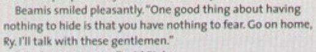
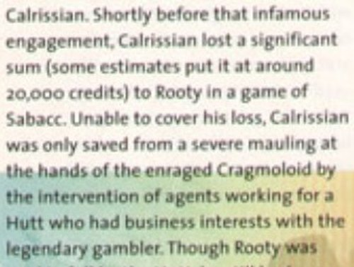
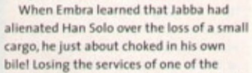

# Owner Material 037 — Star Wars D20 Drive folder (Core, Revised Core and Saga Edition): Star Wars Gamer/Star Wars Gamer 06.pdf [Star Wars Roleplaying Game (d20, 2000)] (scan pages 1–60)

- **Source:** Wizards of the Coast Star Wars Roleplaying Game books, web enhancements, Living Force campaign modules and articles (2000–2010), from the owner's "Star Wars D20" Drive folder (only the three edition subfolders; "General" was not read, as instructed). Secondary source (licensed Legends reference). Scan OCR'd on the box; the scan stays box-only and is **not** published.
- **Method:** every scanned page was OCR'd and machine-screened sentence by sentence for power-relevant statements (fights, kills, defeats, Force feats, rankings, superweapons) that name a character on our roster; each kept sentence is quoted verbatim from the OCR text and has a crop of the printed passage directly under it. Pages with nothing power-relevant are still listed with what is on them.
- **Citation:** "*Star Wars Gamer 06* (SWRPG d20), p.X" by printed page ("scan p.X" where no printed number applies). **Weight:** Licensed RPG material: a secondary source. Narrative text sums up Legends lore; game statistics are rules for players, not canon power levels, and rank lowest.

## scan p.1 (scan page 1)

Page contents: 18 words, 2 paragraphs | headings/entries: 

## scan p.2 (scan page 2)

Page contents: 0 words, 0 paragraphs | headings/entries: 

## scan p.3 (scan page 3)

Page contents: 427 words, 39 paragraphs | headings/entries: THE Force in STAR WARS GAMING; CONTENTS:; G2; THe GAMING Universe; OWE WITH THe Force; Data; TECHNICAL; Speciat Ops: THE FReeLancee ey MSS OOCHER; BRANDON MCLINDOW; Deck Plans; Stete of the Arts; Depertments; Aatrenate Dumaensions; ALION HORIZONS

## scan p.4 (scan page 4)

Page contents: Gamer #6 editorial (Bounty Hunters issue): outgoing editor-in-chief moves to RPG R&D as Star Wars RPG Creative Director; essay on 'May the Force be with you' (hand-read)

## scan p.5 (scan page 5)

Page contents: Force Feedback letters (writer names not recorded): Silent Death Dam Con and BPV answers, NJO Silent Death supplement announced; Valance the Hunter request (hand-read)

## scan p.6 (scan page 6)

Page contents: 740 words, 69 paragraphs | headings/entries: Via internet; Chow writing on the ve weet; Your meditative ritual, of course, told; HOOKS, pi! s Owens; Nerf Ranchers Daug; Sean H Roanoke, VA; Hlackstalker; Veat!; Noxy begins SHCA PORE; Ww orginal onnne rach mor; Ors Gavier #7. See you orn; STAR WARS GAMER

## scan p.7 (scan page 7)

Page contents: Letters: Human-replica droids (Guri) treated as their species with droid Force immunities, heal naturally; drawbacks of the dark side (hand-read)

### Stat block notes (game mechanics, not feats)

- Slayn & Korpil B-Wing/E2: sneak-peek starship stats ahead of Starships of the Galaxy: Tiny 16.9 m, crew 2, Defense 22, SP 100, HP 150, DR 5, assault lasers 8d10x2, heavy proton torpedoes 10d10x2, light ion cannons (3 fire-linked) (Source: *Star Wars Gamer 06* (SWRPG d20), scan p.7)

## scan p.8 (scan page 8)

Page contents: HoloNet Transmission rules Q&A: multiclass limits (20 levels; Jedi only into Force prestige classes), creature levels deferred to Alien Anthology, standard utility belt contents (600 cr, 4 kg; Jedi version adds aquatic breather), power-pack recharge unit, double-weapon penalties, Defense-roll variant, Hutts no longer 'always fallen' (errata 'prone') (hand-read)

## scan p.9 (scan page 9)

Page contents: 549 words, 29 paragraphs | headings/entries: Got rules questions' Send therm to

## scan p.10 (scan page 10)

Page contents: Rogues Gallery: Bounty Hunters portraits (Mike Villardi) (hand-read)

## scan p.11 (scan page 11)

Page contents: Fiction 'Far Cry' by Kathy Tyers: teen band Far Cry (Ryley Ancum, Hannis D'lund, Erik Laudersiag) hides Alliance intelligence in 'bass code' invented by Ry's teacher Tet Tramys, used only in the Six Local Systems (hand-read)

## scan p.12 (scan page 12)

Page contents: 1008 words, 29 paragraphs | headings/entries: Dark eyes, deeper than starlight; Dark Gyes. Warm Thoughts; STAR WARS Gamer 18

## scan p.13 (scan page 13)

Page contents: 944 words, 32 paragraphs | headings/entries: Ry's heart started pounding a core-drive beat,

## scan p.14 (scan page 14)

Page contents: 989 words, 29 paragraphs | headings/entries: STAR WARS GAMER 21

- **Keth Beamis** — entry/section: Keth Beamis faces the TSSF: "“One good thing about having nothing to hide is that you have nothing to fear. Go on home, Ry. I'll talk with these gentlemen.”" Source: *Star Wars Gamer 06* (SWRPG d20), scan p.14
  

## scan p.15 (scan page 15)

Page contents: Far Cry continued: Beamis suicides with an affide crystal rather than betray Ry; Governor Shran Etison (ex-b'ssa nuuvu player, ex-smashball hero) and Captain Hall use Far Cry as bait for the Holstrum Talent Agency on Beltrix; ISA Intelligence agent Onjo Fegel (kloo horn) rides along; Ry turns his bass vye into a transmitter to warn the cell; Ry's mother revealed as an Alliance agent (hand-read)

## scan p.16 (scan page 16)

Page contents: 940 words, 31 paragraphs | headings/entries: Hannis muttered something into his plate,; Amp? But—; STAR WARS Gamer 23

## scan p.17 (scan page 17)

Page contents: 969 words, 35 paragraphs | headings/entries: How maty POmpoUs shRoobs; I could."

## scan p.18 (scan page 18)

Page contents: 941 words, 30 paragraphs | headings/entries: Onjo pushed the enforcer aside."! think not."; STAR WARS Gamen 25

## scan p.19 (scan page 19)

Page contents: 784 words, 53 paragraphs | headings/entries: Thinks for usteNing. YOu rock,; Far Cry; Ryley Ancum, Bass Vye Player; Hannis D'Lund, Touchboard Player; Behind the Music; Shran Etison, Imperial Governor; Feats: Armor Proficiency (light, medium, heavy),; Emphasis (Diplomacy), Toughness, Trustworthy,; Weapon Group Proficiency (blaster pistols, blaster; Erik Lauderslag, Perc Player

### Stat block notes (game mechanics, not feats)

- Ryley Ancum: Male Human Noble 2; Entertain (bass vye) +7; feats Low Profile, Trustworthy (Source: *Star Wars Gamer 06* (SWRPG d20), scan p.19)
- Hannis D'Lund / Erik Laudersiag: Hannis: Male Human Noble 1, touchboard player; Erik: Male Human Noble 1, Entertain (percs and crashers) +8 (Source: *Star Wars Gamer 06* (SWRPG d20), scan p.19)
- Shran Etison: Imperial Governor of the Six Local Systems: Male Human Noble 5/Soldier 5, vibrodagger, Diplomacy +14, Fame, Iron Will, Trustworthy, Speak Shyriiwook (Source: *Star Wars Gamer 06* (SWRPG d20), scan p.19)
- Onjo Fegel: Male Human Scoundrel 4, Generic Con Artist template with Entertain (kloo horn) +10 (Source: *Star Wars Gamer 06* (SWRPG d20), scan p.19)

## scan p.20 (scan page 20)

Page contents: How the Other Half Hunts (Rebellion Era Sourcebook supplement): first official d20 stats for Dengar, Zuckuss, 4-LOM; Dengar bio (Ferini swoop team, Agrilat crash with Han Solo, Imperial cyber-rebuild, Manaroo, Punishing One, Kuat of Kuat, Grappa the Hutt) (hand-read)

## scan p.21 (scan page 21)

Page contents: 542 words, 47 paragraphs | headings/entries: Gays; Punishing One—Dengars modified; One step behind Boba Fett, Dengar; Ing city's Casing; Hutt; Ve; Hi. my name is Dengar; Hi Dengart; Teeth of Tatooine. Manaroo, for

## scan p.22 (scan page 22)

Page contents: 869 words, 24 paragraphs | headings/entries: HOW THE OTHER; Carkoon, rescued; Guckass, the Uncanny Oar; VOLUME | NUMBER 6

### Stat block notes (game mechanics, not feats)

- Speak Dengar: Male Human, Sci §/Sol 3/BH 4; Init +3 (Dex); Def 23 (+10 class, +3 Dex); Spd 10m; VP/WP 95/17; Atk 411/46 melee (1d9+1, punch), 413/48 ranged (308, crit 19-20, blaster carbine) or +13/+8 ranged (special, modified riot gun); SQ Mlicit barter, better lucky than good, sneak attack +406, target bonus +2; SV Fort +9, Ref +10, Will +5; SZ M; FP 2; DSP 3; Rep g; S (Source: *Star Wars Gamer 06* (SWRPG d20), scan p.22)
- Dengar: Male Human Scoundrel 5/Soldier 3/Bounty Hunter 4; Def 23; VP/WP 95/17; blaster carbine, modified riot gun; Pilot +17; Punishing One (modified JumpMaster 5000) (Source: *Star Wars Gamer 06* (SWRPG d20), scan p.22)
- Zuckuss: Gand Findsman bounty hunter with Force skills Enhance Senses +9, Farseeing +12; Alter, Control, Sense; snare rifle; ammonia breather species feature (oxygen exposure Con damage); permanently lost 4 Con; Mist Hunter (Byblos G-1A) (Source: *Star Wars Gamer 06* (SWRPG d20), scan p.22)

## scan p.23 (scan page 23)

Page contents: Zuckuss bio: first Findsman to work offworld, partners with 4-LOM, Bounty Hunters Guild (Cradossk, Bossk, Nil Posondum), lung damage, Nardix bounty, Bright Hope, joins the Alliance, Drawmas Sma'Da (hand-read)

## scan p.24 (scan page 24)

Page contents: 4-LOM bio: LOM-series protocol droid on liner Kuvari Princess turned criminal by computer simulations; Dom Pricina's Antares Sapphire (hand-read)

## scan p.25 (scan page 25)

Page contents: 458 words, 53 paragraphs | headings/entries: ZUCHUSS $; Challenge Code: C; Equipment; Concussion riffe, binders, vocabulator, trans; Survival +9; Unspent Skill Points: &; STAR WARS GAME

### Stat block notes (game mechanics, not feats)

- 4-LOM: Modified walking protocol droid Diplomat 1/Scoundrel 8/Bounty Hunter 2; Def 18; VP/WP 61/15; concussion rifle; Gather Information +17; memory lost when blasted by Fett, now cold fourth-degree hunter (Source: *Star Wars Gamer 06* (SWRPG d20), scan p.25)

## scan p.26 (scan page 26)

Page contents: Bounty hunter weapons: BlasTech W-90 concussion rifle, riot gun and Dengar's modified single-target riot gun, Merr-Sonn GRS-1 snare rifle (shockstun mist plus spraynet entangle) (hand-read)

## scan p.27 (scan page 27)

Page contents: Bounties to Die For (S. Mitch Ritchie), Imperial Enforcement Datacore and IPKC certificates (hand-read)

### Stat block notes (game mechanics, not feats)

- MI-726: rogue walking security droid Scoundrel 2/Soldier 4, two repeating blasters (up to five attacks), ex-Sienar board member's guard turned saboteur; 50,000 cr dismantle on sight (Source: *Star Wars Gamer 06* (SWRPG d20), scan p.27)

## scan p.28 (scan page 28)

Page contents: 537 words, 34 paragraphs | headings/entries: Devidia Vennsiot Female Human NbI 8; Dex); Spd rom; VPYWP 40/1; Atk +9/+4; Do not try to apprehend this dangerous; MI-726 Repeating Blaster Options; Ranged Attack Bonus; DEVIDIA VENNSIOL; STAR WARS GAMER 37

### Stat block notes (game mechanics, not feats)

- Devidia Vennsiol: Female Human Noble 8, Sacorrian official's daughter, stole Safidine Industries prototype blaster pistols with Dorbus Kyrullus; 5,000 cr dead or alive (Source: *Star Wars Gamer 06* (SWRPG d20), scan p.28)

## scan p.29 (scan page 29)

Page contents: 575 words, 19 paragraphs | headings/entries: BOUNTIES TO DIE FOR; BG vo.mMe | WUMBER 6; Independent Posting; Reward: 50,000 credits

### Stat block notes (game mechanics, not feats)

- Stormtrooper X: Male Human Soldier 6/Elite Trooper 2, Outer Rim pirate leader flying an ancient N-1 starfighter, transponder 'Rogue Imperial 5'; Narbuj Desilijic Preor posting 20,000 cr (Source: *Star Wars Gamer 06* (SWRPG d20), scan p.29)

## scan p.30 (scan page 30)

Page contents: Vooz Nooxoo Una ('The Patriot' in Bocce): Coruscant vigilante in engineered organic plant-fiber armor with retractable claws; 7,500 cr Imperial posting (hand-read)

### Stat block notes (game mechanics, not feats)

- Drooto Sploonore: Male Rodian Noble 5/Crime Lord 4, Hydian Way spice baron; self-posted bounty as a bet with Bormm Biveedo; 50,000 cr (Source: *Star Wars Gamer 06* (SWRPG d20), scan p.30)

## scan p.31 (scan page 31)

Page contents: 504 words, 12 paragraphs | headings/entries: NO vo.ume i wuMeeR CG

### Stat block notes (game mechanics, not feats)

- Vooz Nooxoo Una: Male Human Expert 1/Soldier 3/Scoundrel 2 bio-geneticist vigilante; self-made plant-fiber armor DR 3 with thorn damage to unarmed attackers and grapplers, bladed gauntlet (Source: *Star Wars Gamer 06* (SWRPG d20), scan p.31)

## scan p.32 (scan page 32)

Page contents: 492 words, 31 paragraphs | headings/entries: Feats: Alertness, Frightful Presence, improved Initiative, Track,; SUBJECT 4OBEB493%; FEEROORACHUH; STAR WARS GAMern 41

### Stat block notes (game mechanics, not feats)

- Subject 4D668493X: escaped Imperial genetic test creature, Highly evolved Predator 4/Scout 2, darkvision, stowed away to Tatooine; contract for disintegration only (50,000 cr); bounty text hints it is sentient (Source: *Star Wars Gamer 06* (SWRPG d20), scan p.32)
- Reerookachuk: Male Wookiee Soldier 6 slave raised in Kessel mines, never taught Wookiee honor code, led a riot on slaver Sord Montok near the Minos Cluster; 65,000 cr live capture (Source: *Star Wars Gamer 06* (SWRPG d20), scan p.32)

## scan p.33 (scan page 33)

Page contents: 584 words, 23 paragraphs | headings/entries: BOUNTIES TO OIE FOF; N2 volUMe | NUMBER G6; Feats: Armot Proficiency (light, medium,; Blank Shot, Weapon Focus (vibrob-

### Stat block notes (game mechanics, not feats)

- Traggissk Reosss: Male Trandoshan Scoundrel 3/Soldier 6, Winnard Clan pirate flight leader who hit a secret Imperial freighter; Broont Cloone posts 100,000 cr live capture; suspected Rebel (Source: *Star Wars Gamer 06* (SWRPG d20), scan p.33)

## scan p.34 (scan page 34)

Page contents: 595 words, 20 paragraphs | headings/entries: Feats: Alertness, Fame, Persuasive, Sharp-; Eyed, Weapon Group Proficiency (sim-; CrYEDITS; STAR WARS GaweR 4B

### Stat block notes (game mechanics, not feats)

- Skawn Bonduna: Male Twi'lek Fringer 7, ex-teen star of banned band Sonic Free, soundcaster; 30,000 cr Imperial posting (Source: *Star Wars Gamer 06* (SWRPG d20), scan p.34)

## scan p.35 (scan page 35)

Page contents: 324 words, 17 paragraphs | headings/entries: BOUNTIES TO DIE FOR Scranton Toon; GCCRANTON TOON; Hull Points; 120; DR: 5; YY VOLUME | HUMBER 6

### Stat block notes (game mechanics, not feats)

- Scranton Toon: Male Rodian Fringer 2/Scoundrel 2/Soldier 2 pirate, posted by Servid Norn (rival of Plook Hartar); 10,000 cr; ship Goonga Munt Goonga (modified Incom Shock Hauler 33: Def 24, SP 40, HP 120, 4 lasers, concussion missiles) (Source: *Star Wars Gamer 06* (SWRPG d20), scan p.35)

## scan p.36 (scan page 36)

Page contents: The Battle of Hoth: exclusive two-player Rebellion-era board game (Rieekan vs Veers), framed as a New Republic officer-cadet holovid briefing; infantry/vehicle/air two-sided unit counters (hand-read)

## scan p.37 (scan page 37)

Page contents: Battle of Hoth rules: command roll, MARCH/RALLY/HARPOON/SELF-DESTRUCT/STRAFE abilities, event table ('Great shot!', 'Cunning plan', 'Charge!', '...Steady...'), stacking and overrun, bonus/penalty rerolls (hand-read)

## scan p.38 (scan page 38)

Page contents: 378 words, 29 paragraphs | headings/entries: THE BATTLE OF HOTH; Event Table; NB volMme i; SHOOTING PHASE; Players alternate taking turns; EVENTS; MovEMENT; A Sample Command Phase

## scan p.39 (scan page 39)

Page contents: 452 words, 20 paragraphs | headings/entries: STACKING; In some cases, more than one; Units cannot, however, shoot at; AB; A Sample Shooting Phase

## scan p.40 (scan page 40)

Page contents: 292 words, 27 paragraphs | headings/entries: THE BATTLE OF HOTH ahohreeet; Prmacty i}; There's no limit to the nurnber of; RALLY: if this un | damaged, y

## scan p.41 (scan page 41)

Page contents: Battle of Hoth missions narrated by General Blake: 1 'It's a good bet the Empire knows we're here' (Han's tauntaun vs probe droids), 2 'Our first catch of the day', 3 'Prepare for ground assault' (Luke's snowspeeder, Golan batteries, main power generators vs Veers' AT-AT); reference cards and unit SPEED/ARMOR/FIREPOWER tables p43-44 (hand-read)

## scan p.42 (scan page 42)

Page contents: 455 words, 33 paragraphs | headings/entries: THE BATTLE OF HOTH; Imperial: 1 AT-AT 3 AT-ST; Objectives: The mission ends when there; During each of the Alliance player's com; Mission 3; FS et SS; Alliance: 5 Echo Base Troopers

## scan p.43 (scan page 43)

Page contents: 326 words, 28 paragraphs | headings/entries: LURES SMOWSPELDER; REBEL ALLIANCE REFERENCE CARD; Penalties t Mamrocs fy SAF peste; Event Table; T; SNOW TROOPER SNOWTROOPER; EMPIRE REFERENCE CARD; Event Table - Event; STAR WARS GAMER &B

## scan p.44 (scan page 44)

Page contents: 75 words, 16 paragraphs | headings/entries: THE BATTLE OF HOTH; EMPIRE REFERENCE CARD; Unit SPEED ARMOR FIREPOWER; Generators; EMPIRE Snowtrooper Probe Droid AT-ST; AT-AT; SYM voLUME | NUMBER O; ALLIANCE REFERENCE CARD; SPEED ARMOR FIREPOWER; ALLIANCE Echo Base; Trooper W/O; Generators __ 0/0 38; EMPIRE

## scan p.45 (scan page 45)

Page contents: Combat Tactics for Survival (Stephen Schubert): pre-battle Force Mind and inspire confidence, combined fire, cover and fighting defensively, close quarters, grenades, stun, sneak attack; worked example party Vinto (Rodian scoundrel), Mynnic (Human Jedi consular), Wertsnik (Trandoshan soldier), Pal-Han-Das (Cerean noble) (hand-read)

## scan p.46 (scan page 46)

Page contents: Combat Tactics continued: close quarters and hand-to-hand, delaying to avoid firing into melee, fixed emplacements, flanking, disarm/grapple/trip; the example party defeats battle droids and two Dark Jedi (hand-read)

## scan p.47 (scan page 47)

Page contents: 484 words, 14 paragraphs | headings/entries: 

## scan p.48 (scan page 48)

Page contents: 169 words, 11 paragraphs | headings/entries: Vielorsy; Mynnic scowls as he deacti-; The Players; Daan Ito Barus Deoins; Ince COmPULAR Soapere Now; SCOUNDETL; STAR WARS Gawmen SB

## scan p.49 (scan page 49)

Page contents: Combat Tactics: class roles in combat for all eight core classes (hand-read)

## scan p.50 (scan page 50)

Page contents: 224 words, 11 paragraphs | headings/entries: Force Apert; Jeni CONSULAR; Jeo GUARDIAN; STAR WARS GAMOR

## scan p.51 (scan page 51)

Page contents: Model Citizen: The Death Star (H.G. Walls, photos Nanette Gunder): 28mm interiors of the docking bay control room, lift tube bank, and detention block (control room, corridor, cell) from scrap and model kits (hand-read)

## scan p.52 (scan page 52)

Page contents: 249 words, 47 paragraphs | headings/entries: Hanomag half-track bod; The finishing; Henings; DOCKING BAY CONTROL ROOM; WINDOWS; Fue. PUMP; CONTROL PANELS; The; Keep it Simple, Stormtrooper; X-acto knife. Ternpered; Masonite the d

## scan p.53 (scan page 53)

Page contents: 346 words, 92 paragraphs | headings/entries: Oblong pane Isarea; Lift Tube Bank; A centrally-locate 115/16 x 15/16; GY volume - NUMBER G6; The main er; Jide in and out; The blaster ra; Jex card with two; Wo; Ie

## scan p.54 (scan page 54)

Page contents: 242 words, 15 paragraphs | headings/entries: HOLOING; HOLOING Cru *; Leu; COMPUTER Coreinor CONSOLE; DETENTION BLOCK & LIFT TUBES

## scan p.55 (scan page 55)

Page contents: 376 words, 25 paragraphs | headings/entries: 

## scan p.56 (scan page 56)

Page contents: 420 words, 17 paragraphs | headings/entries: STAR WARS GAMER 67

## scan p.57 (scan page 57)

Page contents: The Usual Suspects (Andrew Hind; Dark Horse Comics characters) framed as the underground Republic Journal of Law-Enforcement and Low-Intensity Conflict's Threat Dossier (hand-read)

## scan p.58 (scan page 58)

Page contents: Cragmoloid species: Ankus near Ord Mantell, anthropomorphic elephants near 3 m tall, hunted for tusks, homeworld strip-mined by TaggeCo; traits +4 Str/+2 Wis, Large, +2 charge, tusks, live 400+ years, language Cragii (hand-read)

- **Lando Calrissian**: "Shortly before that infamous engagement, Calrissian lost a significant sum (some estimates put it at around 20,000 credits) to Rooty in a game of Sabacc, Unable to cover his boss, Calrissian was only saved from a severe mauling at the hands of the enraged Cragmoloid by the intervention of agents working for a Hutt who had business interests with the legendary gambler." Source: *Star Wars Gamer 06* (SWRPG d20), scan p.58
  

### Stat block notes (game mechanics, not feats)

- Rooty: Cragmoloid male Scoundrel 2, Nar Shaddaa gambler with sawn-off tusks, won about 20,000 cr from Lando at sabacc; ship Solar Grazer (modified Cuirilla-Raye Xylines CRX-Tug: Small 42 m, Def 21, HP 120, DR 10, two tractor beams) (Source: *Star Wars Gamer 06* (SWRPG d20), scan p.58)

## scan p.59 (scan page 59)

Page contents: Embra the Hutt: businesslike, fair-dealing Hutt rival of Jabba, Yavin Vassilika contest via 4-LOM, Zuckuss, Sardu Sallowe; lives on Mazhar in the Gordian Reach. Moff Harsh: refused cybernetic legs after Chabosh, Captain of Star Destroyer Cauldron, Moff of the Bosph sector (hand-read)

- **Han Solo**: "When Embra learned that labba had alienated Han Solo over the boss of a small cargo, he just about choked in his own bile!" Source: *Star Wars Gamer 06* (SWRPG d20), scan p.59
  

### Stat block notes (game mechanics, not feats)

- Nima Maas: Human female Noble 1/Scoundrel 5, ISB surveillance agent, daughter of Delphon senator Ilov Maas; Black Hole Pirates and the Star Destroyer Ripclaw shaped her; killed on Tatooine pursuing pro-Rebel politician Temo Dionisio after betraying a bounty hunter (Source: *Star Wars Gamer 06* (SWRPG d20), scan p.59)

## scan p.60 (scan page 60)

Page contents: Lieutenant Harme Kiela: spoiled Voss-born TIE interceptor ace, protégé of Air Marshal Von Tarsh; turned pirate to free Tarsh, foiled by Calrissian; escaped, on Cracken's Most Wanted list (hand-read)

### Stat block notes (game mechanics, not feats)

- Embra the Hutt: Hutt male Noble 6/Scoundrel 1/Crime Lord 2; Diplomacy +18, Sense Motive +15; hold-out blaster hidden in his repulsor-sled (Source: *Star Wars Gamer 06* (SWRPG d20), scan p.60)
- Moff Harsh: Male Human Noble 2/Soldier 4/Officer 7; Intimidate +19, Frightful Presence; Imperial-class Star Destroyer Cauldron (Source: *Star Wars Gamer 06* (SWRPG d20), scan p.60)
