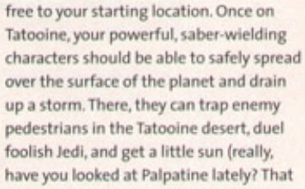
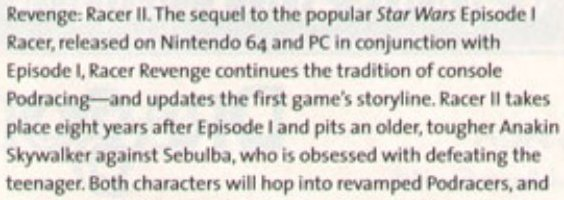

# Owner Material 037 — Star Wars D20 Drive folder (Core, Revised Core and Saga Edition): Star Wars Gamer/Star Wars Gamer 06.pdf [Star Wars Roleplaying Game (d20, 2000)] (scan pages 61–95)

- **Source:** Wizards of the Coast Star Wars Roleplaying Game books, web enhancements, Living Force campaign modules and articles (2000–2010), from the owner's "Star Wars D20" Drive folder (only the three edition subfolders; "General" was not read, as instructed). Secondary source (licensed Legends reference). Scan OCR'd on the box; the scan stays box-only and is **not** published.
- **Method:** every scanned page was OCR'd and machine-screened sentence by sentence for power-relevant statements (fights, kills, defeats, Force feats, rankings, superweapons) that name a character on our roster; each kept sentence is quoted verbatim from the OCR text and has a crop of the printed passage directly under it. Pages with nothing power-relevant are still listed with what is on them.
- **Citation:** "*Star Wars Gamer 06* (SWRPG d20), p.X" by printed page ("scan p.X" where no printed number applies). **Weight:** Licensed RPG material: a secondary source. Narrative text sums up Legends lore; game statistics are rules for players, not canon power levels, and rank lowest.

## scan p.61 (scan page 61)

Page contents: 662 words, 25 paragraphs | headings/entries: Sintas: Human Female Sct 2/Sol 5§/BH 4;; Atk 411/46 melee (2d4+1, vibrodagger),

### Stat block notes (game mechanics, not feats)

- Sintas: Human female Scout 2/Soldier 5/Bounty Hunter 4, two heavy blaster pistols, thermal detonator; Kiffu native with three facial lines on each cheek; Boba Fett's ex-wife and mother of his child (Source: *Star Wars Gamer 06* (SWRPG d20), scan p.61)
- Harme Kiela: Male Human Soldier 5/Scoundrel 2/Starfighter Ace 4; Pilot +21; TIE interceptor (Source: *Star Wars Gamer 06* (SWRPG d20), scan p.61)

## scan p.62 (scan page 62)

Page contents: 701 words, 14 paragraphs | headings/entries: Sardu Sallowuss

### Stat block notes (game mechanics, not feats)

- Sardu Sallowe: Human male (presumably) Fringer 8/Bounty Hunter 2 raised by Jawas on Tatooine, works with a Jawa pack; miniature sandcrawler (modified TaggeCo Survey-class Crawler, Colossal 40 m, 10 holding cells) (Source: *Star Wars Gamer 06* (SWRPG d20), scan p.62)

## scan p.63 (scan page 63)

Page contents: Adventure 'Welcome to the Jungle' (Darrin Drader, Steve Miller, Bart Armstrong, Brandon McLendon), 4th level, any era: scout Milac Troper fled and left Dayla Kev and Hereven to a gasnit; Dayla survived, bore son Hereven, became Lady Ahrkan with two Wookiee outlaws; revenge aboard Ithorian herdship Galactic Horizon (greedy Captain Roogak), Hoojibs drain technology; peace talks over the H'relac system; Lorrdian assistant Venra Andsof (hand-read)

## scan p.64 (scan page 64)

Page contents: 936 words, 34 paragraphs | headings/entries: Troper should remain alive to face Dayla; Another Day. Another Dollar; Getting the Heroes Involved; STAR WARS GAMER

## scan p.65 (scan page 65)

Page contents: Welcome to the Jungle: Venra's request, sealed in the jungle habitat, random encounters (veermok, divto, Wookiee sling sneak attack) (hand-read)

## scan p.66 (scan page 66)

Page contents: Herdship jungle habitat (25 km dome, holographic sky, 10 m of Ithorian soil over metal, airless containment ring), wound infection rule, refusing the hook earns a Dark Side Point (hand-read)

## scan p.67 (scan page 67)

Page contents: Keyed encounters: K1 quicksand with veermok (stats), K2 vornskyr ambush (Forest predator 8, Force skills, poisonous tail), K3 vornskyr shelter with cubs and salvageable power packs, K4 nerf herd stampede, K5 cave of the gasnit (artificial chemical geyser; gasnit Airborne Predator 6, poisonous bite, improved grab) (hand-read)

## scan p.68 (scan page 68)

Page contents: 1106 words, 23 paragraphs | headings/entries: K4, Nene Hero,; There are twenty-five nerfs present; Despite their repulsive appearance, nerf; Skillc: intimidate +3, Listen +90, Move

## scan p.69 (scan page 69)

Page contents: Planned encounter P1 'The Hoojib Imperative': ten energy-siphoning Hoojibs promised freedom by Dayla drain the heroes' powered gear (hand-read)

### Stat block notes (game mechanics, not feats)

- Hoojib: energy drain (contact or within 4 m, 1d3 shots/hours per round) and telepathy within 500 m; 20-30 cm, white fur, single antenna; enslaved by Wookiees Fahraark and Friyahrr (Source: *Star Wars Gamer 06* (SWRPG d20), scan p.69)

## scan p.70 (scan page 70)

Page contents: Encounters P2 'Against the Wookiees' (night raid with slings and clubs), P3 'Hunting Gasnit' (Troper collapses on seeing it), P4 'Dayla and Hereven Revealed'; Xanqar Levitator SU-4 repulsorlift service platform; conclusion with Captain Roogak and the Hoojibs' fate (hand-read)

## scan p.71 (scan page 71)

Page contents: 785 words, 18 paragraphs | headings/entries: Welcome to the Jungle; REePuLsoRrr Seevice PLatroRm; Gamemaster Characters

## scan p.72 (scan page 72)

Page contents: 794 words, 31 paragraphs | headings/entries: Equipment: Comlink, datapad; Haeeven Kev; Amuassanor Mitac Troere; Trope Tei; Equipment: Comlink, vibrottade; STAR WARS GAwen 8S

### Stat block notes (game mechanics, not feats)

- Venra Andsof: Female Lorrdian (Near-Human) Diplomat 4, Sense Motive +12; Lorrdian cultural traits (non-vocal kinetic language, Sense Motive bonus) (Source: *Star Wars Gamer 06* (SWRPG d20), scan p.72)
- Hereven Kev: Human male Force Adept 5/Dark Side Marauder 5; Force Grip +10, Fear +10; feats Hatred, Rage (Source: *Star Wars Gamer 06* (SWRPG d20), scan p.72)
- Milac Troper: Male Human Scout 3/Diplomat 10, Diplomacy +16 (Source: *Star Wars Gamer 06* (SWRPG d20), scan p.72)

## scan p.73 (scan page 73)

Page contents: 782 words, 23 paragraphs | headings/entries: Welcome to the Jungle; Force Feats: Alter; Davita Kev; Feots: Endurance; NUMBER 6

### Stat block notes (game mechanics, not feats)

- Fahraark / Friyahrr / Captain Roogak: Fahraark: Wookiee Scoundrel 6; Friyahrr: Wookiee Scout 3/Soldier 2/Force Adept 1 with Force Grip; Roogak: Ithorian Noble 9 (Source: *Star Wars Gamer 06* (SWRPG d20), scan p.73)
- Dayla Kev: Human female Scout 4/Force Adept 8 (Lady Ahrkan), slugthrower pistol, Force Push +10, Friendship +10, Force Lightning feat; generic Ithorian herdship crew member Expert 2 (Source: *Star Wars Gamer 06* (SWRPG d20), scan p.73)

## scan p.74 (scan page 74)

Page contents: University of Sanbra Guide to Intelligent Life: The Nikto (Cory J. Herndon), sent by renegade sentientologist Tem Eliss from Hutt space: Kintan radiated by dying star M'dweshuu; cult of M'dweshuu and its bloody inquisition; Hutt Churabba bombards the cult and wins the Nikto pact; cult briefly expels the Hutts 1,000 years before Yavin; mixed-race outcasts (hand-read)

## scan p.75 (scan page 75)

Page contents: 631 words, 17 paragraphs | headings/entries: Kajain'sa'Nikto (Red Nikto)

### Stat block notes (game mechanics, not feats)

- Nikto subspecies: Red Kajain'sa'Nikto (desert dweller, week without water), green Kadas'sa'Nikto (forest dweller, scent; 'lost tribe' legend), mountain Esral'sa'Nikto (cheek fins), pale Gluss'sa'Nikto (island dweller, hold breath; NJO colony on Drexel II), southern M'shento'su'Nikto (ultrasonic sensory tubes, Listen +4); all +2 natural armor (Source: *Star Wars Gamer 06* (SWRPG d20), scan p.75)

## scan p.76 (scan page 76)

Page contents: 633 words, 24 paragraphs | headings/entries: The NtkTO; Tbe MOUNTAIN; Kaoas'sa'Nixto (Gatin Nixto); Subspecies Features: +2 Strength, ~2 intel; Special Qualities: Forest Dweller—Green

## scan p.77 (scan page 77)

Page contents: 500 words, 37 paragraphs | headings/entries: Eseat'sa 'Nixto (MOUNTAIN NixTo); Guuss'sa'Nicto (Pat Nexto); They have bost (or simply never evolved); Special Qualities; Keen Senses—Unique; STAR WARS Gamer @1

## scan p.78 (scan page 78)

Page contents: Special Ops: The Freelancer multiclass archetype (Jesse Decker): data-retrieval specialist selling secrets to the highest bidder; new gear thermoguard jumpsuit (2,500 cr, defeats infrared and darkvision) and camouflage poncho (hand-read)

## scan p.79 (scan page 79)

Page contents: Freelancer progression (Scoundrel/Scout multiclass table) with variants Information Network, Infiltrator, Adaptive Learning (hand-read)

## scan p.80 (scan page 80)

Page contents: The Shaft: Swoop Dreams (Cory J. Herndon), Star Wars CCG Tatooine-expansion Dark Side swoop gang deck: Flare-S Racing Swoop, Darth Maul, Aurra Sing, Mara Jade, Emperor, Bane Malar; Watto's Chance Cube with Maul's Electrobinoculars, Restraining Bolt, Weapon Levitation (hand-read)

- **Palpatine (Darth Sidious)**: "Once on Tatooine, your powerful, saber-wielding characters should be able to safely spread over the surface of the planet and drain up a storm, There, they can trap enemy pedestrians in the Tatooine desert, duel foolish Jedi, and get a little sun (really, have you looked at Palpatine lately?" Source: *Star Wars Gamer 06* (SWRPG d20), scan p.80
  

## scan p.81 (scan page 81)

Page contents: 347 words, 29 paragraphs | headings/entries: Maut's Evectro-; RESTRAINING BouT &; Mi; RESTRAINING BOLT &; LEVITATION ATTACK; Levitation Attack, an oft-overlooked destiny 4 (last!

## scan p.82 (scan page 82)

Page contents: Building the Death Star II (Doug Taylor), CCG deck nicknamed 'Alan Parsons Project': We Shall Double Our Efforts!, Moff Jerjerrod, That Thing's Operational, Scythe 1 and 3 (hand-read)

## scan p.83 (scan page 83)

Page contents: 523 words, 17 paragraphs | headings/entries: F' 'Pann

## scan p.84 (scan page 84)

Page contents: LucasArts Takes E3 by Force (Haden Blackman), motto 'Never Underestimate the Power of the Force': Star Wars Racer Revenge: Racer II (PS2, Rainbow Studios), eight years after Episode I, older Anakin vs Sebulba, 18 courses on 7 worlds (hand-read)

- **Darth Vader (Anakin Skywalker)**: "The sequel to the popular Star Wars Episode | Racer, released on Nintendo 64 and PC in conjunction with Episode |, Racer Revenge continues the tradition of console Podracing—and updates the first game's storyline, Racer Il takes place eight years after Episode | and pits an older, tougher Anakin Skywalker against Sebulba, who is obsessed with defeating the teenager." Source: *Star Wars Gamer 06* (SWRPG d20), scan p.84
  

## scan p.85 (scan page 85)

Page contents: E3 previews: Star Wars Obi-Wan (Xbox; Jedi Temple training room, cortosis-staff cartel thug, duel with Mace Windu, slow-motion mode, Theed battle droids, Darth Maul boss); Rogue Leader: Rogue Squadron II (GameCube, Factor 5, Luke and Wedge, Fall 2001) (hand-read)

## scan p.86 (scan page 86)

Page contents: Jedi Outcast: Jedi Knight II (PC, Raven Software, Quake III engine): Kyle Katarn redeemed by Mara Jade after Mysteries of the Sith, set 13-14 years after Yavin, smarter stormtroopers, saber 'limbing'; Starfighter Special Edition (Xbox, Secret Level; Rhys Dallows, Vana Sage, Nym) (hand-read)

## scan p.87 (scan page 87)

Page contents: Galactic Battlegrounds (Age of Empires engine, 6 civilizations, 200 units, scenario editor, 200 MHz minimum); Escape from Monkey Island PS2 (hand-read)

## scan p.88 (scan page 88)

Page contents: 513 words, 31 paragraphs | headings/entries: R Monkeys Too; Ae & "; SITH WARS; STAR WARS GAMER 105

## scan p.89 (scan page 89)

Page contents: Galaxies E3 demo: Classic-era setting between ANH and ESB with Naboo visitable (Great Grass Plains, Otoh Gunga, Theed, Lianorm Swamps); eight playable species; radial grass, 80+ emotes and emoticon-driven animations, kaadu behaviour variety; Tatooine with Jabba, dewback taming, droid companions, krayt dragon; Space Expansion announced for 2003 (1,600 m Star Destroyer) (hand-read)

## scan p.90 (scan page 90)

Page contents: 639 words, 17 paragraphs | headings/entries: Stay Wors Galaxies; Above: Am; STAR WARS Gamern 107

## scan p.91 (scan page 91)

Page contents: Galactic Battlegrounds interview with director Garry Gaber: renamed from 'Battleground', ~75% complete, snowspeeder tow-cable attack, Faamba shield generator; Galaxies player-versus-player system: Truce, Safe and Wild Areas, enemy flagging, bounty or 'report' making the killer an Outcast, forgiveness or local pardons, Declared Rebel factions (hand-read)

## scan p.92 (scan page 92)

Page contents: 597 words, 24 paragraphs | headings/entries: Many massively-multiplayer online games offer players the; STAR WARS GAMER 109

## scan p.93 (scan page 93)

Page contents: 628 words, 17 paragraphs | headings/entries: Star Wars Galaxies will feature a hos

## scan p.94 (scan page 94)

Page contents: Letters: why era icons can't be used on every article; starter-product recommendations (Invasion of Theed boxed set, Dark Side Sourcebook, Rebellion Era Sourcebook, Alien Anthology, Starships of the Galaxy, Secrets of Naboo and Tatooine) (hand-read)

## scan p.95 (scan page 95)

Page contents: Infinities logo and canon: Lucas Licensing editor Sue Rostoni defines canon as 'an authoritative list of books that the Lucas Licensing editors consider an authentic part of the official Star Wars history'; Infinities and Star Wars Tales are outside it. Next-issue previews: Insider #56 (TPM DVD, Kevin Smith, Ahmed Best) and Gamer #7 (Bartyn's Landing, Silent Death NJO, Secrets of Mos Eisley, Defel/Sarkan/Tirrith stats) (hand-read)

