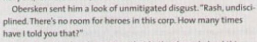
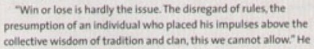
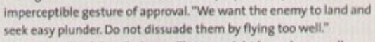
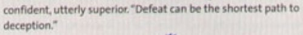
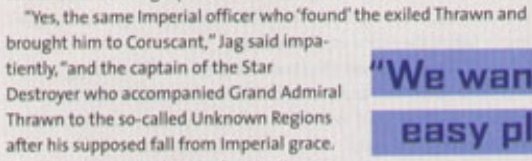
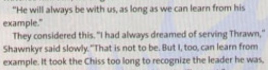
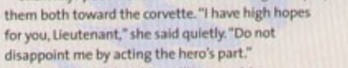
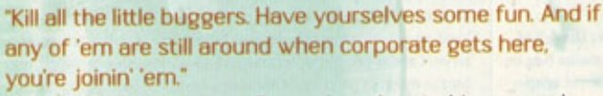
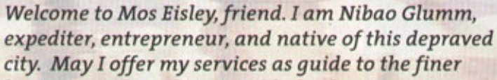
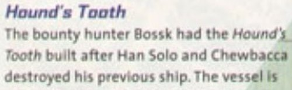

# Owner Material 037 — Star Wars D20 Drive folder (Core, Revised Core and Saga Edition): Star Wars Gamer/Star Wars Gamer 07.pdf [Star Wars Roleplaying Game (d20, 2000)] (scan pages 1–60)

- **Source:** Wizards of the Coast Star Wars Roleplaying Game books, web enhancements, Living Force campaign modules and articles (2000–2010), from the owner's "Star Wars D20" Drive folder (only the three edition subfolders; "General" was not read, as instructed). Secondary source (licensed Legends reference). Scan OCR'd on the box; the scan stays box-only and is **not** published.
- **Method:** every scanned page was OCR'd and machine-screened sentence by sentence for power-relevant statements (fights, kills, defeats, Force feats, rankings, superweapons) that name a character on our roster; each kept sentence is quoted verbatim from the OCR text and has a crop of the printed passage directly under it. Pages with nothing power-relevant are still listed with what is on them.
- **Citation:** "*Star Wars Gamer 07* (SWRPG d20), p.X" by printed page ("scan p.X" where no printed number applies). **Weight:** Licensed RPG material: a secondary source. Narrative text sums up Legends lore; game statistics are rules for players, not canon power levels, and rank lowest.

## scan p.1 (scan page 1)

Page contents: Star Wars Gamer #7 (Vol. 2 No. 1) 'Living on the Fringe' cover: free campaign poster map, Secrets of Mos Eisley, gunslinging adventure, frontier campaign, LucasArts previews, NJO fiction by Elaine Cunningham (hand-read)

## scan p.2 (scan page 2)

Page contents: Contents: Red Sky, Blue Flame (Chiss NJO fiction), Silent Death NJO, Bartyn's Landing (Cory J. Herndon), Secrets of Mos Eisley, Starships of the Bounty Hunters (Owen K.C. Stephens), Alien Anthology Addendum (Defel, Sarkan, Tirrith), Galaxy's Most Wanted (Tusken band), Sanbra guide to the Anx; Special Ops Dilettante and Vehicle Ace; Shaft Vader deck for Jedi Knights TCG; Rebel Commandos CCG; LucasArts strategy (hand-read)

## scan p.3 (scan page 3)

Page contents: 216 words, 25 paragraphs | headings/entries: Spectat Ops: DILETTANTE Oy 2344 OfCKEER; Deck Plans; THE SHAFT—Dark Lord WALKING; AY CORY . HERNDON; Reve. COMMANDOS #Y OOUG TATLO¥; GQ08e; ILLUSTRATION BY JOHN VAN FiecT; VOLUME 2, NUMBER 1 FRINGE BENEFITS; State of the Arts; LucasArts GAME PREVIEWS & STRATEGY; BY MADEN BLACKMAN; Departments

## scan p.4 (scan page 4)

Page contents: Editorial 'game geeks are way cooler than movie geeks' (Dave Gross) (hand-read)

## scan p.5 (scan page 5)

Page contents: Letters 'Tales from the Fringe': replies on the violence-in-media controversy (villains needed to depict good), back-issue ordering via swfan.wizards.com, Acrobat downloads, Jedi prestige classes coming in NJO and Power of the Force sourcebooks (hand-read)

## scan p.6 (scan page 6)

Page contents: 735 words, 39 paragraphs | headings/entries: You Want Back issues?; Rolling Meadows, IL; Zach Olson Via emall; Back Issues —; Star Wars Gamer #1; Premiere issue! 5!; Silent Death" starship; Of Kasirvyyi, |; STAR WARS GAmerR Il

## scan p.7 (scan page 7)

Page contents: Letters: ship maneuver statistic explained (size + engine maneuver modifier + crew skill, from Starships of the Galaxy); Akorec strike cruiser 4d10x2 laser cannons confirmed correct; missing Galaxy poster map (hand-read)

## scan p.8 (scan page 8)

Page contents: Jedi Counseling (JD Wiker): Jedi mission funds of (level x level) x 100 Republic credits, Padawans get none; Valorum likely funded Qui-Gon's 20,000 dataries; orphaned Padawans get a new Master; learning a dark side skill alone gives no Dark Side Point; Battlemind stacks Jedi Guardian and Dark Side Marauder levels; lightsaber-building Force Point imbues the crystals only; errata at www.wizards.com/swerrata (hand-read)

## scan p.9 (scan page 9)

Page contents: Jedi Counseling: Death Star superlaser left as a plot device (omitted from Starships of the Galaxy); trash-compactor ricochet rule (1d4 bounces, d20 per bounce, +0 attack); droid XP depends on participation (R2-D2 Scout 4/Expert 3 vs C-3PO Diplomat 3); trading Jedi levels for Sith prestige class levels (hand-read)

## scan p.10 (scan page 10)

Page contents: Rogues Gallery: Fringers (illustrated by Jim Mahfood) (hand-read)

## scan p.11 (scan page 11)

Page contents: Fiction 'Red Sky, Blue Flame' (Elaine Cunningham): 14-year-old Jag Fel at a hidden Chiss academy under Asdroni and two other moons, flying the battered clawcraft Blue Flame; Chief mechanic Obersken, Commandant Gimald Nurvodo; the false Thrawn return exposed; Commander Stent reports Voss Parck's liaison post fallen; a pirate freighter crashes through the dome (hand-read)

## scan p.12 (scan page 12)

Page contents: 892 words, 32 paragraphs | headings/entries: STAR WARS GAMER 21

- **Obersken** — entry/section: Obersken scolds Jag: "“Rash, undisciplined. There's no room for heroes in this corp. How many times have I told you that?”" Source: *Star Wars Gamer 07* (SWRPG d20), scan p.12
  
- **Gimald Nurvodo** — entry/section: Commandant Gimald rebukes Jag: "“Win or lose is hardly the issue. The disregard of rules, the presumption of an individual who placed his impulses above the collective wisdom of tradition and clan, this we cannot allow.”" Source: *Star Wars Gamer 07* (SWRPG d20), scan p.12
  

## scan p.13 (scan page 13)

Page contents: 1077 words, 29 paragraphs | headings/entries: The Chiss eyed him coolly. "Explain."

## scan p.14 (scan page 14)

Page contents: Red Sky, Blue Flame: cadet commander Shawnkyr Nuruodo takes command after Stent dies; Jag reveals Thrawn engineered his own exile to accept Imperial recruitment, and that Voss Parck staged Soontir Fel's disappearance; Baron Fel once mistook Jag for Wedge; Jag's blue piping marks him as never Chiss; Jag plans to lure the pirates down by flying badly (hand-read)

## scan p.15 (scan page 15)

Page contents: 1037 words, 37 paragraphs | headings/entries: Red Sky. Blue Flame

## scan p.16 (scan page 16)

Page contents: 943 words, 28 paragraphs | headings/entries: Do not dissuade them; STAR WARS GAMER 25

- **Shawnkyr Nuruodo** — entry/section: Shawnkyr's parting order to Jag: "“We want the enemy to land and seek easy plunder. Do not dissuade them by flying too well.”" Source: *Star Wars Gamer 07* (SWRPG d20), scan p.16
  
- **Jagged Fel** — entry/section: Jag replies to Shawnkyr: "“Defeat can be the shortest path to deception.”" Source: *Star Wars Gamer 07* (SWRPG d20), scan p.16
  
- **Grand Admiral Thrawn**: ""Yes, the same Imperial officer who 'found' the exiled Thrawn and brought him to Coruscant," Jag said impatiently, "and the captain of the Star Destroyer who accompanied Grand Admiral Thrawn to the so-called Unknown Regions after his supposed fall froen Imperial grace." Source: *Star Wars Gamer 07* (SWRPG d20), scan p.16
  

## scan p.17 (scan page 17)

Page contents: Red Sky, Blue Flame climax: Jag downs two pirate X-wings with torpedoes and a Z-95 with an ejected overloaded hyperdrive, feigns a crash with a cadet's body; the surviving cadets hang from ropes above mirrored transparisteel plates so the pirates fire low; Shawnkyr hands Jag her cadet commander insignia (hand-read)

## scan p.18 (scan page 18)

Page contents: 958 words, 40 paragraphs | headings/entries: Jag Fel, Hurnan Pilot; Equipment: Charric, cadet's clothing, clawcraft starfighter; STAR WARS GAMER 27

- **Jagged Fel** — entry/section: Jag on Thrawn to the cadets: "“He will always be with us, as long as we can learn from his example.”" Source: *Star Wars Gamer 07* (SWRPG d20), scan p.18
  
- **Shawnkyr Nuruodo** — entry/section: Shawnkyr to Jag: "“I have high hopes for you, Lieutenant,” she said quietly. “Do not disappoint me by acting the hero's part.”" Source: *Star Wars Gamer 07* (SWRPG d20), scan p.18
  

### Stat block notes (game mechanics, not feats)

- Jag Fel: Male Human Soldier 3; Pilot +12, Speak/Read Cheunh; charric, clawcraft starfighter (Source: *Star Wars Gamer 07* (SWRPG d20), scan p.18)

## scan p.19 (scan page 19)

Page contents: Next Stop, Bartyn's Landing (Cory J. Herndon) campaign setting: Lamaredd, third world of the uncharted Lamaro system off the Corellian Run, 85% ocean, no ice caps; Outer Rim Oreworks (ORO) scout Hugo Bartyn, a cruel bigot who hunted the native Menahuun nearly to extinction, became planetary administrator and secretly got rich on seafood (hand-read)

## scan p.20 (scan page 20)

Page contents: Lamaro system: gas giants Lamarebb and Lamarecc near-graze every 14 years, knocking out communications; Lamaremm lichen world; asteroid cloud 'The Reef' forces sublight entry; +4 Astrogate DC without coordinates (hand-read)

## scan p.21 (scan page 21)

Page contents: Bartyn's Landing history: town built from a beached 3-km Hoersch-Kessel LH 3010 capital freighter bought from Neimoidians; MD droid 'Doc' claims to have named it; Bartyn Gourmet Delicacies seafood sold to Hutts and Alderaanian nobles; 'First-Wavers' Quarren, Mon Calamari, Gungans, Chagrians lured as indentured labour (refusing Iskalonians set adrift); Quarren village the Shoals (hand-read)

## scan p.22 (scan page 22)

Page contents: Sailors' Union: Chagrian trawler captain Sirrik Olyeg organises a coded work stoppage of the 170-m trawler fleet; strike wins the Ring, land leases and Jotsen's Island ('Little Mon Cal', capital Farsands) as an alien homeland; Bartyn then had Olyeg assassinated; his daughter Tria Bartyn later freed the indentured; era notes (Rebel base, Yuuzhan Vong target, Fort Belarad on Gerrafuu VI variant) (hand-read)

- **Hugo Bartyn** — entry/section: Bartyn's orders to his research crew about the Menahuun: "“Kill all the little buggers. Have yourselves some fun. And if any of 'em are still around when corporate gets here, you're joinin' 'em.”" Source: *Star Wars Gamer 07* (SWRPG d20), scan p.22
  

## scan p.23 (scan page 23)

Page contents: Bartyn's Last Hunt: the lemur-like Menahuun survived; aged 84, Bartyn and son Traggat led a hunt into the jungle and were never seen again (hand-read)

### Stat block notes (game mechanics, not feats)

- Kurline: Quarren male Diplomat 9, corrupt but well-liked head of the Landing Sailors' Union chapter; also generic trawler captain (Fringer 4) and sailor (Fringer 2) (Source: *Star Wars Gamer 07* (SWRPG d20), scan p.23)

## scan p.24 (scan page 24)

Page contents: 667 words, 26 paragraphs | headings/entries: They were never seen again,; The Gulletbeast: Devourer of the Deep; VP/WP 484/496; Atk +54 melee (408444; Darkvision, swallow whole, DR 10; SV; Challenge Code: |; Feats; improved Initiative,

### Stat block notes (game mechanics, not feats)

- Gulletbeast: Aquatic predator 18 of Lamaredd, up to 750 m long with a 200-m mouth; swallow whole (up to 6 trawlers), nerve bundle (Defense 22) in the roof of the mouth forces ejection; mating every 4 years (Source: *Star Wars Gamer 07* (SWRPG d20), scan p.24)

## scan p.25 (scan page 25)

Page contents: Life in the Landing: 10,000+ citizens, aliens outnumber Humans ten to one, 'Benevolent Tria' Bartyn, Three Jetties harbor, Bartyn family as mayor, 14-member council, Sailors' Union; ORO Directive 220197410 sidebar (hand-read)

- **Miss Mylla** — entry/section: Miss Mylla, Falleen courtesan: "“So what brings you 'round these parts, stranger?”" Source: *Star Wars Gamer 07* (SWRPG d20), scan p.25
  

## scan p.26 (scan page 26)

Page contents: Keepers of the Peace: Mon Calamari Chief Mix Liddell (former harpoon man on trawler Swilla) and the 'Padawan' gang: fallen Jedi student Byrch Dyshkava, who strangled terrorists with Force Grip on his first solo mission, then raided Lamaredd with a blue-green blade, killed Chief Ertine, was captured by Liddell and escaped (hand-read)

### Stat block notes (game mechanics, not feats)

- Mix Liddell: Male Mon Calamari Fringer 4/Scout 2/Soldier 4, custom slugthrower (2d8, +1 within 10 m), Pilot +16; Bespin Motors Flurry II combat cloud car 'Ertine' (Source: *Star Wars Gamer 07* (SWRPG d20), scan p.26)

## scan p.27 (scan page 27)

Page contents: 658 words, 33 paragraphs | headings/entries: Tee Coier's CLoun Car; Air vehicles remain none too common; Grubber Vapps: Male Human Frg 6; init; Wis 17, Cha t2; Profession (gambler) +n, Profession

### Stat block notes (game mechanics, not feats)

- Grubber Vapps: Male Human Fringer 6, senior second and town mechanic; modified RDD-7 racing swoop 'Rudy' with front repeating slugthrower (Source: *Star Wars Gamer 07* (SWRPG d20), scan p.27)

## scan p.28 (scan page 28)

Page contents: 992 words, 27 paragraphs | headings/entries: Toe Tria Bive; Craft: Ubrikkian Private Shipwrights' Con-; Points: 90; DR: 10,; STAR WARS GAMER 38

### Stat block notes (game mechanics, not feats)

- Guther Bartyn: Male Human Diplomat 10, 23rd Bartyn mayor-administrator ('charisma of a mynock'); Ubrikkian GBX-005 sea yacht Tria Blue (70 m, dual turbolasers, proton hydrotorpedoes, bridge detaches as BBK repulsorsub escape sub rated to 2,000 m) (Source: *Star Wars Gamer 07* (SWRPG d20), scan p.28)

## scan p.29 (scan page 29)

Page contents: New vehicle weapon: proton hydrotorpedoes (lock on hit, 200 m/round, 3,000 m, Pilot DC 25 to shake); spaceport security (ORO hires only Humans); annual Landing Shootout (Liddell retired after his 50th straight win; prize is his custom pearl-handled slugthrower); slugthrower culture of Lamaredd (blasters only at sea) (hand-read)

## scan p.30 (scan page 30)

Page contents: Miss Mylla's Saloon in Center Sphere: Falleen courtesan of mysterious (perhaps royal) origin, protective of 'her girls', sweet on Chief Liddell; Chagrian bouncer 'Bantha' Burloo (hand-read)

## scan p.31 (scan page 31)

Page contents: MD-OC6 'Doc', centuries-old never-wiped independent medical droid with a repulsor unit and a shoulder blaster (hand-read)

### Stat block notes (game mechanics, not feats)

- Miss Mylla: Female Falleen Noble 8, Diplomacy +22; 'Bantha' Burloo Chagrian Thug 12; generic Mylla's girl Diplomat 3 (Source: *Star Wars Gamer 07* (SWRPG d20), scan p.31)
- MD-OC6 'Doc': Hovering medical droid Expert 8/Fringer 2, Treat Injury +17, DR 5 vs energy; assistant F-RTZ-2 'Fritz' (Expert 2) (Source: *Star Wars Gamer 07* (SWRPG d20), scan p.31)

## scan p.32 (scan page 32)

Page contents: Landing businesses: Tailfin Cantina (Jerrahg), Even Cut Sabacc Parlor (Mon Cal Nyubulla Bulbul), Ackrahbala's Swoops & Speeders ('Crazy 'Bala', rental rates), Hayner's Mercantile, Skylight Market, Trusty Trikker's Guns & Ammo (one-eyed Quarren ex-outlaw) (hand-read)

## scan p.33 (scan page 33)

Page contents: More businesses: Center Sphere FlimsiNews, Bamfurd's Tapcafe (Ankura Gungan), Khreenk's Smithy (century-resident Trandoshan), Olsini Turpo tailor (Snivvian), Noloh Gunga fuel station (Noloh Gunga Bongoform), Three Jetties Gourmet Restaurant (Ortolan chef Vondri Deeg); 'Under Pressure' rules: 1d8 hull damage per 10 m below max depth, implosion, non-aquatic creatures safe to 40 m (hand-read)

## scan p.34 (scan page 34)

Page contents: 537 words, 34 paragraphs | headings/entries: FISHING TRAWLERS; SEacsaeecece; Waste chute Delow deck) AR Waste Ourro; Drop chute to cold viorage Maletenanme Clovet; Stanwell; Durep chutes femal) Showers; Head; Catwolt [ebew Berd Repubornal mounts; STAR WARS GAaMer "GS

### Stat block notes (game mechanics, not feats)

- Vehicles of Lamaredd: Noloh Gunga Bongoform skimmersub (500 m depth); 170-m fishing trawler deck plans (map by Ideal + Design Works) (Source: *Star Wars Gamer 07* (SWRPG d20), scan p.34)

## scan p.35 (scan page 35)

Page contents: Lamaredd hooks: murdered councilman, Cargo Track 3000 race, gulletbeast collision, Tria Blue global yacht race vs a Neimoidian, escort to Cape Regret, stolen swoop Rudy, Menahuun warriors in the dead zone 'the Rank', jungle predator hunt (hand-read)

### Stat block notes (game mechanics, not feats)

- Vehicles of Lamaredd: Heavy fishing trawler (300 sailors, 800 t cargo, turbolaser); Doc's Jal-Paara G-62 repulsorsail skiff; Ubrikkian BBE trawler escape repulsorsub; Noloh Gunga lifepod; adventure hooks (fungal plague on Little Mon Cal, anti-Human terrorists) (Source: *Star Wars Gamer 07* (SWRPG d20), scan p.35)

## scan p.36 (scan page 36)

Page contents: Mos Eisley's hidden businesses (Peter Schweighofer), narrated by Nibao Glumm: Desert Survey Office run by scout Telowe with a prank-covered wall map of Tatooine (Krayt Dragon Spawning Grounds, Wreck of Thangar Pirate Cruiser), a secretive Jawa informant; Gamorrean assistant (hand-read)

- **Nibao Glumm** — entry/section: Nibao Glumm introduces Mos Eisley: "Welcome to Mos Eisley, friend. I am Nibao Glumm, expediter, entrepreneur, and native of this depraved city." Source: *Star Wars Gamer 07* (SWRPG d20), scan p.36
  

## scan p.37 (scan page 37)

Page contents: 758 words, 25 paragraphs | headings/entries: BME kB rae | ) a; Now and then patrons approach the fellow,; TELOWwE; Cha 15. Challenge Code: A; Jawa, Speak Rodese, Spot +9, Survival +9; STAR WARS Gamer MO

### Stat block notes (game mechanics, not feats)

- Telowe: Male Human Scout 4; modified Hyrotil Ranger-5 swoop; adventure hook 'Woman from the Past': Masda Telowe of Esseles claims to be his sister but is his vengeful ex-wife with bounty hunters (Source: *Star Wars Gamer 07* (SWRPG d20), scan p.37)

## scan p.38 (scan page 38)

Page contents: Rayne's Dune Sea Outfitters: huge warehouse guarded by Rodian roustabouts, gear and storage for smugglers; binary load lifter stats; Rayne retired from the Core Worlds (hand-read)

## scan p.39 (scan page 39)

Page contents: 477 words, 8 paragraphs | headings/entries: 

## scan p.40 (scan page 40)

Page contents: 664 words, 29 paragraphs | headings/entries: Rayne's Binary Load Lifter: Walking labor; Rayne's INVENTORY; Jawa, Speak Rodese,

### Stat block notes (game mechanics, not feats)

- Rayne: Female Human Noble 4, former route coordinator for the Brentaal smuggling syndicate Brentaal's Wayward Children; Rodian roustabout (Soldier 4) stats (Source: *Star Wars Gamer 07* (SWRPG d20), scan p.40)

## scan p.41 (scan page 41)

Page contents: Rayne's hidden hyperwave transceiver; Rodian clan loyalty (she armed their blood feud); hook 'Rayne's Shopping List' (Twi'lek slaves and rylspice from Ryloth, Bothawui art, Sluis Van targeting computer, morrts from Gamorr); The Paddocks beast dealer (hand-read)

## scan p.42 (scan page 42)

Page contents: 805 words, 21 paragraphs | headings/entries: SY vowwme & numecrt; Crutcar

### Stat block notes (game mechanics, not feats)

- Cruegar: Male Gran Fringer 3 from Kinyen, crooked owner of the Paddocks (banthas, dewbacks, cracian thumpers, rontos), poisons rented mounts, keeps scurriers and two Dravian hounds (nashtahs) whose barbed tail tags prey (+8 Search/Spot) (Source: *Star Wars Gamer 07* (SWRPG d20), scan p.42)

## scan p.43 (scan page 43)

Page contents: Hook 'Ronto Round-Up'; Shiin's Library: Outer Rim data archive guarded by a stun-blaster droid gatewatcher; Shiin appears variously as Cerean, Mon Cal, Sullustan, Duros or Twi'lek (shape-changer or several beings); 100 credits/day or a donated datacard (hand-read)

## scan p.44 (scan page 44)

Page contents: Shiin's esoteric holdings (Regdo's Clan Catalog of Rodian clans, Teachings of Kooroo scroll); Shiin also runs slicing and data forgery; hook 'Wrath of Quay': a Weequay priest of Quay hires heroes to steal the Disk of Quay from the vault; vault security stats and knockout gas (hand-read)

## scan p.45 (scan page 45)

Page contents: Quick Pit: Verpine mobile starship-service crew with four modified Trast A-A5 speeder trucks servicing ships landed on the sand outside Mos Eisley; fee table by ship size (hand-read)

## scan p.46 (scan page 46)

Page contents: 975 words, 25 paragraphs | headings/entries: SESS wr Mone Samar; SB vowwme & wumoer i; Quick Pit Mecnanocs

### Stat block notes (game mechanics, not feats)

- Pg'lax: Verpine Fringer 5 from the Roche system, former mercenary racing pit-crew chief sabotaged and stranded on Tatooine, fled Mos Espa to Mos Eisley; Quick Pit mechanic Fringer 2 (Source: *Star Wars Gamer 07* (SWRPG d20), scan p.46)

## scan p.47 (scan page 47)

Page contents: Hook 'Troubles' (docking-bay owners hire a Kubaz poisoner and offworld mercenaries); Mos Eisley map with old locations (Dowager Queen, Chalmun's, Docking Bay 94 of the De Maal brothers, Jabba's townhouse, Dim-U monastery, Lucky Despot, Momaw Nadon) and the four new ones (hand-read)

## scan p.48 (scan page 48)

Page contents: Harbingers: Starships of the Bounty Hunters (deck plans by Christopher West, art Jeff Carlisle): Hound's Tooth, IG-2000, Mist Hunter, Punishing One, Slave I (hand-read)

- **Bossk; Han Solo; Chewbacca**: "Hound's Tooth The bounty hunter Bossk had the Hounds Tooth built after Han Solo and Chewbacca destroyed his previous ship." Source: *Star Wars Gamer 07* (SWRPG d20), scan p.48
  

## scan p.49 (scan page 49)

Page contents: 456 words, 20 paragraphs | headings/entries: Mr. Fett's Wild Ride; STAR wans Gamer 61

### Stat block notes (game mechanics, not feats)

- Hound's Tooth: Bossk's modified Corellian YV-666 light freighter with X10-D droid brain voice control, trophy room, automated skinning table, four magnetic holding cages, carries the scout ship Nashtah Pup (treat as two-seat Z-95); quad laser, concussion missiles, multiple shield banks (Source: *Star Wars Gamer 07* (SWRPG d20), scan p.49)
- IG-2000: IG-88's modified Trilon Inc. Aggressor assault fighter (20 m), atmosphere ducted to an 8-prisoner lower deck, FX-7 med bay, interrogation room that can be evacuated, stasis chamber, ion cannon plus two mandible tractor beams (Source: *Star Wars Gamer 07* (SWRPG d20), scan p.49)

## scan p.50 (scan page 50)

Page contents: 612 words, 16 paragraphs | headings/entries: Mist Hunter

### Stat block notes (game mechanics, not feats)

- Mist Hunter: Zuckuss and 4-LOM's modified Byblos G-1A starfighter, refitted by Rebel engineers as a recon ship: sensor mask (+4 DC to detect), concealed compartments for 8 drugged prisoners, airlock clamp; now collecting New Republic bounties (Source: *Star Wars Gamer 07* (SWRPG d20), scan p.50)

## scan p.51 (scan page 51)

Page contents: 506 words, 20 paragraphs | headings/entries: Punishing One; Dengars transport; Se; STAR WARS Gamer 63

### Stat block notes (game mechanics, not feats)

- Punishing One: Dengar's modified Corellian Engineering JumpMaster 5000 (old scout ship), no prisoner cells (takes death bounties), sensor beacons, turret quad laser with built-in immobile R2 gunner (+8) (Source: *Star Wars Gamer 07* (SWRPG d20), scan p.51)

## scan p.52 (scan page 52)

Page contents: 378 words, 23 paragraphs | headings/entries: Internally, Soave #/ ts largely unchanged; The normal crew quarters have been; Craft: Modified MandalMotors Pursuer; Class: Space transport;

### Stat block notes (game mechanics, not feats)

- Slave II: Boba Fett's modified MandalMotors Pursuer-class enforcement ship bought after escaping the Sarlacc while Slave I was impounded; Torplex shields, ion cannon turret, rear proton torpedoes, five force-field prisoner cages, +4 sensors (Source: *Star Wars Gamer 07* (SWRPG d20), scan p.52)

## scan p.53 (scan page 53)

Page contents: Alien Anthology Addendum (Steve Miller): Defel of Af El orbiting super-giant Ka Dedus, see only ultraviolet, appear as shadows, renowned metallurgists, need visors offworld (hand-read)

## scan p.54 (scan page 54)

Page contents: 783 words, 61 paragraphs | headings/entries: N"; When 100 Species Arent Enough; Equipment: Variety of personal be lorngpireyrs; Defel, Speak Basic, Speak Detel; Autonrati« Languages; Defel and Basi; Sarkan languages. The greeting; Sarkans begrudgingly allowed Humans and; Emperor's death at Endor; Sarkans suddenly; SoroSuub has been trying; STAR WARS GAMER 67

### Stat block notes (game mechanics, not feats)

- Defel / Sarkan: Defel commoner with Invisibility and Limited Vision qualities (+2 attack, 50% miss chance in shadow); Sarkans of Sarka: reptilian, nova rubies, hour-long formal greeting of life history, battles won, gems mined, mates taken; reverted after Endor, snubbing SoroSuub (Source: *Star Wars Gamer 07* (SWRPG d20), scan p.54)

## scan p.55 (scan page 55)

Page contents: Tirrith of desert world Beheboth: non-corporeal glowing green vapor hive beings, empathic bond, pacifist, defend with knockout gas; failed first-contact specialist Gideon Longspar captured part of a hive to gas moisture farms and steal water until freed by Rebel Commander Luke Skywalker; the hive then made rain; New Republic troops now guard Beheboth (hand-read)

## scan p.56 (scan page 56)

Page contents: 725 words, 15 paragraphs | headings/entries: STAR WARS Gamer 6D

### Stat block notes (game mechanics, not feats)

- Tirrith: Tirrith commoner and hive (1d10+20 Tirrith): non-corporeal (harmed only by energy and vacuum), somniferous gas (Fort DC 20, unconscious 2d4 hours), telepathy within 20 m, empathic damage to the hive (Source: *Star Wars Gamer 07* (SWRPG d20), scan p.56)

## scan p.57 (scan page 57)

Page contents: Destruction on a Colossal Scale (Erik A. Dewey): Star Wars Silent Death rules for capital ships as terrain: weapons per hex (Imperial Star Destroyer, Mon Cal cruiser, Death Star, Nebulon-B, Trade Federation battleship), shield generators, vulnerable areas, turbolaser speed restriction (hand-read)

## scan p.58 (scan page 58)

Page contents: Silent Death weapons: ion cannons, tractor beams lowering Drive and 'locking on', Yuuzhan Vong volcanic cannons double damage on doubles (hand-read)

## scan p.59 (scan page 59)

Page contents: Silent Death NJO scenarios: grieving Han Solo's Millennium Falcon vs a Yorik-vec cruiser near Corellia; coralskipper scouts vs two X-wings; Mon Cal Star Cruiser Independence task force vs a Yorik-vec cruiser near Mon Calamari (hand-read)

## scan p.60 (scan page 60)

Page contents: Silent Death counters: X-wing and coralskipper ship sheets with critical hit tables ('I've got a problem here.', dovin basal hits, 'Chunk. Bits of rock blown off') (hand-read)

