# Owner Material 037 — Star Wars D20 Drive folder (Core, Revised Core and Saga Edition): Star Wars Gamer/Star Wars Gamer 07.pdf [Star Wars Roleplaying Game (d20, 2000)] (scan pages 61–108)

- **Source:** Wizards of the Coast Star Wars Roleplaying Game books, web enhancements, Living Force campaign modules and articles (2000–2010), from the owner's "Star Wars D20" Drive folder (only the three edition subfolders; "General" was not read, as instructed). Secondary source (licensed Legends reference). Scan OCR'd on the box; the scan stays box-only and is **not** published.
- **Method:** every scanned page was OCR'd and machine-screened sentence by sentence for power-relevant statements (fights, kills, defeats, Force feats, rankings, superweapons) that name a character on our roster; each kept sentence is quoted verbatim from the OCR text and has a crop of the printed passage directly under it. Pages with nothing power-relevant are still listed with what is on them.
- **Citation:** "*Star Wars Gamer 07* (SWRPG d20), p.X" by printed page ("scan p.X" where no printed number applies). **Weight:** Licensed RPG material: a secondary source. Narrative text sums up Legends lore; game statistics are rules for players, not canon power levels, and rank lowest.

## scan p.61 (scan page 61)

Page contents: Silent Death Online on AOL Games Channel (Mythic Entertainment, Iron Crown license; Kesmai's Dave Marsh); Millennium Falcon and Yorik-vec cruiser counters with critical hit tables (hand-read)

## scan p.62 (scan page 62)

Page contents: 407 words, 33 paragraphs | headings/entries: Critical Hite; Frowrt (204); Med+2 or 208+ADB+3 Mede6 Rance: 4/6/8; Gunner 8: Twin VOLCANIC CANNONS; Rance: 4/6/86; Derensrve; VALE: Derive: 3 7; Tmt Turn Cost:; Dam Con: 1-3 Jammer: 1-2; Lert om mich (204); Fes ESebPEeHP ER Pale

## scan p.63 (scan page 63)

Page contents: 35 words, 11 paragraphs | headings/entries: FRERELLLG:; TRACTOR BEAM; Youcoucces

## scan p.64 (scan page 64)

Page contents: Star Wars Silent Death rules summary (full rules in Star Wars Gamer #3) (hand-read)

## scan p.65 (scan page 65)

Page contents: Adventure 'Reckonings' (Cory J. Herndon, art Ramon Perez): four 5th-level heroes, Rise of the Empire era a few years after Naboo, arriving at Bartyn's Landing (natives of Cape Regret or knocked out of hyperspace by the Reef) (hand-read)

## scan p.66 (scan page 66)

Page contents: Reckonings opener: the 104-year-old dying Padawan with a dead lightsaber demands a street duel, uses Force Push and Grip if unhurt; side encounters: wrestling the Ankura Gungan 'Mighty Musstoro', Tailfin bar brawl with a kloo-horn player, Miss Mylla's stolen Corellian brandy held by corrupt ORO guards (hand-read)

- **Byrch Dyshkava** — entry/section: The hooded Padawan accosts the heroes: "“Watch where you're walking,” he growls. Your smell offends me.”" Source: *Star Wars Gamer 07* (SWRPG d20), scan p.66
  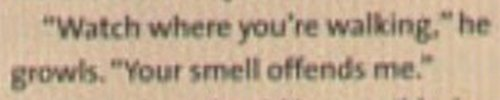

## scan p.67 (scan page 67)

Page contents: Reckonings: Chief Liddell arrives with Second Vapps; Force adepts of Lamaredd (Menahuun shamans call the Force 'Pa'ela', 'holy blood'); Jedi unwelcome; rumors (missing courtesans in the Krakana's Maw, lost fishing boats) (hand-read)

- **Byrch Dyshkava** — entry/section: The collapsed Padawan cries out: "“Liddell!” He shouts with all his remaining might. “Liddell! You owe me a death! I can't wait forever!”" Source: *Star Wars Gamer 07* (SWRPG d20), scan p.67
  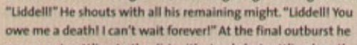

### Stat block notes (game mechanics, not feats)

- The Padawan: Byrch Dyshkava, aged Male Human Jedi Guardian 4/Scoundrel 4/Fringer 2, DSP 15, Force Grip +8, Force Push +10, non-functional lightsaber, slugthrower pistol (Source: *Star Wars Gamer 07* (SWRPG d20), scan p.67)

## scan p.68 (scan page 68)

Page contents: The Padawan reveals he was captured by Menahuun and held twenty years before digging out; Liddell hires the heroes as seconds (100 credits/week, silver seven-pointed stars) with Gungan guide Boom Boom; alternative: mercenaries for Guther Bartyn with bronze stars (hand-read)

- **Byrch Dyshkava** — entry/section: The Padawan wakes in Doc's care: "“Mix! You swore you'd kill me! You swore!”" Source: *Star Wars Gamer 07* (SWRPG d20), scan p.68
  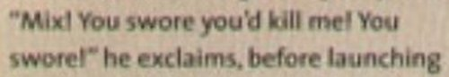
- **Mix Liddell** — entry/section: Liddell sends the heroes to Miss Mylla's: "“I don't know if you've been to see Miss Mylla yet. She's hard to miss—about six feet tall, green, legs up to here—but she runs a fine establishment." Source: *Star Wars Gamer 07* (SWRPG d20), scan p.68
  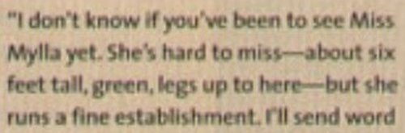

## scan p.69 (scan page 69)

Page contents: 1060 words, 19 paragraphs | headings/entries: 

### Stat block notes (game mechanics, not feats)

- Menahuun scout: Menahuun Scout 2 (Small, darkvision, hold breath) with laser rifles bearing the seven-pointed ORO star logo; beach ambush; Mon Cal dockmaster Howe Walwahd of Pier Green, whose boat was sunk by a BGD trawler (Source: *Star Wars Gamer 07* (SWRPG d20), scan p.69)

## scan p.70 (scan page 70)

Page contents: Tria Blue deck plans (map by Ideal + Design Works): bridge, ballroom, staterooms, galley with chef droids, pool deck (hand-read)

## scan p.71 (scan page 71)

Page contents: Pier Green 11: four decapitated ORO guards flank the Tria Blue slip; two Menahuun saboteurs rig a fusion-generator feedback loop to blow in 2 minutes (Repair DC 20 to spot, DC 18 to fix, 4d10 if it explodes) (hand-read)

## scan p.72 (scan page 72)

Page contents: Part III Bartyn's Secret: Bartyn mansion of red vaffu wood at the foot of Mt. Hugo in the Krakana's Maw; bribing Guther Bartyn earns a Jedi a Dark Side Point if kept (hand-read)

- **Guther Bartyn** — entry/section: Guther Bartyn greets the heroes: "“If it isn't the Chief's new seconds,” he cackles. He lights a cigarra and beckons you forward, “You folks got something to say to me, Say it. I'm a busy man”" Source: *Star Wars Gamer 07* (SWRPG d20), scan p.72
  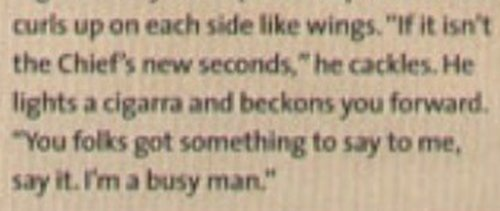

## scan p.73 (scan page 73)

Page contents: Interrogating Bartyn: Hugo Bartyn built an underground command center (life support, underground river) to conquer Lamaredd, sealed it ~500 years ago (hand-read)

## scan p.74 (scan page 74)

Page contents: Part IV Into the Krakana's Maw: the direct approach up the Northeast Cargo Track behind droid cargo-haulers into the loading bay; Menahuun snipers on ledges; ore-processing unit heat damage; hidden stone-faced command-center doors; ORO processing center maps (hand-read)

### Stat block notes (game mechanics, not feats)

- MMV-608: Tracked security droid Soldier 6, two repeating blaster rifles and two vibro-axes, guarding Bartyn's secret tunnel for 500 years (Source: *Star Wars Gamer 07* (SWRPG d20), scan p.74)

## scan p.75 (scan page 75)

Page contents: 605 words, 35 paragraphs | headings/entries: Wicw Way Dio Trey Gor; Our oF SecuT; Caw Cre Deep (Troee rene tunnets; Ore Tre sctredl; Comeund Ovoadi strance; Loans Bay; Ove Tre acheed; Ove Proce vieng Lint; O8D Cargo toreder Droid froet I rtrance; Command Drow; Deort Maret mance; LOADING BAY; Droip MAINTENANCE; TAR WARG GAMER

## scan p.76 (scan page 76)

Page contents: The Tunnels of Mt. Hugo: random encounter table (lost, spike trap from droid parts, pit trap, Menahuun patrol, cavehopper: giant frog with a crocodilian snout, Menahuun make clothing from its hide) (hand-read)

## scan p.77 (scan page 77)

Page contents: Eeytch, Menahuun shaman and grand champion: champions must steal the 'holy mark' (the seven-pointed ORO star); the Menahuun moved south three generations ago when the waters died (the Rank) and founded Hua'Bal, 'Hidden Glory', in the mine's command center; Test of Champions with nets, Enhance Ability, Move Object, Force Push and Force Whirlwind (hand-read)

- **Eeytch** — entry/section: The Menahuun shaman to the heroes: "“Unless the Landing's champions defeat those of the Menahuun, we'll overrun 'the Slayer's' land and kill all in our path.”" Source: *Star Wars Gamer 07* (SWRPG d20), scan p.77
  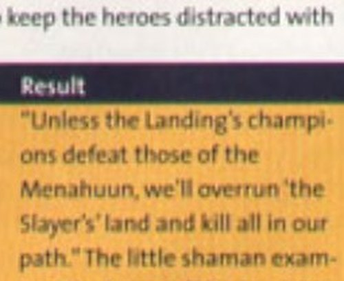

## scan p.78 (scan page 78)

Page contents: 542 words, 36 paragraphs | headings/entries: Ae ry ' >; STAR WARS GAMER 83

### Stat block notes (game mechanics, not feats)

- Menahuun Champion: Male or female Menahuun Soldier 5, spear and net; Hua'Bal map key (holotheater, fighting pit, underwater tunnel to the sea, mounted mining laser, weapons range, greenhouse) (Source: *Star Wars Gamer 07* (SWRPG d20), scan p.78)

## scan p.79 (scan page 79)

Page contents: Reckonings outcomes by Diplomacy: ceasefire, ore-for-food trade, or Menahuun joining Landing society; ORO withdraws, Bartyn fills the tunnel, the Landing gets its first elected Administrator; further adventures: a new black-robed 'Padawan' shoots Mix Liddell at a rally, the pirate 'the Red Quarren', Guther Bartyn sends two dozen MMV droids; Dark Days war (Miss Mylla flees to Little Mon Cal) (hand-read)

## scan p.80 (scan page 80)

Page contents: Menahuun species: 1.2 m lemuroid natives ('Great Menahua'), poor smell, big black eyes; survivors of Hugo Bartyn 'the Slayer'; fled the ORO waste pipeline south, found the mine tunnels, spent two hundred years building converted mining lasers (no multifire) (hand-read)

## scan p.81 (scan page 81)

Page contents: Galaxy's Most Wanted: Scourge of the Desert (Michael Mikaelian, with thanks to Decipher): Tusken Raiders; Jawas exploded in number after colonization as settlers killed Sand People (hand-read)

### Stat block notes (game mechanics, not feats)

- URoRRuR'R'R / Rrr'ur'R: Tusken tribal leader unafraid of offworlders and machines (slugthrower rifle, gaderffii); his bantha Rrr'ur'R, a former alpha male, with Trample 4d6 (Source: *Star Wars Gamer 07* (SWRPG d20), scan p.81)

## scan p.82 (scan page 82)

Page contents: Ur'Ru'r, fierce Tusken warrior who raids as far north as Mos Espa; RR'uruurrr, bantha herder who single-handedly defeated a farm boy who would one day become a powerful Jedi; names from the Star Wars CCG (Sandy Wible of Decipher quoted); see Secrets of Tatooine (hand-read)

## scan p.83 (scan page 83)

Page contents: University of Sanbra Guide to Intelligent Life: the Anx (Craig R. Carey, Jason Fry, Dan Wallace; art Joe Corroney), Professor Eliss on beloved 4-meter anatomy professor Ilhox Argunn who drew a 12-armed glider's skeleton perfectly at a glance; Anx bones on Shusugaunt mistaken for an aquatic species; Graviex Med, crest sinuses for low-frequency speech, scent sight, three stomachs (hand-read)

## scan p.84 (scan page 84)

Page contents: Anx: emotions shown by fin color (fin cloaks, bad sabacc players), gift-giving potlatches, uncanny anatomy sense; the Empire turned the Graviex Launchworks into a waste dump until only mutated superbacteria lived on Graviex Med; Imperial Remnant slicers faked a disassembly order to steal Thrawn's Star Destroyer Chimaera back to Gilad Pellaeon (hand-read)

### Stat block notes (game mechanics, not feats)

- Anx: Anx commoner: blindsight, scent, communicate with other Anx within 5 km, -5 Bluff without fin cloak, Martial Artist threatens on 18+ (Source: *Star Wars Gamer 07* (SWRPG d20), scan p.84)

## scan p.85 (scan page 85)

Page contents: Anx: the mute gladiator the Great Goblin still holds the Loovria pits kill record after three centuries, died of terror alone in a freighter hold to Nal Hutta; Anx history with the Graviex Launchworks cannons and enslavement by the Shusugaunt; Medx homunculi jokes (hand-read)

### Stat block notes (game mechanics, not feats)

- Horox Ryyder: Male Anx Noble 10, Galactic Senator for the Raioballo sector, considered as successor to Finis Valorum, goes without a fin cloak; 'the Republic is his herd, his clan, and his true species' (Source: *Star Wars Gamer 07* (SWRPG d20), scan p.85)
- Graxol Kelvyyn: Anx slave trader on Ryloth, gambler and friend of Watto, in love with his Twi'lek slave Shakka; Knowledge (criminal organizations) +20 (Source: *Star Wars Gamer 07* (SWRPG d20), scan p.85)

## scan p.86 (scan page 86)

Page contents: Archetypes: Dilettante (Jesse Decker, art Dennis Cramer): variants Resource Access, Inspire Indifference, Quick Study; multiclassing advice (hand-read)

## scan p.87 (scan page 87)

Page contents: 788 words, 33 paragraphs | headings/entries: The resources gained arrive in the Dilet-; VARIANT 3: Quick StuDy; Mulitclassing Pathways; Stan WARS GAmMer 1038

## scan p.88 (scan page 88)

Page contents: Vehicle Ace prestige class: racing circuits (Ferini team; Malastare, Mepha'as Prime, Bescane, Caprioril, Tatooine), swoop gangs (Blood Razors, Hutt Vectors, Bloodsniffers, Star Hellions, Big Gizz's gang), test and combat pilots (hand-read)

## scan p.89 (scan page 89)

Page contents: Vehicle Ace class features (Vehicle Defense, Familiarity, Vehicle Evasion) and new feat Vehicle Dodge; SoroSuub Air-2 racing swoop, the swoop a young Han Solo 'borrowed' to escape slavers on Bonadan (hand-read)

## scan p.90 (scan page 90)

Page contents: Deck Plans (Cory J. Herndon): The Shaft: Dark Lord Walking, Jedi Knights TCG Vader deck (End This Destructive Conflict theme, Scum & Villainy set); Motti adds +2 to Vader, Major Millich plus Dewback Patrol combo, Tear This Ship Apart, Imperial Precision (hand-read)

- **Darth Vader (Anakin Skywalker); Grand Moff Tarkin**: "Vader's tearm relies on Star Destroyers and Tarkin's technological terror to cover the system during the initial three planets, but the Sith Master isn't particularly con cerned with space—notice that he doesn't even have his own TIE with him in this deck The capital ships are there to be sacrificed if necessary." Source: *Star Wars Gamer 07* (SWRPG d20), scan p.90
  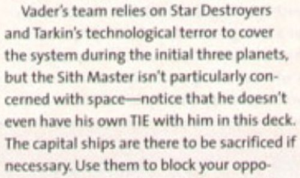

## scan p.91 (scan page 91)

Page contents: 641 words, 48 paragraphs | headings/entries: Deatm Stare & Stag Desteovers; Masoe Mitticn, 2 Teoorers & Dewsack Parrot; Step2; Step 3; Step 4; Tear This Ship Apart & Your; Star Destroyer This deck isn't; CHaracters (29) 2 Admiral Mott + Fleet; Admiral; AF-19 + Quick Draw; Boba Fett + Relentless Hunter; Major Millich + Security Chief; Conquest; Devastator Stalker; VOLUME 2 NUMBER!; Events (25); Imperial Precision, Blaster Rifle & Trooper; Keep The Local Systems In Une; Local Trouble; Pick Up Some Power Converters; Sim Powers + Vaoen (6)

## scan p.92 (scan page 92)

Page contents: Rebel Commandos (Doug Taylor): Star Wars CCG Rebel Strike Team / Garrison Destroyed deck with The Shield Is Down!, Strike Planning, Endor: Back Door, Crix Madine; Luke, Qui-Gon, Wedge (hand-read)

## scan p.93 (scan page 93)

Page contents: Rebel Commandos scouts: Sergeant Junkin, Corporal Beezer, Corporal Midge, Corporal Delevar, Lieutenant Greeve, Chewbacca of Kashyyyk, Colonel Cracken (Tala 1), Lieutenant Blount (Tala 2) (hand-read)

- **Darth Vader (Anakin Skywalker)**: "Anakin's Podracer might even win a Podrace without any racing Interrupts thanks to the high destinies you can draw insurrection, Deactivate The Shield Genera tor, Garrison Destroyed, and The Shield Is Down! combine well to strengthen your scouts." Source: *Star Wars Gamer 07* (SWRPG d20), scan p.93
  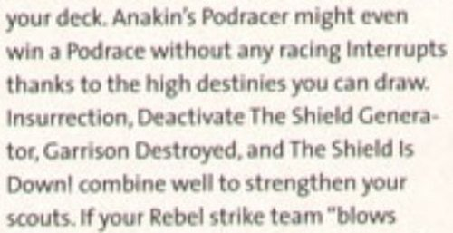

## scan p.94 (scan page 94)

Page contents: Rogue Leader: Rogue Squadron II preview (Haden Blackman): Factor 5 GameCube launch title; Wedge Antilles as Rogue Leader after Luke is shot down on Hoth; producer Brett Tosti on story-driven missions from Yavin to Endor, dynamic AI and wingman commands (hand-read)

- **Luke Skywalker**: "Luke Skywalker, Rogue Squadron's commander, has already been shot down, Only Wedge Antilles, a Corellian space jockey who survived the attack on the first Death Star, can slow the Imperial advance long enough for the Rebels to escape." Source: *Star Wars Gamer 07* (SWRPG d20), scan p.94
  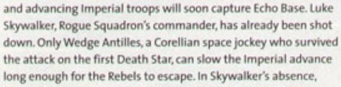
- **Luke Skywalker**: "(Luke and Wedge survived the Battle of Yavin and, according to continuity sources, formed the basis of Rogue Squadron, the group of Rebel pilots that appears in The Empire Strikes Back and continues its adven tures in novels and a Dark Horse comic book series.)" Source: *Star Wars Gamer 07* (SWRPG d20), scan p.94
  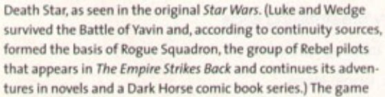

## scan p.95 (scan page 95)

Page contents: 776 words, 31 paragraphs | headings/entries: THe Power OF THE GAMECUBE; Rocue Leaver Desaier; Platform: Nintendo GameCube; Genre: Flight Action; Release Date: November; Number of Missions: including bonus missi; Playable Craft: 5 (not including bonus vehicies; Star Wars Era: Rebellion; STAR WARS GAMER 115

## scan p.96 (scan page 96)

Page contents: Rogue Leader missions: the Maw, 'Rendezvous with the Razor', Bespin switch from A-wing to cloud car, Hoth switch from Luke to Wedge, medals unlock bonus missions; 60 frames per second (hand-read)

## scan p.97 (scan page 97)

Page contents: Obi-Wan (LucasArts, Xbox, producer Mike Gallo, director Dan Connors): originally the PC project codenamed 'Tanis'; pre-Episode I Coruscant missions against the Black Heth gang (Grans, Rodians, Trandoshans) (hand-read)

- **Obi-Wan Kenobi**: "But before Obi-Wan vows to train the most powerful Force-user in the galaxy, he must stop a dangerous criminal cartel, defeat "Star Wars ninjas," and battle a menacing Tusken warlord in LucasArts Entertainment's Obi- Wan." Source: *Star Wars Gamer 07* (SWRPG d20), scan p.97
  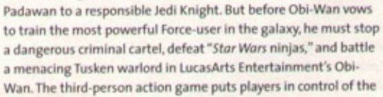

## scan p.98 (scan page 98)

Page contents: Obi-Wan game: the Jin'ha, 'Star Wars ninjas' and weapons dealers on a swamp planet, carry cortosis weapons that resist lightsabers; on Tatooine Obi-Wan rescues the handmaiden he thinks is the Queen from Tuskens and fights a battleaxe-wielding Tusken warchief (hand-read)

## scan p.99 (scan page 99)

Page contents: Obi-Wan game: Theed with sniper, grenadier and kamikaze battle droids and a cortosis-armored assassin droid linking the Jin'ha to the Trade Federation; final duel with Darth Maul; right-stick lightsaber control, Force swings, Saber Throw, Force Focus slow motion; "Obi-Wan is a Jedi. He doesn't need a deflector shield." (hand-read)

- **Obi-Wan Kenobi**: "As in the films, the lightsaber can also deflect incoming blaster fire, The standard "autoblock" feature basically acts as Obi-Wan's shield." Source: *Star Wars Gamer 07* (SWRPG d20), scan p.99
  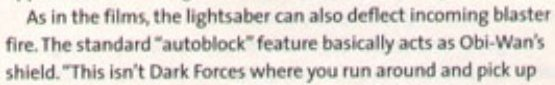

## scan p.100 (scan page 100)

Page contents: Obi-Wan game: Force Meter, acrobatics shrink the collision box, 80% combat; allied Qui-Gon Jinn and Naboo soldiers (hand-read)

- **Qui-Gon Jinn; Obi-Wan Kenobi**: "Without a doubt, the most powerful of these allies is Qui-Gon Jinn, Obi-Wan's master and mentor." Source: *Star Wars Gamer 07* (SWRPG d20), scan p.100
  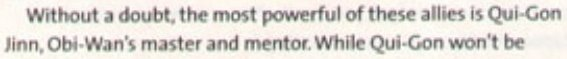

## scan p.101 (scan page 101)

Page contents: Obi-Wan Jedi Tactics sidebar (Dan Connors); saber arena in the Jedi Temple with opponents up to Mace Windu and Jedi Council members; Jin'ha swamps began as Naboo swamps from Tanis (hand-read)

## scan p.102 (scan page 102)

Page contents: Galactic Battlegrounds (LucasArts RTS): 43 missions starting with seven Chewbacca tutorial missions; lead level designer Reed Knight with Steve McManus and Kevin Schmitt; six civilizations (Empire, Gungans, Naboo, Rebel Alliance, Trade Federation, Wookiees) with strengths (hand-read)

## scan p.103 (scan page 103)

Page contents: Galactic Battlegrounds mission types (build-and-attack, set-piece, quest); the AT-AT crush: a broken Empire AI sent 30+ AT-ATs against Don Sielke's Wookiee base on Kessel until 'the game mercifully crashed' (hand-read)

## scan p.104 (scan page 104)

Page contents: Knights of the Old Republic first concept art (BioWare/LucasArts), about 4,000 years before Yavin; Battlegrounds tips: Wookiee berserker with two ryyk blades, Gungan fambaa shield generator, droideka, Jedi Conversion (hand-read)

## scan p.105 (scan page 105)

Page contents: HoloNet letters: Chiss errata, Chiss get no bonus skill points or feats (see Alien Anthology); the blamed WED-299 repair droid 'sent to the spice mines of Kessel' (hand-read)

## scan p.106 (scan page 106)

Page contents: HoloNet letters: Elaine Cunningham's Jag Fel story this issue; reader theory that Yoda and Yaddle are Whills answered "Comment I cannot," is all Yoda has to say; d3/d2 explained (d6 halved) (hand-read)

## scan p.107 (scan page 107)

Page contents: HoloNet answers: starship gunnery uses ranged attack bonus with -4 without Starship Operation or Gunnery; a Teras Kasi prestige class and alternate stats for Arden Lyn promised; crew quality explained; Insider #57 preview (Attack of the Bounty Hunters: Temuera Morrison, Daniel Logan, Leeanna Walsman) (hand-read)

## scan p.108 (scan page 108)

Page contents: Jedi Mind Tricks puzzle (Mike Selinker): encoded names of Star Wars movie characters (hand-read)

