# Owner Material 037 — Star Wars D20 Drive folder (Core, Revised Core and Saga Edition): Star Wars Gamer/Star Wars Gamer 08.pdf [Star Wars Roleplaying Game (d20, 2000)] (scan pages 1–60)

- **Source:** Wizards of the Coast Star Wars Roleplaying Game books, web enhancements, Living Force campaign modules and articles (2000–2010), from the owner's "Star Wars D20" Drive folder (only the three edition subfolders; "General" was not read, as instructed). Secondary source (licensed Legends reference). Scan OCR'd on the box; the scan stays box-only and is **not** published.
- **Method:** every scanned page was OCR'd and machine-screened sentence by sentence for power-relevant statements (fights, kills, defeats, Force feats, rankings, superweapons) that name a character on our roster; each kept sentence is quoted verbatim from the OCR text and has a crop of the printed passage directly under it. Pages with nothing power-relevant are still listed with what is on them.
- **Citation:** "*Star Wars Gamer 08* (SWRPG d20), p.X" by printed page ("scan p.X" where no printed number applies). **Weight:** Licensed RPG material: a secondary source. Narrative text sums up Legends lore; game statistics are rules for players, not canon power levels, and rank lowest.

## scan p.1 (scan page 1)

Page contents: Star Wars Gamer #8 (Vol 2 No 2, The New Jedi Order) cover lines: Greg Keyes serial 'Battle on Bonadan', Yuuzhan Vong Player's Guide, Luke Skywalker Jedi Master, Galactic Battlegrounds, Elaine Cunningham's 'Solo: Rogue Apprentice' (hand-read)

## scan p.2 (scan page 2)

Page contents: Cover by Mikael Noguchi from Stackpole's NJO Onslaught: Master Luke Skywalker uses two lightsabers to rescue a fellow Jedi from the Yuuzhan Vong (hand-read)

## scan p.3 (scan page 3)

Page contents: Contents: The Apprentice (Cunningham, Anakin Solo's revenge, tied to Dark Journey); Chalmun's Cantina model; Spaceport Guide Vaynai Archipelago and Topside Infiltration (Peter Schweighofer); Being Yuuzhan Vong (Daniel Wallace); 'Hive of the Infidel'; Sanbra Guide to the P'w'eck? (Priapulin); Sector Ranger; Mercenary; Robin D. Laws GM advice (hand-read)

## scan p.4 (scan page 4)

Page contents: Editorial (Dave Gross): 'game canon' is what you like; plan for a fallen-planet fantasy-style Star Wars campaign with Force wizards like the Dathomir witches and a forgotten early Yuuzhan Vong outpost (hand-read)

## scan p.5 (scan page 5)

Page contents: Editorial (Michael Mikaelian): NJO issue with Keyes's 'Emissary of the Void' Part 1, Vong campaign guide, adventure and Rogues Gallery (hand-read)

## scan p.6 (scan page 6)

Page contents: HoloNet answers: Deck Plans to expand from Gamer #10; NJO Sourcebook plus this issue cover Vong heroes or adversaries; back-issue summaries for Gamer #4–7 (hand-read)

## scan p.7 (scan page 7)

Page contents: HoloNet answer: Ebenn Q3 Baobab 'elaborates'; ancient vs modern Huttese is like Chaucer vs modern English, and Hutts have not changed physically in millennia (hand-read)

## scan p.8 (scan page 8)

Page contents: Jedi Counseling cortosis: weave (Dark Side Sourcebook) shuts the saber off after damage; Hand of Thrawn cortosis ore takes the damage itself; Yinchorr cortosis shields (Jedi Council: Acts of War) shut it off before damage; reactivation is a free action but not mid full attack (hand-read)

### Stat block notes (game mechanics, not feats)

- Jedi Counseling: off-hand weapon gives only one extra attack; multifire and Affect Mind are both full-round actions, so not in one round; double-bladed lightsaber with only EWP (lightsaber) works as a normal saber, extra blade attack at -4 plus two-weapon penalties; extra Force Points allowed for lightsaber crystal checks and the Craft check; Sith sword gets no level damage bonus; Force Mind and Knight Mind bonuses do not stack (Source: *Star Wars Gamer 08* (SWRPG d20), scan p.8)

## scan p.9 (scan page 9)

Page contents: Jedi Counseling: no rule bars non-Jedi from lightsabers; wielding one marks you as a Jedi 'just as a katana marks someone as a samurai', expected to uphold the Jedi Code (hand-read)

### Stat block notes (game mechanics, not feats)

- Jedi Counseling: a hero who no longer meets prestige class requirements loses its special abilities but keeps vitality, BAB, saves, bonus feats, Defense and Reputation (Source: *Star Wars Gamer 08* (SWRPG d20), scan p.9)
- Aurra Sing: Dark Side Sourcebook errata: Force Push +4, Move Object +4, See Force +5 (cross-class), add Dodge feat (Source: *Star Wars Gamer 08* (SWRPG d20), scan p.9)
- Darth Vader: Dark Side Sourcebook errata: should have Alertness (Source: *Star Wars Gamer 08* (SWRPG d20), scan p.9)
- Dark Side Sourcebook errata: Move Object not required for Dark Side Devotee; Dark Side Marauder BAB +1 not +3; Corrupted Jedi trading levels rules (Source: *Star Wars Gamer 08* (SWRPG d20), scan p.9)

## scan p.10 (scan page 10)

Page contents: Rogues Gallery: Yuuzhan Vong illustrated by Jeff Carlisle (hand-read)

## scan p.11 (scan page 11)

Page contents: 0 words, 0 paragraphs | headings/entries: 

## scan p.12 (scan page 12)

Page contents: Emissary of the Void Part 1 'Battle on Bonadan' (Greg Keyes): Uldir Lochett, Search and Rescue Corps captain, with the Dug Leaft, the melancholy Duros Vook and platinum-haired scarred Vega Sepen; ship damaged by a Vong interdictor on the Hydian Way, stranded in the Corporate Sector at the In the Red cantina on Bonadan's galasol strip; a girl flees CSA police (hand-read)

## scan p.13 (scan page 13)

Page contents: Battle on Bonadan: Uldir leaps onto a planetary ore-barge train and catches a multisensor cable; Bonadan's polluted wasteland at sunset, 'The Force was present even in a wasteland' (hand-read)

- **Vega Sepen** — entry/section: Vega Sepen: "“Not our fight,” she cautioned, "We're rescue fliers, not bounty hunters”" Source: *Star Wars Gamer 08* (SWRPG d20), scan p.13
  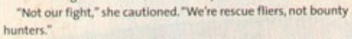

## scan p.14 (scan page 14)

Page contents: Battle on Bonadan: the girl fights Uldir with kicks and telekinetically thrown ore, then rescues him from CSA security fliers; Uldir trained at Master Skywalker's academy but has no natural Force talent; planets scramble to hand Jedi to the Yuuzhan Vong (hand-read)

## scan p.15 (scan page 15)

Page contents: Battle on Bonadan: Uldir was betrayed by a Peace Brigade ex-partner; the Vong warmaster promised to stop if all Jedi were handed over; the Jedi Klin-Fa Gi deflects bolts with a yellow lightsaber from the speeder's prow; a Yuuzhan Vong executor is on Bonadan; the Search and Rescue Corps is a cover for Luke's network moving Jedi to safety; Uldir's ship No Luck Required (hand-read)

- **Vega Sepen; Uldir Lochett** — entry/section: Vega Sepen: "He grinned tightly, remembering what Vega would say: “if” is just a short way of saying, “we're doomed.”" Source: *Star Wars Gamer 08* (SWRPG d20), scan p.15
  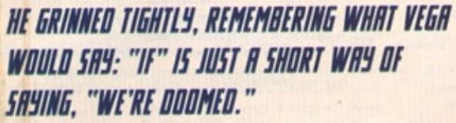
- **Klin-Fa Gi** — entry/section: Klin-Fa Gi: ""I'll bet it doesn't. CSA attorneys can find a loophole when there isn't even a loop.”" Source: *Star Wars Gamer 08* (SWRPG d20), scan p.15
  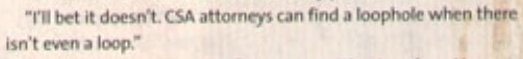

## scan p.16 (scan page 16)

Page contents: Battle on Bonadan: Uldir hauls Klin-Fa back aboard one-handed while she deflects bolts, and flies into a Bonadan weather-control 'sweeper storm' built for maximum ionization (hand-read)

- **Uldir Lochett** — entry/section: Uldir Lochett: "“It wasn't before I met you,” Uldir replied. "Now I'd need a professional opinion.”" Source: *Star Wars Gamer 08* (SWRPG d20), scan p.16
  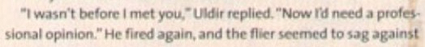

## scan p.17 (scan page 17)

Page contents: Battle on Bonadan: Uldir senses a Force use that 'felt somehow wrong' from Klin-Fa before the crash; he swims her through the flash flood to a cave and calls Vega on a trace-scrambled comlink ("Hey, boss-boy") (hand-read)

## scan p.18 (scan page 18)

Page contents: Battle on Bonadan: Klin-Fa grew up on Bonadan; she cannot feel one searcher in the Force, so it is a Yuuzhan Vong; 'To Be Continued'; Greg Keyes, author of Edge of Victory I: Conquest and II: Rebirth (hand-read)

### Stat block notes (game mechanics, not feats)

- Uldir Lochett: Rescue Pilot: Male Human Sct 5/Sol 3; Init +7; Def 16; VP/WP 24/12; Atk +8/+3 melee (1d6+2 punch) or +9/+5 ranged; SQ Trailblazing, uncanny dodge, skill mastery (Pilot, Spot); SV Fort +6 Ref +7 Will +4; FP 4, DSP 0, Rep 2; Str 14 Dex 16 Con 11 Int 15 Wis 10 Cha 14; Pilot +16, Astrogate +10, Spot +10, Knowledge (Jedi lore) +4; Force Skill Enhance Ability +10; feats Force-Sensitive, Martial Artist, Spacer, Starship Dodge, Starship Operation (space transport), Track; speaks Basic, Dug, Durese (Source: *Star Wars Gamer 08* (SWRPG d20), scan p.18)

## scan p.19 (scan page 19)

Page contents: 0 words, 0 paragraphs | headings/entries: 

## scan p.20 (scan page 20)

Page contents: The Apprentice: Tenel Ka's lightsaber has a carved rancor-tooth hilt and Gallinore rainbow gems, living crystals, for a turquoise iridescent blade; Jaina compares this to Anakin's attuned Vong lambent crystal and hopes Gallinore's bioengineers can explain the Trickster, the living ship she and Zekk stole from a worldship (hand-read)

- **Kyp Durron**: "Kyp had the sort of face that inspired camaraderie and confidence, and probably would have even without the added charisma of his formidable Jedi powers." Source: *Star Wars Gamer 08* (SWRPG d20), scan p.20
  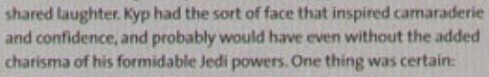

## scan p.21 (scan page 21)

Page contents: The Apprentice: Tenel Ka distrusts Kyp after Sernpidal, where he used the Force to make Jaina believe the Vong were building superweapons and used her name to bring Rogue Squadron into attacking a civilian target, the new worldship; Lowbacca defends Chewbacca's honor and his life debt (hand-read)

- **Kyp Durron; Jaina Solo** — entry/section: Star Wars Gamer 08: "Kyp is an exceptionally powerful Jedi" Jaina paused for a brief, humorless smile." Source: *Star Wars Gamer 08* (SWRPG d20), scan p.21
  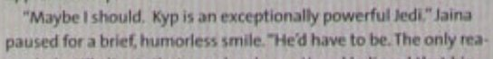

## scan p.22 (scan page 22)

Page contents: The Apprentice: Jaina and Kyp secretly hold a Hapan Vong collaborator, who attacked Tenel Ka, in a Force trance in the hold; Jaina wants his coral slave implant removed and modified 'to hit the Yuuzhan Vong with their own weapons'; Kyp's rumored practice at removing memories (hand-read)

- **Kyp Durron** — entry/section: Kyp Durron: "“Jedi are sworn to protect all living things, yet I find myself strangely unable to shed tears on his behalf.”" Source: *Star Wars Gamer 08* (SWRPG d20), scan p.22
  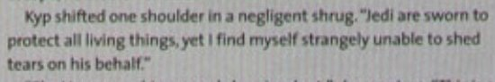

## scan p.23 (scan page 23)

Page contents: The Apprentice: 'You asked me to be your apprentice. This is where it starts.' Kyp agrees ('You know we could never speak of this'); Jaina deceives the prisoner with a false conditional pardon plus Jedi persuasion; Kyp lowers their body temperature with the Force to sneak through the heat-sensitive ventilation tunnels (hand-read)

- **Jaina Solo; Kyp Durron** — entry/section: Jaina Solo: ""That's the asking price.” Jaina spread both hands and gave him her best imitation of her father's trademark smirk. "Do you want me or not?”" Source: *Star Wars Gamer 08* (SWRPG d20), scan p.23
  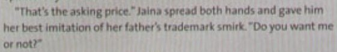

## scan p.24 (scan page 24)

Page contents: The Apprentice: coolant floods the sealed tunnel; Kyp keeps the prisoner afloat in a rescuer's hold and uses a Force shove and his lightsaber to free Jaina from a drain grate (hand-read)

- **Jaina Solo** — entry/section: Star Wars Gamer 08: "Jagged, eerily dancing tendrits caught the Hapan, lifted him, and then hurled him across the tunnel, Once before Jaina had unleashed Force lightning." Source: *Star Wars Gamer 08* (SWRPG d20), scan p.24
  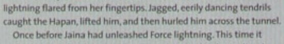
- **Jaina Solo** — entry/section: Jaina Solo: "Instinctively Jaina threw out one hand toward her attacker. Dark lightning flared from her fingertips." Source: *Star Wars Gamer 08* (SWRPG d20), scan p.24
  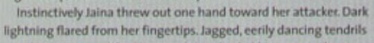
- **Kyp Durron**: "She felt Kyp's touch through the Force, and then she was sliding to one side of the grate, moved by a psychic shove more powerful than the swift-flowing stream." Source: *Star Wars Gamer 08* (SWRPG d20), scan p.24
  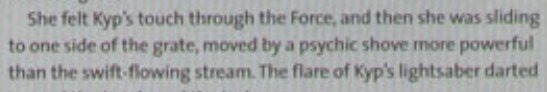

## scan p.25 (scan page 25)

Page contents: The Apprentice: Jaina says if she wanted to sing ballads she'd travel with Tionne; Sinsor Khal, a small bearded scientist in a blood-hiding red lab coat, calls Jaina Ta'a Chume's young protege and is strangely closed in the Force (hand-read)

- **Kyp Durron** — entry/section: Kyp Durron: "“An apprentice should learn from a Master, not repeat his mistakes.”" Source: *Star Wars Gamer 08* (SWRPG d20), scan p.25
  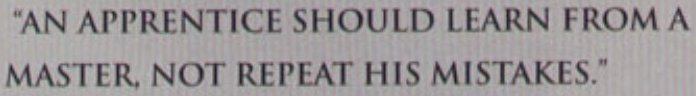

## scan p.26 (scan page 26)

Page contents: page repeats the text of p24 (layout duplicate in the scan) (hand-read)

- **Jaina Solo**: "Once before Jaina had unleashed Force lightning." Source: *Star Wars Gamer 08* (SWRPG d20), scan p.26
  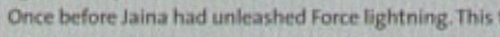
- **Kyp Durron**: "She felt Kyp's touch through the Force, and then she was sliding to one side of the grate, moved by a psychic shove more powerful than the swift-flowing stream, The flare of Kyp's lightsaber darted toward the hatch, and the lock gave way." Source: *Star Wars Gamer 08* (SWRPG d20), scan p.26
  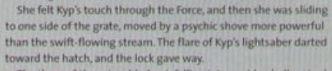

## scan p.27 (scan page 27)

Page contents: Vaynai: spaceport run by a consortium of island owners; each island's militia is hired thugs; few prisons, so penalties are immediate (hand-read)

## scan p.28 (scan page 28)

Page contents: Vaynai planetary data: tropical, about 30°C by day, near Lanna on the Perlemian; arrivals must stay under 50 meters at least 20 km out or be shot down by topside gunnery; scavengers salvage the wrecks (hand-read)

### Stat block notes (game mechanics, not feats)

- Vaynai hazards: Boiling Sea acidic water and steam damage with Fortitude saves vs Constitution damage; Distant Peaks breakers Fortitude DC 20 or 3d6 per round, -7 to air maneuvers nearby (Source: *Star Wars Gamer 08* (SWRPG d20), scan p.28)

## scan p.29 (scan page 29)

Page contents: Vaynai districts: topside estates with concealed gunnery and guard-beasts; floating vendors sell meals to docked ships (hand-read)

### Stat block notes (game mechanics, not feats)

- Vaynai: landing fees: Tiny ship 60, Small 250? (OCR garbled: 60/250/300/1,200/2,500), passenger tax 25, cargo tariff 10% of value (Source: *Star Wars Gamer 08* (SWRPG d20), scan p.29)

## scan p.30 (scan page 30)

Page contents: Vaynai: promenade and towers district, then caverns that worsen deeper in (refugee warrens, gang hideouts, iridescent fungus light); Streysel Island owned by eccentric art collector Gallo Memm, rumored to have political and crimelord ties, with Duros steward Havaal running the thug security force (hand-read)

### Stat block notes (game mechanics, not feats)

- Vaynai topside defenses: cave-mounted quad laser cannons (Attack +6, 6d10x2) and surface turbolaser platforms (Attack +6, 5d10x2) (Source: *Star Wars Gamer 08* (SWRPG d20), scan p.30)

## scan p.31 (scan page 31)

Page contents: Vaynai: Fil'vye's tower is guarded by burly Klatooinians; nobody but Fil'vye may enter his office armed (hand-read)

### Stat block notes (game mechanics, not feats)

- Uncle Nyyv: Male Sullustan Exp 3; Gather Information +10, Profession (chef) +10, Knowledge (cuisine) +7; feats Skill Emphasis (Profession: chef), Trustworthy; eatery barge Colossal 25 m, 100 km/h, altitude 40 m, Defense 4, 60 hull, DR 5, tractor beam (Source: *Star Wars Gamer 08* (SWRPG d20), scan p.31)

## scan p.32 (scan page 32)

Page contents: Vaynai: Fil'vye's pilots indenture themselves for a ship and rarely end with more than they started; six escort gigs 'liberated' from the Corporate Sector; a secret holo-masked warehouse cave that even Memm does not know about (hand-read)

### Stat block notes (game mechanics, not feats)

- Onoron Fil'vye: Male Bothan Nbl 9; Def 15; VP/WP 32/10; SQ call in a favor (3), inspire confidence +2, command +4; Will +8; Rep 9; Knowledge (organized crime) +12, Sense Motive +12, Appraise +10, Intimidate +10; feats Lightning Reflexes, Persuasive, Quick Draw, Sharp-Eyed (Source: *Star Wars Gamer 08* (SWRPG d20), scan p.32)
- Fil'vye Transport escort craft: TS Zeta 19 starfighter, Tiny 15 m, crew 2 (Skilled +4), Defense 22, 80 hull, DR 5, 2 fire-linked laser cannons in turret +8, 5d10x2 (Source: *Star Wars Gamer 08* (SWRPG d20), scan p.32)
- Fil'vye Transport Guard: Male Klatooinian; force pike 2d8+2, heavy blaster pistol 3d8; blast vest and helmet (Source: *Star Wars Gamer 08* (SWRPG d20), scan p.32)

## scan p.33 (scan page 33)

Page contents: Vaynai: Doctor Guzerre's Clinic, a grizzled Twi'lek doctor behind an armored door with a weapon lock-vault; security scanner gives +10 Search (hand-read)

### Stat block notes (game mechanics, not feats)

- Slick: fermented Vaynai seaweed: as a salve works like a medpac, ingested restores 5 vitality and 1 wound once per hour, stacking with other healing; side effect euphoric delirium, Fortitude DC 30 or 1d3 Wisdom damage, again after 1 minute; eats through plastoid containers, best kept in glass (Source: *Star Wars Gamer 08* (SWRPG d20), scan p.33)
- Doctor Guzerre: Male Twi'lek Exp 5; Def 12; VP/WP —/8; scalpel 1d4-1, hold-out blaster 3d4; Knowledge (medicine) +8, Treat Injury +8, Computer Use +8; Challenge Code A (Source: *Star Wars Gamer 08* (SWRPG d20), scan p.33)

## scan p.34 (scan page 34)

Page contents: Vaynai: Ocean Harvesters maintenance station on Streysel; floating harvester plants use repulsorlifts and tractor beams to pull schools of fish from the water, docking every two months (hand-read)

### Stat block notes (game mechanics, not feats)

- Harvester Plant: SoroSuub AQ21? Aqua-Harvester Factory: Colossal, crew 14, passengers 150, cargo 18,000 metric tons, max 100 km/h, altitude 20 m, Defense 6, 200 hull, DR 12, 4 defense blasters (Source: *Star Wars Gamer 08* (SWRPG d20), scan p.34)

## scan p.35 (scan page 35)

Page contents: Illuminated Aquean: anyone found armed forfeits everything, including winnings; those who use weapons are thrown off the promenade onto the rocks; tanks hold sea life from Vaynai, Ando, Mon Calamari, Pantolomin, Aquaris and Bestine, with non-reflective coatings and hidden shield generators (hand-read)

### Stat block notes (game mechanics, not feats)

- Casino Security Attendants: Male Mon Calamari Sol 3; Init +6; Def 15; VP/WP 20/10; stun baton, blaster pistol 3d6; Craft (aquarium) +6 (Source: *Star Wars Gamer 08* (SWRPG d20), scan p.35)
- Amira Nasrabi: Female Mon Calamari Sci 6; Def 15; VP/WP 17/8; SQ sneak attack +2d6; Rep 7; Int 17; Craft (poison) +14, Appraise +12, Gather Information +11, Knowledge (biology) +10 (Source: *Star Wars Gamer 08* (SWRPG d20), scan p.35)

## scan p.36 (scan page 36)

Page contents: Vaynai: the Jungle Vault, the Ithorian Whuvurnm's underground cavern jungle club, entered by a five-credit donation door that stays open ten seconds; rumors that his cuttings came from a topside estate or that he once owned one (hand-read)

## scan p.37 (scan page 37)

Page contents: 775 words, 42 paragraphs | headings/entries: Litwin & Stoe@user; To Caveens; To CAVERNS; Lush foliage on bushes and trees prevent; Making a sim le; NG vowwme & wumoer @; Aqueam tron sticks and; The highest roll

### Stat block notes (game mechanics, not feats)

- Jungle Vault: all Listen rolls -5; trin sticks: six two-colored sticks form geometric shapes, resolved by Intelligence check plus hand quality plus +2 for each of Bluff, Diplomacy, Intimidate, Sense Motive above 4 ranks; dejarik is resolved by an opposed Intelligence check with the same skill bonuses (Source: *Star Wars Gamer 08* (SWRPG d20), scan p.37)
- Whuvurnm: Male Ithorian Frg 4; Init +3; Def 13; VP/WP 27/13; quarterstaff 1d6/1d6; SQ Barter, jury rig +2; Fort +7; Profession (bartender) +10, Profession (gardener) +10, Knowledge (nature) +10, Knowledge (botany) +9; feats Endurance, Great Fortitude, Improved Initiative (Source: *Star Wars Gamer 08* (SWRPG d20), scan p.37)

## scan p.38 (scan page 38)

Page contents: Vaynai adventure seed 'Listening Leaves': Nasrabi has heroes plant seeds whose vines record voices on their leaves in the Jungle Vault, and the plants develop defenses (hand-read)

### Stat block notes (game mechanics, not feats)

- Preena Jallop: Female Human Sco 6; Def 19; VP/WP 24/11; heavy wrench 1d6, heavy blaster 3d8; SQ illicit barter, better lucky than good, sneak attack +2d6; Repair +14, Craft (starship) +10, Pilot +10, Move Silently +10; feats Gearhead, Sharp-Eyed, Skill Emphasis (Repair), Spacer, Trustworthy (Source: *Star Wars Gamer 08* (SWRPG d20), scan p.38)
- Vaynai poisons table: sponge powder, aquytin, scale dust (hallucinations), gnooroop extract, cripe oil, pantol spine venom (injury DC 18, 2d6 wounds then paralysis, 1,500 credits) (Source: *Star Wars Gamer 08* (SWRPG d20), scan p.38)

## scan p.39 (scan page 39)

Page contents: Vaynai adventure seed 'Kidnapped!': bounty hunters abduct one of Preena's orphans, really a runaway noble girl, for her possessive parents (hand-read)

### Stat block notes (game mechanics, not feats)

- Preena's repair bay: shield upgrade up to +20% at 2,500 credits per 10 points; fire control +4 for 5,000 or +6 for 10,000 per weapon (over +4 is military); typical tech crew apprentice stats with Repair +8 (Source: *Star Wars Gamer 08* (SWRPG d20), scan p.39)

## scan p.40 (scan page 40)

Page contents: Being Yuuzhan Vong: the NJO Sourcebook (February) covers the first nine novels; 'The Sith wanted to rule the galaxy's inhabitants. The Yuuzhan Vong want to sacrifice them'; a sympathetic Vong hero like Vua Rapuung of Edge of Victory I: Conquest (hand-read)

- **Yun-Yuuzhan** — entry/section: Being Yuuzhan Vong: "Calling the species “the Vong” offends the creator god Yun-Yuuzhan and is blasphemy of the highest order." Source: *Star Wars Gamer 08* (SWRPG d20), scan p.40
  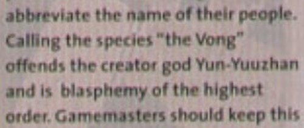

## scan p.41 (scan page 41)

Page contents: Being Yuuzhan Vong: Vong scouts entered Republic space about 30 years before Yavin; the invasion began 25 ABY at Vector Prime; five castes (warrior, shaper, priest, intendant, worker); warriors most loyal to Supreme Overlord Shimrra but lack creativity; shapers may secretly suspect their biotech comes from an ancient, nearly depleted library and so be heretics (hand-read)

### Stat block notes (game mechanics, not feats)

- Yuuzhan Vong hero templates: Warrior (Sol 1; amphistaff, coufee, thud bugs, blorash jelly, vonduun crab armor, tizowyrm), Scout (Sct 1; thud bug launcher, ooglith masquer, villip), Shaper (Exp 1; Craft biomechanisms +8, Craft disease +5), Priest (tsaisi), Intendant (Sco 1); all immune to Force Sense and Alter (Source: *Star Wars Gamer 08* (SWRPG d20), scan p.41)

## scan p.42 (scan page 42)

Page contents: Being Yuuzhan Vong settings: the aging worldship Alak Schou, occupied planets, biologically altered planets (hand-read)

### Stat block notes (game mechanics, not feats)

- Yorik-vec Assault Cruiser: coralskipper-era gunboat for adventuring groups, a YT-1300 analog but a military vessel: quad volcano cannon turret and twin volcano cannons, consumables 1 month (stats partly garbled) (Source: *Star Wars Gamer 08* (SWRPG d20), scan p.42)

## scan p.43 (scan page 43)

Page contents: Being Yuuzhan Vong NJO timeline: the Praetorite Vong disgraced at Helska; Tsavong Lah's decree after Duro that the Jedi be surrendered empowers the Peace Brigade; Supreme Commander Nas Choka punishes Hutt Space; after Coruscant falls, 'Few enemies are more dangerous than an enemy with nothing to lose' (hand-read)

## scan p.44 (scan page 44)

Page contents: Being Yuuzhan Vong: biologically altered planets are either cleansed for habitation (Nal Hutta, Coruscant) or living factories (Belkadan, Tynna) (hand-read)

### Stat block notes (game mechanics, not feats)

- Grutchin symbiote: half-meter armored insect anchored by its legs into four hollows gouged down to the host's shoulder blades, attacks on telepathic command until the target dies; Armored predator 8, Def 20; using a surrogate in battle is vaguely dishonorable for warriors (Source: *Star Wars Gamer 08* (SWRPG d20), scan p.44)

## scan p.45 (scan page 45)

Page contents: Vong adventure seed 'Kneel, Imperial Slave!': after Ithor, strike the Yaga Minor shipyards in a captured Sentinel-class shuttle, destroy a lab studying bafforr tree pollen (fatal to Vong in vonduun crab armor), and meet Lumiya stealing the pollen (hand-read)

### Stat block notes (game mechanics, not feats)

- Tokhlor tallow: bursting oily ticks: Reflex DC 16 (smooth) or fall prone, -4 Dex while slick, 1d2 wounds per round on bare skin (Source: *Star Wars Gamer 08* (SWRPG d20), scan p.45)
- Kavaavik: blind burrowing avian that plugs its spinal needle into the wearer's optic nerve through the right tear duct, granting 500-meter blindsight in gray silhouettes; host blinded 1d4 rounds if it dies (Source: *Star Wars Gamer 08* (SWRPG d20), scan p.45)

## scan p.46 (scan page 46)

Page contents: Vong adventure seed 'Domain Yaght Must Die!': a blood feud with rival Domain Yaght during the pacification of Gyndine (hand-read)

### Stat block notes (game mechanics, not feats)

- Tzur'qipat: clamshell holding a tentacled tzur and a qipat firewasp; on the order "yuth ugh" the tzur eats the incompatible wasp, generating a 100x100 m smokescreen (total concealment); Defense 7, hardness 10, 30 WP, 30% chance to trigger when hit (Source: *Star Wars Gamer 08* (SWRPG d20), scan p.46)
- Blast bug: 4d4 to target, 2d4 within 2 m, Reflex DC 15 half; dud on a natural 1; Snap bug: Reflex DC 10 or blind 1d4 rounds, Fortitude DC 12 or stunned 2d8 rounds (Source: *Star Wars Gamer 08* (SWRPG d20), scan p.46)
- Steng's talons: 8–10 sgauru-bone spikes sheathed in yorik coral implanted in the torso, extend 10 cm in a grapple for 2d10; honors Warmaster Steng, who lost to Warmaster Yo'Gand in the Cremlevian War but died with honor (Source: *Star Wars Gamer 08* (SWRPG d20), scan p.46)
- Fire spitter: implant replacing the forearm, feeding on blood; every 3 rounds spews flaming biomatter 2d8 (host takes 1d6); twice a day sprays flammable goo over 2x2 m (Source: *Star Wars Gamer 08* (SWRPG d20), scan p.46)

## scan p.47 (scan page 47)

Page contents: Vong adventure seed 'Heretic!': heretic Vong who learned Shimrra deceives his people defect, but their New Republic 'rescuers' are Peace Brigaders (hand-read)

## scan p.48 (scan page 48)

Page contents: Revised Starship Combat (JD Wiker and Owen K.C. Stephens): grid squares are 500 meters (hand-read)

### Stat block notes (game mechanics, not feats)

- Revised Starship Combat: the fastest starships travel roughly 8,400 km/h; facing a side or corner; every other diagonal move costs 2; large ships occupy several squares; relative altitude matters only in gravity wells; four crew-quality levels give check modifiers and attack bonuses for GM ships (Source: *Star Wars Gamer 08* (SWRPG d20), scan p.48)

## scan p.49 (scan page 49)

Page contents: 736 words, 42 paragraphs | headings/entries: Think Inside the Box; Free Actions; Star Destroyer crew could cold-start thew; Speed and Movement; Stunts, below); Attack Actions; Full Attack; Sample Move 2; STAR WARG Games SO

### Stat block notes (game mechanics, not feats)

- Revised Starship Combat: power-up time by size from a move action (Fine) to 10 minutes (Colossal), reduced one step with Pilot DC 20, so a good Star Destroyer crew could cold-start in five minutes and an X-wing in a full round; five speeds: Stopped, Docking, Cruising, Attack, Ramming (Source: *Star Wars Gamer 08* (SWRPG d20), scan p.49)

## scan p.50 (scan page 50)

Page contents: 524 words, 48 paragraphs | headings/entries: FASTER, STARFIGHTER,; KILL! KIL!; Modifiers on the Standard Scale; A starshio; Simple Manguvers; ForwaRo; Flying straight forward is the easiest; Defense Bonus; Points; Simple Movement; Reverse 1MP; GO volume & NuMBER 2; Simpte Sue 7MP; Moving forward 1 square co" tsi mow; Sipe Sur SMP

### Stat block notes (game mechanics, not feats)

- Revised Starship Combat: cruising is the top speed of Star Destroyers and Mon Calamari cruisers; attack speed tops Y-wings, stock YT-1300s and Corellian corvettes; ramming speed tops X-wings and TIEs; Defense bonus by speed (+1 Docking, +2 Cruising, +3? Attack); Standard Scale Defense bonus against attackers outside the starship scale (Source: *Star Wars Gamer 08* (SWRPG d20), scan p.50)

## scan p.51 (scan page 51)

Page contents: 532 words, 15 paragraphs | headings/entries: Diagonal Movement; DIAGONAL ForwaRrD; DIAGONAL SEMPLE Sur 3 MP

### Stat block notes (game mechanics, not feats)

- Revised Starship Combat: simple maneuvers: 45° turn costs 1 MP after moving 1 square; reverse max speed Docking; simple slip 2 MP and side slip 5 MP; Afterburn up one speed category at Pilot DC 10 (Source: *Star Wars Gamer 08* (SWRPG d20), scan p.51)

## scan p.52 (scan page 52)

Page contents: 950 words, 41 paragraphs | headings/entries: FASTER, STARFIGHTER,; KILL! KILL!; Pilot check (DC 10); Haro Beat; LAND; Quick Turns; DC 35; G2 volume # wuUMuER 2; Starship Collision Damage, below)

### Stat block notes (game mechanics, not feats)

- Revised Starship Combat: Hard Brake DC 15; quick turns from DC by angle (180° is DC 20), losing 45° per 5 short; Land DC 20 ±5 per size step; establishing pursuit by opposed Pilot (target +5), the pursuer then attacks with a forward weapon as a free action, ignoring speed Defense modifiers; two pursuers gain a +2 flank bonus; escape by opposed Pilot (pursuer +5); example of the pilot Vuko's YT-1300 and two TIE fighters (Source: *Star Wars Gamer 08* (SWRPG d20), scan p.52)

## scan p.53 (scan page 53)

Page contents: Revised Starship Combat sidebar 'Pursuing or Chasing?': a pilot can drag pursuers through hazards to raise Avoid Hazard DCs (hand-read)

### Stat block notes (game mechanics, not feats)

- Revised Starship Combat: Reversal: opposed Pilot with the pursuer +10; a reversal against a wing affects the whole wing; Regain Control only after a loss of control (Source: *Star Wars Gamer 08* (SWRPG d20), scan p.53)
- Revised Starship Combat: Join/Rejoin Wing: 2–6 fighters in one square at the same speed and facing, Pilot DC 15 (DC 20 if mixed sizes); the wing uses the lowest initiative and the worst Pilot total, and combines fire as a battery (+1 per extra ship); GM tip: give heroes wings so they can assign damage to wingmates first (Source: *Star Wars Gamer 08* (SWRPG d20), scan p.53)

## scan p.54 (scan page 54)

Page contents: 821 words, 46 paragraphs | headings/entries: FASTER, STARFIGHTER,; KILL! KILG!; Failed Stunts; Control table to determine the effect; Starship Sizes Stamsnip STANDARD Scaus Star Moores; Colossal ~8; Gargantuan Huge Large; Medium Small Colossal; Gargantuan Huge; Large Medium; Tiny; Diminutive; Smalt Tiny Diminutive; Fine; BY volume & NUMBER 2; Suze (m) EXampues; TIE fighter; Missile, escape pod Human; Sand tick Stingfly

### Stat block notes (game mechanics, not feats)

- Revised Starship Combat: resist/escape tractor beam DC 10/20 ±4 per size step; failing a stunt by 10 or more risks loss of control: Skew (-2 to checks, -1 Defense), Pitch (-5, -2 Def), Yaw (-5, -5 Def), Spin (-10, -8 Def), Tumble (-12, -10 Def); Starship Sizes table from Colossal (Star Destroyer, Mon Cal cruiser) down to Fine, with italic sub-Fine scale for Humans, Ewoks, Yealamiri?, sand ticks and stingflies (Source: *Star Wars Gamer 08* (SWRPG d20), scan p.54)

## scan p.55 (scan page 55)

Page contents: 517 words, 6 paragraphs | headings/entries: STAR WARS Gamer 6S

### Stat block notes (game mechanics, not feats)

- Revised Starship Combat: Avoid Hazard DC by obstacle size from Fine 5 to Colossal 40, modified by speed (Stopped -10 to Ramming +10) and vector (away -10, perpendicular +0, toward +5); stunt DC summary table (Source: *Star Wars Gamer 08* (SWRPG d20), scan p.55)

## scan p.56 (scan page 56)

Page contents: 857 words, 39 paragraphs | headings/entries: FASTER, STARFIGHTER,; KILL? KILGS; Ramming and Collisions; Starship Collision Damage Damage; Base Speed Die Type; Docking d4; Cruising ds Attack do Ramming di; Vector Multiplier Target Is... Moving toward; Multiptier; POWERING WEAPONS; Huge or larger full round; Small/Medium/Large — move action; Tiny or smaller free action; RAISING SHIELDS; Gargantuan

### Stat block notes (game mechanics, not feats)

- Revised Starship Combat: flying close for +5 increments can shake pursuers (example: the pilot Sarribo threads an asteroid cluster at DC 30); collision damage die by speed (Docking d4 to Ramming d12?), number of dice by the smaller object's size, multiplied by vector; ship initiative by size modifier; weapon power-up full round for Huge+, move action for Small–Large, free for Tiny-; flying with weapons powered in civilized systems is like waving a blaster pistol (Source: *Star Wars Gamer 08* (SWRPG d20), scan p.56)

## scan p.57 (scan page 57)

Page contents: 608 words, 24 paragraphs | headings/entries: FACING AND Fintnc Aecs; Normal Starship Fire Arcs; FRONT; Large Starship Fire Arcs; FRONT; Rance; MAKING ATTACK Ro.s; STAR WARS GAMER 67

### Stat block notes (game mechanics, not feats)

- Revised Starship Combat: fire arcs forward, aft, left, right, partial or full turrets; large ships split weapons across squares in an arc (Source: *Star Wars Gamer 08* (SWRPG d20), scan p.57)
- Revised Starship Combat: at Point Blank, capital ships can bring at most 25% of their weapons on Medium/Small ships and 10% on Tiny or smaller; firing into a dogfight -4; -4 without the right Starship Operation feat; a pilot-gunner with 4+ Pilot ranks gets +2 synergy (Source: *Star Wars Gamer 08* (SWRPG d20), scan p.57)

## scan p.58 (scan page 58)

Page contents: 956 words, 36 paragraphs | headings/entries: KIL! KILG?; Point Dirense WEAPONS; Yowing TIE fighter; Millennium Falcon; Guardian light cruiser; Trade Federation battleship; Starship Speeds; Attack 6; Rarnimeng 10

### Stat block notes (game mechanics, not feats)

- Revised Starship Combat: multiple attacks with one weapon group; double lasers and blasters multifire (-4), quad lasers autofire (-6), even on capital ships; attack run +2 to hit and -4 Defense; ram attack ignores the armor bonus; fighting defensively +2 Def/-4 attack, total defense +4 (+3/+6 with 6 Pilot ranks and the feat); point defense weapons fire as Medium; battery of up to five weapons +1 each (max +4), one extra hit per 3 over; table of top speeds for the A-wing, X-wing, Y-wing, TIE, Z-95, droid starfighter, Millennium Falcon, Guardian cruiser, ISD, Mon Cal cruiser, Nebulon-B, Corellian corvette and Trade Federation battleship (Source: *Star Wars Gamer 08* (SWRPG d20), scan p.58)

## scan p.59 (scan page 59)

Page contents: 1019 words, 30 paragraphs | headings/entries: Starship Missile Weapons; ESTABLISHING AND BREAKING MissiLe Lock; Fint-Linken Missices; AVOIDING Missile ATTACKS; STAR WARE Gamer 6D

### Stat block notes (game mechanics, not feats)

- Revised Starship Combat: missiles: unguided missiles fly straight; lock within 20 squares by an attack roll (+2 with 5 Computer Use ranks); missiles move 9 squares per action for 6 rounds, Defense 22, 30 HP; decoy by flying through an occupied square; example of the gunner N'ottakcca rolling a natural 20 against a Guardian-class customs cruiser (Source: *Star Wars Gamer 08* (SWRPG d20), scan p.59)

## scan p.60 (scan page 60)

Page contents: 834 words, 32 paragraphs | headings/entries: Cerricat Mits; Superficialionization 10; Tractor Beams; Takinc Damact; RePAiminG DaMace

### Stat block notes (game mechanics, not feats)

- Revised Starship Combat: fire-linked weapons add a die per doubling; criticals bypass shields; ion damage table (Repair DC 10/20/30 to restart); tractor beams ignore the armor bonus; a ship taking twice its remaining hull in one hit explodes for 20d6 (Reflex DC 20 half) to those aboard; shields regenerate 1 per size category per minute; hull repaired per hour equals the Repair result (Source: *Star Wars Gamer 08* (SWRPG d20), scan p.60)
