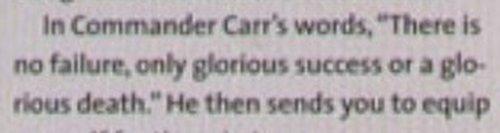
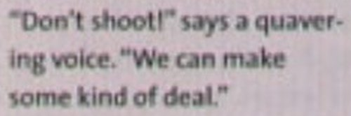
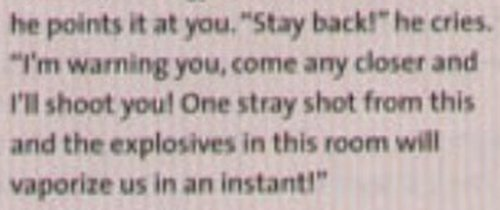
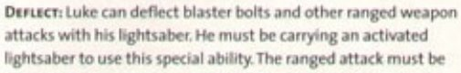
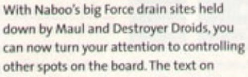
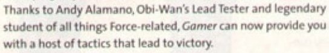
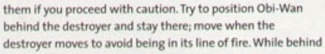
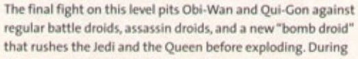
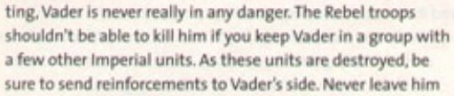
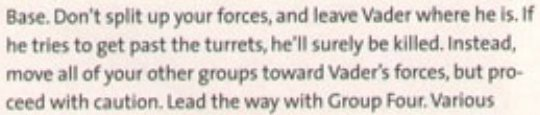

# Owner Material 037 — Star Wars D20 Drive folder (Core, Revised Core and Saga Edition): Star Wars Gamer/Star Wars Gamer 08.pdf [Star Wars Roleplaying Game (d20, 2000)] (scan pages 61–112)

- **Source:** Wizards of the Coast Star Wars Roleplaying Game books, web enhancements, Living Force campaign modules and articles (2000–2010), from the owner's "Star Wars D20" Drive folder (only the three edition subfolders; "General" was not read, as instructed). Secondary source (licensed Legends reference). Scan OCR'd on the box; the scan stays box-only and is **not** published.
- **Method:** every scanned page was OCR'd and machine-screened sentence by sentence for power-relevant statements (fights, kills, defeats, Force feats, rankings, superweapons) that name a character on our roster; each kept sentence is quoted verbatim from the OCR text and has a crop of the printed passage directly under it. Pages with nothing power-relevant are still listed with what is on them.
- **Citation:** "*Star Wars Gamer 08* (SWRPG d20), p.X" by printed page ("scan p.X" where no printed number applies). **Weight:** Licensed RPG material: a secondary source. Narrative text sums up Legends lore; game statistics are rules for players, not canon power levels, and rank lowest.

## scan p.61 (scan page 61)

Page contents: Mos Eisley cantina model: 1 3/4-inch grid squares give a model about 43 3/4 x 26 1/4 inches, built in two Masonite sections with 5-inch chipboard walls (hand-read)

## scan p.62 (scan page 62)

Page contents: Mos Eisley cantina model: Ponda Baba's severed arm is the one film shot that shows the set's metal grate floor, recreated with screen mesh on card (hand-read)

## scan p.63 (scan page 63)

Page contents: Mos Eisley cantina model: stucco from sand on wet paint, khaki base, light fixtures in royal blue, red and yellow, costume jewelry wall decorations; tables from plumbing drain fittings or bottle caps (hand-read)

## scan p.64 (scan page 64)

Page contents: Mos Eisley cantina model: chairs cut from a 'chair battery', table illuminators from pen caps, and the droid detector built from wood and markers (hand-read)

## scan p.65 (scan page 65)

Page contents: Mos Eisley cantina model: the horseshoe bar and distillery island; per Star Wars Insider #54 the head of the never-used droid 8D8? was originally part of the distillery set, so an action figure head is used (hand-read)

## scan p.66 (scan page 66)

Page contents: Hive of the Infidel: commander Malik Carr recruits commandos who speak Basic, aboard the battleship Yammka (hand-read)

## scan p.67 (scan page 67)

Page contents: Yammosk: war coordinator resembling an octopus with a one-meter red head, black eyes and a blue communications vein; mildly telepathic and empathic, reproduces by budding, in contact with other yammosks within a few thousand kilometers (hand-read)

- **Malik Carr** — entry/section: Hive of the Infidel: "“There is no failure, only glorious success or a glorious death.”" Source: *Star Wars Gamer 08* (SWRPG d20), scan p.67
  

### Stat block notes (game mechanics, not feats)

- Hive of the Infidel Vong heroes: soldiers get Exotic Weapon Proficiency (amphistaff) instead of blaster, heavy and vibro weapon proficiencies; no Computer Use; gear: amphistaff, blorash jelly, gnullith, ooglith cloaker, razorbug, thud bug (Source: *Star Wars Gamer 08* (SWRPG d20), scan p.67)
- Yuuzhan Vong claws: retractable bone spurs from knuckles, elbows or knees, DC 5 Will to deploy, 1d8 piercing (Source: *Star Wars Gamer 08* (SWRPG d20), scan p.67)
- Yuuzhan Vong cuffs: living claw restraints, Escape Artist DC 40 (failing by 5 deals 1d4?), 10 wounds, DR 10; once injured they ignore commands and tighten for 2d4 per round (Source: *Star Wars Gamer 08* (SWRPG d20), scan p.67)
- Vonduun crab armor variants: Warrior's +4 Defense, Subaltern's +5, Sub-commander's +6 (medium) (Source: *Star Wars Gamer 08* (SWRPG d20), scan p.67)

## scan p.68 (scan page 68)

Page contents: Hive of the Infidel: commandos in ooglith cloakers can jump across to the Chilastra (Dexterity DC 10) and slip through the docking bay's magnetic field; Z-95s arrive in about 10 minutes if they are locked out (hand-read)

### Stat block notes (game mechanics, not feats)

- Chilastra: Loronar MOD-17 container freighter: Capital, 6 million new / 3 million used, Gargantuan 550 m, crew 50, cargo 200,000 tons, hyperdrive x2 (backup x12), Cruising, Defense 16, SP 100, HP 400, DR 20; four modular cargo habitats, three holding refugees (Source: *Star Wars Gamer 08* (SWRPG d20), scan p.68)
- Landing Bay Chief: Sol 2/Nbl 2; Def 16; VP/WP 27/12; vibrodagger, blaster carbine; Diplomacy +9, Computer Use +7; interior walls hardness 10, 120 WP; hull hardness 20, 720 WP; decompression takes three rounds (Source: *Star Wars Gamer 08* (SWRPG d20), scan p.68)

## scan p.69 (scan page 69)

Page contents: Hive of the Infidel: data terminals show stale manifests listing the cargo habitats as full of processed food gel; security warnings send a six-member team; major alerts seal the bridge and engineering after 10 minutes; the rest of the refugee fleet stays silent rather than give away its hiding place (hand-read)

## scan p.70 (scan page 70)

Page contents: Hive of the Infidel: a cannibalized YT-1300 in the landing bay whose belly blaster cannon still works (only the bay chief knows); the bridge crew fights to the death to protect Captain Yesha Bergeron; Pilot -8 on New Republic controls (-4 with Read/Write Basic); Noor Shan can watch holovids, void sections, close iris valves and switch off gravity (hand-read)

## scan p.71 (scan page 71)

Page contents: Hive of the Infidel: the Ithorian Dr. Viohei, captured by the Vong at Ithor, will sell out anyone, heals commandos as if with a medpac (bacta does not work on Vong) and can identify Ka-Tu-Un (hand-read)

- **Dr. Viohei** — entry/section: Hive of the Infidel: "“Don't shoot!” says a quavering volce."We can make some kind of deal.”" Source: *Star Wars Gamer 08* (SWRPG d20), scan p.71
  

### Stat block notes (game mechanics, not feats)

- Noor Shan: Female Sullustan Sco 3; VP/WP 10/9?; heavy blaster; SQ darkvision, illicit barter, better lucky than good; Bluff +8, Gather Information +8, Hide +8; feats Quick Draw, Starship Operation (capital ship) (Source: *Star Wars Gamer 08* (SWRPG d20), scan p.71)
- Yesha Bergeron: Female Human Sct 3/Sol 4; Def 19; blaster carbine; Pilot +17?, Repair +11, Tumble +9; feats Martial Artist, Weapon Focus (punch), Zero-G Combat, Trailblazing (Source: *Star Wars Gamer 08* (SWRPG d20), scan p.71)

## scan p.72 (scan page 72)

Page contents: Hive of the Infidel: empty crew quarters are a maze for a cat-and-mouse game; escape pods near the bridge, crew quarters and engineering (hand-read)

- **Tyvius** — entry/section: Hive of the Infidel: "“Stay back!” he cries. “I'm warning you, come any closer and I'll shoot you! One stray shot from this and the explosives in this room will vaporize us in an instant!”" Source: *Star Wars Gamer 08* (SWRPG d20), scan p.72
  

### Stat block notes (game mechanics, not feats)

- Dr. Viohei: Ithorian doctor: Knowledge (medicine) +16, Treat Injury +17, Profession (doctor) +15?, Craft (medicine) +13; hold-out blaster (Source: *Star Wars Gamer 08* (SWRPG d20), scan p.72)

## scan p.73 (scan page 73)

Page contents: Hive of the Infidel: iris valves stick after 5 damage; an uppity astromech insults the commandos and, if it sees through their ooglith masquers (Spot +3), rolls off to warn the bridge; the Vong call droids 'life-mocking monsters' (hand-read)

### Stat block notes (game mechanics, not feats)

- Hive of the Infidel engineering traps: built one per 20 minutes of a major alert: caustic vapor (Fort DC 19, 2d6 per round for five rounds), an R2 unit bomb (7d6 within 10 m, Reflex DC 24 half), an electrified floor (2d6 per round), a six-gravity section (grapple +13), caltrops, and a weakened gantry stair (7d6) (Source: *Star Wars Gamer 08* (SWRPG d20), scan p.73)

## scan p.74 (scan page 74)

Page contents: Hive of the Infidel: Habitat 3's Binary Load Lifter walking droid expects to move something and waits impatiently for five minutes (hand-read)

### Stat block notes (game mechanics, not feats)

- Velsey: Male Rodian Sco 5/Nbl 2/Crimelord 1; VP/WP 23/9; blaster pistol, vibrodagger, briefcase of New Republic credits; Diplomacy +14, Bluff +13, Gather Information +13, Knowledge (criminal organizations) +13; Fame; Velsey's thugs Sco 2 with blaster rifles (Source: *Star Wars Gamer 08* (SWRPG d20), scan p.74)

## scan p.75 (scan page 75)

Page contents: Hive of the Infidel: Habitat 3 stores electronics the captain 'liberated' from an unguarded warehouse before the invasion; in Habitat 4, the Cerean Force adept Ka-Tu-Un, of the obscure Ner Yan ('mind chord') tradition, cowers in the food line, makes his quarterstaff a Force weapon and throws crates with Move Object (4d6, 4 VP each) (hand-read)

### Stat block notes (game mechanics, not feats)

- Ka-Tu-Un: Cerean FA 9; Def 18; VP/WP 44/10; quarterstaff 1d6+1d4 Force weapon; SQ comprehend speech, Force talisman +2; Move Object +14, Force Push +14, Enhance Ability +12, Heal Self +12, Empathy +9; feats Ambidexterity, Two-Weapon Fighting, Burst of Speed, Alter, Control, Sense (Source: *Star Wars Gamer 08* (SWRPG d20), scan p.75)

## scan p.76 (scan page 76)

Page contents: Hive of the Infidel: there is a 10% chance a refugee knows Ka-Tu-Un, 20% a crew member and 30% a security staffer (the text puts him in Habitat 3 although the encounter places him in Habitat 4); round up all the Cereans; under no circumstances would normal Vong retreat; Malik Carr would rather they died gloriously; replacement heroes can be commandos left guarding the thrall pilot (hand-read)

### Stat block notes (game mechanics, not feats)

- Hive of the Infidel NPCs: generic security guard Sol 2, security officer Sol 3, crewmember Exp 1, refugee leader Nbl 3 (Diplomacy +12, Knowledge Druckenwell +7) (Source: *Star Wars Gamer 08* (SWRPG d20), scan p.76)

## scan p.77 (scan page 77)

Page contents: Topside Infiltration hooks: Memm's art collection is a small fortune; the Fenelar armor, crafted by the extinct Fenelar, supposedly inspires fear; a preemptive strike against a dangerous artifact; revenge for his gunnery emplacements; or a patron who wants him embarrassed (hand-read)

## scan p.78 (scan page 78)

Page contents: Topside Infiltration: a loose stone in the temple dome (Search DC 15, Strength DC 25); dim Weequay sentries can be lured inside; the lake's six statues of four-armed aliens with two pikes seem to turn their heads; the lifttube pavilion blast door is hardness 15, 240 WP, DC 45; turbolaser emplacements are remote-operated and cannot aim at the island; patrols pass every 20 minutes (hand-read)

## scan p.79 (scan page 79)

Page contents: Topside Infiltration: patrols avoid the lake because the statues hide guardian droids, which Memm enjoys springing on trespassers; Memm lands his luxury yacht on the landing field (absent means he is away) and hires the gifted kids from Preena's repair bay for overhauls, tipping them generously (hand-read)

### Stat block notes (game mechanics, not feats)

- Memm's estate guards: six statue attack droids (walking security droid Sol 4, Def 20, two force pikes, Two-Weapon Fighting); nashtah (Domesticated Predator 5, barbed tail, leap attack with six claws over 10 m); Weequay sentry Sol 3 (vibro-ax, blaster rifle, pheromone communication); sentries patrol in fours with two nashtahs (Source: *Star Wars Gamer 08* (SWRPG d20), scan p.79)

## scan p.80 (scan page 80)

Page contents: 768 words, 22 paragraphs | headings/entries: ToPSIDE INFILTRATION; Weequay patrols check the landing; Feats; Toughness

### Stat block notes (game mechanics, not feats)

- Vaynai pollinators swarm: Vermin 4, Def 13, DR 15, sting 1d4 plus Fort DC 12 or 1d6 wounds; 20% chance per five minutes in the terraced garden; Memm and his gardener carry a sonic transmitter emulating pollinator wing frequency (Source: *Star Wars Gamer 08* (SWRPG d20), scan p.80)
- Memm's villa: Weequay house guard Sol 4 (vibro-ax, Martial Artist, Two-Weapon Fighting); main blast door hardness 15, 240 WP, DC 45 (Disable Device DC 30 silently); two sentry towers (Source: *Star Wars Gamer 08* (SWRPG d20), scan p.80)

## scan p.81 (scan page 81)

Page contents: Topside Infiltration: the guard captain Chyvalle alternates an hour resting in the control center with an hour patrolling the villa, reversing her route on every other circuit; Havaal, Memm's Duros steward, putters around before dawn (hand-read)

### Stat block notes (game mechanics, not feats)

- Memm's villa: walls hardness 18, 90 WP, DC 40: a 5 cm metal shell faced with 5 cm of stone (Climb DC 20); transparisteel windows 3 m up (Source: *Star Wars Gamer 08* (SWRPG d20), scan p.81)
- Chyvalle: Female Weequay Sco 6; force pike 2d8+2, heavy blaster; SQ pheromone communication, sneak attack; Hide +14, Move Silently +17; feats Improved Initiative, Skill Emphasis (Move Silently), Stealthy; security specialists Exp 3 (Source: *Star Wars Gamer 08* (SWRPG d20), scan p.81)

## scan p.82 (scan page 82)

Page contents: Topside Infiltration: Chyvalle sends reinforcements to the flanks and then sneaks up from the opposite direction, appearing where the heroes least expect her (hand-read)

### Stat block notes (game mechanics, not feats)

- Memm's collection: over 40 works (Appraise DC 20): Fenelar armor (+8 Defense but handles as medium armor, helmet sensors +2 Spot/Listen, infrared, bracer combat knives 1d6, +4 Intimidate; 55,000); a gold-plated titanium bust of the Cerean philosopher Canivar (10,000); the Kooroo 'sundial', which is not actually a sundial (11,500); the Prophecy of Vaal, the seer's final prophecy (85,000); Gusepp's Hand, severed by the Jedi guardian Iunist? from the infamous Trandoshan tyrant Gusepp (60,000) (Source: *Star Wars Gamer 08* (SWRPG d20), scan p.82)
- Havaal: Male Duros Exp 5; hold-out blaster, 1,500 credits; Forgery +9, Gather Information +9, Knowledge (bureaucracy) +8; feats Spacer, Trustworthy (Source: *Star Wars Gamer 08* (SWRPG d20), scan p.82)

## scan p.83 (scan page 83)

Page contents: Topside Infiltration: escape by flying a skiff off the cliff into the ocean (Pilot DC 25); successful thieves get a bounty and Weequay hunters; Memm applauds captured thieves who reached the gallery and may offer them lucrative work if they return his things (hand-read)

### Stat block notes (game mechanics, not feats)

- Gallo Memm: Male Nimbanel Nbl 11; Def 18; VP/WP 41/10; hold-out blaster; SQ call in a favor, inspire confidence +3, command +4; Appraise +15, Computer Use +17, Knowledge (bureaucracy) +17, Diplomacy +16?, Gather Information +14; feats Persuasive, Trustworthy (Source: *Star Wars Gamer 08* (SWRPG d20), scan p.83)
- Nimbanel (new species): bald reptilian humanoids with tufts of cheek hair, gifted at mathematics and bureaucracy, who befuddle opponents with procedure; served the Hutt clans, the Corporate Sector and the Bureau of Ships and Services; all speak Basic, Nimbanese and Huttese; +2 Int, -2 Wis, +2 Computer Use and Knowledge (bureaucracy) (Source: *Star Wars Gamer 08* (SWRPG d20), scan p.83)

## scan p.84 (scan page 84)

Page contents: Galaxy's Most Wanted: Luke Skywalker, Jedi Master (Bill Slavicsek with Michael Mikaelian, art by Ashley Wood): after Endor, Luke realized that completing his own understanding of the Force was a selfish task; the Yavin 4 academy survived Exar Kun; self-appointed Jedi police acting as judge, jury and executioner were seen as a threat; he reached out to Kyp Durron's rogue Jedi (hand-read)

## scan p.85 (scan page 85)

Page contents: Luke Skywalker, Jedi Master: with Luke's help Mara overcame the disease inflicted by the Yuuzhan Vong and bore their first son, named Ben after Obi-Wan Kenobi (hand-read)

- **Luke Skywalker**: "Dertect: Luke can deflect blaster bolts and other ranged weapon attacks with his lightsaber, He must be carrying an activated laghtsaber to use this special ability." Source: *Star Wars Gamer 08* (SWRPG d20), scan p.85
  

### Stat block notes (game mechanics, not feats)

- Luke Skywalker: Male Hurnan Fringer 2/Jedi Guardian 13/Jedi Master 3; init +2 (Dex); Defense 25 (+13 class, +2 Dex) or 32 (when using Deflect: Defense and Lightsaber Defense); Speed 10; VP/WP 116/12; Atk +21/+06/ 411/46" melee (5d8+2/19-20, lightsaber) or +09/4+14/+9/+4 ranged (36, blaster pistol); $Q Barter, Block, Bonus class skill (Repair), Deflect (Attack —3, Defense +3, extend defense and (Source: *Star Wars Gamer 08* (SWRPG d20), scan p.85)
- Luke Skywalker: +3 dodge bonus to Defense when blocking ranged attacks with his lightsaber (Source: *Star Wars Gamer 08* (SWRPG d20), scan p.85)
- Luke Skywalker: Male Human Fringer 2/Jedi Guardian 13/Jedi Master 3; Def 25 (32 with Deflect and Lightsaber Defense); VP/WP 116/12; lightsaber +21/+16/+11/+6, 5d8+2; SQ Block (deflect without a lightsaber using protective gear), Deflect, Force Secret (Improve Battlemind, Improve Force Skill: Battlemind); Skywalkers use Force Points as if three levels higher; FP 9, Rep +6; Pilot +14, See Force +12, Empathy +12; Force feats Force Mastery, Knight Defense, Lightsaber Defense; equipment X-wing, R2-D2, a self-built lightsaber (Source: *Star Wars Gamer 08* (SWRPG d20), scan p.85)

## scan p.86 (scan page 86)

Page contents: Dice, Camera, Action! (Robin D. Laws), first installment: structure is a springboard, not something the GM imposes; three-act, set-piece and serial structures (hand-read)

## scan p.87 (scan page 87)

Page contents: Dice, Camera, Action!: 'The story is what happens when the players interact with your adventure'; Luke never told George Lucas that attacking the Death Star seemed too risky; character goals for Leia, Han, Luke and Qui-Gon; treat the party as a composite lead; assume heroes are good guys and risk-takers; next time, Hitchcock's McGuffin (hand-read)

## scan p.88 (scan page 88)

Page contents: Guide to Priapulins (from the desk of the professor, on the run from an Imperial death squad): at the Priapulin colony on Krinemonen III in the Mon Calamari Shipyards, a Priapulin host swam up and devoured the being his young cousin Tam had been chatting with; Rise of the Empire Priapulins were emissaries and pilots, non-violent resisters under the Empire, rebuilt the North Flows of Pria in the New Republic, and in the NJO became Jedi auxiliaries in the tradition of the great Charza Kwinn (hand-read)

## scan p.89 (scan page 89)

Page contents: Priapulins: most live on Pria's atolls and tidal flats, with some ocean-floor outposts; a room a Human finds comfortable is too dry for them (hand-read)

### Stat block notes (game mechanics, not feats)

- Priapulin species traits: +2 Wis, -2 Cha; Large; speed 6 m on land, 15 m in water; amphibious; example names Charza Kwinn, Tala Shorin, Massac Shalog; any non-violent class, mostly scouts; Force-sensitives support but never become Jedi Knights (Source: *Star Wars Gamer 08* (SWRPG d20), scan p.89)
- Priapulin species traits: +10 Swim but -20 to skill and Constitution checks in dry conditions; +2 Diplomacy and Handle Animal; low-light vision; Priapulin commoner (Large, 4 m) carries food-kin (Source: *Star Wars Gamer 08* (SWRPG d20), scan p.89)

## scan p.90 (scan page 90)

Page contents: Priapulin measures: a salt pan is about 1.2 km; time is told in tides of 10 standard hours ('a perfect orbit' of Pria's single moon); the Pria day is 20 standard hours and three seconds (hand-read)

## scan p.91 (scan page 91)

Page contents: Sector Rangers prestige class (James Maliszewski, art by Michael Avon Oeming): unchanged since the Old Republic, overseen by the Republic and then the Imperial Office of Criminal Investigations; motto "What Others Abandon, We Protect"; can demand extradition, suspend corrupt local officials and deputize civilians; requires BAB +4, Starship Operation, Track, Diplomacy 6, Gather Information 5?, Pilot 4, Sense Motive 6 (hand-read)

## scan p.92 (scan page 92)

Page contents: Sector Rangers: Special Enforcement Officers cross sector boundaries, the subject of many holodramas, and infiltrate gangs such as Black Sun and the Sabrin Ring (hand-read)

### Stat block notes (game mechanics, not feats)

- Sector Ranger class features: Target Bonus +1 rising at odd levels (half for a small group, a third for a species such as Hutts); Authority adds class level to Diplomacy/Intimidate with local officials; Resource Access (level x Charisma check x 20 credits, e.g. 1,500); Impartiality adds Diplomacy ranks to Gather Information; Deputies (6th), Exceptional Deputies (8th), Special Enforcement Officer (10th) (Source: *Star Wars Gamer 08* (SWRPG d20), scan p.92)

## scan p.93 (scan page 93)

Page contents: Mercenary multiclass archetype: true mercenaries stay bought; selling out makes it hard to find another contract; ask why your hero left the military (hand-read)

## scan p.94 (scan page 94)

Page contents: Brotherhood Mortalis: the most successful mercenary brotherhood, founded twenty-five years before the Battle of Yavin, with members spread across 100 worlds; its simple pact is that a member who identifies himself gets medical aid from any other member, which makes members less likely to flee, and many smugglers and governments hire only Brotherhood members (hand-read)

### Stat block notes (game mechanics, not feats)

- Mercenary archetype: variants Close Call (once per session, Reflex DC 10 + damage to avoid a knockout blow, instead of heavy armor proficiency) and Quick Draw instead of Skill Emphasis; progression with 'Better lucky than good', sneak attack +2d6/+4d6 (Source: *Star Wars Gamer 08* (SWRPG d20), scan p.94)

## scan p.95 (scan page 95)

Page contents: Jedi astronavigation puzzle (Mike Selinker, art by Scott Morse): fit 60 planets and sectors into a grid and work out what unites them, e.g. Alderaan, Kessel, Nkllon, Bimmisaari, Rhommamool, Koornacht, Ossus, Tatooine (hand-read)

## scan p.96 (scan page 96)

Page contents: The Shaft: 'Family Naboo-nion' deck (Cory J. Herndon), with a spoiler warning about the twins' mother; Luke and Leia fight alongside Gungans, Panaka, the handmaidens and Jar Jar; Ric Olie with the Queen's Starship and Captain Madakor with the Radiant VII (hand-read)

## scan p.97 (scan page 97)

Page contents: Family Naboo-nion: farmboy Luke in Artoo-Detoo In Red 5 swaps for one-handed Jedi Luke; Saché adds +2 to Padmé's defense and Sabé makes her immune to attrition (hand-read)

## scan p.98 (scan page 98)

Page contents: Fury of the Dark Lord: Darth Maul is in Control (Doug Taylor), an Episode I Closed deck built on Let Them Make The First Move with five copies of Maul, Maul Strikes, Qui-Gon's End and No Match For A Sith (hand-read)

- **Darth Maul**: "With Naboo's big Force drain sites held down by Maul and Destroyer Droids, you can now turn your attention to controlling other spots on the board." Source: *Star Wars Gamer 08* (SWRPG d20), scan p.98
  

## scan p.99 (scan page 99)

Page contents: Darth Maul deck: Watto and his chance cube shut off opponent destiny; Nute Gunray and Tey How shut down drains; Keder the Black stops the Senate drain; Sebulba's Podracer and Hit Racer (hand-read)

## scan p.100 (scan page 100)

Page contents: Star Wars Obi-Wan strategy (Haden Blackman, tips from lead tester Andy Alamano?), levels 1–3: Coruscant thugs; protect the informant at the construction yard; plant a tracking device on the Jin'ha ship, where a basic Jin'ha warrior takes at least two hits (hand-read)

- **Obi-Wan Kenobi**: "Thanks to Andy Alamano, Obi-Wan's Lead Tester and legendary student of all things Force-related, Gamer can now provide you with a host of tactics that lead to victory." Source: *Star Wars Gamer 08* (SWRPG d20), scan p.100
  

## scan p.101 (scan page 101)

Page contents: Star Wars Obi-Wan testers' five rules: Be Versatile, Reflect, Blasters First, Explore, and Stretch Your Thumbs; Jin'ha staves are a cortosis alloy that withstands lightsabers ('stick and move'); Jin'ha snipers in the swamp; at the Jin'ha mine Obi-Wan disables the cortosis-synthesis machine, and Jin'ha swordsmen take about four hits (hand-read)

## scan p.102 (scan page 102)

Page contents: Star Wars Obi-Wan: at the end of level 6 Obi-Wan joins Qui-Gon, Plo Koon and Eeth Koth against Jin'ha swordsmen; levels 7–9 cover the Trade Federation battleship, the landing craft (cortosis-shelled Trade Federation assassin droids) and Theed (hand-read)

- **Obi-Wan Kenobi**: "Try to position Obi-Wan behind the destroyer and stay there; move when the destroyer moves to avoid being in its line of fire." Source: *Star Wars Gamer 08* (SWRPG d20), scan p.102
  

## scan p.103 (scan page 103)

Page contents: Star Wars Obi-Wan: levels 10–13 cover the palace guide, Qui-Gon's balcony attack plan, bomb droids, the Queen's kidnapping by Tusken Raiders and a duel with the Tusken War Chief and his flaming axe (hand-read)

- **Obi-Wan Kenobi; Qui-Gon Jinn**: "The final fight on this level pits Obi-Wan and Qui-Gon against regular battle droids, assassin droids, and a new "bomb droid" that rushes the Jedi and the Queen before exploding." Source: *Star Wars Gamer 08* (SWRPG d20), scan p.103
  

## scan p.104 (scan page 104)

Page contents: Star Wars Obi-Wan: levels 14–17 cover baron droids (walking tanks), the anti-aircraft cannon, level 16 (the hardest according to playtesters) and sealing the six hangar doors (hand-read)

## scan p.105 (scan page 105)

Page contents: Galactic Battlegrounds briefing (lead tester Chane Hollander and Dave Silverstein): campaign leaders include Leia for the Rebels, Vader for the Empire and OOM-9 for the Trade Federation; know your strengths, range kills (hand-read)

## scan p.106 (scan page 106)

Page contents: Galactic Battlegrounds civilization strengths: the Empire has mechs, heavy weapons and dark Jedi; the Trade Federation mechs, sea craft and heavy weapons; the Rebels aircraft, Jedi and troopers; the Royal Naboo aircraft, sea craft and Jedi; the Wookiees troopers, heavy weapons and aircraft; the Gungans mechs (armored animals), heavy weapons and sea craft; special units include destroyer droids and fambaa shield generators; hire bounty hunters; find holocrons; deploy heroes in squads (hand-read)

## scan p.107 (scan page 107)

Page contents: Galactic Battlegrounds Empire missions ('The Vader Campaign'): mission 1 at Yavin 4's Great Temple; mission 5 at Hoth, grouping mounted units, troopers and mechs, and pummels and artillery, until Veers's Blizzard Force AT-ATs arrive (hand-read)

- **Darth Vader (Anakin Skywalker)**: "The Rebel troops shouldn't be able to kill him if you keep Vader in a group with a few other imperial units, As these units are destroyed, be sure to send reinforcements to Vader's side." Source: *Star Wars Gamer 08* (SWRPG d20), scan p.107
  

## scan p.108 (scan page 108)

Page contents: Galactic Battlegrounds Hoth: rendezvous with Vader, who dies if he tries to get past the turrets; Trade Federation mission 6 as OOM-9, toppling a resilient Gungan Boss in a hidden fortress (hand-read)

- **Darth Vader (Anakin Skywalker)**: "If he tries to get past the turrets, he'll surely be killed. instead, move all of your other groups toward Vader's forces, but proceed with caution." Source: *Star Wars Gamer 08* (SWRPG d20), scan p.108
  

## scan p.109 (scan page 109)

Page contents: Galactic Battlegrounds Gungan Fortress: invade the eastern island, mine everything to depletion, build a fortress and frigates (detectors for underwater units), destroy the turrets with destroyers, break the Gungan navy, then assault the fortress for your Neimoidian masters (hand-read)

## scan p.110 (scan page 110)

Page contents: Letters answers: 'Nobody's slapped a metal bikini on you' (don't worry about every NJO detail; run short adventures); run Hive of the Infidel with the good guys as the hunted; swoop rule of thumb: each 10% improvement adds 10% of the base cost (Flair-S from 105 to 125 speed goes from 6,500 to 7,800 credits); Vader, Luke, Dengar and Lobot are cyborgs, with no cybernetics rules yet (hand-read)

## scan p.111 (scan page 111)

Page contents: Star Wars Insider preview: interviews with Joel Edgerton (Owen Lars), Bonnie Piesse (Beru Whitesun) and Billy Dee Williams; the 501st Legion; Rick McCallum on Attack of the Clones (hand-read)

## scan p.112 (scan page 112)

Page contents: 5 words, 2 paragraphs | headings/entries: ARK

