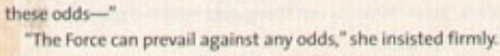
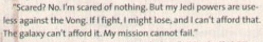
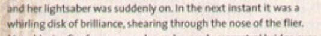
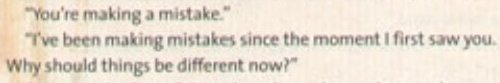
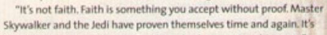
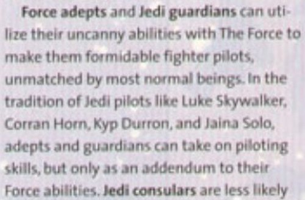
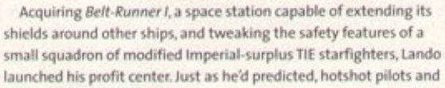
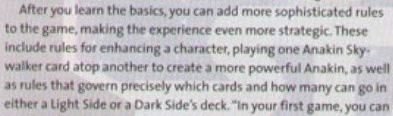

# Owner Material 037 — Star Wars D20 Drive folder (Core, Revised Core and Saga Edition): Star Wars Gamer/Star Wars Gamer 09.pdf [Star Wars Roleplaying Game (d20, 2000)] (scan pages 1–60)

- **Source:** Wizards of the Coast Star Wars Roleplaying Game books, web enhancements, Living Force campaign modules and articles (2000–2010), from the owner's "Star Wars D20" Drive folder (only the three edition subfolders; "General" was not read, as instructed). Secondary source (licensed Legends reference). Scan OCR'd on the box; the scan stays box-only and is **not** published.
- **Method:** every scanned page was OCR'd and machine-screened sentence by sentence for power-relevant statements (fights, kills, defeats, Force feats, rankings, superweapons) that name a character on our roster; each kept sentence is quoted verbatim from the OCR text and has a crop of the printed passage directly under it. Pages with nothing power-relevant are still listed with what is on them.
- **Citation:** "*Star Wars Gamer 09* (SWRPG d20), p.X" by printed page ("scan p.X" where no printed number applies). **Weight:** Licensed RPG material: a secondary source. Narrative text sums up Legends lore; game statistics are rules for players, not canon power levels, and rank lowest.

## scan p.1 (scan page 1)

Page contents: Star Wars Gamer #9 (Vol 2 No 3, Starfighters) cover: the new Star Wars TCG, Aces of Wraith Squadron, Rogue Leader strategy guide, a Jedi Starfighter preview, '3,720 to 1: Run the Belt, Beat the Odds', Battle Empath and Jedi Weapon Master, Sanbra's Guide to Aliens, NJO fiction by Greg Keyes (hand-read)

## scan p.2 (scan page 2)

Page contents: 35 words, 4 paragraphs | headings/entries: Simple shape and hard,; Miter is rapidly establish

## scan p.3 (scan page 3)

Page contents: Contents (badly garbled OCR): Dark Tidings, the Uldir serial part 2 (escape from Borudan?); the Endor and Moddell Sector campaign guide; Wings of Rogues; Wraith Squadron (Aaron Allston); Running the Belt; Sanbra's Guide: the Nosaurian; Dice, Camera, Action!; Special Ops: the Jedi Weapon Master (Owen K.C. Stephens) and the Battle Empath; the adventure Race for the Tessent; the TCG; Jedi Starfighter; Jedi Outcast; Galaxies update; Rogue Leader; Galactic Battlegrounds multiplayer (hand-read)

## scan p.4 (scan page 4)

Page contents: Editorial 'Flights of Fancy' (Dave Gross): TIE Fighter turned him into a Star Wars gamer, flying as the Emperor's Hand in a TIE Advanced; the best way to get to the galaxy far, far away is to fly (hand-read)

## scan p.5 (scan page 5)

Page contents: Letters answers: a weapon battery is up to five identical weapons firing as one, +1 attack per extra weapon to +4, with damage rolled as for one; the Bothan Assault Cruiser has six 4-cannon batteries; Chiss clawcraft stats appeared in Gamer #5 (hand-read)

## scan p.6 (scan page 6)

Page contents: Letters answers: Maarek Stele's indoctrination as an Emperor's Hand was created for Gamer #5, and Blackhole's history went into the Rebellion Era Sourcebook; the TIE advanced, bomber and interceptor are in Starships of the Galaxy, but not the TIE defender (hand-read)

## scan p.7 (scan page 7)

Page contents: Letters answers: Darth Maul was printed as a Near-Human before his species was decided, and once he became a Zabrak he lost the Human bonuses; Gamer #5's Chiss bonuses were wrong (no Human bonuses); custom droids such as C-3PX can have heroic levels; website coverage of the super adventure Tempest Feud (Jeff Grubb, Owen K.C. Stephens), finally spotlighting the Hutts (hand-read)

## scan p.8 (scan page 8)

Page contents: Letters answers: newcomers should start with the Star Wars Adventure Game, then the revised core rulebook; missing language data from 'Bounties to Die For' is filled in (Vooz Nooxoo Oona Read/Write Basic, Scranton Toon Read/Write Rodese, Traggissk Reosss Dosh); Reerookachuck grew up a slave and never learned to read and write (hand-read)

## scan p.9 (scan page 9)

Page contents: Jedi Counseling (JD Wiker): add Strength to lightsaber damage; lightsabers don't cut through everything (Qui-Gon slowly cutting the blast doors, Maul only striking sparks off the pit's lip); there is no speeder scale, so Deflect Blasters works against speeder-bike and STAP blasters; critical hits on a hero with no vitality go to wounds; a Force Point applies to rolls made after it is spent (hand-read)

## scan p.10 (scan page 10)

Page contents: Jedi Counseling: one Exotic Weapon Proficiency covers lightsaber variants unless both ends of a double-bladed saber are lit (the 'lightstaff'); a guard blade does knife damage; a lightsaber is a Medium weapon (about 130 cm lit) with Hardness 5 and 5 wounds; underwater a lightsaber burns out (from the TPM screenplay), so a submerged one shuts down and needs half an hour to recharge; a Force adept can take Sense at 1st level (hand-read)

## scan p.11 (scan page 11)

Page contents: Rogues Gallery: Pilots for Hire (art by Scott Roller): 'Be sure to buy the insurance' (hand-read)

## scan p.12 (scan page 12)

Page contents: 0 words, 0 paragraphs | headings/entries: 

## scan p.13 (scan page 13)

Page contents: Emissary of the Void Part II (Greg Keyes): Uldir and Klin-Fa Gi hide from a CSA search party with a Yuuzhan Vong after the flood; Uldir left the Jedi academy a failure, with only a slight sense of Jedi using the Force and uncommon luck; he sensed something dark in her when she cushioned the flier crash; she claims a secret mission for Master Skywalker (hand-read)

- **Klin-Fa Gi** — entry/section: Emissary of the Void: "“The Force can prevail against any odds,” she insisted firmly." Source: *Star Wars Gamer 09* (SWRPG d20), scan p.13
  

## scan p.14 (scan page 14)

Page contents: Emissary of the Void II: Klin-Fa runs from the Vong because 'my Jedi powers are useless against the Vong', since 'My mission cannot fail'; Bonadan's badlands are an erosion scar from Corporate Sector industrialization; Uldir hides his comlink under a rock because his crew knows asyui-in means 'not' in Dug (hand-read)

- **Klin-Fa Gi** — entry/section: Emissary of the Void: ""Scared? No. I'm scared of nothing, But my Jedi powers are useless against the Vong. If|fight,|might lose, and I can't afford that. The galaxy can't afford it. My mission cannot fail,”" Source: *Star Wars Gamer 09* (SWRPG d20), scan p.14
  

## scan p.15 (scan page 15)

Page contents: Emissary of the Void II: the Yuuzhan Vong warrior's dying words: 'It is not your galaxy… You have merely infested it for a time. We have come to end the infection, in the name of glorious Yun-Yuuzhan' (hand-read)

- **Klin-Fa Gi** — entry/section: Emissary of the Void: "and her lightsaber was suddenly on. in the next instant it was a : whirling disk of brilliance, shearing through the nose of the flier." Source: *Star Wars Gamer 09* (SWRPG d20), scan p.15
  

## scan p.16 (scan page 16)

Page contents: Emissary of the Void II: Klin-Fa deflects bolts as a living shield until the fliers encircle them; the rescue comes on a parade float shaped like a giant head, with Leaft the Dug firing blasters from three hand-feet and Vega with a rifle; the astromech Uvee (U'V-002) flies the No Luck Required alone; they escape Bonadan without shields and with an undependable hyperdrive (hand-read)

## scan p.17 (scan page 17)

Page contents: Emissary of the Void II: Uldir shows Klin-Fa the No Luck Required (an old Corellian medium transport with a cesium-vapor turbolaser turret and proton torpedoes); she says 'Things have changed a little since I've been away' (hand-read)

- **Uldir Lochett** — entry/section: Emissary of the Void: "“Tve been making mistakes since the moment|first saw you. Why should things be different now?”" Source: *Star Wars Gamer 09* (SWRPG d20), scan p.17
  

## scan p.18 (scan page 18)

Page contents: Emissary of the Void II: Vega warns that some of the Emperor's devices are still buried under Wayland's mountain and the Vong dig things up; either they are building an anti-Jedi weapon or Klin-Fa wants to use something herself (hand-read)

- **Uldir Lochett** — entry/section: Emissary of the Void: "“It's not faith, Faith is something you accept without proof. Master Skywalker and the Jedi have proven themselves time and again." Source: *Star Wars Gamer 09* (SWRPG d20), scan p.18
  

## scan p.19 (scan page 19)

Page contents: Emissary of the Void II: Luke reports Klin-Fa Gi was killed, or presumed so, on Gyndine two months ago and knows of no Wayland mission; she opens the ship to space, sabotages the hyperdrive and flees in hyperdrive-capable A-wing one, leaving them stranded two years from the nearest planet at sublight (hand-read)

### Stat block notes (game mechanics, not feats)

- No Luck Required: modified YZ-775 medium transport (Moore Corellian Engineering Corp?), 52 m; Def 20; SP 180 (DR 5); HP 210 (DR 15); double turbolaser cannon and 2 proton torpedo launchers in one turret (one weapon per round); launches an A-wing every other round (Source: *Star Wars Gamer 09* (SWRPG d20), scan p.19)

## scan p.20 (scan page 20)

Page contents: Campaign Guide to Endor and the Moddell Sector (Craig R. Carey, Jason Fry and Daniel Wallace): epigraph by Beryl Suttrige, Ur-Dean Emeritus, College of Astrocartography, Charmath: the diamond core found around the Din Pulsar and the Ast Kikorie array; the Inner Zuma (Spar, Ablajeck, Moddell sectors) lies above the Outer Zuma (Kakani, Sugai, Fusai, Ikenomin); the Hydian Way was blazed about 2,000 BBY; the Zuma was uncharted as recently as 1,000 BBY; hyperspace eddies and sinkholes, and ships vanish on the short hop from Annaj to Ovise (hand-read)

## scan p.21 (scan page 21)

Page contents: Moddell Sector: the Ayrou of Maya Kovel came closest to spaceflight, and the New Republic seated an Ayrou senator; the Kuna constellation names (Kuna's Tooth, Eye, Fist, Tail, Horn; the supergiants Kuna's Heart, Scar?, Gullet); the capital is Annaj (or Cann); the Annaj-Houche Run; Vashan penitents journey to Mina; scientists go to Ast Kikorie (hand-read)

## scan p.22 (scan page 22)

Page contents: Endor: the second of nine moons of a silver-banded gas giant; gravity shadows have crashed hundreds of ships, earning its name as a 'desert island in space'; castaways include the Towani family, a tribe of Marauders from Sanyassa and the trader Noa Briqualon (hand-read)

### Stat block notes (game mechanics, not feats)

- Rokna Blue: Will save DC 16 or lose 1 Int, then DC 28 per later dose, up to -6 Int; reversed at a medical center (3,000–5,000 credits), with Treat Injury DC 15 or Heal Another 20; permanent after one week (Source: *Star Wars Gamer 09* (SWRPG d20), scan p.22)

## scan p.23 (scan page 23)

Page contents: Ewok traps: kal puk log piles, hunting nets, sling nets used on sturicis, and the tek swee ('head hitter') swinging log against the Gorax; two opposed tek swees killed the first scout walker (hand-read)

## scan p.24 (scan page 24)

Page contents: Endor fauna: bordoks are caravan beasts that may be approaching sentience; the divto is a limbless three-headed venomous reptile, some of which stowed away on Imperial freighters (hand-read)

### Stat block notes (game mechanics, not feats)

- Gorax: Forest Predator 6; Def 12; VP/WP 55/38; 2 claws 2d6+7, bite 2d8+10; terrifying presence; Str 24; up to 25 m tall (30 m claims discounted); fewer than two dozen on the moon; keep live prey in hanging cages; allied with hanadaks (Source: *Star Wars Gamer 09* (SWRPG d20), scan p.24)

## scan p.25 (scan page 25)

Page contents: 416 words, 25 paragraphs | headings/entries: Ls; Feats: Stealthy, Track; Biwenc; Skills: Hide; Feats: Endurance, Run; STAR WARS GAMER 31

### Stat block notes (game mechanics, not feats)

- Endor fauna: condor dragon (Airborne Predator 3, nests in the Yawari Cliffs and carries off Medium creatures, screech +4 Intimidate); rearing spider (Desert Vermin 4, eats Gorax leftovers); blurrg (Plains Herd Animal 3, used by the Marauders) (Source: *Star Wars Gamer 09* (SWRPG d20), scan p.25)

## scan p.26 (scan page 26)

Page contents: Endor geography: the Yawari Cliffs (Ewok gliders, condor dragon tunnels), the Desert of Salma (Gorax and dewback-sized rearing spiders), the Dragon's Pelt savanna and the Dragon's Spine; the Sanyassan Marauders built a castle from Dragon's Spine stone and rode blurrgs; King Terak died months before the Battle of Endor (hand-read)

### Stat block notes (game mechanics, not feats)

- Endor flora: Yuzzum commoner (+2 Dex, -2 Str, primitive); perosa sap needs a DC 30 Strength check to separate; fgir 'shooter roots' fire poison needles within 20 m (Fort DC 15 or 2d6 temporary Dex); kata-wata doubles natural healing (Source: *Star Wars Gamer 09* (SWRPG d20), scan p.26)

## scan p.27 (scan page 27)

Page contents: Charal: a Dathomiri Nightsister who fled Dathomir over a century before Endor, under a death mark from witches sent to feed her to the rancors; a master shapeshifter (hand-read)

### Stat block notes (game mechanics, not feats)

- Noa Briqualon: Male Human Sct 12; Def 19; Survival +20, Profession (surveyor) +17; uncanny dodge; speaks Ithorese, Rellarian, Shistavanen, Shyriiwook and Teek (Source: *Star Wars Gamer 09* (SWRPG d20), scan p.27)
- Terak: Male Sanyassan Thug 9; enchanted ring, blaster pistol, sword; Intimidate +9; feats Dodge, Toughness, Weapon Focus (sword) (Source: *Star Wars Gamer 09* (SWRPG d20), scan p.27)

## scan p.28 (scan page 28)

Page contents: Adventure hook 'Wired to Kill': the old Rokna Blue station's defenses are protecting a potent slow-growing strain, and the Taloron? kingpin 'Blue' Imcrix hijacks the heroes to grab it before New Republic demolition (hand-read)

### Stat block notes (game mechanics, not feats)

- Charal: Female Human FA 2/Dark Force Witch 6; VP/WP 48/13; DSP 10; inspire fear, spider walk, enshroud; Affect Mind +11, Handle Animal +14; Force feats Alter, Force Whirlwind, Sense, Summon Storm; the ring changes her form as an attack action (bird form Tiny, 0.6 m, with improved grab) (Source: *Star Wars Gamer 09* (SWRPG d20), scan p.28)

## scan p.29 (scan page 29)

Page contents: Adventure hook 'Sith Lords' (labelled NJO, though set after Endor): a clan of 480 Jawas among the scavengers; Lord Vader's crimson lightsaber was never recovered from the Death Star wreckage and is rumored to orbit the moon or lie in the forest (hand-read)

### Stat block notes (game mechanics, not feats)

- Forest Moon of Endor: gravity 85%; 18-hour day; 402-day year; fewer than 50 offworld trading post staff; exports rokna fungus and medicinal goods (Source: *Star Wars Gamer 09* (SWRPG d20), scan p.29)

## scan p.30 (scan page 30)

Page contents: Ast Kikorie: a ring of orbital AST telescopes (the prefix works like 'Ord'); the locals call it 'Downbelow'; a skyhook links Kikorie Port (half a million people) to the station; the Din Pulsar went supernova about 5,000 BBY, recorded in Sanyassan art and songs and perhaps in the Marauders' radiation-damaged DNA; the Ewoks call it the Gorax King's Heart, a myth of the sun god and a swallowed diamond, and a gas-giant core really is a planet-sized diamond (hand-read)

### Stat block notes (game mechanics, not feats)

- The Dark Side Stain: 15% chance near the Death Star wreckage; Force-sensitives make Fort DC 14 or take 1d6 damage, and Fort DC 16 or fall unconscious for 2d6 minutes (Source: *Star Wars Gamer 09* (SWRPG d20), scan p.30)

## scan p.31 (scan page 31)

Page contents: Sidebar 'Galactic Coordinates': Coruscant is (0,0,0) although slightly northwest of the true center; 15 parsecs (just under 49 light-years) per unit; a parsec is 3.258 light-years (the OCR has 3,258); Annaj is at (-334,-697,16)? (hand-read)

## scan p.32 (scan page 32)

Page contents: Mina, a moon of the gas giant Hanchin: pechs and eight-legged feathered dochinies; Vashan bodhis at Inkus Mont polish 'sin-bullets' in their six antestomaches and spit them out at Hanchin-set, and penitents swallow them for absolution; the Monsua Nebula's only reachable system is Zorbia; Murk, a red dwarf where the Pipeline ended at an Imperial transfer station (hand-read)

## scan p.33 (scan page 33)

Page contents: Trindello: Trindellan oaks are shoots of a single root system with wood nearly as hard as iron, overharvested by cutters; Sanyassa IV: Marauder pirates, a might-makes-right kleptocracy, maybe genetically damaged by the Din supernova; Vasha: chitinous Vashans of rival theocracy castes, now a near-satrapy of the Ayrou (hand-read)

## scan p.34 (scan page 34)

Page contents: Vashans swallow interesting items into their antestomaches, so shops post 'No Vashans' signs; Vex Major's Ffib descendants call it 'Far Gent'; the Belt hides starships and fugitives; Ecclesis von der Agar, a decorated Nova Scout now sliding into dementia, recruits rookie scouts in Belt cantinas but has an uncanny knack for new routes (hand-read)

### Stat block notes (game mechanics, not feats)

- Moddell species: dochinie (Airborne Predator 1); Ayrou commoner; rujo (Herd Animal 2); Sanyassan (+2 Str, +2 Con, -2 Dex, -2 Int); Vashan (+4 Str, +2 Con, -2 Wis, -4 Cha, natural armor +3); kargul, an 80 m worm (Forest Herd Animal 7, Colossal, Str 37, bite 4d8+19?) (Source: *Star Wars Gamer 09* (SWRPG d20), scan p.34)

## scan p.35 (scan page 35)

Page contents: Zorbia: quarrelsome Human pirates with a language derived from ancient Corellian, either a lost colony or castaways, who once flew fluidic-system spaceboats with slugthrowers; source list includes Caravan of Courage, Battle of Endor, the Ewoks comics (Zorbians), Star Tours, Bounty Hunters: Aurra Sing (the only prequel-era Endor), Shield of Lies (Rokna Blue) and The Glove of Darth Vader (the Endor Gate) (hand-read)

## scan p.36 (scan page 36)

Page contents: Squadron campaigns (J. Swallow): Fringers as 'bush pilots' who hot-wired Skyhoppers and dreamed of a Z-95 Headhunter, and repair crews; make the commander a GM character (hand-read)

## scan p.37 (scan page 37)

Page contents: Squadron campaigns: Plourr Ilo, Rogue Squadron's 'warrior princess'; class roles (scoundrel supply officers, scout recon, soldier aces, Jedi pilots in the tradition of Luke, Corran Horn, Kyp Durron and Jaina Solo); GMs may grant 1–4 free Pilot points; Colonel Alask Vrei, a former Twi'lek baron ruined in a clan power struggle, who calls his crew his 'subjects' and commands 'harsh but fair' (hand-read)

- **Luke Skywalker; Corran Horn; Kyp Durron; Jaina Solo**: "Force adepts and Jedi guardians can uti lize thelr uncanny abilities with The Force to make them formidable fighter pilots unmatched by most normal beings. in the tradition of Jedi pilots like Luke Skywalker Corran Horn, Kyp Durron, and Jaina Solo, adepts and guardians can take on piloting skills, but only as an addendum to their Force abilities." Source: *Star Wars Gamer 09* (SWRPG d20), scan p.37
  

## scan p.38 (scan page 38)

Page contents: Squadron campaigns: Rebel squadrons have 13 pilots (a commander, two Captains each leading five, two Lieutenants and eight Flight Officers); bush-pilot squadrons fly rattletrap ships; a basic pilot kit (flight suit, helmet, comlink, medpac, blaster pistol, field kit) (hand-read)

### Stat block notes (game mechanics, not feats)

- Squadron Reputation: base 1d4; +1 per Jedi member (not in the Rebellion era); +1 per +5 of each member's Reputation; buys Fighter Quality (Superior 8 such as N-1 and TIE x1, Average 4 such as X-wing and TIE, Poor 2 such as Y-TIEs and 'Uglies') and Maintenance (Well 8, Typical 6, Poor 4, Neglected 2); worked example squadron, the Nightfighters (Source: *Star Wars Gamer 09* (SWRPG d20), scan p.38)

## scan p.39 (scan page 39)

Page contents: 618 words, 31 paragraphs | headings/entries: NUMBER OF FLAWS; Maintenance Level; Bad; Well; Fighter Quality Typical Neglected; Fraws; Crain oF COMMAND; Rank Fl git Officer; Reputation; Lieutenant Captain; Commander

### Stat block notes (game mechanics, not feats)

- Starfighter Flaws: 2d6 table: serious flaw, engine malfunction (20%), life support, S-foils/landing gear/hatch jam (30%), weapon, projectile jam (25%), comms, hyperdrive burnout (25%), shield failure (25%), multiple; Repair DC 20 once per week; flaw counts by quality and maintenance (Source: *Star Wars Gamer 09* (SWRPG d20), scan p.39)

## scan p.40 (scan page 40)

Page contents: 682 words, 20 paragraphs | headings/entries: Typical planetside bases vary in Bespin; SPACEBORNE BASES

### Stat block notes (game mechanics, not feats)

- Squadron ranks and bases: Lieutenant, Captain and Commander remove 1, 2 and 3 Flaws; planetside base table (airless moon, ice world, temperate, desert, jungle, gas giant, urban, ocean, hostile atmosphere, ruined wasteland); spaceborne (station, starship, asteroid belt, comet, derelict); mercenary units post bounties for kills (Source: *Star Wars Gamer 09* (SWRPG d20), scan p.40)

## scan p.41 (scan page 41)

Page contents: Squadron campaigns: planetary defense forces such as the Naboo Starfighter Corps, CorSec, Hapes, the CSA and the Tapani Sector; in the NJO, Jedi starfighters return, like Kyp Durron's Dozen-and-Two Avengers flying XJ X-wings (hand-read)

### Stat block notes (game mechanics, not feats)

- Base size and operations grade: Large (Commenor, Death Star), Standard (Hoth, a Star Destroyer), Small (Tierfon Outpost in the Sumitra sector, Theed); Superior removes a Flaw and gives +2 with command, Poor adds a Flaw and -2; upgrade checks DC 25/30 monthly; nomadic squadrons count as Poor (Source: *Star Wars Gamer 09* (SWRPG d20), scan p.41)

## scan p.42 (scan page 42)

Page contents: Victor Flight: Naboo's orbital 'coast guard' of mavericks, with runs to the Ohma-D'un colony; its former flight leader was arrested for giving pirates freighter transit patterns, and the then head of Royal Security, Captain Magneta, suspected the other pilots; the naive new commander Stal Bridda led police cruisers against a Trade Federation transport group (hand-read)

## scan p.43 (scan page 43)

Page contents: Nomad Squadron: one of the Alliance's first full squadrons after Yavin, originally all A-wings, whose point of honor is that its pilots 'could fly anything, anywhere, anytime'; in the NJO, under Captain Tarrik, it flies from the Mon Calamari cruiser Allegiant in the Meridian Sector (hand-read)

## scan p.44 (scan page 44)

Page contents: Wraith Squadron (Joshua J. Radke): Wedge's bet with Ackbar that if the washouts couldn't form a unit he would accept the General's rank he had refused; Wedge is the only pilot to help destroy both Death Stars and survive, a 'soldier's officer'; Gate is a cranky R5, a line supposedly designed for agriculture (hand-read)

## scan p.45 (scan page 45)

Page contents: Wraith Squadron: Wes Janson is executive officer, the man who killed Kell's father and trained Myn Donos; Kell Tainer is the demolitions expert who wants to prove the Dorans aren't cowards and who courts Tyria Sarkin (hand-read)

### Stat block notes (game mechanics, not feats)

- Tyria Sarkin Wedge Antilles: Male Human Sol 7/ Starfighter Ace 5/Officer 3; init +8 (Dex, improved initiative); Def 24 (+10 class, +4 Dex); Spd 10m; VP/WP g9/ta; Atk +12/+7/+2 melee (1d3, punch) or +16/411/+6 ranged (308, blaster pistol); SQ Starfighter defense, familiarity +3 (X-wing), starfighter evasion, leadership, requisition supplies; SV Fort +1, Ref +12, Will +9; SZ Mz FP 4; DSP 0; Rep 10; Str 1 (Source: *Star Wars Gamer 09* (SWRPG d20), scan p.45)
- Wedge Antilles: Male Human Sol 7/Starfighter Ace 5/Officer 3; Def 24; Pilot +27; Rep 10; Diplomacy +16; Profession (gambler) +6; with Gate (Source: *Star Wars Gamer 09* (SWRPG d20), scan p.45)
- Gate: Tracked Astromech Droid Expert 4; Astrogate +13, Repair +13; heuristic processor (Source: *Star Wars Gamer 09* (SWRPG d20), scan p.45)
- Wes Janson: Male Human Sol 7/Starfighter Ace 5; Pilot +21; Profession (teacher) +11; Expert Gunner; Knowledge (Taanab) +4 (Source: *Star Wars Gamer 09* (SWRPG d20), scan p.45)

## scan p.46 (scan page 46)

Page contents: Runt: a Thakwaash with several personalities, nicknamed by his siblings for being short; transferred repeatedly because his 'pilot' personality disobeyed orders; replaced Jesmin as communications specialist; Face Loran was a child propaganda star, scarred by a stray bolt when commandos raided, and hid on Pantolomin (hand-read)

### Stat block notes (game mechanics, not feats)

- Kell Tainer: Male Human Sct 2/Sol 5; Demolitions +15 (double Skill Emphasis); vibrodagger; R2 unit 'Thirteen' (Source: *Star Wars Gamer 09* (SWRPG d20), scan p.46)
- Runt: Male Thakwaash Fringer 3/Sol 4; Large; multiple personalities; Knowledge (holonet) +10 (Source: *Star Wars Gamer 09* (SWRPG d20), scan p.46)

## scan p.47 (scan page 47)

Page contents: Tyria Sarkin: a veteran of the Antarian Rangers on Toprawa and the Wraiths' second insertion expert; Thakwaash are about 3 m tall with Gungan-like heads and the strength of four Humans, and call themselves 'we' (hand-read)

### Stat block notes (game mechanics, not feats)

- Face Loran: Male Human Nob 4/Sol 3/Starfighter Ace 1; Disguise +12, Entertain (acting) +12; Fame, Mimic; R2 unit 'Vape' (Source: *Star Wars Gamer 09* (SWRPG d20), scan p.47)

## scan p.48 (scan page 48)

Page contents: Tyria was groomed at the Academy as the next 'Luke Skywalker' but failed, then was written up for gross insubordination when she refused Colonel Repness's black market scheme; Piggy is a Gamorrean 'humanized' by Imperial experiment with genius-level mathematics, nicknamed like Jek Tono Porkins, and was framed into transferring; Dia Passik, a Twi'lek former slave, replaced Falynn Sandskimmer (hand-read)

### Stat block notes (game mechanics, not feats)

- Myn Donos: Male Human Sct 7/Sol 1/Starfighter Ace 1; Hide and Move Silently +13; SoroSuub X-45 sniper rifle; R2 'Shiner' (Source: *Star Wars Gamer 09* (SWRPG d20), scan p.48)
- SoroSuub X-45 sniper rifle: originally the 'Riflette' sporting blaster; over-focused thin bolt, reclassified military-only for its popularity with assassins; fragile; 1,000 credits, 3d6+1, critical 18-20, range 50 m, 4 kg (Source: *Star Wars Gamer 09* (SWRPG d20), scan p.48)

## scan p.49 (scan page 49)

Page contents: Shalla Nelprin, the hand-to-hand instructor, is the younger daughter of the Republic agent Vyn Narcassan, who fled to Ingo; her sister Vula trained Kell with Page's commandos; Lara Notsil is really Gara Petothel, a Zsinj agent once with Admiral Apwar Trigit on the Implacable, recruited by Ton Phanan and Face, who now doubts her side; Elassar Targon is a spotless Devaronian volunteer who wanted to fly with Wedge (hand-read)

### Stat block notes (game mechanics, not feats)

- Tyria Sarkin: Female Human Sct 5/Sol 3; Force-Sensitive; Knowledge (Jedi lore) +9; R5 'Chunky' (Source: *Star Wars Gamer 09* (SWRPG d20), scan p.49)
- Piggy: Male Gamorrean Thug 2/Sol 6; Knowledge (mathematics) +18; humanization gave +4 Dex, +12 Int and +1 skill point per level; a removable throat translator lets him speak Basic (Source: *Star Wars Gamer 09* (SWRPG d20), scan p.49)

## scan p.50 (scan page 50)

Page contents: Wraith Squadron: Elassar is the medic and comic, an imitation of Ton Phanan; Cubber, the chief mechanic shared with Rogue Squadron, drinks and dreams of retirement; Squeaky, an irritable 3PO quartermaster, served on Leia's Tantive IV, escaped Kessel and waited tables at the DownTime lounge (hand-read)

### Stat block notes (game mechanics, not feats)

- Wraith support: Cubber Tech Specialist 10 (Repair +23, Craft starship weapons +20); Squeaky protocol droid Diplomat 3; Dia Passik Twi'lek Fringer 1/Sol 6 (Knowledge streetwise +15); Shalla Nelprin Sct 4/Sol 5/Elite Trooper 1 (Two-Weapon Fighting, Martial Artist) (Source: *Star Wars Gamer 09* (SWRPG d20), scan p.50)

## scan p.51 (scan page 51)

Page contents: Wraith Squadron rosters for the novels Wraith Squadron, Iron Fist and Solo Command; honor roll: Jesmin Ackbar (Ackbar's niece, killed over the pilot moon New Blood?), Falynn Sandskimmer and Grinder Thri'ag (both killed against the Implacable), Ton Phanan (allergic to bacta, shot down on Halmad), Castin Donn (killed on the Iron Fist) (hand-read)

### Stat block notes (game mechanics, not feats)

- Lara Notsil: Female Human Scoundrel 6/Sol 2; Bluff +14, Disguise +13; 'better lucky than good'; sneak attack +2d6; DSP 2; R5 'Tonin' (Source: *Star Wars Gamer 09* (SWRPG d20), scan p.51)
- Elassar Targon: Male Devaronian Sol 4/Tech Specialist 4; Treat Injury +18; Surgery; 4 medkits (Source: *Star Wars Gamer 09* (SWRPG d20), scan p.51)

## scan p.52 (scan page 52)

Page contents: Running the Belt (JD Wiker): on Dubrillion, Lando's game of skill sees how long pilots last flying against the current in the asteroid belt called Lando's Folly (about 20 km thick), using modified Imperial-surplus TIEs shielded by the station Belt-Runner I; a nonrefundable 2,500-credit 'damage deposit' weeds out the timid (hand-read)

- **Lando Calrissian**: "Acquiring Belt-Runner !,a space station capable of extending its shields around other ships, and tweaking the safety features of a small squadron of modified Imperial-surplus TIE starfighters, Lando launched his profit center." Source: *Star Wars Gamer 09* (SWRPG d20), scan p.52
  

## scan p.53 (scan page 53)

Page contents: Belt-Runner I splits its projected shields among Jaina's, Jacen's and Anakin's TIEs during the Yuuzhan Vong attack on Dubrillion; Lando's three TIE Advanced x1s trade their shields for proton torpedoes; his two TIE bombers have two-seat cockpits (hand-read)

### Stat block notes (game mechanics, not feats)

- Belt-Runner I: space station, 284 m; 18,000,000 credits used; crew 86; projects up to 600 SP to ships within sensor range (680 SP own); 20 turbolasers in four batteries; HP 375 (Source: *Star Wars Gamer 09* (SWRPG d20), scan p.53)
- Modified TIE Advanced x1 / TIE Bomber: x1: 78,400 credits used; hyperdrive x4; Def 24; HP 90; 2 heavy blaster cannons 6d10x2; proton torpedo launcher (16); bomber: 72,500, Tiny, crew 2, point laser cannons and concussion missiles (16) (Source: *Star Wars Gamer 09* (SWRPG d20), scan p.53)

## scan p.54 (scan page 54)

Page contents: 1045 words, 35 paragraphs | headings/entries: RUNNING; THE GENERATING | see; NUMBER B; Asteroid Hazards; Loss of Starship Control; FAILED MANEUVERS; Speed in the Belt; Speed Modifier Number of Hazards

### Stat block notes (game mechanics, not feats)

- Running the Belt rules: speed sets hazards per round (docking 2, cruising 3, attack 4, ramming 5; avoid two); 'hugging the rim' adds +5 to hazard rolls but uses a d6 for knock-outs; 'risky flying' adds up to Pilot ranks, then that much as a cumulative penalty next round; loss of control table (skew -2, yaw -5, bump -5, spin -10, crash -10); worked examples with Jaina and Jacen (Source: *Star Wars Gamer 09* (SWRPG d20), scan p.54)

## scan p.55 (scan page 55)

Page contents: 737 words, 27 paragraphs | headings/entries: Modified TIE Advanced xl; Hazard Size Speed, and Direction; Use the tables below to determine an; STAR WARS GAMer G1

### Stat block notes (game mechanics, not feats)

- Running the Belt rules: bumps are one-quarter ram damage; a second crash ends the run; leaving voluntarily takes 1d4 more rounds; out-of-control knock-out if 1d10 is at or under the consecutive out-of-control actions; Reputation points at 20, 30 and 40 rounds; asteroid size, speed and direction tables (Source: *Star Wars Gamer 09* (SWRPG d20), scan p.55)

## scan p.56 (scan page 56)

Page contents: Wizards of the Coast's new Star Wars Trading Card Game (Michael G. Ryan): designed by Richard Garfield, Mark Rosewater, Robert Gutschera and Skaff Elias from fall 2000; Space, Ground and Character arenas, where you win two of three; Speed sets attack order (hand-read)

## scan p.57 (scan page 57)

Page contents: Star Wars TCG: dice equal to Power, hits on 4–6; stacking character versions (Obi-Wan in three, C-3PO in two) instead of rare 'cook's son' characters; Mission cards 'Execution in the Arena' and 'Wedding of Destiny' (hand-read)

- **Darth Vader (Anakin Skywalker)**: "After you learn the basics, you can add more sophisticated rules to the game, making the experience even more strategic, These inchuge rules for enhancing a character, playing one Anakin Sky walker card atop another to create a more powerful Anakin, as well a5 rules that govern precisely which cards and how many can goin either a Light Side of a Dark Side's deck." Source: *Star Wars Gamer 09* (SWRPG d20), scan p.57
  

## scan p.58 (scan page 58)

Page contents: Star Wars TCG: playtest card 'I Am Your Father' made Vader 'General Veers's father more than once'; first tournaments at Star Wars Celebration II in Indianapolis; Episode IV base set expected November (hand-read)

## scan p.59 (scan page 59)

Page contents: Star Wars TCG strategy: lose your sacrificed arena by a lot and win two barely; deck archetypes (Bombard/Ion Cannon, big units, swarms, Critical Hit, droids, high Force); a four-of-a-kind rule (hand-read)

## scan p.60 (scan page 60)

Page contents: Star Wars TCG: US debut April 23; Sith Rising due July 2002; 11-card boosters at $3.29 with holo odds 1 in 3; a card anatomy diagram (Anakin Skywalker version C) (hand-read)

