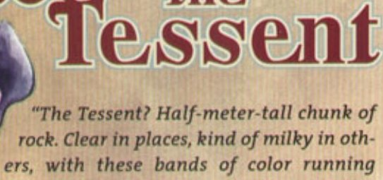
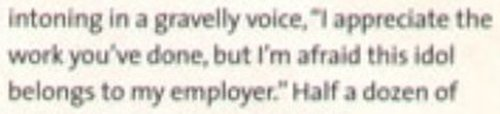
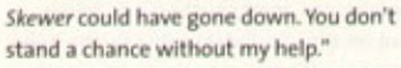
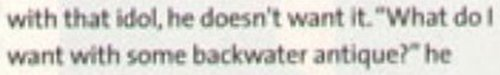
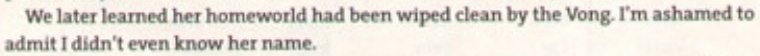
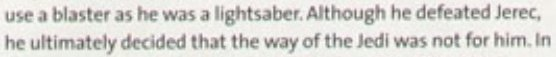
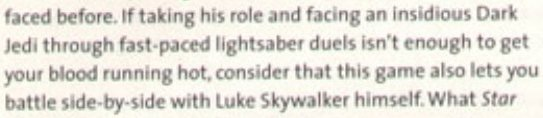
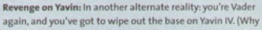

# Owner Material 037 — Star Wars D20 Drive folder (Core, Revised Core and Saga Edition): Star Wars Gamer/Star Wars Gamer 09.pdf [Star Wars Roleplaying Game (d20, 2000)] (scan pages 61–104)

- **Source:** Wizards of the Coast Star Wars Roleplaying Game books, web enhancements, Living Force campaign modules and articles (2000–2010), from the owner's "Star Wars D20" Drive folder (only the three edition subfolders; "General" was not read, as instructed). Secondary source (licensed Legends reference). Scan OCR'd on the box; the scan stays box-only and is **not** published.
- **Method:** every scanned page was OCR'd and machine-screened sentence by sentence for power-relevant statements (fights, kills, defeats, Force feats, rankings, superweapons) that name a character on our roster; each kept sentence is quoted verbatim from the OCR text and has a crop of the printed passage directly under it. Pages with nothing power-relevant are still listed with what is on them.
- **Citation:** "*Star Wars Gamer 09* (SWRPG d20), p.X" by printed page ("scan p.X" where no printed number applies). **Weight:** Licensed RPG material: a secondary source. Narrative text sums up Legends lore; game statistics are rules for players, not canon power levels, and rank lowest.

## scan p.61 (scan page 61)

Page contents: Race for the Tessent: in Alsakan legend the tessent is a fierce avian with a feline head that aided the ancient kings of Archais; Saml? Previl, the Prime Abseiler, rode it into his final battle against the dukes of the Ten Valleys; the Alsakan Guard took it as an emblem and merchants paint it on ship noses as a ward; the idol, carved over a millennium ago by an artist of the primitivist school of Collus Elder, vanished shortly before the fall of the Empire (hand-read)

- **Barzur Antilles** — entry/section: Race for the Tessent: "“The Tessent? Half-meter-tall chunk of rock. Clear in places, kind of milky in others, with these bands of color running" Source: *Star Wars Gamer 09* (SWRPG d20), scan p.61
  

## scan p.62 (scan page 62)

Page contents: Race for the Tessent rivals: the unscrupulous Alsakan xenoarchaeologist Follnor Callat, with a Mandalorian and a Blood Carver tracker; the Kintan Gunrunners of Sarafur and their ambitious lieutenant Tu'rse'yulir; Korraj's Thonner pirates; the Vashan swordsman Poina Tuc-shol, who thinks unbelievers can't touch it, and the caste theocrat Dochi At-Rial (hand-read)

## scan p.63 (scan page 63)

Page contents: Race for the Tessent on Ast Kikorie: an Aldera Guard who held the Tessent is believed lost when a meteorite shower downed the second AST station; Callat lives in Kikorie Port's Lon Heights with four assistants, former students from the University of Rudrig, and flies a Placid-class freighter; Nikto mercenaries visit (hand-read)

## scan p.64 (scan page 64)

Page contents: Fenn Shysha: a Human who took Mandalorian armor as a Supercommando, stays near Mandalore and takes mercenary jobs to fund his fight against slavers; honorable; era substitutes include Jango Fett, Jodo Kast or the bounty hunter Alfreda Goot (hand-read)

- **Fenn Shysha** — entry/section: Race for the Tessent: "I appreciate the work you've done, but I'm afraid this idol belongs to my employer.”" Source: *Star Wars Gamer 09* (SWRPG d20), scan p.64
  

### Stat block notes (game mechanics, not feats)

- Follnor Callat: Male Human Expert 12; Knowledge (archaeology) +21, Forgery +18, Profession (archaeologist) +18; reads Killik, Kivian, Dakoti and others; Infamy, Iron Will; invalid universal access pass (Source: *Star Wars Gamer 09* (SWRPG d20), scan p.64)

## scan p.65 (scan page 65)

Page contents: Tu'rse'yulir, a Kajain'sa'Nikto lieutenant who sees the Gunrunners as peers of the Hutts and dreams of the Alsakan weapons cache; her pet Kar'sylic is a 2.5 m Kintan Strider, hunted to extinction on Kintan, used by Hutts as guard beasts where nashtahs can't thrive (hand-read)

### Stat block notes (game mechanics, not feats)

- Fenn Shysha: Male Human Sol 7/Sct 2/Elite Trooper 5; Def 21; VP/WP 94/12; Knowledge (Mandalore) +15; flamethrower gauntlet, rocket darts, jet pack, spiked boots; ship Free Mandalore (Source: *Star Wars Gamer 09* (SWRPG d20), scan p.65)
- Blood Carver thief: Male Blood Carver Scoundrel 3; Hide and Move Silently +10; Forgery +7 (Callat's hireling) (Source: *Star Wars Gamer 09* (SWRPG d20), scan p.65)
- Kintan Gunrunner: Male Red Nikto Thug 3; force pike; desert dweller (+4 Survival in desert; a week without water) (Source: *Star Wars Gamer 09* (SWRPG d20), scan p.65)

## scan p.66 (scan page 66)

Page contents: 'Plug-Eye' Maygo, a Sanyassan bodyguard and prizefighter from Annaj, got his name when a malfunctioning slugthrower lodged an iron ball in his left eye socket; the Gunrunners won't share the treasure with him (hand-read)

### Stat block notes (game mechanics, not feats)

- Tu'rse'yulir and allies: Tu'rse'yulir Female Red Nikto Scoundrel 6 (250,000 credits of contraband weapons, Astrogate +12); Kintan Strider Desert Predator 6 (superior recuperation); 'Plug-Eye' Maygo Male Sanyassan Thug 5; Gunrunner skiffs (Ubrikkian Bantha II, double laser cannon) (Source: *Star Wars Gamer 09* (SWRPG d20), scan p.66)

## scan p.67 (scan page 67)

Page contents: Sarafur interests: the Vashan Liberation Force, about twenty rebels against the Ayrou; the Rodian shipjacker Tershan, living in a sea-creature skull; LC-Zed, a rogue early LC hunting droid (precursor to the Eliminator 434) that killed its master, three officers and a portmaster, stole a governor's shuttle and is hunted by the Abbaji System Constables (hand-read)

## scan p.68 (scan page 68)

Page contents: Korraj lost the euphoria-inducing throat-sac ability of the t'landa Til in the Tertiary Ingo Riots and speaks in a gravelly whisper; his base in the Lesser Firagh Peninsula tidal flats docks a 'SkyHeist' 43v in an air-filled sea cave; about two dozen underlings, Quarren and Aqualish guards; he hates Pale Nikto (Gluss'sa'Nikto); Zoun maulers roam the peninsula (hand-read)

### Stat block notes (game mechanics, not feats)

- LC-Zed: Hovering Assassin Droid Sol 6; two heavy blasters; DR 5; cerellium armor; no vocabulator (Source: *Star Wars Gamer 09* (SWRPG d20), scan p.68)
- Kallukoras: Male Trandoshan Sct 3/Tech Specialist 5; Craft (armor) +16; mastercraft armor +1 (Source: *Star Wars Gamer 09* (SWRPG d20), scan p.68)

## scan p.69 (scan page 69)

Page contents: Thonner: corsit-puzzle trees so spiked that even the climbing corsit impales itself; puzzle-wood staffs make vicious melee weapons; rumor: a former Ayrou prisoner spent 'Sixteen years' locked up after one fistfight (hand-read)

### Stat block notes (game mechanics, not feats)

- Zoun Mauler / Saqc'or / Veikas: Zoun Mauler Swamp Predator 8, Move Silently +14; Saqc'or Male Svivreni Fringer 7, Profession (miner) +13 (Svivreni get +4 to Appraise ores and gems and +2 to Fortitude and Will); Veikas Male Mon Calamari Sct 3/Sct 5, Survival +15, Swim +14 (Source: *Star Wars Gamer 09* (SWRPG d20), scan p.69)

## scan p.70 (scan page 70)

Page contents: Vasha: a deep-core mine found an idol in feather wrappings with an Il Madri hierarch's seals; Dochi At-Rial labors in The Abyss toward the lair of the Rot-Maggot, the god of decay; railless repulsor platforms; honeycomb berths near Tatarrar spaceport; corpse-white apilid worms bore through rock; At-Rial wears a string of dried Ayrou heads taken from the morgue (hand-read)

### Stat block notes (game mechanics, not feats)

- Apilid Worm: Subterranean Predator 1; meter long; blindsight (Source: *Star Wars Gamer 09* (SWRPG d20), scan p.70)

## scan p.71 (scan page 71)

Page contents: Dochi At-Rial swallowed the Tessent into his antestomach (Knowledge (alien species) DC 30); he flees to Inicus Mont on Qina; the Ayrou outlawed Vashan blades, but Poina Tuc-shol keeps the edged-weapon tradition from hidden mountain combat schools and believes the Tessent is a sin-bullet expelled by the Vashan god of creativity (hand-read)

### Stat block notes (game mechanics, not feats)

- Poina Tuc-shol: Male Vashan Sct 2/Sol 8; two short swords; Improved Two-Weapon Fighting; golden sin-bullet charm (Source: *Star Wars Gamer 09* (SWRPG d20), scan p.71)

## scan p.72 (scan page 72)

Page contents: Groex Gal came to Qina from the Dousc system hoping to found a colony for the six-armed Ebranites; guide for over a decade, 100 credits off season; keeps four refitted Z-95 Headhunters in a hidden cave (hand-read)

### Stat block notes (game mechanics, not feats)

- Groex Gal: Male Ebranite Expert 9/Sct 3; Climb +18, Profession (mountaineer) +19, Survival +17; Ebranite traits: +2 Str and Dex, -4 Cha, bonus Ambidexterity, +4 Climb and Survival (Source: *Star Wars Gamer 09* (SWRPG d20), scan p.72)

## scan p.73 (scan page 73)

Page contents: Race for the Tessent on Endor: the Zorbian pirate craft Skewer may have crashed with Ayrou antiquities; the guide Macy Yakaro, a former Annaj spaceport controller, has a transponder detector and wants thirty percent, with a 20% nightly chance he ends up on a cooking spit at a dark-ways outcast Ewok camp; condor dragons nest in the Yawari Cliffs with the shiny loot (hand-read)

- **Macy Yakaro** — entry/section: Race for the Tessent: "You don't stand a chance without my help.”" Source: *Star Wars Gamer 09* (SWRPG d20), scan p.73
  

### Stat block notes (game mechanics, not feats)

- Free Mandalore / Uglies: Free Mandalore: modified Kubrai Transportation Kubrai 54, about 590,000 credits, 20 m, hyperdrive x1, 75 SP, blaster cannons and proton torpedo tubes with tracking beacons; Uglies: scratch-built, 25,000–40,000 credits; the Gunrunners field five in poor shape (Source: *Star Wars Gamer 09* (SWRPG d20), scan p.73)

## scan p.74 (scan page 74)

Page contents: Endgames: Brixbrax Ux-rox in the Cave of Memory reads objects' provenance by holding them in his antestomach (10–1,000 credits); he may spit the idol into the crowd, where it is mistaken for a sin-bullet; or the Tessent may be a synthetic fake carrying an Annaj factory worker's psychic residue, with Fenn Shysa slipping away (hand-read)

- **Dr. Follnor Callat** — entry/section: Race for the Tessent: ""What do! want with some backwater antique?”" Source: *Star Wars Gamer 09* (SWRPG d20), scan p.74
  

## scan p.75 (scan page 75)

Page contents: Callsigns (Owen K.C. Stephens): naming Star Wars characters; Corellian names are a single given name plus a family name, or long names like Hal Kir Drayson; joined families form names like 'Sal-Solo'; methods include substitution ('Tam Sythe', 'Dak Falgate'), name milling ('Steow Faunor' to 'Stow Fanor'), reversal ('Kire Anom') and reference books (hand-read)

## scan p.76 (scan page 76)

Page contents: Callsigns: tables of common Corellian female, male and family names (Antilles, Drayson, Donos, Horn, Terrik, Solo and others) (hand-read)

## scan p.77 (scan page 77)

Page contents: Nosaurians of New Plympto (Corellian sector Outlier systems): 1.2–1.55 m reptiles with a six-spiked horn ridge (jagged stubs mark old or quarrelsome ones), black-and-white vision, phosphorescent mouth linings, quick reflexes, and an involuntary bray to 'sing down' the sunset that gets them refused service offworld (hand-read)

- **Professor Eliss** — entry/section: Nosaurians: "I'm ashamed to admit I didn't even know her name," Source: *Star Wars Gamer 09* (SWRPG d20), scan p.77
  

## scan p.78 (scan page 78)

Page contents: Nosaurian history: the economy depended on intoxicant rikknit egg yolks until Valorum protected the ten-legged rikknit, turning most of the population into poachers; the Empire classed New Plympto 'expendable'; General Fefar Blackeye led three guerrilla campaigns, was captured a year after Yavin and shown in a Coruscant zoo cage with primates until he took his own life; independence during the Corellian insurrection; Nosaurians joined Nolaa Tarkona's Diversity Alliance; Alema and Numa Rar led the resistance to the Vong, who left a virus that melted hundreds of thousands, and the world is quarantined like Ithor (hand-read)

### Stat block notes (game mechanics, not feats)

- Nosaurian Commoner / species: +2 Dex, -2 Cha; +2 Climb and Survival; gore 1d6; New Plympto: 22-hour day, 370-day year, 1 billion people (before the NJO); example names Clegg Holdfast, Fefar Blackeye, Moco Minkfruit (Source: *Star Wars Gamer 09* (SWRPG d20), scan p.78)

## scan p.79 (scan page 79)

Page contents: Clegg Holdfast, Podracer: son of a fish-catcher and a candle maker from Phemiss's drifter district, he left at thirteen; a TriNebulon News back-pages writer ('Area Woman Has Sector's Largest Collection of Juri Jars'), he lied his way into a Podracing Quarterly column and raced a Keizar-Volvec KV9T9-B Wasp mid-pack; New Plympto was one of twenty-seven alien Core Worlds classed expendable (hand-read)

### Stat block notes (game mechanics, not feats)

- Clegg Holdfast: Male Nosaurian Frg 1; Profession (journalist) +4, Profession (Podracer) +4; Skill Emphasis (Gather Information) (Source: *Star Wars Gamer 09* (SWRPG d20), scan p.79)

## scan p.80 (scan page 80)

Page contents: Dice, Camera, Action! part 2: The McGuffin (Robin D. Laws): Hitchcock's term for what characters pursue; the Death Star plans in A New Hope; bait-and-switch McGuffins (Psycho, The Phantom Menace's blockade giving way to Anakin); people as McGuffins (Luke in Empire, Han in carbonite); 'A physical McGuffin helps the players know when the story is over.' (hand-read)

## scan p.81 (scan page 81)

Page contents: The McGuffin: sympathetic McGuffin characters must be helpless and should be GM characters (or an absent player's character for a session); unsympathetic McGuffins are hunted (a double agent, a saboteur); have heroes and villains both seek it; stories where heroes are the villains' McGuffin, like Empire, run bleak; question checklist for building one; next time, the Big Twist (hand-read)

## scan p.82 (scan page 82)

Page contents: Jedi weapon masters were most common in the Tales of the Jedi era, and none are known to have survived the Purge, though some could arise in Skywalker's Praxeum (hand-read)

### Stat block notes (game mechanics, not feats)

- Jedi Weapon Master (Owen K.C. Stephens with JD Wiker): prestige class; requires base attack +5, Battlemind 8+, Tumble 6+, Jedi level 5+, Alter, Control, Sense, Expertise, Force-Sensitive, Weapon Focus; bonus weapon feats at levels 1/4/7; deflect (defense +1 rising to +2; redirect attacks at -4, improving to -3 and -2); extended defense within 2 m at level 6; increase weapon damage +1d8 at levels 2/5/9; 4 + Int skill points (Source: *Star Wars Gamer 09* (SWRPG d20), scan p.82)

## scan p.83 (scan page 83)

Page contents: 463 words, 23 paragraphs | headings/entries: The Jedi Weapon Master; Base Attack Fort Reflex; Levet Bonus Save Save; Krayt Dragon; Increase weapon damage Bonus weapon feat; Deflect (extended); Hidden Vornskyr; Defense Reputation Bonus Bonus; Deflect (defense +2); Deflect (attack +2), weapon mastery +5 45; STAR WARS Gamer @1

### Stat block notes (game mechanics, not feats)

- Jedi Weapon Master: weapon mastery choices: Devastating Strike (doubles threat range, e.g. lightsaber 17–20, uses per day equal to level), Martial Arts Kata (extra unarmed, disarm +4 or trip attack once per session), Rapid Strike (extra attack, -2 to all), Superior Weapon Focus +1, Weapon Specialization +2; bonus Knight feat at total Jedi level 7 (Source: *Star Wars Gamer 09* (SWRPG d20), scan p.83)

## scan p.84 (scan page 84)

Page contents: 606 words, 57 paragraphs | headings/entries: PECIAL OPS Battle Empat; A few, however; ILLUSTRATION BY; Archetype; BY JESSE DECKER VINOD RAMS; Although some battle empaths find; Prerequisite: Force Sensitive, Sense Force level t+

### Stat block notes (game mechanics, not feats)

- Battle Empath archetype (Jesse Decker): multiclass Force-user warrior; new feats Force Sight (+2 Force bonus to ranged attacks on covered targets, halves concealment miss chance) and Guided Attack (study a foe for two rounds to halve her Dex bonus to Defense) (Source: *Star Wars Gamer 09* (SWRPG d20), scan p.84)

## scan p.85 (scan page 85)

Page contents: 535 words, 26 paragraphs | headings/entries: VaRIANtI Abilities Proficiency feats; Although the chart below shows the typica; The Battle Empath; Refiex Save; Fort Save; Base Attack Bonus; Class Level; STAR WARS Gamen 9B

### Stat block notes (game mechanics, not feats)

- Battle Empath: variants: Instinctive Warrior (Precise Shot instead of heavy armor), Amplified Training (Skill Emphasis in a Force skill instead of armor feats), Talk Softly (Diplomacy instead of Intimidate); dark-side empaths grab heavy armor and blasters instead of mastering the Force (Source: *Star Wars Gamer 09* (SWRPG d20), scan p.85)

## scan p.86 (scan page 86)

Page contents: Star Wars Jedi Starfighter preview (Eric Bratcher, PlayStation 2): Daron Stinnett directs; Rhys Dallows and Vana Sage give way to Jedi councilwoman Adi Gallia in a Jedi Starfighter with Force powers ('magic in space'), starting with Shield; the Trade Federation Scarab returns (hand-read)

## scan p.87 (scan page 87)

Page contents: Jedi starfighter sidebar: Saesee Tiin, an experienced test pilot, suggested a Jedi starfighter corps; Kuat Systems Engineering's Aethersprite-class Delta-7 docks with a TransGalMeg hyperdrive booster ring (3 rounds, Pilot DC 20, -4 maneuver while docked); the hardwired R4-P astromech deters thieves; available only to Jedi by the Supreme Chancellor's dispensation (hand-read)

### Stat block notes (game mechanics, not feats)

- Delta-7 Aethersprite-class starfighter: Diminutive 8 m; crew 1; hyperdrive x1 with ring; Def 24; SP 30; HP 65; ramming speed; 1,150 km/h atmospheric; 4 fire-linked laser cannons 6d10x2; pilot -2 Astrogate and Computer Use without the R4-P droid (Source: *Star Wars Gamer 09* (SWRPG d20), scan p.87)

## scan p.88 (scan page 88)

Page contents: Jedi Starfighter: Nym, the Feeorin pirate, flies the bomber Havoc (bomblets, cruise missiles, cluster missiles, proximity mines); set ten years after Starfighter during Attack of the Clones; Nym's base on Lok is now a Trade Federation outpost and he leads resistance fighters; Adi investigates Federation weapon manufacturing and they find a super-weapon (hand-read)

## scan p.89 (scan page 89)

Page contents: Jedi Starfighter: fifteen missions and nine bonus levels; a 4 km mountain; a small moon with point-source gravity; about 40 new craft, 75% new, including talon-shaped Hex Deployers that must be destroyed piece by piece; Adi's 'Missile Command' level (hand-read)

## scan p.90 (scan page 90)

Page contents: Jedi Starfighter: two-player split screen for every mission, five training missions, scripted reminders, a smoother difficulty curve with on-the-fly difficulty changes; March ship date; Stinnett read the Episode II script (hand-read)

## scan p.91 (scan page 91)

Page contents: Jedi Knight II: Jedi Outcast preview (Elliott Chin, PC): Kyle Katarn as a reluctant Jedi like Mara Jade; Desann's Reborn (Force-endowed servants he dupes Kyle into helping create), stormtroopers who flee when their leader falls, Gran and Rodian bounty hunters, and a mine monster (hand-read)

## scan p.92 (scan page 92)

Page contents: Jedi Outcast: a 3D lightsaber that blocks sabers, with location-based kills; Kyle gave up the Force nine years after Mysteries of the Sith, where Mara Jade saved him from the dark side; he flies missions for Mon Mothma with Jan Ors; it opens at an Imperial listening post on Kejim, taken over by the Dark Jedi Desann (hand-read)

- **Kyle Katarn; Jerec** — entry/section: Star Wars Gamer 09: "Although he defeated Jerec, he ultimately decided that the way of the Jedi was not for him." Source: *Star Wars Gamer 09* (SWRPG d20), scan p.92
  

## scan p.93 (scan page 93)

Page contents: Jedi Outcast Force powers include Force Lightning (a single bolt that becomes a massive sheet at high level), Jump, Heal, Push, Pull and Choke (hand-read)

## scan p.94 (scan page 94)

Page contents: Star Wars Galaxies Update (Haden Blackman, PC): Fall 2002 release; the Public Test (open beta) for the MMORPG (hand-read)

- **Luke Skywalker**: "If taking his role and facing an insidious Dark jedi through fast-paced lightsaber duels isn't enough to get your blood running hot, consider that this game also lets you battle side-by-side with Luke Skywalker himself." Source: *Star Wars Gamer 09* (SWRPG d20), scan p.94
  

## scan p.95 (scan page 95)

Page contents: Galaxies Public Test: bug triage (crash bugs first, then visual like a missing krayt dragon texture, then gameplay like item duplication or stormtroopers shooting through walls, then typos); fans spot continuity conflicts; balancing eight species (Bothan, Zabrak, Mon Calamari, Wookiee, Human, Rodian, Trandoshan, Twi'lek), especially Wookiees; MMO glossary (shard = 'Galaxy', persistent world = Persistent Galaxy) (hand-read)

## scan p.96 (scan page 96)

Page contents: Galaxies balancing: skills from slicing to hairdressing, power-gamed skill combos, ranged weapons, enemies from womp rats to stormtroopers; post-launch content: new art, enemies, 'wearables' and missions (hand-read)

## scan p.97 (scan page 97)

Page contents: Rogue Leader: Rogue Squadron II review (Cory J. Herndon, GameCube): X-, Y-, A- and B-wings and snowspeeders; play as Luke or Wedge; space missions; covering the Hoth retreat; Prisons of the Maw; raiding a crashed Star Destroyer; stealing a shuttle from an Imperial academy for General Solo; Endor climax (hand-read)

## scan p.98 (scan page 98)

Page contents: 835 words, 35 paragraphs | headings/entries: Mission 1; Death Star Attack; Upgrade: Advanced Shields; VOLUME 2 NUMBER 5; Mission 7: Imperial Academy Heist (Day); Special Modifications: Weapons Upgrades; Mission 7: imperial Academy Heist (Night); Mission 8: Raid On Bespin; Mission 10: Strike at the Core

### Stat block notes (game mechanics, not feats)

- Rogue Leader weapon upgrades by mission: Death Star Attack advanced shields; Ison Corridor Ambush proton torpedoes; Hoth blasters; Prisons of the Maw cluster missiles; Razor Rendezvous proton bombs; Vengeance on Kothlis homing torpedoes; Imperial Academy Heist concussion missiles (day) and spread bombs (night); Raid on Bespin homing missiles; Battle of Endor homing cluster missiles; Strike at the Core targeting computer (Source: *Star Wars Gamer 09* (SWRPG d20), scan p.98)

## scan p.99 (scan page 99)

Page contents: Rogue Leader bonus missions: Triumph of the Empire (you play Vader in the trench), Revenge on Yavin (Vader wipes out the Yavin IV base), Death Star Endurance (a lone X-wing against waves of TIEs) (hand-read)

- **Darth Vader (Anakin Skywalker)**: "Revenge on Yavin: In another alternate reality; you're Vader again, and you've got to wipe out the base on Yavin IV." Source: *Star Wars Gamer 09* (SWRPG d20), scan p.99
  

## scan p.100 (scan page 100)

Page contents: Galactic Battlegrounds multiplayer tips from Matthew Keast (by Haden Blackman): explore early, expand early, keep workers at about half your population, build backup command centers at Tech Level 3 (hand-read)

## scan p.101 (scan page 101)

Page contents: Galactic Battlegrounds: resource priority (about a third of workers on food, more than half on carbon, ore later); Gungans need ore early for fambaa shield generators; nova for Jedi and aircraft; several Troop Centers and Mech Factories; forward 'assault settlements' (hand-read)

## scan p.102 (scan page 102)

Page contents: Jedi Mind Tricks: Flight School puzzle: a damaged starfighter must pick one of five hyperspace beacons in a moving asteroid field (hand-read)

## scan p.103 (scan page 103)

Page contents: Jedi Mind Tricks solution: beacons lie on lines or Pythagorean-triangle diagonals (3x4x5, 6x8x10) and beacon D is always safe; letters: 'Model Citizen' models by HG Walls, with the Lars homestead next issue (hand-read)

## scan p.104 (scan page 104)

Page contents: Letters: the stun setting against high-level enemies (Fort +3 to +7 against blaster pistol stun DC 15, so they save about half the time); Huttese greetings; next issue (#59) is the Silver Anniversary, with The New Essential Guide to Characters, a Rogue Squadron who's who, the Bantha Tracks history and a Home One briefing room set piece (hand-read)

