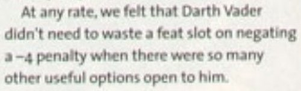
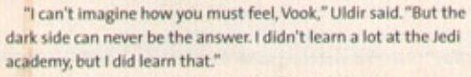
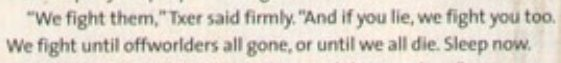
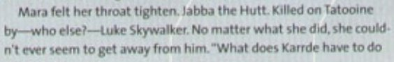
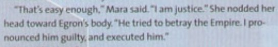
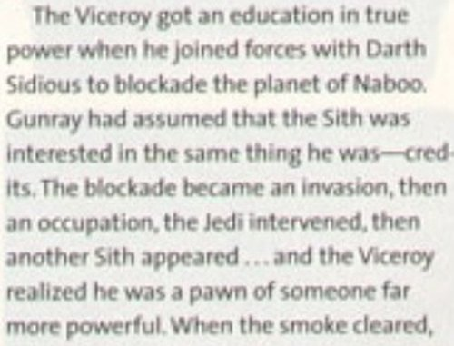
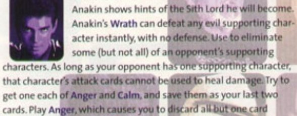
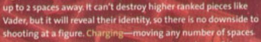

# Owner Material 037 — Star Wars D20 Drive folder (Core, Revised Core and Saga Edition): Star Wars Gamer/Star Wars Gamer 10.pdf [Star Wars Roleplaying Game (d20, 2000)] (scan pages 1–60)

- **Source:** Wizards of the Coast Star Wars Roleplaying Game books, web enhancements, Living Force campaign modules and articles (2000–2010), from the owner's "Star Wars D20" Drive folder (only the three edition subfolders; "General" was not read, as instructed). Secondary source (licensed Legends reference). Scan OCR'd on the box; the scan stays box-only and is **not** published.
- **Method:** every scanned page was OCR'd and machine-screened sentence by sentence for power-relevant statements (fights, kills, defeats, Force feats, rankings, superweapons) that name a character on our roster; each kept sentence is quoted verbatim from the OCR text and has a crop of the printed passage directly under it. Pages with nothing power-relevant are still listed with what is on them.
- **Citation:** "*Star Wars Gamer 10* (SWRPG d20), p.X" by printed page ("scan p.X" where no printed number applies). **Weight:** Licensed RPG material: a secondary source. Narrative text sums up Legends lore; game statistics are rules for players, not canon power levels, and rank lowest.

## scan p.1 (scan page 1)

Page contents: Star Wars Gamer #10 (Vol 2 No 4, Attack of the Clones issue): 180 new Star Wars TCG cards, Galactic Power Brokers, a Jedi solitaire adventure, Knights of the Old Republic, Jedi Starfighter, Racer Revenge, Star Wars Galaxies (hand-read)

## scan p.2 (scan page 2)

Page contents: 13 words, 5 paragraphs | headings/entries: 

## scan p.3 (scan page 3)

Page contents: Contents: 'War on Wayland' (New Jedi Order serial), 'Handoff' by Timothy Zahn (Mara Jade as Emperor's Hand), board games, the Model Citizen Lars homestead, Galactic Power Brokers, the revised RPG, Droid Starships (Owen K.C. Stephens), Clawdites, the Sharpshooter and Medic prestige classes, the TCG, 'Jedi's Legacy' and 'Standoff on Leritor' adventures, previews of Bounty Hunter and KotOR, strategy guides for Racer Revenge and Jedi Starfighter, Galaxies (hand-read)

## scan p.4 (scan page 4)

Page contents: Editorial 'What Kind of Gamer are You?' (Michael Mikaelian): Darth Sidious as the calculating GM, Jango Fett for electronic games and Epic Duels, Obi-Wan Kenobi the bluffer (Pazaak, Stratego, TCG), Jar Jar Binks the lucky social player (hand-read)

## scan p.5 (scan page 5)

Page contents: Letters: Luke's 'Galaxy's Most Wanted' stats (Fringer 2/Jedi Guardian 13/Jedi Master 3) preview the revised rulebook's Jedi Master prestige class; three tech specialist characters hidden in #9 (hand-read)

### Stat block notes (game mechanics, not feats)

- Weequay (preview species traits): +2 Con, -2 Wis, -2 Cha; automatic languages Sriluurian, Basic and pheromonal Sriluurian (subject to change) (Source: *Star Wars Gamer 10* (SWRPG d20), scan p.5)

## scan p.6 (scan page 6)

Page contents: Letters: Combat Reflexes and Attuned are new feats in the revised rulebook; Attuned gives +2 to Enhance Ability and Heal Self; a sidebar gives Dash Rendar, LE-BO2D9 and the Outrider (hand-read)

### Stat block notes (game mechanics, not feats)

- Dash Rendar: Male Human Scoundrel 4/Soldier 3/Elite Trooper 3/Starship Ace 5; Init +2; Def 27; VP/WP 122/16; Atk +15/+10/+5 ranged (3d8, heavy blaster); uncanny dodge, starfighter evasion, DR 3 armor; Pilot +23; feats include Defensive Martial Arts, Heroic Surge, Martial Arts and Starship Dodge (space transport); equipment: heavy blaster, the modified CEC YT-2400 Outrider, repair droid LE-BO2D9 (Source: *Star Wars Gamer 10* (SWRPG d20), scan p.6)
- LE-BO2D9: Walking maintenance droid, Expert 2/Scoundrel 3; Def 12; VP/WP 12/10; illicit barter, lucky; Computer Use +9, Entertain (comedy) +7, Gather Information +13, Pilot +9, Repair +9 (Source: *Star Wars Gamer 10* (SWRPG d20), scan p.6)
- Outrider: Heavily modified CEC YT-2400, Small 20 m, crew 1, 6 passengers, 150 t cargo, 2 months consumables; hyperdrive x0.75 (backup x8); Maneuver +6; Def 21; SP 60 (DR 10); ramming speed; 1,150 km/h; 2 double turbolaser cannons (turret) +9, 5d10x2; not for sale (Source: *Star Wars Gamer 10* (SWRPG d20), scan p.6)

## scan p.7 (scan page 7)

Page contents: Letters: revised starship rules (Gamer #8) preview Chapter 11 of the revised rulebook; Ramming Speed stays; diagonal move cost resets each round; establish pursuit needs ships in the same square; a reader asks for Dark Forces characters (Kyle, Jan Ors, 8t88, Jerec) (hand-read)

## scan p.8 (scan page 8)

Page contents: Letters: Kyle Katarn (as he appears in The New Jedi Order) will be statted in the Power of the Jedi Sourcebook; the promised 'Custom Lightsaber' article was dropped; Christopher Perkins explains the 384-page revised core rulebook (corrections, feedback, Episode II content in one book) (hand-read)

### Stat block notes (game mechanics, not feats)

- San-Ni staff (Kel Dor Jedi weapon master's weapon): 50 credits, 2.5 kg, Large energy weapon; a 50 cm baton that triples to 150 cm with 10 cm stun prods; Stunning Grapple: attacks a grappled foe without provoking, each round pinned deals 1d4 electrical damage and Fort DC 16 or unconscious 2d6 rounds (Source: *Star Wars Gamer 10* (SWRPG d20), scan p.8)

## scan p.9 (scan page 9)

Page contents: Rogues Gallery: City Slickers (Kyle Stanley Hunter, the only staffer since issue #1; his comic Swerve) (hand-read)

## scan p.10 (scan page 10)

Page contents: Jedi Counseling (JD Wiker): armor 'stops' a lightsaber only if you rule the saber attacks the armor; Master Speed activates as a free action; flight coveralls (250 credits, no DR, 1 hour of life support); a blast door is DC 25 to open by Move Object (DC 45 is to damage it) (hand-read)

## scan p.11 (scan page 11)

Page contents: Jedi Counseling: a blaster can chew through an AT-AT given time (DR 15 compromise; Wedge's two-hit kill); Constitution changes are retroactive but Intelligence skill points are not; non-heroic multiclassing takes no -2 Defense; Throw Lightsaber dropped from the revised rulebook (hand-read)

- **Darth Vader (Anakin Skywalker)** — entry/section: Jedi Counseling on Vader's thrown lightsaber: "At any rate, we felt that Darth Vader didn't need to waste a feat slot on negating a-4 penalty when there were so many other useful options open to him" Source: *Star Wars Gamer 10* (SWRPG d20), scan p.11
  

### Stat block notes (game mechanics, not feats)

- Darth Vader: lacks Throw Lightsaber in every write-up: the feat only negates the -4 improvised-thrown penalty and a catwalk has Defense 3, so it wasn't worth a feat slot (possibly why he missed Luke) (Source: *Star Wars Gamer 10* (SWRPG d20), scan p.11)

## scan p.12 (scan page 12)

Page contents: Fiction 'War on Wayland' (New Jedi Order serial, part 1): Uldir Lochett's transport No Luck Required leaks air after the rogue Jedi Klin-Fa Gi jams the starfighter bay, sabotages the hyperdrive and steals their starfighter; first officer Vega Sepen (Corellian), and the Dug Leafr (hand-read)

## scan p.13 (scan page 13)

Page contents: War on Wayland: Vook, the Duro crewman, lost his homeworld to the Vong; Klin-Fa Gi cut the inner doors with her lightsaber and the hyperwave antenna, stranding them in Vong space twenty light-years from anywhere (hand-read)

## scan p.14 (scan page 14)

Page contents: War on Wayland: Klin-Fa heads for Wayland, likely after the Emperor's old weapons; Uldir fears a Dark Jedi would help Senate hard-liners legalize handing Jedi to the Vong; Master Skywalker ordered him to bring her in for debriefing; three coralskippers and a corvette analog meet them at Wayland (hand-read)

- **Uldir Lochett** — entry/section: Uldir on the dark side: "But the dark side can never be the answer.|didn't learn a lot at the Jedi academy, but|did learn that." Source: *Star Wars Gamer 10* (SWRPG d20), scan p.14
  

## scan p.15 (scan page 15)

Page contents: War on Wayland: Uldir launches a modified A-wing under cover of jettisoned garbage; Vega torches a coralskipper with the Luck's ion drive and escapes; dovin basal voids swallow concussion missiles, torps and blaster bolts (hand-read)

## scan p.16 (scan page 16)

Page contents: War on Wayland: Uldir's gravitometric-fused concussion missile wrecks the skips in atmosphere; Mount Tantiss (the Emperor's storehouse, hidden by a clerical error, destroyed by Skywalker) is Klin-Fa's goal; Uldir trained at the Yavin 4 academy and has limited Force sense; he finds five natives killed by lightsaber (hand-read)

## scan p.17 (scan page 17)

Page contents: War on Wayland: Txer, a Myneyrsh and leader of the Free People, calls the Vong the 'Cut-Up-People' and their native collaborators 'Cut-Up-Wish-to-bes'; he calls blasters 'shame weapons'; the Emperor is the 'Dark Man' (hand-read)

## scan p.18 (scan page 18)

Page contents: War on Wayland: a Shaper base of damuteks grows on the slumped ruins of Mount Tantiss (damuteks known from Talon Karrde's records and Anakin Solo's infiltration on Yavin 4); a sick, burned perimeter zone (hand-read)

- **Txer** — entry/section: Txer's vow against the offworlders: "We fight them," Txer said firmly, "And if you lie, we fight you too. We fight until offworlders all gone, or until we all die." Source: *Star Wars Gamer 10* (SWRPG d20), scan p.18
  

## scan p.19 (scan page 19)

Page contents: War on Wayland: a huge coral drilling-worm tower; Myneyrshi, Psadans and descendants of a lost human colony serve the Vong; Uldir reaches through the Force with unusual clarity and senses Klin-Fa Gi, then a spike of hatred (hand-read)

## scan p.20 (scan page 20)

Page contents: War on Wayland: Klin-Fa Gi saves Uldir and a Psadan with the Force from the Chom-Vrone's semi-plasma mining vents; she carries something wrapped in living tissue; dozens of Vong warriors approach (to be continued) (hand-read)

### Stat block notes (game mechanics, not feats)

- Vega Sepen: Female Human Soldier 6; Init +6; Def 17; feats include Improved Martial Arts, Two-Weapon Fighting, Weapon Focus (punch); Knowledge (tactics) +10 (Source: *Star Wars Gamer 10* (SWRPG d20), scan p.20)
- Leaft: Male Dug Soldier 4; Def 19; VP/WP 27/11; +9 ranged blaster pistol (Multishot, Rapid Shot, Two-Weapon Fighting); Pilot +10; three blaster pistols (Source: *Star Wars Gamer 10* (SWRPG d20), scan p.20)
- Vook: Vook Gehu: Male Duros Tech Specialist 5; Int 19; Craft (hyperdrives) +15, Craft (sublight drives) +14, Knowledge (starships) +15, Repair +13; research, instant mastery, tech specialty (mechanic +1) (Source: *Star Wars Gamer 10* (SWRPG d20), scan p.20)

## scan p.21 (scan page 21)

Page contents: 0 words, 0 paragraphs | headings/entries: 

## scan p.22 (scan page 22)

Page contents: Fiction 'Handoff' by Timothy Zahn (illus. Dave Dorman): Mara Jade, on the run from Ysanne Isard after the Emperor's death, at a Coruscant Full Symphony concert on Chibias; she sees Counselor Raines of Governor Egron's staff plant a datacard on a boy (hand-read)

## scan p.23 (scan page 23)

Page contents: Handoff: Mara poses as 'Litassa Colay', the director of offworld special events; her Force sense fails ('The Force, apparently, was no longer with her'); her sleeve gun and lightsaber are in her hotel (hand-read)

## scan p.24 (scan page 24)

Page contents: Handoff: Mara disables security man Jayx and escapes with the boy as stormtroopers arrive; the boy from Saraban City on Sibisime was lured to Chibias with a job offer at the governor's palace (hand-read)

## scan p.25 (scan page 25)

Page contents: Handoff: the boy, Ghent, slices a Level Three Governor/Diplomatic Imperial encryption instantly; 'They call me Ghent'; Mara arms herself with her sleeve gun and lightsaber (hand-read)

## scan p.26 (scan page 26)

Page contents: Handoff: Mara poses as 'Arica Pradeux', an envoy of a Grand Admiral, with recognition code Hapspir Barrint; 'Counselor Raines' is Markko, unofficially attached to Governor Egron; she brokers Ghent's services at two thousand an hour (hand-read)

## scan p.27 (scan page 27)

Page contents: Handoff: Markko claims a captured Rebel sector-command computer; Mara spots and evades two tails, an Emperor's-trainer technique (hand-read)

## scan p.28 (scan page 28)

Page contents: Handoff: Mara follows the tails to a house and is caught by Markko; she has lost her Force warning sense and wonders whether the Force was ever hers or only the Emperor acting through her; the locals mention Talon Karrde, a would-be smuggling chief filling Jabba's void; Alec Pradeux was among Palpatine's advisors (hand-read)

- **Luke Skywalker**: "Killed on Tatooine by—who else?—Luke Skywalker, No matter what she did, she couldn't ever seem to get away from him." Source: *Star Wars Gamer 10* (SWRPG d20), scan p.28
  

## scan p.29 (scan page 29)

Page contents: Handoff: Markko is an agent of the Rebel Alliance with a local cell; Mara plans to betray them to Egron to win an Intelligence post and get Isard off her back (hand-read)

## scan p.30 (scan page 30)

Page contents: 1004 words, 42 paragraphs | headings/entries: Egron sent him a sharp look. "Negotiations?"; STAR WARS GAMER 35

## scan p.31 (scan page 31)

Page contents: Handoff: Ghent's slice reveals the Shasstariss Whisperers Corporation logo: the 'Rebel' computer is the primary control node of an Imperial Star Destroyer, and Egron is selling military encrypts to the Rebellion (hand-read)

## scan p.32 (scan page 32)

Page contents: Handoff: under cover of Ghent's Periander feedback screech, Mara uses the Emperor-taught Paparak cross-cut with her lightsaber to weaken the hall's walls; she bluffs Markko about a cantrosh-gas painting frame (hand-read)

## scan p.33 (scan page 33)

Page contents: Handoff: the hall collapses on the Star Destroyer computer; Mara spares four stormtroopers with recognition code Besh-Senth-Isk-Twelve, pattern Nen-Peth 1377 (hand-read)

## scan p.34 (scan page 34)

Page contents: Handoff: Mara throws her lightsaber at Egron and kills the traitor governor with her sleeve blaster; Markko takes Ghent hostage (hand-read)

## scan p.35 (scan page 35)

Page contents: Handoff: Mara lets Markko go to spare Ghent ('Until next time'); she gives Ghent nearly all her money for a ticket home (hand-read)

- **Mara Jade Skywalker** — entry/section: Mara as Imperial justice: "That's easy enough," Mara said“! am justice.” She nodded her head toward Egron’s body. “He tried to betray the Empire.|pronounced him guilty, and executed him." Source: *Star Wars Gamer 10* (SWRPG d20), scan p.35
  

## scan p.36 (scan page 36)

Page contents: Handoff: Talon Karrde recruits Ghent as his slicer, his people having dealt with both the Imperial and Rebel pursuers, and he plans to search the mystery woman's abandoned belongings (hand-read)

### Stat block notes (game mechanics, not feats)

- Ghent: Male Human Tech Specialist 5/Slicer 5; Def 19; VP/WP 38/10; Computer Use +25, Repair +22, Craft (computer) +17, Disable Device +17; decode, skill mastery, virus (crack); feats Gearhead, Trick (Source: *Star Wars Gamer 10* (SWRPG d20), scan p.36)

## scan p.37 (scan page 37)

Page contents: Galactic Power Brokers: 'Mr. Sith Goes to Coruscant': half the Senate seats are empty, lost to Count Dooku's Separatists; Supreme Chancellor Palpatine's journals are studied, and he befriended the Jedi Master Jorus C'baoth; his committees root out corruption (hand-read)

### Stat block notes (game mechanics, not feats)

- Palpatine: Male Human Noble 4; init +0; Def 13 (+3 class); Spd 10m; VP/WP 21/13; Atk +3 melee (103, punch) of +3 ranged; SQ Favor +2, bonus class skill (intimidate), inspire confi dence, resource access, coordinate +1; SV Fort +2, Ref +2, Will +7; SZ M; FP 3; OSP o; Rep Equipment: Chancellor's robes, offices and apartments on Coruscant, private shuttle, priv (Source: *Star Wars Gamer 10* (SWRPG d20), scan p.37)

## scan p.38 (scan page 38)

Page contents: 539 words, 39 paragraphs | headings/entries: Mr, Sith Goes to Coruscant; Supreme (; Human Soldier 3 init +6 (Dex, improved; Challenge Code: 8; Atk 45; STAR WARS GAMern "MB

### Stat block notes (game mechanics, not feats)

- Mas Amedda: Male Chagrian Diplomat 8; Diplomacy +13, Knowledge (bureaucracy) +14; Iron Will, Persuasive; a stern Vice Chancellor accused of misusing power, who plans to retire, take a wife and vanish; he respects Bail Organa and Padme Amidala (Source: *Star Wars Gamer 10* (SWRPG d20), scan p.38)
- Supreme Chancellor's Guard: Male Human Soldier 3; force pike and heavy blaster; DR 5 armor; created after Captain Prid Shan demanded funding; can be dismissed only by Palpatine (Source: *Star Wars Gamer 10* (SWRPG d20), scan p.38)

## scan p.39 (scan page 39)

Page contents: 753 words, 43 paragraphs | headings/entries: Senator ts considered an extremely eligible; Ball Organa: Male Human Noble 6; Init; YM VOLUME 2? NUMBER 4; The Commerce Factions; Weapon Group Proficiency (Diaster

### Stat block notes (game mechanics, not feats)

- Bail Organa: Male Human Noble 6; Diplomacy +14, Knowledge (galactic politics) +14, Sense Motive +13; Iron Will; a 'courageous pacifist' and eligible bachelor who puts diplomacy before courtship (Source: *Star Wars Gamer 10* (SWRPG d20), scan p.39)
- Orn Free Taa: Male Twi'lek Diplomat 9/Crimelord 4; Bluff +17, Diplomacy +22, Gather Information +20; Infamy, Persuasive; the most corrupt Senator, who has driven enemies to 'suicide' (Source: *Star Wars Gamer 10* (SWRPG d20), scan p.39)
- Shu Mai: Female Gossam Noble 8, Commerce Guild Presidente; Profession (merchant) +16, Profession (bureaucrat) +15; bought her people's ancestral land on Castell and raised the rent (Source: *Star Wars Gamer 10* (SWRPG d20), scan p.39)

## scan p.40 (scan page 40)

Page contents: 819 words, 59 paragraphs | headings/entries: Equipment; Viceroy's robes, mechno-chalr with remote-control unit, multithanne!; Skills: Appraise; Speak Neimokiun; Passel Argente: Male Koorivar Diplomat 6/Not; Hold; Challenge C; STAR WARS GAMen "SE

- **Palpatine (Darth Sidious)**: "The Viceroy got an education in true power when he joined forces with Darth Sidious to blockade the planet of Naboo Gunray had assumed that the Sith was interested in the same thing he was-—cred its, The blockade became an invasion, then an occupation, the Jedi intervened, then another Sith appeared ... and the Viceroy realized he was a pawn of someone far more powerful." Source: *Star Wars Gamer 10* (SWRPG d20), scan p.40
  

### Stat block notes (game mechanics, not feats)

- Nute Gunray: Male Neimoidian Diplomat 12; Diplomacy +17, Knowledge (business) +19; raised in a grub hatchery; abandoned by Sidious after Naboo, survived dozens of hearings, and vowed never again to deal with a Sith Lord (Source: *Star Wars Gamer 10* (SWRPG d20), scan p.40)
- Passel Argente: Male Koorivar Diplomat 6/Noble, Corporate Alliance Magistrate, already decided to join Dooku; Koorivar history of migration and wandering merchants (Source: *Star Wars Gamer 10* (SWRPG d20), scan p.40)

## scan p.41 (scan page 41)

Page contents: 849 words, 64 paragraphs | headings/entries: Wis 14, Cha 14. Challenge Code: D; Craft (droids) +18, Craft (electronic; Group Proficiency (blaster pistols; Diplomacy +10, Knowledge; Special Qualities: Atmospheric Require-

### Stat block notes (game mechanics, not feats)

- Wat Tambor: Male Skakoan Tech Specialist 8/Noble 3, Techno Union Foreman; Craft (droids) +18, Repair +20; Atmospheric Requirements: takes 2d6 per round without his suit (Fort DC 20 halves) (Source: *Star Wars Gamer 10* (SWRPG d20), scan p.41)
- San Hill: Male Muun Diplomat 10, Intergalactic Banking Clan chairman; Knowledge (business) +19, Appraise +19; plans to lend to both sides in a war; the IBC launders Hutt money (Source: *Star Wars Gamer 10* (SWRPG d20), scan p.41)

## scan p.42 (scan page 42)

Page contents: Galactic Power Brokers: Dex's Diner was a decent eatery until the planners built another monad on top, leaving it in the under-city; Dex came to Coruscant to comfort a sick relative and go legitimate (hand-read)

### Stat block notes (game mechanics, not feats)

- Elan Sleazebaggano: Male Balosar Tech Specialist 1/Scoundrel 2; a failed medical student who stole supplies for Hat Lo and now bartends, peddling glitterstim and death sticks; a growing death-stick addict (Source: *Star Wars Gamer 10* (SWRPG d20), scan p.42)
- Dexter Jettster: Male Besalisk Scoundrel 6; Gather Information +10, Profession (merchant) +10; Obi-Wan's old friend from Ord Sigatt, a former gunrunner at the Outland Transit Station who left after a Bando Gora raid and sold his last stock to Jango Fett (Source: *Star Wars Gamer 10* (SWRPG d20), scan p.42)

## scan p.43 (scan page 43)

Page contents: Revised Rulebook Companion by JD Wiker: converting characters to the revised RPG; the tech specialist class is added; the Ewok Primitive quality now affects starting feats; Mon Calamari Amphibious is renamed Breathe Underwater; classes get more starting credits (hand-read)

## scan p.44 (scan page 44)

Page contents: Revised Companion: the noble gains favor and resource access, and command becomes coordinate; the scoundrel's sneak attack is replaced by lucky and precise attack, and Headstrong is a bonus feat; the scout gets skill mastery (one skill) and new bonus feats; the soldier gets a 3rd-level bonus feat; the Force adept gets Force secret; the Jedi guardian becomes the master of deflecting blaster bolts (hand-read)

## scan p.45 (scan page 45)

Page contents: 337 words, 50 paragraphs | headings/entries: Bth _; Wth -; Noble; VOLUME 2 NUMBER 4; Coordinate +1; Favor +5; Coordinate +4 Bonus feat Coordinate +5; Lucky (1/game session) Precise attack +1; Bonus feat Lucky (2/game session); Bonus feat

## scan p.46 (scan page 46)

Page contents: Revised Companion: aptitude bonuses (Alertness, Trustworthy) don't stack; the new Surgery feat; armor now gives DR instead of Defense (old Defense bonus -2 = DR); a new random height and weight table (hand-read)

## scan p.47 (scan page 47)

Page contents: Revised Companion: attacks of opportunity; Starfighter Ace becomes Starship Ace to cover transport pilots (hand-read)

## scan p.48 (scan page 48)

Page contents: Revised Companion: the new Jedi get Exotic Weapon Proficiency (lightsaber) at 1st level, choose their Force feat order, and use deflect (defense/attack) and block; Jedi Master at 13th level; consular and guardian tables (hand-read)

## scan p.49 (scan page 49)

Page contents: All's Fair in Life and Stratego by Rob Daviau: strategy for Hasbro's 2002 Star Wars board games; Epic Duels deck strategy for Obi-Wan (Force Control, Force Balance), Yoda (Force Lift, Force Rebound), and Han and Chewie (Bowcaster Attack) (hand-read)

## scan p.50 (scan page 50)

Page contents: Board-game strategy: Epic Duels decks for Luke and Leia, Mace Windu (Battlemind scales with hand size), Anakin and Padme (Anakin's Wrath instantly defeats an evil supporting character), and Boba Fett and Greedo; The Game of Life: A Jedi's Path, where three Dark Paths make you a Sith (hand-read)

- **Darth Vader (Anakin Skywalker)**: "Anakin shows hints of the Sith Lord he will become Anakin's Wrath can defeat any evil supporting character instantly, with n@user se to eliminate some (but not all) of an opponent's supportin characters, As long as your opponent has one sopporting Character, that character's attack cards cannot b-atised to heal damagentry to get one each of Anger and Calm, and save them as your last two cards." Source: *Star Wars Gamer 10* (SWRPG d20), scan p.50
  

## scan p.51 (scan page 51)

Page contents: Board-game strategy: Jedi Unleashed in the Geonosis arena (riding the Reek); Epic Duels decks for Darth Vader (All Too Easy does 20 damage), the Emperor (Force Lightning, You Will Die), and Darth Tyranus (hand-read)

## scan p.52 (scan page 52)

Page contents: Board-game strategy: Epic Duels decks for Darth Maul (Sith Speed allows up to 8 attack cards a turn) and Jango Fett with Zam Wesell; Star Wars Stratego special powers: Vision, Advanced Blast, Charging, Leaping, Quickness (hand-read)

- **Darth Vader (Anakin Skywalker)**: "It can't destroy higher ranked pieces like Vader, but it will reveal their identity, so there is no downside to shooting at a figure." Source: *Star Wars Gamer 10* (SWRPG d20), scan p.52
  

## scan p.53 (scan page 53)

Page contents: You Are Not a Jedi Yet by Michael G. Ryan: learning the new Wizards of the Coast Star Wars TCG; Space, Ground and Character arenas, where controlling two of the three wins; speed-ordered combat; Force abilities such as Evade (hand-read)

## scan p.54 (scan page 54)

Page contents: Star Wars TCG: build-point setup; the expert rules require a 60-card minimum deck, 12 of each unit type, and keywords Bombard, Critical Hit, Deflect, Evade, Ion Cannon, Shields; Organized Play (hand-read)

## scan p.55 (scan page 55)

Page contents: Attack of the FAQ by Paul Barclay: Star Wars TCG rules Q&A (one shared turn for both players; Attract Enemy Fire versus a Republic Assault Ship's bombard) (hand-read)

## scan p.56 (scan page 56)

Page contents: Star Wars TCG card encyclopedia pages (card images; OCR unreadable) (hand-read)

## scan p.57 (scan page 57)

Page contents: Star Wars TCG: stacking unique unit cards (an Anakin Skywalker card example); a stacked unit gets +10 speed and +1 power per card beneath it, up to three (hand-read)

## scan p.58 (scan page 58)

Page contents: Star Wars TCG FAQ: prevent, deflect and evade damage; deflect redirects damage to another unit; how to play two Dark Side decks against each other (hand-read)

## scan p.59 (scan page 59)

Page contents: Star Wars TCG card encyclopedia pages (pp59-67; card art and garbled OCR; rules Q&A on unique units, speed-effect duration, and 'dice of damage' on p63) (hand-read)

## scan p.60 (scan page 60)

Page contents: 0 words, 0 paragraphs | headings/entries: 

