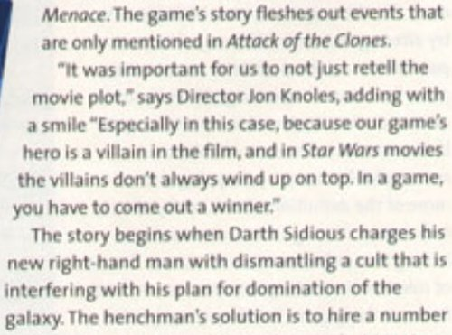

# Owner Material 037 — Star Wars D20 Drive folder (Core, Revised Core and Saga Edition): Star Wars Gamer/Star Wars Gamer 10.pdf [Star Wars Roleplaying Game (d20, 2000)] (scan pages 61–120)

- **Source:** Wizards of the Coast Star Wars Roleplaying Game books, web enhancements, Living Force campaign modules and articles (2000–2010), from the owner's "Star Wars D20" Drive folder (only the three edition subfolders; "General" was not read, as instructed). Secondary source (licensed Legends reference). Scan OCR'd on the box; the scan stays box-only and is **not** published.
- **Method:** every scanned page was OCR'd and machine-screened sentence by sentence for power-relevant statements (fights, kills, defeats, Force feats, rankings, superweapons) that name a character on our roster; each kept sentence is quoted verbatim from the OCR text and has a crop of the printed passage directly under it. Pages with nothing power-relevant are still listed with what is on them.
- **Citation:** "*Star Wars Gamer 10* (SWRPG d20), p.X" by printed page ("scan p.X" where no printed number applies). **Weight:** Licensed RPG material: a secondary source. Narrative text sums up Legends lore; game statistics are rules for players, not canon power levels, and rank lowest.

## scan p.61 (scan page 61)

Page contents: 121 words, 11 paragraphs | headings/entries: De mete cary het mend tet

## scan p.62 (scan page 62)

Page contents: 0 words, 0 paragraphs | headings/entries: 

## scan p.63 (scan page 63)

Page contents: 349 words, 13 paragraphs | headings/entries: Expanding the Unive; Mission and Battle

## scan p.64 (scan page 64)

Page contents: 102 words, 5 paragraphs | headings/entries: 

## scan p.65 (scan page 65)

Page contents: 31 words, 3 paragraphs | headings/entries: 

## scan p.66 (scan page 66)

Page contents: 0 words, 0 paragraphs | headings/entries: 

## scan p.67 (scan page 67)

Page contents: 393 words, 22 paragraphs | headings/entries: Ce ee — @ ore @user; FP Spee ot the Palen; Po > Se; Cart Kocyclooecia

## scan p.68 (scan page 68)

Page contents: The Lars Homestead by HG Walls: building a 25mm model of the Lars moisture farm from AotC; courtyard louver panel and room layout (hand-read)

## scan p.69 (scan page 69)

Page contents: Lars Homestead model: room dimensions (main courtyard 8 inch diameter, maintenance pit, garage, master bedroom) and construction from balsa, cardboard, and an old VHS cassette (hand-read)

## scan p.70 (scan page 70)

Page contents: 473 words, 15 paragraphs | headings/entries: Cut a section of tub np S/s

## scan p.71 (scan page 71)

Page contents: Lars Homestead model: detailing with Action Fleet Podracer Hangar and Mos Espa Market parts, scratch-built vaporators, and a T-16 Skyhopper made from an Imperial Shuttle model (hand-read)

## scan p.72 (scan page 72)

Page contents: The Corellian Engineering/Loronar Series: droid starships from 'The Nerfworks' (CEC-t Shipyard Lab 6671-x42), a joint CEC and Loronar unit; droid ships take a long shakedown period and are vulnerable to ion weapons (hand-read)

### Stat block notes (game mechanics, not feats)

- YQ-400 Monitor: CEC/Loronar droid patrol ship; Small, 26 m, crew 0 (Normal +2); no hyperdrive; heavy ion cannons and laser cannons; SP 60, HP 120; 175,000 credits (Source: *Star Wars Gamer 10* (SWRPG d20), scan p.72)

## scan p.73 (scan page 73)

Page contents: Nerfworks ships: the YQ-400 uses passive sensors and never fires unless attacked; the Ycaqt droid transport is named for a stubborn Velmor riding beast, has 'prissy' droid brains, and tends to get lost in hyperspace (hand-read)

### Stat block notes (game mechanics, not feats)

- Ycaqt droid transport: CEC/Loronar droid cargo ship; Small, 21 m; hyperdrive x2; 250 metric tons of cargo; ion cannon only; 130,000 credits (Source: *Star Wars Gamer 10* (SWRPG d20), scan p.73)

## scan p.74 (scan page 74)

Page contents: The Crusader XX-777: a prototype droid escort frigate run by a reconditioned centuries-old military protocol droid with hard-wired protocols (protect the innocent, obey, self-preservation); it fled into hyperspace rather than be dismantled, and is rumored to stop pirates and rescue stranded crews in the Fringe (hand-read)

### Stat block notes (game mechanics, not feats)

- Crusader (XX-777): prototype droid frigate; Large, 120 m, crew 0 (Expert +8); hyperdrive x1.5; turbolasers 7d10x5 (+13), heavy ion cannons, assault concussion missiles 9d10x5; SP 230, HP 460; valued around 1.8 million credits (Source: *Star Wars Gamer 10* (SWRPG d20), scan p.74)

## scan p.75 (scan page 75)

Page contents: Jedi's Legacy: Niquon's saber regimen stresses defense; the Dolandu trapper Borta brings Niquon a modified medical assassin droid that flies and injects poison (hand-read)

### Stat block notes (game mechanics, not feats)

- Nason Laric: level 1 Jedi Guardian (solo adventure hero); Def 14, Vitality 12; Battlemind +6, Enhance Ability +6, Force Defense +6, Heal Self +4 (Source: *Star Wars Gamer 10* (SWRPG d20), scan p.75)

## scan p.76 (scan page 76)

Page contents: Jedi's Legacy: Nason flies Niquon's cloudjumper, carrying his Master's lightsaber, to Port Kalla on Yabosta to find the pilot and technician Lowghen Badra; a small human girl watches him (hand-read)

## scan p.77 (scan page 77)

Page contents: Jedi's Legacy: Drethi venom comes from a winged beast bred thousands of years ago to kill Jedi; it 'burns when the Force flows', even the most powerful Jedi healers cannot combat it, and expired venom is the only treatment; Niquon once fought a group that rediscovered the Drethi, with Lowghen as his pilot (hand-read)

## scan p.78 (scan page 78)

Page contents: Jedi's Legacy: a Dark Jedi apprentice girl with a purplish-red lightsaber attacks Nason; her masters sent her and some Rodians rather than Von Totha or the Droids; rules sidebars for Battlemind, Enhance Ability, Heal Self, and Force Points (hand-read)

### Stat block notes (game mechanics, not feats)

- Dark Jedi Apprentice (Jedi's Legacy): Def 14, Init +1, Melee +2, damage 2d8, 1 Force Point (spends it on her third attack for +2d6 from the dark side) (Source: *Star Wars Gamer 10* (SWRPG d20), scan p.78)

## scan p.79 (scan page 79)

Page contents: Jedi's Legacy: Lowghen holds off Rodian ambushers in the Port Kalla plaza; the watching girl carries a lightsaber (a former Jedi, a Jedi slayer, a looter, or a member of a shadowy order) (hand-read)

## scan p.80 (scan page 80)

Page contents: Jedi's Legacy: Lowghen Badra, a gray-bearded engineer ('Badra's Engineering and Repair'), recognizes Niquon's saber; the dark girl ignites a deep purplish-crimson blade in the hangar (hand-read)

## scan p.81 (scan page 81)

Page contents: Jedi's Legacy: Niquon hurls a mountaineer's pike at the Drethi with the Force despite the agony of the venom; the Drethi explodes into burning ash at Stomorr, and the venom hisses in Niquon's wounds (hand-read)

## scan p.82 (scan page 82)

Page contents: Jedi's Legacy: the Dolandu hail 'Two protectors, now!'; the Drethi poison seeks out every thread connecting the victim to the Force and incinerates it; Stomorr is littered with destroyed droids and Rodian mercenaries (hand-read)

### Stat block notes (game mechanics, not feats)

- Drethi: winged, clawed beast of unnatural darkness bred to kill Jedi; Def 14, Init +2, Melee +4 (1d6+2 plus Force-burning venom), Vitality 22 (wounded); conjures an icy wind (Source: *Star Wars Gamer 10* (SWRPG d20), scan p.82)

## scan p.83 (scan page 83)

Page contents: Standoff on Leritor by Peter Schweighofer: an adventure for 4-6 heroes of 4th-7th level; the combine-reaper Gevion is besieged by a Sauvax army; settlers fleeing the Core settled Leritor off the Corellian Run near Bothan Space (hand-read)

## scan p.84 (scan page 84)

Page contents: Standoff on Leritor: the Settlement Pact bars settlers, starships and harvesters from within 100 km of the coast; Leritor has a 322-day year and 28-hour days (hand-read)

### Stat block notes (game mechanics, not feats)

- Sauvax: amphibious six-legged crustaceans with claws (+2 Str, +2 Con, -2 Dex, -2 Cha; Amphibious; +4 Swim; +2 Spot/Listen); the commoner wields a gruush spear (1d8+1); they live in tribal villages called kuuvan (Source: *Star Wars Gamer 10* (SWRPG d20), scan p.84)

## scan p.85 (scan page 85)

Page contents: Standoff on Leritor: the harvester Neliist vanished weeks ago to the north; the Sauvax insist on face-to-face talks with their tevelor, who stands on a carved rock; map of the coastal region with an excavation site in the Bleaks (hand-read)

## scan p.86 (scan page 86)

Page contents: Standoff on Leritor: clues include muddy silt in the river, plumes of smoke, and a starfighter engine part; the wrecked harvester Nellist was disabled by starship blasters and staged with Sauvax spears; the slaughtered Sauvax village holds offworld binders and a medpac; the survivors describe 'immense birds' that spat fire (hand-read)

## scan p.87 (scan page 87)

Page contents: Standoff on Leritor: Profex Rynalla, a noble scholar from the University of Sanbra who secretly researches the Sith and archaic Jedi traditions, uses settler and Sauvax slaves to dig up an ancient crashed starship for the Sith artifact the Bracers of Najus; five Klatooinian guards watch about 50 slaves (hand-read)

### Stat block notes (game mechanics, not feats)

- PTR-3 Vedette (slaver snub fighter): Core Galaxy Systems starfighter; Tiny, 10.5 m; laser cannon 4d10x2 (+8); SP 20, HP 100; 75,000 credits (Source: *Star Wars Gamer 10* (SWRPG d20), scan p.87)

## scan p.88 (scan page 88)

Page contents: 529 words, 12 paragraphs | headings/entries: 

### Stat block notes (game mechanics, not feats)

- Slaver Guard (Leritor): Male Klatooinian Soldier 2; Def 16; VP/WP 18/12; blaster rifle and stun baton; unswerving loyalty; the camp fence deals 2d8 electrical damage per round (Source: *Star Wars Gamer 10* (SWRPG d20), scan p.88)

## scan p.89 (scan page 89)

Page contents: Standoff on Leritor: Rynalla fights with Force Grip, Force Strike, Force Lightning and Move Object and flanks the heroes personally; her computer files reveal the lost ship's Sith passengers; the camp's generator, slave caves, tailings pile and mess hall (hand-read)

## scan p.90 (scan page 90)

Page contents: The Bracers of Najus: made by the Sith artisan Najus for his vendetta against the Jedi, they double the bonus dice when calling on the dark side against a light-sided Force-sensitive with no Dark Side Points, but if the opponent uses the dark side against the wearer, the opponent gets the bonus; adventure hooks include a Sith stronghold and vengeful conspirators (hand-read)

### Stat block notes (game mechanics, not feats)

- Profex Rynalla: Female Human Noble 3/Force Adept 5; VP/WP 44/12; DSP 8; Force Grip +15, Force Lightning +15, Force Strike +15, Move Object +10, Affect Mind +9; Knowledge (Sith lore) +10; Frightful Presence, Burst of Speed, Dissipate Energy (Source: *Star Wars Gamer 10* (SWRPG d20), scan p.90)

## scan p.91 (scan page 91)

Page contents: Dice, Camera, Action! by Robin D. Laws (screenwriting for GMs): the first act is built from obstacle scenes; success or failure both lead to a new obstacle; example McGuffin Professor Etha Naru, who can mass-produce lightsabers any stormtrooper can use (hand-read)

## scan p.92 (scan page 92)

Page contents: Dice, Camera, Action!: use 'must pass' obstacles sparingly; the big twist ends act one (archetype: Alderaan destroyed, the Death Star revealed); in the Etha Naru example her plans empower dark side users, lead to the fortress planet Tikath, and she proves to be a hero's mother (hand-read)

## scan p.93 (scan page 93)

Page contents: The University of Sanbra Guide to the Clawdites by Craig R. Carey, Jason Fry and Daniel Wallace: Professor Tem Eliss's escape from COMPNOR with Professor Mankuskett (Chair of the Council on Metagrowth and Polymorphism) and a changeling friend; Clawdites are a gene-therapy variant of the Zolanders of the Mid Rim world Zolan (hand-read)

## scan p.94 (scan page 94)

Page contents: Clawdites: skin changing is excruciating (the actor Suzdice called it 'a million needles stabbing out from the inside'); they cannot copy specific individuals or add flesh such as an Ithorian's hammerhead; Zolander religion condemned those 'who do not show their true face', forcing Clawdites to wear scarves in 'deception colors' or live in ghettoes (hand-read)

### Stat block notes (game mechanics, not feats)

- Clawdite: species traits: -2 Str; Skin-changer (mimic any Medium humanoid species, but not specific individuals; full-round action; 1d4 damage per round when not in Clawdite form, Fortitude DC 12 for half); commoner Def 10, VP/WP -/10 (Source: *Star Wars Gamer 10* (SWRPG d20), scan p.94)

## scan p.95 (scan page 95)

Page contents: Clawdites: they approached Count Dooku's Confederacy; the Empire blockaded Zolan; after Endor a New Republic negotiator's assassination sparked a war that left the vaporer Renneyn in Zolan's capital and the Clawdites holding three-quarters of the planet; Zolan's magnetic field stops repulsorlifts, so ships dock at a station and use orbital gliders, and rocket smog keeps the world in twilight; Major Showolter's Guile Company uses Clawdites to infiltrate the Yuuzhan Vong, with a high fatality rate (hand-read)

### Stat block notes (game mechanics, not feats)

- Shapeshifter (feat): Clawdites and other natural skin-changers only: also alter hair and eye color and specific body parts; +8 Disguise and no -2 cross-species penalty for humanoids; 1d4 damage on transforming and each minute after (Fortitude DC 12 for half) (Source: *Star Wars Gamer 10* (SWRPG d20), scan p.95)

## scan p.96 (scan page 96)

Page contents: Zam Wesell (by JD Wiker): a 'progressive' Clawdite heretic who funds radical Clawdites on Zolan, reached the third level of mastery in the Mabari (an ancient order of Zolan warrior knights), and works out of Denon for both Separatists and loyalists (hand-read)

### Stat block notes (game mechanics, not feats)

- Zam Wesell: Female Clawdite Soldier 3/Scoundrel 5/Bounty Hunter 4; Def 20; VP/WP 66/13; sneak attack +2d6; Disguise +15, Pilot +13; feats Shapeshifter, Mimic, Far Shot, Precise Shot, Track; carries a slugthrower rifle and an ASN-121 assassin droid (Source: *Star Wars Gamer 10* (SWRPG d20), scan p.96)

## scan p.97 (scan page 97)

Page contents: Sharpshooter prestige class: Myn Donos, a Corellian militia sniper recruited into Wraith Squadron by Wedge Antilles, is the famous example; requires BAB +4, Hide 5, Spot 5, Far Shot, Point Blank Shot, Precise Shot (hand-read)

### Stat block notes (game mechanics, not feats)

- Sharpshooter (prestige class): Preferred Weapon +1 (1st/5th/9th), Ranged Sneak Attack +1d6 to +3d6, Follow Target, Improved Range (2x, then 2.5x increment), Deadly Aim (coup de grace at range from 7th); vitality 1d6 (Source: *Star Wars Gamer 10* (SWRPG d20), scan p.97)

## scan p.98 (scan page 98)

Page contents: 806 words, 31 paragraphs | headings/entries: Weight: rating = rating « 0.1 k; The Sharpshooter; Base Attack Fort Reflex; Level Bonus Save Save; Special; CEE 2); Defense Reputation; Bonus Bonus; STAR WARS GAMER 107

### Stat block notes (game mechanics, not feats)

- Targeting Scope / Aiming: scope rating divides the target distance for range penalties, but the user loses Dodge and Dex to Defense; optional aiming rule: a full-round ranged touch attack denies the target its Dex bonus for the next shot; kneeling -1 and prone -2 to the range penalty (Source: *Star Wars Gamer 10* (SWRPG d20), scan p.98)

## scan p.99 (scan page 99)

Page contents: The Medic (an archetype by Gary M. Sarli): field doctors in combat zones, serving the Alliance, the Empire, the Old and New Republics, the Corellian Special Forces, Antarian Rangers, Peace Brigade and Rocket Jumpers, or working independently for pirates and smugglers (hand-read)

## scan p.100 (scan page 100)

Page contents: 375 words, 29 paragraphs | headings/entries: Veriant Abilities; The Macc; Sol 2/Tech 4; Sol 3/Tech §; Sol 4/Tech 6; Sol 4/Tech 8; Sol 5/Tech 9; Open Wide and; New Medical Equipment; SY OWEN £.C. STEPHENS; Meoicat Backpack; Cost: 600 credits; Weight: 5 kg; Defense Reputation; Bonus Bonus; Emphasis, 430; Special Abilithes; Fag FOOT, ORIN; STAR WARS GAmMeR 108

### Stat block notes (game mechanics, not feats)

- Medic (archetype variants): Skill Mastery (Treat Injury: take 10 under stress); emergency aid in a threatened area without provoking an attack of opportunity; Ready for Anything (+4 Treat Injury on wounds 10 minutes old or less); built as Soldier/Tech multiclass (Source: *Star Wars Gamer 10* (SWRPG d20), scan p.100)
- Medical Backpack: by Owen K.C. Stephens: 600 credits, 5 kg; a medical kit, a collapsible repulsorlift stretcher (150 kg), a diagnostic scanner and a medical procedures database (Source: *Star Wars Gamer 10* (SWRPG d20), scan p.100)

## scan p.101 (scan page 101)

Page contents: Call Signs: Names of Kashyyyk by Owen K.C. Stephens: during the Rebellion, Rebels used Wookiee names as code terms; Shyriiwook is made of barks, growls, grumbles, grunts, moans, snarls and trills, which Ewoks and Yuzzem reportedly come close to pronouncing; a standardized Basic transcription exists (hand-read)

## scan p.102 (scan page 102)

Page contents: Wookiee name generator: a prefix plus suffixes with meanings, for example 'Star-Gazer' = Jowova or Jowkazza (hand-read)

## scan p.103 (scan page 103)

Page contents: Star Wars Bounty Hunter preview by Eric Bratcher (PS2/GameCube): you play Jango Fett about ten years before Attack of the Clones; Darth Sidious charges his new right-hand man with destroying a cult, and he hires bounty hunters to kill its leader; Kenner's mail-away Boba Fett and Bossk figures (hand-read)

- **Palpatine (Darth Sidious)**: "The game's story fleshes out events that are only mentioned in Attack of the Clones "it was important for us to not just retell the movie plot," says Director Jon Knoles, adding with a smile "Especially in this case, because our game $ hero is a villain in the film, and in Star Wars movies the villains don't always wind up on top, In a game, you have to come out a winner The story begins when Darth Sidious charges his new right-hand man with dismantling a cult that is interfering with his plan for domination of the galaxy." Source: *Star Wars Gamer 10* (SWRPG d20), scan p.103
  

## scan p.104 (scan page 104)

Page contents: Bounty Hunter preview: Jango flies the Mandalorian ship Jaster's Legacy before he gets Slave I, prompting speculation about Jaster Mereel; his arsenal includes twin blasters, a jetpack rocket, a wrist flamethrower and a whipcord (hand-read)

## scan p.105 (scan page 105)

Page contents: Bounty Hunter preview: the jetpack allows leaps and dashes but not flight; the story starts at Outland Station with Jango's friend Rozatta, a tough old Toydarian; the cult steals the dead from battlefields; foes include a krayt dragon, an army of Dugs, a corrupt politician, and rival bounty hunters across six worlds (hand-read)

## scan p.106 (scan page 106)

Page contents: Bounty Hunter preview: Montross, Jango's ruthless arch-nemesis, kills a begging victim ('I'm worth more alive!' / 'You're worth enough dead'); the cult leader is pitched as an Apocalypse Now / Colonel Kurtz figure (hand-read)

## scan p.107 (scan page 107)

Page contents: Knights of the Old Republic preview by Elliott Chin (Xbox): BioWare's RPG set 4,000 years before The Phantom Menace and about 40 years after the Tales of the Jedi comics; Exar Kun's lightsaber is an obtainable artifact (hand-read)

## scan p.108 (scan page 108)

Page contents: KotOR preview: up to ten party members (Jedi including Wookiee and Twi'lek types, a Republic soldier, a Mandalorian, an astromech, and an IG-88-like assassin droid), three at a time; the hero's sibling is the second-most powerful Jedi in the galaxy, and the most powerful is the one you hunt (hand-read)

## scan p.109 (scan page 109)

Page contents: KotOR preview: thousands of Jedi and Sith in open war; Dantooine and Kashyyyk demo worlds plus Tatooine, Taris and an underwater world; the Ebon Hawk is a freighter like the Falcon 'with a wedge missing' and serves as the main base (hand-read)

## scan p.110 (scan page 110)

Page contents: KotOR preview: more than fifty Force powers; the game may use the Wizards d20 rules; mini-games include the collectible card game Pazaak (Blackjack-like, chosen over sabacc) and an Ebon Hawk turret game; release planned for November 2002 (hand-read)

## scan p.111 (scan page 111)

Page contents: Star Wars Racer Revenge strategy (tips from Dale Geist and Johnny Szary): set eight years after Anakin beat Sebulba at the Boonta Eve Classic; brake into turns and boost out; target the track favorite; spend truguts at Watto's Garage (hand-read)

## scan p.112 (scan page 112)

Page contents: Racer Revenge track guide: Ryloth (the Brightlands and Nightlands, with Twi'leks living in the twilight band) and Gamorr (Watchtower Run) (hand-read)

## scan p.113 (scan page 113)

Page contents: Racer Revenge track guide: Gamorr (the Ruins of Carnuss Gorgull, the Citadel and the Cave of Shrieks), Mon Calamari (Orotoru G'am, the Ballast Complex, the Grand Reefs), Sullust (SoroSuub Facility, Serres Sarrano) and Tatooine (Mos Espa Open, the Badlands) (hand-read)

## scan p.114 (scan page 114)

Page contents: Racer Revenge: the Boonta Eve Classic (Beggars Canyon, Arch Canyon, Jett's Chute) and shortcut tips for each course (hand-read)

## scan p.115 (scan page 115)

Page contents: Jedi Starfighter strategy by Brett Rector (PS2): the evil Captain Toth and a mysterious cohort threaten the Republic in the Karthakk system; Mace Windu sends Adi Gallia, described as a Corellian Jedi Master raised on Coruscant, the daughter of diplomats; the Delta-7 prototype Jedi starfighter has quad-pulse lasers and light armor (hand-read)

## scan p.116 (scan page 116)

Page contents: Jedi Starfighter: the Feeorin pirate Nym flies the Havoc, a strike bomber modified by Nym and the pirate mechanic Reti, with six laser cannons and energy bombs, cruise missiles, cluster missiles and proximity mines (hand-read)

## scan p.117 (scan page 117)

Page contents: Jedi Starfighter: Adi's Force powers have Connect, Clarity and Disconnect states; Force Shield (Clarity reflects lasers back) and Force Lightning (hand-read)

## scan p.118 (scan page 118)

Page contents: Jedi Starfighter: Force Reflex (slows time) and Force Shockwave; tactics for the Havoc's weapons and using boost and brake (hand-read)

## scan p.119 (scan page 119)

Page contents: Star Wars Galaxies update by Haden Blackman (PC MMO, Fall 2002): a ranged-combat focus, sniper skills, and bounty hunter careers like Aurra Sing or Boba Fett (hand-read)

## scan p.120 (scan page 120)

Page contents: Star Wars Galaxies: medics and cantina dancers who heal mental fatigue; ranchers, farmers and miners in a resource-spawning economy; hairdressers, tattoo artists and tailors; a skill-based system with no rigid classes (hand-read)

