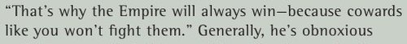

# Owner Material 037 — Star Wars D20 Drive folder (Core, Revised Core and Saga Edition): Adventures/Beneath Aucellis Park.pdf [Star Wars Roleplaying Game Revised Core (d20, 2002)]

- **Source:** Wizards of the Coast Star Wars Roleplaying Game books, web enhancements, Living Force campaign modules and articles (2000–2010), from the owner's "Star Wars D20" Drive folder (only the three edition subfolders; "General" was not read, as instructed). Secondary source (licensed Legends reference). Scan OCR'd on the box; the scan stays box-only and is **not** published.
- **Method:** every scanned page was OCR'd and machine-screened sentence by sentence for power-relevant statements (fights, kills, defeats, Force feats, rankings, superweapons) that name a character on our roster; each kept sentence is quoted verbatim from the OCR text and has a crop of the printed passage directly under it. Pages with nothing power-relevant are still listed with what is on them.
- **Citation:** "*Beneath Aucellis Park* (SWRPG d20 Revised Core), p.X" by printed page ("scan p.X" where no printed number applies). **Weight:** Licensed RPG material: a secondary source. Narrative text sums up Legends lore; game statistics are rules for players, not canon power levels, and rank lowest.

## scan p.1 (scan page 1)

Page contents: Beneath Aucellis Park by Morrie Mullins: a free Star Wars mini-adventure for any era (written for the Rebellion era), for four heroes of 7th-9th level (hand-read)

## scan p.2 (scan page 2)

Page contents: Beneath Aucellis Park: a family theme park on the moon Keriba VI in the Kalarba system celebrating the explorer Emo Aucellis (rides include Well of Darkness and Time's Radiance) is secretly a cover for an Imperial re-education facility; era variants are militant Loyalists (Rise of the Empire) or the Yuuzhan Vong (New Jedi Order) (hand-read)

## scan p.3 (scan page 3)

Page contents: Beneath Aucellis Park: the synth-drug platykona-zemlo-mobris (pl-z-mo, street name 'pleaz-mo', from 'Please, more') laces the park's concessions; after a stolen shipment caused chaos at a dinner party, the park hired the smuggler and 'cleaner' Balthazar Sim; the shipper Evin Telbre, who secretly helps slaves escape Hutt space, hires the heroes to bring Sim in and tracks him via a homing corsage (hand-read)

## scan p.4 (scan page 4)

Page contents: Beneath Aucellis Park: 312 B1-type security droids in six squads of 52, plus six droideka-statted squad leaders; the rides include Wampa's Vengeance, Kessel Run for Kids, Geonosis Arena Acklay-Rider and the Death Plunge; the concessions sell Nerf burgers and Mynock mud pie (hand-read)

## scan p.5 (scan page 5)

Page contents: Beneath Aucellis Park: a hovercar chase through the Cavern's Delight ride and a hidden chute down to the control room, where Sim meets his commander, the Bothan mercenary Hoogi Grym, head of secret security for the park (hand-read)

### Stat block notes (game mechanics, not feats)

- Balthazar Sim: Male Human Scoundrel 9; Def 19; VP/WP 48/12; heavy blaster pistol, combat gloves; Knowledge (brainwashing) +12, Search/Spot +15; Martial Arts, Heroic Surge (Source: *Beneath Aucellis Park* (SWRPG d20 Revised Core), scan p.5)

## scan p.6 (scan page 6)

Page contents: Beneath Aucellis Park: Grym's line "I don't know you" summons security droids and "You are friends" calls them off; he lies through his teeth in negotiation; 31 people are mid-re-education; reprogramming the facility takes a DC 55 Computer Use check (hand-read)

- **Balthazar Sim** — entry/section: Sim mocks heroes who leave: "“That’s why the Empire will always win—because cowards like you won't fight them.”" Source: *Beneath Aucellis Park* (SWRPG d20 Revised Core), scan p.6
  

### Stat block notes (game mechanics, not feats)

- Hoogi Grym: Male Bothan Fringer 13; Def 20; DR 2; VP/WP 80/10; stun grenades; Diplomacy +19, Survival +19, Intimidate +18; Frightful Presence, Trustworthy; Knowledge (enemies of my employer) +5 (Source: *Beneath Aucellis Park* (SWRPG d20 Revised Core), scan p.6)

## scan p.7 (scan page 7)

Page contents: Beneath Aucellis Park: Evin Telbre pays up to 3,000-5,000 credits each for Sim, alive or dead; Morrie Mullins was plot director for the RPGA's Living Force campaign (hand-read)

