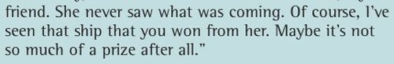

# Owner Material 037 — Star Wars D20 Drive folder (Core, Revised Core and Saga Edition): Adventures/Cat and Mouse.pdf [Star Wars Roleplaying Game Revised Core (d20, 2002)]

- **Source:** Wizards of the Coast Star Wars Roleplaying Game books, web enhancements, Living Force campaign modules and articles (2000–2010), from the owner's "Star Wars D20" Drive folder (only the three edition subfolders; "General" was not read, as instructed). Secondary source (licensed Legends reference). Scan OCR'd on the box; the scan stays box-only and is **not** published.
- **Method:** every scanned page was OCR'd and machine-screened sentence by sentence for power-relevant statements (fights, kills, defeats, Force feats, rankings, superweapons) that name a character on our roster; each kept sentence is quoted verbatim from the OCR text and has a crop of the printed passage directly under it. Pages with nothing power-relevant are still listed with what is on them.
- **Citation:** "*Cat and Mouse* (SWRPG d20 Revised Core), p.X" by printed page ("scan p.X" where no printed number applies). **Weight:** Licensed RPG material: a secondary source. Narrative text sums up Legends lore; game statistics are rules for players, not canon power levels, and rank lowest.

## scan p.1 (scan page 1)

Page contents: Cat and Mouse by Eric Cagle: a Star Wars mini-adventure using Ultimate Adversaries, for any era (best in Rise of the Empire), for 4-6 heroes of 3rd-5th level (hand-read)

## scan p.2 (scan page 2)

Page contents: Cat and Mouse: the Duros gambler Kelna Toodo, a former pilot's apprentice deep in debt to Beeda the Hutt (owner of a floating casino), won the aging Radiant Splendor and its caged Corellian sand panther at dice, and plans to free the panther on the heroes Beeda wants dead (hand-read)

## scan p.3 (scan page 3)

Page contents: Cat and Mouse: in the cantina The White Door in the port town Akmalla, Kelna rigs a midnight sabacc game (players Jokot, the Twi'lek accomplice Lyt Re, the Cerean Lar-Odo and the Duros Bonna Noot) with a micro camera lens on his eye, so the heroes 'win' the Radiant Splendor (hand-read)

## scan p.4 (scan page 4)

Page contents: 24 words, 3 paragraphs | headings/entries: SPACE TRANSPORT 3

## scan p.5 (scan page 5)

Page contents: Cat and Mouse: the Radiant Splendor is a ragged stock SoroSuub Barzo cargo freighter; Kelna's remote can open the panther cage, lock the doors and kill the ship's power from up to 10 km away (hand-read)

- **Kelna Toodo** — entry/section: Kelna after the rigged sabacc game: "“She never saw what was coming. Of course, I’ve seen that ship that you won from her. Maybe it’s not so much of a prize after all.”" Source: *Cat and Mouse* (SWRPG d20 Revised Core), scan p.5
  

### Stat block notes (game mechanics, not feats)

- Kelna Toodo: Male Duros Scoundrel 4; Def 15; VP/WP 21/10; Gamble +13, Sleight of Hand +9; marked cards, loaded dice, remote datapad; ship the Hot Streak (Z-95 Headhunter, Hyperdrive x2); 60,000 credits in debt to Beeda the Hutt (Source: *Cat and Mouse* (SWRPG d20 Revised Core), scan p.5)
- Corellian Sand Panther: Medium predator 4; Def 22; VP/WP 26/14; 2 claws +13 (1d6+5, poisoned, DC 14 Fort, Con damage) and bite; pounce, rake, scent; +4 Climb, Jump and Listen (Source: *Cat and Mouse* (SWRPG d20 Revised Core), scan p.5)

## scan p.6 (scan page 6)

Page contents: Cat and Mouse: if caught, Kelna confesses Beeda's grudge and tries to cut a deal; recapturing the panther alive earns a bonus; Eric Cagle also wrote Ultimate Alien Anthology and Ultimate Adversaries (hand-read)

