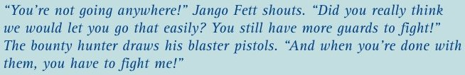
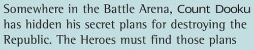
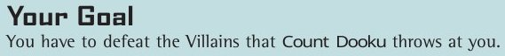
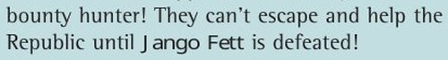
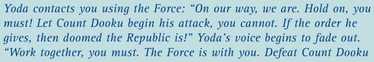
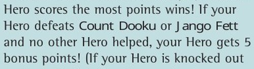
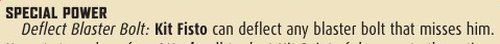
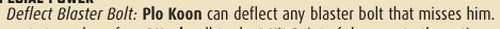
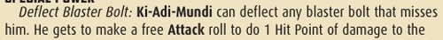

# Owner Material 037 — Star Wars D20 Drive folder (Core, Revised Core and Saga Edition): Adventures/Geonosis Battle Arena Advanced Missions.pdf [Star Wars Roleplaying Game Revised Core (d20, 2002)]

- **Source:** Wizards of the Coast Star Wars Roleplaying Game books, web enhancements, Living Force campaign modules and articles (2000–2010), from the owner's "Star Wars D20" Drive folder (only the three edition subfolders; "General" was not read, as instructed). Secondary source (licensed Legends reference). Scan OCR'd on the box; the scan stays box-only and is **not** published.
- **Method:** every scanned page was OCR'd and machine-screened sentence by sentence for power-relevant statements (fights, kills, defeats, Force feats, rankings, superweapons) that name a character on our roster; each kept sentence is quoted verbatim from the OCR text and has a crop of the printed passage directly under it. Pages with nothing power-relevant are still listed with what is on them.
- **Citation:** "*Geonosis Battle Arena Advanced Missions* (SWRPG d20 Revised Core), p.X" by printed page ("scan p.X" where no printed number applies). **Weight:** Licensed RPG material: a secondary source. Narrative text sums up Legends lore; game statistics are rules for players, not canon power levels, and rank lowest.

## scan p.1 (scan page 1)

Page contents: Geonosis Battle Arena Advanced Missions, game design by JD Wiker: an action-figure d20 mini-game for 2-4 players aged 8 and up, extending the Geonosis Battle Arena game; each turn is Move plus Attack, Use a Skill or Use the Force (hand-read)

## scan p.2 (scan page 2)

Page contents: Advanced Mission 1, Count Dooku's Challenge: the heroes search the balcony for Dooku's secret plans (16+ on a d20) while fighting his guards; Advanced Mission 2, Jango Attacks!: Jango Fett traps the heroes in the arena (Zam Wesell can replace him) (hand-read)

- **Count Dooku** — entry/section: Dooku's hologram greets the heroes: "“Welcome to my Battle Arena,” says Count Dooku. “I know you are here looking for my secret plans, but you won’t find them! So instead, why don’t you play with some of my guards?”" Source: *Geonosis Battle Arena Advanced Missions* (SWRPG d20 Revised Core), scan p.2
  
- **Jango Fett** — entry/section: Jango traps the heroes in the arena: "“You’re not going anywhere!” Jango Fett shouts. “Did you really think we would let you go that easily? You still have more guards to fight!”" Source: *Geonosis Battle Arena Advanced Missions* (SWRPG d20 Revised Core), scan p.2
  
- **Count Dooku** — entry/section: Advanced Mission |: Count Dooku's Challenge: "Somewhere in the Battle Arena, Count Dooku has hidden his secret plans for destroying the Republic." Source: *Geonosis Battle Arena Advanced Missions* (SWRPG d20 Revised Core), scan p.2
  
- **Count Dooku** — entry/section: Advanced Mission |: Count Dooku's Challenge: "Your Gaal You have to defeat the Villains that Count Dooku throws at you." Source: *Geonosis Battle Arena Advanced Missions* (SWRPG d20 Revised Core), scan p.2
  
- **Jango Fett** — entry/section: Advanced Mission 2: Jango Attacks!: "They can't escape and help the Republic until Jango Fett is defeated!" Source: *Geonosis Battle Arena Advanced Missions* (SWRPG d20 Revised Core), scan p.2
  

## scan p.3 (scan page 3)

Page contents: Advanced Mission 3, Escape from the Battle Arena!: the captured heroes must hold out until Yoda arrives with Clone Troopers, scoring bonus points for healing knocked-out allies (hand-read)

- **Yoda** — entry/section: Yoda contacts the captured heroes through the Force: "“On our way, we are. Hold on, you must! Let Count Dooku begin his attack, you cannot. If the order he gives, then doomed the Republic is!”" Source: *Geonosis Battle Arena Advanced Missions* (SWRPG d20 Revised Core), scan p.3
  
- **Count Dooku**: "Defeat Count Dooku and his army!"" Source: *Geonosis Battle Arena Advanced Missions* (SWRPG d20 Revised Core), scan p.3
  
- **Count Dooku**: "If your Hero defeats Count Dooku or J ango Fett and no other Hero helped, your Hero gets 5 bonus points!" Source: *Geonosis Battle Arena Advanced Missions* (SWRPG d20 Revised Core), scan p.3
  

## scan p.4 (scan page 4)

Page contents: Geonosis Battle Arena character cards (pp 4-6) are printed rotated 90 and 180 degrees; read from re-OCR at 90/180/270 degrees plus viewing the images. Each card lists Hit Points, Defense, Attack and weapon damage, Use a Skill (Climb, Heal, Ride) and Use the Force (Force Jump, Force Strike, Mind Trick) target numbers, and a Special Power (hand-read)

- **Kit Fisto**: "SPECIAL POWER Deflect Blaster Bolt: Kit Fisto can deflect any blaster bolt that misses him." Source: *Geonosis Battle Arena Advanced Missions* (SWRPG d20 Revised Core), scan p.4
  

### Stat block notes (game mechanics, not feats)

- Saesee Tiin: Battle Arena card: 4 Hit Points; Defense 13; Attack +3, lightsaber 3 Hit Points; Climb/Heal/Ride 13; Force Jump/Force Strike/Mind Trick 11; Deflect Blaster Bolt (free Attack roll for 1 Hit Point against a shooter who misses, lightsaber in hand) (Source: *Geonosis Battle Arena Advanced Missions* (SWRPG d20 Revised Core), scan p.4)
- Battle Droid: Battle Arena card: 1 Hit Point; Defense 12; Attack +1, blaster rifle 2 Hit Points; Climb/Heal/Ride 19; Droid: cannot be affected by the Mind Trick power (Source: *Geonosis Battle Arena Advanced Missions* (SWRPG d20 Revised Core), scan p.4)
- Kit Fisto: Battle Arena card: 3 Hit Points; Defense 14; Attack +4, lightsaber 3 Hit Points; Climb/Heal/Ride 13; Force Jump/Force Strike/Mind Trick 10; Deflect Blaster Bolt (Source: *Geonosis Battle Arena Advanced Missions* (SWRPG d20 Revised Core), scan p.4)
- Luminara Unduli: Battle Arena card: 3 Hit Points; Defense 13; Attack +3, lightsaber 3 Hit Points; Climb/Heal/Ride 12; Force powers 9; Deflect Blaster Bolt (Source: *Geonosis Battle Arena Advanced Missions* (SWRPG d20 Revised Core), scan p.4)

## scan p.5 (scan page 5)

Page contents: 330 words, 52 paragraphs | headings/entries: Spry; TUS V 3SN; SqUI0q HH *M38VSLHSN L\; O00 0; SLNIOd LIH; Plo Koon™; SPECIAL POWER; SY3MOd 1WidadS; HIT POINTS; O90 0; DEFENSE ATTACK +3; USE A SKILL Climb; Heal; Ride; TINS V ISN; O00 0; SINIOd LIH; Ki-Adi-Mundi™; SPECIAL POWER; HIT POINTS; O90 0; DEFENSE; USE A SKILL Climb; Heal; Ride

- **Plo Koon**: "Deflect Blaster Bolt: Plo Koon can deflect any blaster bolt that misses him." Source: *Geonosis Battle Arena Advanced Missions* (SWRPG d20 Revised Core), scan p.5
  
- **Ki-Adi-Mundi**: "Deflect Blaster Bolt: Ki-Adi-Mundi can deflect any blaster bolt that misses him." Source: *Geonosis Battle Arena Advanced Missions* (SWRPG d20 Revised Core), scan p.5
  

### Stat block notes (game mechanics, not feats)

- Yoda: Battle Arena card: 3 Hit Points; Defense 17; Attack +4, lightsaber 3 Hit Points; Climb 12, Heal 10, Ride 10; Force powers 7; Deflect Blaster Bolt; Powerful Jedi (re-roll a failed Use the Force roll once each turn) (Source: *Geonosis Battle Arena Advanced Missions* (SWRPG d20 Revised Core), scan p.5)
- Captain Typho: Battle Arena card: 4 Hit Points; Defense 13; Attack +3, blaster pistol 1 Hit Point; Climb/Heal/Ride 11; Great Warrior (re-roll a failed Attack roll once each turn) (Source: *Geonosis Battle Arena Advanced Missions* (SWRPG d20 Revised Core), scan p.5)
- Plo Koon: Battle Arena card: 3 Hit Points; Defense 14; Attack +3, lightsaber 3 Hit Points; Climb/Heal/Ride 11; Force Jump 9, Force Strike 9, Mind Trick 11; Deflect Blaster Bolt (Source: *Geonosis Battle Arena Advanced Missions* (SWRPG d20 Revised Core), scan p.5)
- Ki-Adi-Mundi: Battle Arena card: 3 Hit Points; Defense 14; Attack +3, lightsaber 3 Hit Points; Climb/Heal/Ride 11; Force powers 8; Deflect Blaster Bolt (Source: *Geonosis Battle Arena Advanced Missions* (SWRPG d20 Revised Core), scan p.5)

## scan p.6 (scan page 6)

Page contents: Geonosis Battle Arena: p6 also repeats the Battle Droid card and carries an ad for the Star Wars Roleplaying Game revised core rulebook ('Become one of the greatest heroes of the galaxy', 'Control Your Destiny') with an online demo at playstarwars.com (hand-read)

### Stat block notes (game mechanics, not feats)

- Zam Wesell: Battle Arena card: 3 Hit Points; Defense 13; Attack +3, blaster pistol 1 Hit Point; Climb/Heal/Ride 12; Killing Shot (a natural 20 on an Attack roll deals 3 Hit Points instead of 1) (Source: *Geonosis Battle Arena Advanced Missions* (SWRPG d20 Revised Core), scan p.6)
