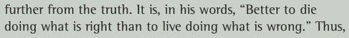
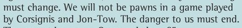

# Owner Material 037 — Star Wars D20 Drive folder (Core, Revised Core and Saga Edition): Adventures/Hunger.pdf [Star Wars Roleplaying Game Revised Core (d20, 2002)]

- **Source:** Wizards of the Coast Star Wars Roleplaying Game books, web enhancements, Living Force campaign modules and articles (2000–2010), from the owner's "Star Wars D20" Drive folder (only the three edition subfolders; "General" was not read, as instructed). Secondary source (licensed Legends reference). Scan OCR'd on the box; the scan stays box-only and is **not** published.
- **Method:** every scanned page was OCR'd and machine-screened sentence by sentence for power-relevant statements (fights, kills, defeats, Force feats, rankings, superweapons) that name a character on our roster; each kept sentence is quoted verbatim from the OCR text and has a crop of the printed passage directly under it. Pages with nothing power-relevant are still listed with what is on them.
- **Citation:** "*Hunger* (SWRPG d20 Revised Core), p.X" by printed page ("scan p.X" where no printed number applies). **Weight:** Licensed RPG material: a secondary source. Narrative text sums up Legends lore; game statistics are rules for players, not canon power levels, and rank lowest.

## scan p.1 (scan page 1)

Page contents: Hunger, a free Star Wars mini-adventure for the Rebellion era by Morrie Mullins (web, (c)2003), for four heroes of 10th-12th level; Star Wars RPG design manager Chris Perkins (hand-read)

## scan p.2 (scan page 2)

Page contents: Background: Pinett, a small mining moon in the Elrood sector near Mid/Outer Rim spice routes, with spaceports Oscum and Beliarr; the Corsignis Property Alliance (Chagrian Deniv Corsignis, a 'Gamorrean approach to business') and the Jon-Tow Economic Development Group (a consortium of smugglers) blockade the moon against each other; the Pinett Freedom Force, led by the Rodian Daetan Taakses on a public hunger strike, peacefully occupies empty landing platforms (hand-read)

## scan p.3 (scan page 3)

Page contents: Hooks: Imperial couriers delivering to Daetan's nephew Oryel Taakses, an Imperial informant loyal above all to family; Rebel agents bringing supplies with Daetan as contact; or smugglers with a crippled ship. Scene 1, Inspection: the Corsignis freighter Nosh vu'Ta and Jon-Tow command wing Herriar argue over orbital patterns gamma and delta ('Jon-Tow lasers malfunction more than taun-tauns stink'); blockade-running Pilot checks DC 15/25/28 and a chase by two hotshot pilots (hand-read)

## scan p.4 (scan page 4)

Page contents: Boarded!: Nosh vu'Ta is Huttese for 'We profit'; neither side takes bribes; each side's statement of the blockade's purpose. Scene 2, Insurrection: port-worker thugs (two per hero) attack Daetan Taakses, a pacifist who forbids his entourage to fight and meditates under fire (hand-read)

- **Daetan Taakses** — entry/section: Taakses on why the Freedom Force will not fight back: "Better to die doing what is right than to live doing what is wrong." Source: *Hunger* (SWRPG d20 Revised Core), scan p.4
  

## scan p.5 (scan page 5)

Page contents: Scene 3, Interruption: Freedom Force protesters accidentally activate a Clone War-era tractor beam under pad A-13, dragging a Jon-Tow freighter out of orbit with its pilot unconscious; the heroes breach the housing (100 WP, Hardness 10, or DC 32 Disable Device) and disengage it (DC 25), or board the freighter within 20 rounds (hand-read)

- **Daetan Taakses** — entry/section: Taakses asks the heroes for help: "We will not be pawns in a game played by Corsignis and Jon-Tow." Source: *Hunger* (SWRPG d20 Revised Core), scan p.5
  

### Stat block notes (game mechanics, not feats)

- Jaeth: Human male smuggler leading the port workers, Scout 5/Scoundrel 6; Defense 19; VP/WP 68/13; stun baton or +1 mastercraft heavy blaster pistol; Bluff +15, Demolition +18, Hide +17, Move Silently +18; feats include Cautious, Dodge, Improved Initiative, Iron Will, Point Blank Shot; Challenge Code E; guarded by 1d6+3 low-level outlaws (Source: *Hunger* (SWRPG d20 Revised Core), scan p.5)

## scan p.6 (scan page 6)

Page contents: Let's Talk It Out: Jon-Tow Captain-in-Chief Kurakk, a large, mellowed Trandoshan known for brutal honesty (Will +11), and the Corsignis representative Nari Beksen, a gravelly-voiced Human woman in her early forties who grinds her teeth (Will +10); a DC 25/20/30 Diplomacy path to a trade agreement with equal cargo volume (5% margin) tracked by an independent group, ideally Taakses (hand-read)

### Stat block notes (game mechanics, not feats)

- Looca B'Nash: Young quiet male Duros, Jaeth's Force-sensitive lieutenant, Force Adept 11/Noble 1; Defense 17; VP/WP 83/12; Affect Mind +16, Force Grip +12, Force Strike +18, Illusion +19; Force secret Improve Force Strike; Frightful Presence (DC 23); Force feats Alter, Control, Force Mind, Improved Force Mind, Mind Trick, Sense; Challenge Code F (Source: *Hunger* (SWRPG d20 Revised Core), scan p.6)

## scan p.7 (scan page 7)

Page contents: Wrapping Up: the blockade ends, and the hunger - both physical and the hunger for power - abates, 'At least, for now...'. About the Author: Morrie Mullins, a psychology professor who saw Star Wars in 1977, RPGA writer since 1999 and two-year Plot Director of the Living Force campaign (hand-read)

