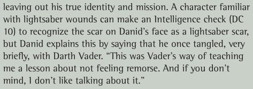
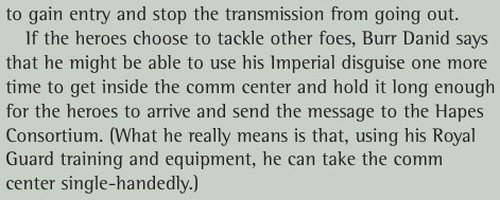
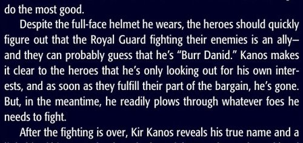
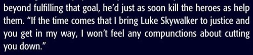
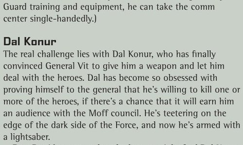
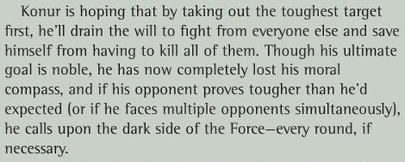

# Owner Material 037 — Star Wars D20 Drive folder (Core, Revised Core and Saga Edition): Adventures/Nightsaber.pdf [Star Wars Roleplaying Game Revised Core (d20, 2002)]

- **Source:** Wizards of the Coast Star Wars Roleplaying Game books, web enhancements, Living Force campaign modules and articles (2000–2010), from the owner's "Star Wars D20" Drive folder (only the three edition subfolders; "General" was not read, as instructed). Secondary source (licensed Legends reference). Scan OCR'd on the box; the scan stays box-only and is **not** published.
- **Method:** every scanned page was OCR'd and machine-screened sentence by sentence for power-relevant statements (fights, kills, defeats, Force feats, rankings, superweapons) that name a character on our roster; each kept sentence is quoted verbatim from the OCR text and has a crop of the printed passage directly under it. Pages with nothing power-relevant are still listed with what is on them.
- **Citation:** "*Nightsaber* (SWRPG d20 Revised Core), p.X" by printed page ("scan p.X" where no printed number applies). **Weight:** Licensed RPG material: a secondary source. Narrative text sums up Legends lore; game statistics are rules for players, not canon power levels, and rank lowest.

## scan p.1 (scan page 1)

Page contents: Nightsaber: Rebel Jedi Part II, a free Star Wars miniadventure by JD Wiker (cover) (hand-read)

## scan p.2 (scan page 2)

Page contents: Credits ((c)2003); for four 15th-level heroes about 12 years after Yavin. The Story Thus Far: New Republic Special Forces Lieutenant Dal Konur, trained a few weeks at Luke Skywalker's Jedi Academy, plotted to assassinate the Moff Council; caught at the Bilbringi shipyards in 'Rebel Jedi'. Synopsis: an Imperial task force forces a diversion to Dathomir, where an Imperial envoy investigating the defunct Star Chamber and the Infinity Wave has taken over the New Republic embassy (hand-read)

## scan p.3 (scan page 3)

Page contents: A fake Force-plague quarantine; Konur seeks Imperial asylum; Kir Kanos, the last surviving Imperial Royal Guard, poses as a shuttle pilot; the Dreaming River clan is being rounded up; the Singing Mountain leaders are imprisoned; the resistance wants to contact Teneniel Djo in the Hapes Consortium. Adjusting for level/era; hooks from Luke Skywalker or Leia Organa Solo (15,000 credits each); sidebar Where's Konur?. Scene 1, Back to Yavin 4: an Imperial fleet near Agamar (hand-read)

## scan p.4 (scan page 4)

Page contents: Interdictor ambush: the fleet (preparing an assault on Orinda under Grand Admiral Pellaeon) sends two groups of eight TIEs, a gunship, a customs cruiser and an Interdictor with Lancer frigates; arrest order to the Star Destroyer Raptor; the hyperdrive coolant leak (Repair DC 30) leaves options: call for help, risk the hyperdrive, or a week on ion engines to Dathomir (hand-read)

## scan p.5 (scan page 5)

Page contents: Scene 2, Dathomir Quarantine: fake port authority claims a disease that targets Force-users ('A hundred of the Force witches are dead already'); landing means 'decontamination', confiscated gear (a Jedi's hologram taken as a 'souvenir') and a containment-field holding cell. Scene 3, Escape. Sidebar What About Konur?: he plays along or claims asylum as a refugee from 'Jedi justice' (hand-read)

## scan p.6 (scan page 6)

Page contents: Force-field cell (DR 20, Disable Device DC 25). The shuttle pilot 'Burr Danid' frees the heroes; he is really Kir Kanos, on Dathomir to execute Sigit Ranth, the Imperial scientist who helped create the Emperor's defective clones; General Vit salvages broken lightsabers from an old Jedi ship to arm Nightsisters as dark Jedi for 'Project: Nightsaber'; Danid explains his lightsaber scar as a brief tangle with Darth Vader; escape in his Lambda shuttle (hand-read)

- **Kir Kanos; Darth Vader (Anakin Skywalker)** — entry/section: Kanos (as Burr Danid) explains his lightsaber scar: "A character familiar with lightsaber wounds can make an Intelligence check (DC 10) to recognize the scar on Danid's face as a lightsaber scar, but Danid explains this by saying that he once tangled, very briefly, with Darth Vader. "This was Vader's way of teaching me a lesson about not feeling remorse. And if you don't mind, I don't like talking about it."" Source: *Nightsaber* (SWRPG d20 Revised Core), scan p.6
  

## scan p.7 (scan page 7)

Page contents: Scene 4, The Dathomiri Underground: past the wreck of the Chu'unthor; Imperial scout walkers and Nightsisters on rancors round up the Dreaming River witches (main column: three AT-STs, 30 stormtroopers, six high-level Nightsisters on rancors); rescue threat table; News of the World (Teneniel Djo can bring a Hapan liberation force; Dreaming River leader Astrinol Hja imprisoned). Scene 5, The Liberation of Dathomir: a three-pronged attack on the prison facility and the communications center (hand-read)

## scan p.8 (scan page 8)

Page contents: Comm center (Computer Use DC 35/25, message to the Hapan Royal Communications Authority); Kanos can take the comm center single-handedly; Dal Konur, now armed with a lightsaber by General Vit, attacks lightsaber-wielders first and calls on the dark side every round if needed; Supporting Cast: Dal Konur stat block; Kir Kanos dons his Royal Guard armor, plows through foes, then reveals his identity and threatens Luke Skywalker (hand-read)

- **Kir Kanos** — entry/section: Kanos can hold the comm center alone: "If the heroes choose to tackle other foes, Burr Danid says that he might be able to use his Imperial disguise one more time to get inside the comm center and hold it long enough for the heroes to arrive and send the message to the Hapes Consortium. (What he really means is that, using his Royal Guard training and equipment, he can take the comm center single-handedly.)" Source: *Nightsaber* (SWRPG d20 Revised Core), scan p.8
  
- **Kir Kanos** — entry/section: Kanos in the final battle: "Despite the full-face helmet he wears, the heroes should quickly figure out that the Royal Guard fighting their enemies is an ally— and they can probably guess that he's "Burr Danid." Kanos makes it clear to the heroes that he's only looking out for his own interests, and as soon as they fulfill their part of the bargain, he's gone. But, in the meantime, he readily plows through whatever foes he needs to fight." Source: *Nightsaber* (SWRPG d20 Revised Core), scan p.8
  
- **Kir Kanos; Luke Skywalker** — entry/section: Kanos warns the heroes: ""If the time comes that I bring Luke Skywalker to justice and you get in my way, I won't feel any compunctions about cutting you down."" Source: *Nightsaber* (SWRPG d20 Revised Core), scan p.8
  
- **Dal Konur** — entry/section: Konur armed with a lightsaber: "The real challenge lies with Dal Konur, who has finally convinced General Vit to give him a weapon and let him deal with the heroes. Dal has become so obsessed with proving himself to the general that he's willing to kill one or more of the heroes, if there's a chance that it will earn him an audience with the Moff council. He's teetering on the edge of the dark side of the Force, and now he's armed with a lightsaber." Source: *Nightsaber* (SWRPG d20 Revised Core), scan p.8
  
- **Dal Konur** — entry/section: Konur's tactics: "Konur is hoping that by taking out the toughest target first, he'll drain the will to fight from everyone else and save himself from having to kill all of them. Though his ultimate goal is noble, he has now completely lost his moral compass, and if his opponent proves tougher than he'd expected (or if he faces multiple opponents simultaneously), he calls upon the dark side of the Force—every round, if necessary." Source: *Nightsaber* (SWRPG d20 Revised Core), scan p.8
  

### Stat block notes (game mechanics, not feats)

- Dal Konur: Male Human Soldier 8/Elite Trooper 9/Jedi Guardian 1; Defense 23; VP/WP 160/17; Atk +21/+16/+11/+6 (unarmed 3d4+3, lightsaber 2d8+3, mastercraft heavy blaster pistol 3d8+5); uncanny dodge, deadly strike, deflect; Fort +17; FP 6; DSP 2; Force skills Affect Mind +5, Force Stealth +3 (p9); feats incl. Advanced/Improved Martial Arts, Heroic Surge, Spring Attack, Shot on the Run; Force feats Alter, Control; Challenge Code G (Source: *Nightsaber* (SWRPG d20 Revised Core), scan p.8)

## scan p.9 (scan page 9)

Page contents: Rest of Dal Konur's stats; Kir Kanos stat block; Dathomiri Dark Force Witch stat blocks (high, mid, low level) (hand-read)

### Stat block notes (game mechanics, not feats)

- Kir Kanos: Male Human Thug 6/Soldier 3/Force Adept 3/Scoundrel 2/Bounty Hunter 1; Defense 20; DR 9 (ceremonial armor); VP/WP 75/14; mastercraft double-bladed force pike +15/+10/+5 (2d8+4) or two-weapon; mastercraft heavy blaster pistol +16 (3d8+2); Fort +13, Ref +12, Will +8; FP 6; DSP 4; Enhance Ability +7, Enhance Senses +4, Force Defense +6; feats incl. Improved Critical (force pike), Two-Weapon Fighting, Martial Arts; Force feats Control, Sense; Challenge Code F (Source: *Nightsaber* (SWRPG d20 Revised Core), scan p.9)
- Dathomiri Dark Force Witch (high level): Female Human Force Adept 2/Dark Force Witch 6; Defense 18; VP/WP 47/13; DSP 10; Affect Mind +10, Fear +6, Force Grip +3, Force Lightning +7, Force Strike +9, Move Object +9, See Force +6; inspire fear, spider walk, enshroud; rancor mount; Force feats Alter, Control, Sense, Summon Storm (mid level: FA 2/DFW 4, VP 36, Force Lightning +5; low level: FA 2/DFW 2, VP 25) (Source: *Nightsaber* (SWRPG d20 Revised Core), scan p.9)

## scan p.10 (scan page 10)

Page contents: End of the low-level Dark Force Witch stats; About the Author: JD Wiker (core rulebook, Dark Side Sourcebook, NJO Sourcebook, Power of the Jedi Sourcebook; president of The Game Mechanics) (hand-read)

