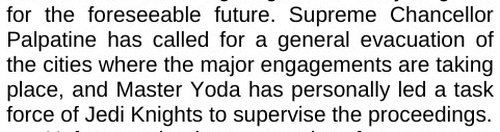
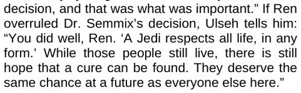
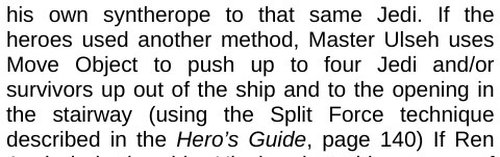
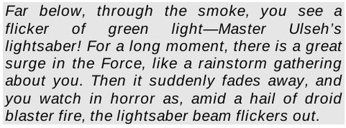
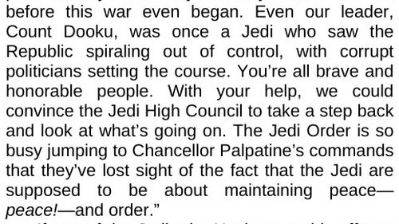
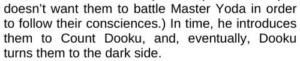
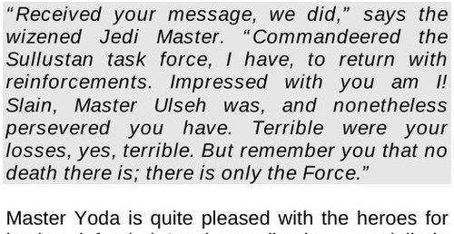
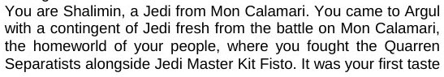

# Owner Material 037 — Star Wars D20 Drive folder (Core, Revised Core and Saga Edition): Adventures/Only the Force.pdf [Star Wars Roleplaying Game Revised Core (d20, 2002)]

- **Source:** Wizards of the Coast Star Wars Roleplaying Game books, web enhancements, Living Force campaign modules and articles (2000–2010), from the owner's "Star Wars D20" Drive folder (only the three edition subfolders; "General" was not read, as instructed). Secondary source (licensed Legends reference). Scan OCR'd on the box; the scan stays box-only and is **not** published.
- **Method:** every scanned page was OCR'd and machine-screened sentence by sentence for power-relevant statements (fights, kills, defeats, Force feats, rankings, superweapons) that name a character on our roster; each kept sentence is quoted verbatim from the OCR text and has a crop of the printed passage directly under it. Pages with nothing power-relevant are still listed with what is on them.
- **Citation:** "*Only the Force* (SWRPG d20 Revised Core), p.X" by printed page ("scan p.X" where no printed number applies). **Weight:** Licensed RPG material: a secondary source. Narrative text sums up Legends lore; game statistics are rules for players, not canon power levels, and rank lowest.

## p.1 (scan page 1)

Page contents: Cover: Only the Force, a one-round Rise of the Empire era adventure by JD Wiker; young Jedi evacuate refugees under Separatist fire; (c)2004 RPGA tournament use (hand-read)

## p.2 (scan page 2)

Page contents: RPGA running notes; play notes: adventure may end with all Jedi heroes dead, a test of resolve akin to the Jedi trials; six Jedi heroes arrived on Argul three days ago (hand-read)

## p.3 (scan page 3)

Page contents: Hero list (Teo Gronn, Olge Plavi-Dol, Mariineh, Ren Auglu, Shalimin, Wamtra); villains: Separatist army and commander Drogen Hosh, but real threat is the heroes' fears; background: Argul on the Corellian Trade Line near Cerea; Palpatine calls evacuation, Yoda leads Jedi task force; Master Ulseh stays with six young Jedi; scene summaries begin (hand-read)

- **Palpatine (Darth Sidious); Yoda** — entry/section: Palpatine calls the Argul evacuation; Yoda leads the Jedi task force: "Supreme Chancellor Palpatine has called for a general evacuation of the cities where the major engagements are taking place, and Master Yoda has personally led a task force of Jedi Knights to supervise the proceedings." Source: *Only the Force* (SWRPG d20 Revised Core), p.3
  

## p.4 (scan page 4)

Page contents: Scene summaries 2-5 and conclusion (Ulseh dies with the falling transport; Hosh's surrender offer; Yoda returns with Republic transports); the planet Argul, near-Human Argullians, last free mesa docking tower (hand-read)

## p.5 (scan page 5)

Page contents: Opening crawl; Scene 1 Hard Bargains: three groups of Jedi face a 'Separatist spy' accusation, a bribe attempt, and a physician refusing to load 'degenerate' patients (hand-read)

## p.6 (scan page 6)

Page contents: The Spy: Ozuun, critic of the Senate, not a spy; tactics (orders, attack = Dark Side Point, Diplomacy, Affect Mind); The Merchant: Turyit tries to smuggle 60 barrels of bacta claiming rare wine (hand-read)

## p.7 (scan page 7)

Page contents: Turyit's bargaining; The Doctor: Dr. Semmix condemns 42 terminal patients; Ulseh observes Ren Auglu's decision ('A Jedi respects all life, in any form'); Scene 2 A Jedi Falls: final Acclamator transport hit by droid artillery (hand-read)

- **Master Ulseh** — entry/section: Ulseh to his Padawan: "If Ren overruled Dr. Semmix's decision, Ulseh tells him: "You did well, Ren. 'A Jedi respects all life, in any form.' While those people still live, there is still hope that a cure can be found. They deserve the same chance at a future as everyone else here."" Source: *Only the Force* (SWRPG d20 Revised Core), p.7
  

## p.8 (scan page 8)

Page contents: Transport crashes against the tower; Ulseh leads rescue through the stairwell wall (180 damage, lightsabers ignore DR); rescue checks, Move Object DC 20 per survivor; wreck slips 4 m after ten rounds (hand-read)

## p.9 (scan page 9)

Page contents: Syntherope rescue; wreck slides away; Ulseh uses Move Object (Split Force) to push up to four Jedi/survivors to safety, and falls with the ship; his green lightsaber flickers amid droid fire, a great surge in the Force, then fades; Scene 3 General Panic; Administrator Mozim wants clones to ring the control tower (hand-read)

- **Master Ulseh** — entry/section: Ulseh's last Move Object (Split Force): "If the heroes used another method, Master Ulseh uses Move Object to push up to four Jedi and/or survivors up out of the ship and to the opening in the stairway (using the Split Force technique described in the Hero's Guide, page 140)" Source: *Only the Force* (SWRPG d20 Revised Core), p.9
  
- **Master Ulseh** — entry/section: Death of Master Ulseh: "Far below, through the smoke, you see a flicker of green light—Master Ulseh's lightsaber! For a long moment, there is a great surge in the Force, like a rainstorm gathering about you. Then it suddenly fades away, and you watch in horror as, amid a hail of droid blaster fire, the lightsaber beam flickers out." Source: *Only the Force* (SWRPG d20 Revised Core), p.9
  

## p.10 (scan page 10)

Page contents: Mozim's plan to save officials; bargaining, Affect Mind limits; his loudspeaker speech; public reaction; comm silence (hyperspace transceiver destroyed); Hosh plans an infiltration (hand-read)

## p.11 (scan page 11)

Page contents: Droids infiltrate via the transport wreckage; Scene 4 The Silent Assault: STAP diversion from a dropship, two dozen battle droids rush the control tower; dead heroes' players take clone troopers; Ozuun attacked by a mob (hand-read)

## p.12 (scan page 12)

Page contents: Attacking the crowd in anger = Dark Side Point; Scene 5: Hosh's hologram offers cease-fire and himself as hostage in exchange for the Argullian officials; Mozim refuses; coercing him = Dark Side Point; surrender option: Hosh keeps the Jedi's lightsabers (hand-read)

## p.13 (scan page 13)

Page contents: Hosh recruits for the Separatists citing Count Dooku; recruits are later turned to the dark side by Dooku; defiance option: all-out droid assault table; conclusion: Yoda arrives with four Acclamators ('there is only the Force') and recommends survivors for the trials (hand-read)

- **Drogen Hosh; Count Dooku; Palpatine (Darth Sidious)** — entry/section: Hosh recruits the Jedi, citing Dooku: "Even our leader, Count Dooku, was once a Jedi who saw the Republic spiraling out of control, with corrupt politicians setting the course. You're all brave and honorable people. With your help, we could convince the Jedi High Council to take a step back and look at what's going on. The Jedi Order is so busy jumping to Chancellor Palpatine's commands that they've lost sight of the fact that the Jedi are supposed to be about maintaining peace— peace!—and order." Source: *Only the Force* (SWRPG d20 Revised Core), p.13
  
- **Count Dooku; Drogen Hosh** — entry/section: Dooku turns Hosh's Jedi recruits: "In time, he introduces them to Count Dooku, and, eventually, Dooku turns them to the dark side." Source: *Only the Force* (SWRPG d20 Revised Core), p.13
  
- **Yoda** — entry/section: Yoda: there is only the Force: ""Received your message, we did," says the wizened Jedi Master. "Commandeered the Sullustan task force, I have, to return with reinforcements. Impressed with you am I! Slain, Master Ulseh was, and nonetheless persevered you have. Terrible were your losses, yes, terrible. But remember you that no death there is; there is only the Force."" Source: *Only the Force* (SWRPG d20 Revised Core), p.13
  

## p.14 (scan page 14)

Page contents: Stats: Master Ulseh (Human Jedi Consular 9/Jedi Master 4); Clone Trooper (Thug 6) (hand-read)

### Stat block notes (game mechanics, not feats)

- Master Ulseh: Human Jedi Consular 9/Jedi Master 4; VP/WP 49/10; lightsaber +12/+7 (4d8-1); FP 5; Force skills Affect Mind +17, Heal Another +19, Move Object +12, Force Strike +10; Force feats Alter, Compassion, Control, Force Mind, Knight Defense, Knight Mind, Lightsaber Defense, Sense (Source: *Only the Force* (SWRPG d20 Revised Core), p.14)

## p.15 (scan page 15)

Page contents: Stats: Administrator Mozim (Diplomat 8); Argullian citizen (hand-read)

## p.16 (scan page 16)

Page contents: Stats: Commander Drogen Hosh (Noble 2/Soldier 4/Officer 6, DSP 11) (hand-read)

### Stat block notes (game mechanics, not feats)

- Drogen Hosh: Human Noble 2/Soldier 4/Officer 6; VP/WP 71/10; FP 6, DSP 11; Frightful Presence; Bluff +13, Diplomacy +13, Knowledge (tactics) +12 (Source: *Only the Force* (SWRPG d20 Revised Core), p.16)

## p.17 (scan page 17)

Page contents: Vehicles: Acclamator-class assault ship, Phoenix Hawk light pinnace, STAP (hand-read)

## p.18 (scan page 18)

Page contents: Droids: battle droid, super battle droid, destroyer droid (hand-read)

## p.19 (scan page 19)

Page contents: Pregenerated hero: Teo Gronn (Duros Jedi Guardian 5), masters Lyron (killed on Geonosis) and Oshi-Jid (lost over Muunilinst); views of the other Jedi (hand-read)

## p.20 (scan page 20)

Page contents: Pregenerated hero: Olge Plavi-Dol (Human Jedi Consular 8, healer from Commenor); Shalimin's master Upulu; Wamtra's master Nemen Ull; Mariineh's master Silmis Vey (hand-read)

## p.21 (scan page 21)

Page contents: Pregenerated hero: Mariineh (Twi'lek Jedi Guardian 6, Padawan of Silmis Vey) (hand-read)

## p.22 (scan page 22)

Page contents: Pregenerated hero: Ren Auglu (Human Jedi Consular 4, Padawan of Ulseh, from Naboo) (hand-read)

## p.23 (scan page 23)

Page contents: Blank page (footer only) (hand-read)

## p.24 (scan page 24)

Page contents: Pregenerated hero: Shalimin (Mon Calamari Jedi Consular 5), fought the Quarren Separatists alongside Kit Fisto; master Upulu (hand-read)

- **Kit Fisto** — entry/section: Shalimin fought beside Kit Fisto on Mon Calamari: "You came to Argul with a contingent of Jedi fresh from the battle on Mon Calamari, the homeworld of your people, where you fought the Quarren Separatists alongside Jedi Master Kit Fisto." Source: *Only the Force* (SWRPG d20 Revised Core), p.24
  

## p.25 (scan page 25)

Page contents: Pregenerated hero: Wamtra (Rodian Jedi Guardian 4), master Nemen Ull killed by battle droid AATs (hand-read)

## p.26 (scan page 26)

Page contents: Replacement character: clone trooper (Thug 6); footer misprinted 'The Will of Heaven' (hand-read)

## p.27 (scan page 27)

Page contents: Map of the Argullian docking tower (hand-read)

