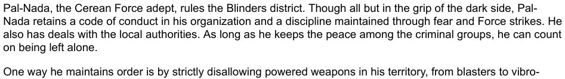
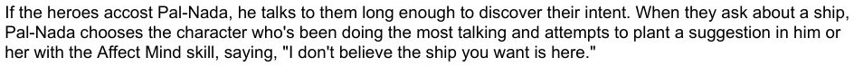
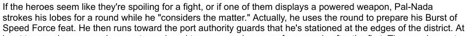

# Owner Material 037 — Star Wars D20 Drive folder (Core, Revised Core and Saga Edition): Adventures/Put Up Your Dukes.pdf [Star Wars Roleplaying Game Revised Core (d20, 2002)]

- **Source:** Wizards of the Coast Star Wars Roleplaying Game books, web enhancements, Living Force campaign modules and articles (2000–2010), from the owner's "Star Wars D20" Drive folder (only the three edition subfolders; "General" was not read, as instructed). Secondary source (licensed Legends reference). Scan OCR'd on the box; the scan stays box-only and is **not** published.
- **Method:** every scanned page was OCR'd and machine-screened sentence by sentence for power-relevant statements (fights, kills, defeats, Force feats, rankings, superweapons) that name a character on our roster; each kept sentence is quoted verbatim from the OCR text and has a crop of the printed passage directly under it. Pages with nothing power-relevant are still listed with what is on them.
- **Citation:** "*Put Up Your Dukes* (SWRPG d20 Revised Core), p.X" by printed page ("scan p.X" where no printed number applies). **Weight:** Licensed RPG material: a secondary source. Narrative text sums up Legends lore; game statistics are rules for players, not canon power levels, and rank lowest.

## scan p.1 (scan page 1)

Page contents: Intro and synopsis: heroes seek a stolen ship in the Blinders district of Sahl-Evin, run by the Cerean Force adept Pal-Nada; Scene 1 Welcome to Happytown (no energy weapons); Scene 2 The Blinders, a Duros port guard's warning (hand-read)

## scan p.2 (scan page 2)

Page contents: Guards are on Pal-Nada's payroll; Scene 3 The Hutt's Last Laugh cantina; Pal-Nada rules through fear and Force strikes and bans powered weapons; informants Orth Maag (Zabrak bartender) and Squedge Eepsey (Duros stoolie) (hand-read)

- **Pal-Nada** — entry/section: Pal-Nada rules the Blinders by fear and Force strikes: "Pal-Nada, the Cerean Force adept, rules the Blinders district. Though all but in the grip of the dark side, Pal- Nada retains a code of conduct in his organization and a discipline maintained through fear and Force strikes. He also has deals with the local authorities. As long as he keeps the peace among the criminal groups, he can count on being left alone." Source: *Put Up Your Dukes* (SWRPG d20 Revised Core), scan p.2
  

## scan p.3 (scan page 3)

Page contents: Squedge will point out Pal-Nada; Tarkil Hroka, Gamorrean pit champion, picks a fight (image check recovered 'attempts to pick a fight. The other patrons in the bar quickly get into it,'); Scene 4 the pit fight; Tarkil stats; crowd side activities (hand-read)

### Stat block notes (game mechanics, not feats)

- Tarkil Hroka: Male Gamorrean Soldier 7; VP/WP 68/17; fist +13/+8 (2d4+5); Str 20 (Source: *Put Up Your Dukes* (SWRPG d20 Revised Core), scan p.3)

## scan p.4 (scan page 4)

Page contents: Pal-Nada watches from the shadows; Scene 5 We Meet At Last: Pal-Nada tries Affect Mind ('I don't believe the ship you want is here'), or uses Burst of Speed to flee to his bribed guards; Pal-Nada stats (Cerean Force Adept 7); Esm Arkhee (Twi'lek Diplomat 4) (hand-read)

- **Pal-Nada** — entry/section: Pal-Nada's mind trick: "When they ask about a ship, Pal-Nada chooses the character who's been doing the most talking and attempts to plant a suggestion in him or her with the Affect Mind skill, saying, "I don't believe the ship you want is here."" Source: *Put Up Your Dukes* (SWRPG d20 Revised Core), scan p.4
  
- **Pal-Nada** — entry/section: Pal-Nada's Burst of Speed: "If the heroes seem like they're spoiling for a fight, or if one of them displays a powered weapon, Pal-Nada strokes his lobes for a round while he "considers the matter." Actually, he uses the round to prepare his Burst of Speed Force feat. He then runs toward the port authority guards that he's stationed at the edges of the district." Source: *Put Up Your Dukes* (SWRPG d20 Revised Core), scan p.4
  

### Stat block notes (game mechanics, not feats)

- Pal-Nada: Male Cerean Force Adept 7; VP/WP 37/10; Force-imbued club (1d6+1d8); FP 2, DSP 7; Affect Mind +12, Illusion +12, Force Stealth +11, Force Strike +10; Force feats Alter, Burst of Speed, Control, Force-Sensitive, Mind Trick, Sense (Source: *Put Up Your Dukes* (SWRPG d20 Revised Core), scan p.4)

## scan p.5 (scan page 5)

Page contents: Wrapping up: jail/bribes, Squedge may be a plant, Pal-Nada plots revenge (hand-read)

