# Owner Material 037 — Star Wars D20 Drive folder (Core, Revised Core and Saga Edition): Adventures/Rebel Jedi.pdf [Star Wars Roleplaying Game Revised Core (d20, 2002)]

- **Source:** Wizards of the Coast Star Wars Roleplaying Game books, web enhancements, Living Force campaign modules and articles (2000–2010), from the owner's "Star Wars D20" Drive folder (only the three edition subfolders; "General" was not read, as instructed). Secondary source (licensed Legends reference). Scan OCR'd on the box; the scan stays box-only and is **not** published.
- **Method:** every scanned page was OCR'd and machine-screened sentence by sentence for power-relevant statements (fights, kills, defeats, Force feats, rankings, superweapons) that name a character on our roster; each kept sentence is quoted verbatim from the OCR text and has a crop of the printed passage directly under it. Pages with nothing power-relevant are still listed with what is on them.
- **Citation:** "*Rebel Jedi* (SWRPG d20 Revised Core), p.X" by printed page ("scan p.X" where no printed number applies). **Weight:** Licensed RPG material: a secondary source. Narrative text sums up Legends lore; game statistics are rules for players, not canon power levels, and rank lowest.

## scan p.1 (scan page 1)

Page contents: Title page / art (hand-read)

## scan p.2 (scan page 2)

Page contents: Background: Dal Konur, ex-SpecForce lieutenant sent to the Jedi Academy on Borsk Fey'lya's advice, wants the Force used to end the war and stows away; era/level adjustment notes; hooks (hand-read)

- **Dal Konur** — entry/section: Dal Konur leaves the Jedi Academy: "Lieutenant Dal Konur had served with distinction in the Rebel Alliance as a SpecForce trooper. Highly trained and extremely motivated, he was indomitable in combat and a master of infiltration. When his nascent Force abilities began to surface, he took the advice of New Republic Councilor Borsk Fey’lya and sought training at the Jedi Academy. But old ways died hard, and Lieutenant Konur couldn't grasp why the Jedi didn’t use a weapon as potent as the Force to end the conflict with the Empire once and for all. Disgusted, he took matters into his own hands, stowing away aboard the Academy’s supply ship and heading out into parts unknown." Source: *Rebel Jedi* (SWRPG d20 Revised Core), scan p.2
  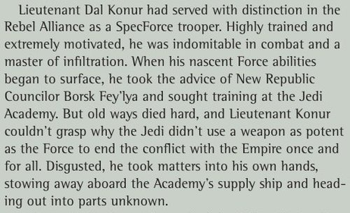

## scan p.3 (scan page 3)

Page contents: Yavin 4: Kyp Durron lays out refreshments; Luke's briefing (Dal's gift for clouding minds, plan to strike the Moff Council, possible dark side spirit from Sith temples); Luke cannot follow because Dal would sense him; Peckhum mind-tricked to Ord Mantell (hand-read)

- **Luke Skywalker; Dal Konur** — entry/section: Luke: Dal's gift for clouding weak minds: "“One of my students may have become seduced by the dark side. Dal Konur was a lieutenant in the Rebel Alliance’s special forces until about two months ago, when we discovered that he had Force potential. He came here for training, and he had a natural gift for clouding weak minds—which is why, I suspect, he was so good at infiltration in SpecForce." Source: *Rebel Jedi* (SWRPG d20 Revised Core), scan p.3
  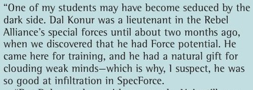
- **Luke Skywalker; Dal Konur** — entry/section: Luke: Dal's plan to strike the Moffs: "“But Dal came here with an agenda. He’s still very much a soldier, and he wants to see the end of the war with the Empire. Unfortunately, Dal doesn’t want to wait for our two governments to arrange a lasting peace. He told me that a surgical strike by Jedi Knights at the ruling council of Moffs would leave the Empire without leaders, allowing the New Republic to move in and neutralize the entire Imperial fleet." Source: *Rebel Jedi* (SWRPG d20 Revised Core), scan p.3
  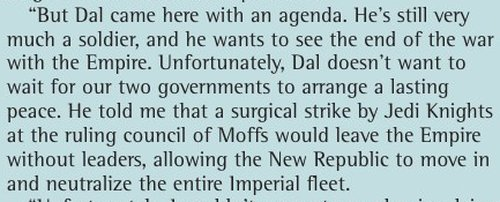
- **Luke Skywalker; Dal Konur** — entry/section: Luke: Dal and a dark side spirit: "“Unfortunately, I couldn’t support any plan involving the assassination of sentient beings, so I advised Dal to reconsider. Apparently, he did—just not in the way I'd hoped. I found notes in Dal’s room that suggested he might have been exploring the ruins of some of Yavin 4’s old Sith temples. If so, he may have come into contact with—or perhaps been seduced by—a dark side spirit. We've had a bit of trouble with one here before. If so, if he’s on his way to use the dark side to defeat the Empire, he may unwittingly unleash an even greater evil." Source: *Rebel Jedi* (SWRPG d20 Revised Core), scan p.3
  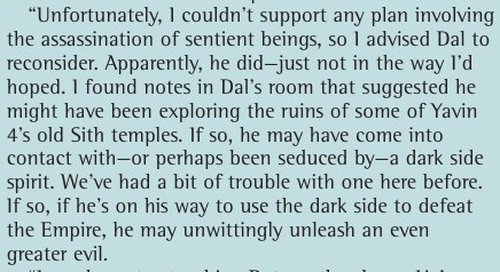
- **Luke Skywalker; Dal Konur** — entry/section: Luke: stop him gently: "“I need you to stop him. But gently, please. He’s a student, and a friend, and he doesn’t deserve to be killed or maimed just for trying to end a war the only way he knows how. Will you go after Dal Konur and bring him back before he does something we'll all regret?”" Source: *Rebel Jedi* (SWRPG d20 Revised Core), scan p.3
  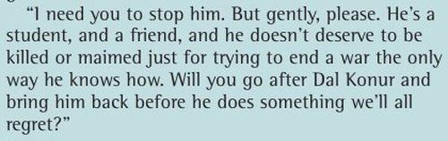
- **Luke Skywalker; Dal Konur** — entry/section: Luke: Dal would sense my presence: "If the heroes accept, Luke says that he can’t offer much in the way of help. “I can give you a few supplies—and some stun grenades, in case you get close enough to use them— but I can’t go with you. Dal would detect my presence in the Force as soon as I got close, and with his abilities, he could disappear before I ever saw him. But he doesn’t know you, so you might have a better chance of catching him by surprise.”" Source: *Rebel Jedi* (SWRPG d20 Revised Core), scan p.3
  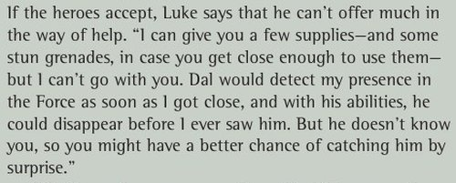

## scan p.4 (scan page 4)

Page contents: Q&A with Luke (Dal mostly practiced basics, gift for mind trick); Luke offers a Force-sensitive hero a low-power lightsaber spar and a teaching post, mentioning Keiran Halcyon and Kam Solusar; Ord Mantell savrip hunters under Dal's mind trick (hand-read)

- **Kam Solusar; Luke Skywalker** — entry/section: Rebel Jedi: "“Some of my students here—Keiran Halcyon and Kam Solusar in particular—are gifted lightsaber duelists, but neither has all that much experience as yet.” Should a hero accept Luke’s offer, the sparring takes place on the landing pad, and if the hero wins, Luke takes it in good grace." Source: *Rebel Jedi* (SWRPG d20 Revised Core), scan p.4
  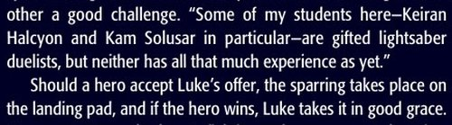
- **Dal Konur** — entry/section: Dal's gift for the mind trick: "How skilled is Dal Konur as a Jedi? Dal had picked up a few tricks by himself over the years, but here at the Academy, he mostly practiced the basics. He had a gift for the Jedi mind trick, however." Source: *Rebel Jedi* (SWRPG d20 Revised Core), scan p.4
  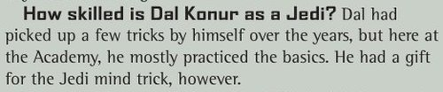
- **Luke Skywalker** — entry/section: Luke offers to spar: "If any of the heroes are Force-Sensitive, Skywalker remarks on this fact. “I hadn't heard that you had Jedi training,” he says. “Perhaps, when things are a little less chaotic, we can share what we've both learned. I may be the teacher here, but I'm also a student.” If the hero is agreeable, Luke even suggests that they spar—with lightsabers set on low power, of course—to give each other a good challenge. “Some of my students here—Keiran Halcyon and Kam Solusar in particular—are gifted lightsaber duelists, but neither has all that much experience as yet.”" Source: *Rebel Jedi* (SWRPG d20 Revised Core), scan p.4
  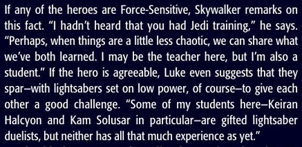

## scan p.5 (scan page 5)

Page contents: Warehouse: Dal found Old Republic-era weapons and a long-dead Jedi Knight's lightsaber; Trandoshan warden; Smekt the drop-office clerk mind-tricked (empty envelope); Bilbringi, taken from Thrawn's forces (hand-read)

- **Dal Konur** — entry/section: Dal finds a long-dead Jedi's lightsaber: "Dal did, in fact, come to this warehouse, using stealth and a mind trick or two to get past the guard long enough to search the boxes and crates inside. Eventually, he found what he wanted: several crates of Old Republic-era weapons—and the lightsaber of a long-dead Jedi Knight. What he couldn't carry, he transferred to another warehouse in the same complex, and then came back during normal business hours to remove the stuff, as legal as could be." Source: *Rebel Jedi* (SWRPG d20 Revised Core), scan p.5
  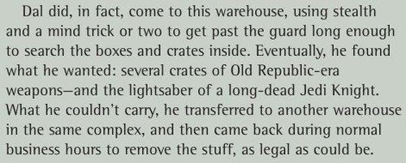

## scan p.6 (scan page 6)

Page contents: Bilbringi docks: no one remembers Dal (Hide + Affect Mind); dockworker Rian Vitt mind-wiped; Captain Jest Lar-Quain sold his Firespray-31 and can't recall to whom (hand-read)

## scan p.7 (scan page 7)

Page contents: Hangar bay controls rerouted to Dal by Affect Mind; Confrontation: Dal's 'Join me!' plea to strike Bastion; if refused he ignites a near-black dark blue lightsaber; Dal Konur stats (Soldier 8/Elite Trooper 9/Jedi Guardian 1; Affect Mind +5, Force Stealth +3) (hand-read)

- **Dal Konur** — entry/section: Dal reroutes hangar control by Affect Mind: "Not wanting to be at the mercy of the controller, Dal has used Affect Mind to convince each shift’s controller to reroute control of the hangar bay’s functions to a remote, which Dal now carries. Restoring control to the control center requires first a Disable Device check (DC 25), followed by a Computer Use check (DC 35). Each check requires a full round." Source: *Rebel Jedi* (SWRPG d20 Revised Core), scan p.7
  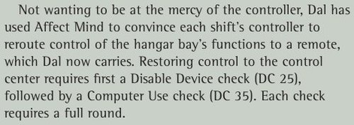
- **Dal Konur; Luke Skywalker** — entry/section: Dal: Join me!: "“We're on the same side,” says the hardened-looking figure that emerges from the hangar bay’s parts shop. “Come with me to Bastion. Help me end this war! We can slip into Imperial space, capture the entire Moff Council, and secure an Imperial surrender in one week. One week! Nobody else has to die! No one has to go over to the dark side! Luke can’t see that, but surely you can! Join me! We can end this destructive conflict and bring order to the whole galaxy!”" Source: *Rebel Jedi* (SWRPG d20 Revised Core), scan p.7
  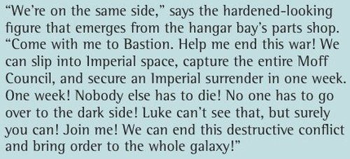
- **Dal Konur; Luke Skywalker** — entry/section: Dal: Luke's black-and-white view: "“I should have known. You've got Luke’s “‘black-andwhite’ view of life. You think that the Force should never be used aggressively. Well, that might be true in peacetime, but not in wartime. You do what you have to do, if it will stop more unnecessary bloodshed. But I guess the truth is lost on you." Source: *Rebel Jedi* (SWRPG d20 Revised Core), scan p.7
  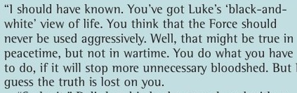
- **Dal Konur** — entry/section: Dal's near-black lightsaber: "“So be it.” Dal’s hand jerks downward, and with a distinctive snap-hiss, he’s suddenly holding a lightsaber, with a blade so dark blue that it appears almost black. “Let’s get this over with.”" Source: *Rebel Jedi* (SWRPG d20 Revised Core), scan p.7
  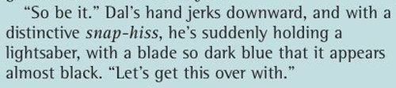
- **Dal Konur** — entry/section: Dal knows he can't best a Jedi Knight in a duel: "Dal Konur’s forte is infiltration, but he’s also an accomplished soldier—and he’s certainly no fool. Though his combat skills are formidable, he knows that he can’t hope to best a trained Jedi Knight in a lightsaber duel. His plan, instead, is to just keep his opponents away from his ship while the E-Web blasters on Grid 3 slowly eliminate them, one by one. If he hasn’t activated the grid lifts yet, he does so as his first action." Source: *Rebel Jedi* (SWRPG d20 Revised Core), scan p.7
  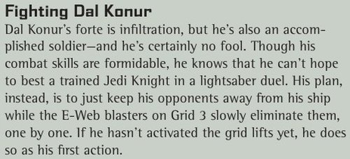

### Stat block notes (game mechanics, not feats)

- Dal Konur: Male Human Soldier 8/Elite Trooper 9/Jedi Guardian 1; VP/WP 160/17; lightsaber +21 (2d8+3); deflect (defense +1); FP 6, DSP 2; Affect Mind +5, Force Stealth +3 (Source: *Rebel Jedi* (SWRPG d20 Revised Core), scan p.7)

## scan p.8 (scan page 8)

Page contents: Tactics: Dal avoids lightsaber duels, relies on E-Web grid; conclusion (New Republic custody), leads into Nightsaber (hand-read)

