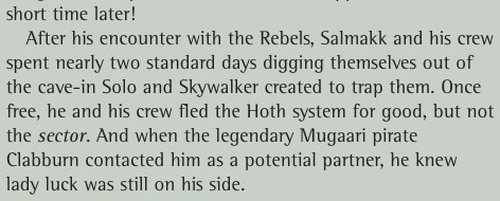
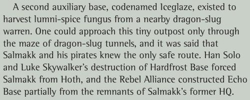

# Owner Material 037 — Star Wars D20 Drive folder (Core, Revised Core and Saga Edition): Adventures/Rough And Tundra.pdf [Star Wars Roleplaying Game Revised Core (d20, 2002)]

- **Source:** Wizards of the Coast Star Wars Roleplaying Game books, web enhancements, Living Force campaign modules and articles (2000–2010), from the owner's "Star Wars D20" Drive folder (only the three edition subfolders; "General" was not read, as instructed). Secondary source (licensed Legends reference). Scan OCR'd on the box; the scan stays box-only and is **not** published.
- **Method:** every scanned page was OCR'd and machine-screened sentence by sentence for power-relevant statements (fights, kills, defeats, Force feats, rankings, superweapons) that name a character on our roster; each kept sentence is quoted verbatim from the OCR text and has a crop of the printed passage directly under it. Pages with nothing power-relevant are still listed with what is on them.
- **Citation:** "*Rough And Tundra* (SWRPG d20 Revised Core), p.X" by printed page ("scan p.X" where no printed number applies). **Weight:** Licensed RPG material: a secondary source. Narrative text sums up Legends lore; game statistics are rules for players, not canon power levels, and rank lowest.

## scan p.1 (scan page 1)

Page contents: Cover (hand-read)

## scan p.2 (scan page 2)

Page contents: Credits; in-character warning about Salmakk and Clabburn from a retired Yarith Sector Ranger; intro; background (hand-read)

## scan p.3 (scan page 3)

Page contents: Getting involved: patron groups OJC, Figg Excavations, Mining Guild, the Empire (hand-read)

## scan p.4 (scan page 4)

Page contents: The Hutts; The Plot Revealed (FiggEx hired the pirates); Salmakk's history: Hoth base, trapped by Solo and Skywalker's cave-in; Salmakk stats (Scoundrel 8/Soldier 4) (hand-read)

- **Han Solo; Luke Skywalker** — entry/section: Solo and Skywalker trap Salmakk's pirates on Hoth: "After his encounter with the Rebels, Salmakk and his crew spent nearly two standard days digging themselves out of the cave-in Solo and Skywalker created to trap them. Once free, he and his crew fled the Hoth system for good, but not the sector. And when the legendary Mugaari pirate Clabburn contacted him as a potential partner, he knew lady luck was still on his side." Source: *Rough And Tundra* (SWRPG d20 Revised Core), scan p.4
  

### Stat block notes (game mechanics, not feats)

- Salmakk: Male Mon Calamari Scoundrel 8/Soldier 4; VP/WP 77/11 (Source: *Rough And Tundra* (SWRPG d20 Revised Core), scan p.4)

## scan p.5 (scan page 5)

Page contents: Clabburn (the Younger, son of the legendary Clabburn) and stats; casefile on the Malachite Scent; the crew; the Broken Jaw (hand-read)

### Stat block notes (game mechanics, not feats)

- Clabburn the Younger: Male Mugaari Scoundrel 12; VP/WP 82/14; DSP 3 (Source: *Rough And Tundra* (SWRPG d20 Revised Core), scan p.5)

## scan p.6 (scan page 6)

Page contents: Broken Jaw stats; contacts Nogo Sistek and Fannis Gult with stats; sidebar on Clabburn the Elder (hand-read)

## scan p.7 (scan page 7)

Page contents: Mapes Shaywa (secret FiggEx Security chief, alias Barseth Gynes) and stats; Treva Horme; Solomahal begins (hand-read)

### Stat block notes (game mechanics, not feats)

- Mapes Shaywa: Male Human Scoundrel 8/Soldier 4; VP/WP 80/12 (Source: *Rough And Tundra* (SWRPG d20 Revised Core), scan p.7)
- Solomahal: Male Lutrillian Soldier 8/Fringer 4; VP/WP 84/14 (Source: *Rough And Tundra* (SWRPG d20 Revised Core), scan p.7)

## scan p.8 (scan page 8)

Page contents: Solomahal stats and secret identity as a Clone Wars general; Sergeant Taray; Sheryc Seka (hand-read)

## scan p.9 (scan page 9)

Page contents: Locations: Hoth (Hardfrost and Iceglaze bases, destroyed by Han and Luke), Hoth asteroid field Airtight Base with space slugs; dragon-slug stats; Darlyn Boda (hand-read)

- **Han Solo; Luke Skywalker** — entry/section: Han and Luke destroy Hardfrost Base: "A second auxiliary base, codenamed Iceglaze, existed to harvest lumni-spice fungus from a nearby dragon-slug warren. One could approach this tiny outpost only through the maze of dragon-slug tunnels, and it was said that Salmakk and his pirates knew the only safe route. Han Solo and Luke Skywalker’s destruction of Hardfrost Base forced Salmakk from Hoth, and the Rebel Alliance constructed Echo Base partially from the remnants of Salmakk’s former HQ." Source: *Rough And Tundra* (SWRPG d20 Revised Core), scan p.9
  

## scan p.10 (scan page 10)

Page contents: Pepper's Pax; haruspex readings; Gerrenthum Figg HQ; Bespin Port Town (hand-read)

