# Owner Material 037 — Star Wars D20 Drive folder (Core, Revised Core and Saga Edition): Adventures/Shadows in the Force.pdf [Star Wars Roleplaying Game Revised Core (d20, 2002)]

- **Source:** Wizards of the Coast Star Wars Roleplaying Game books, web enhancements, Living Force campaign modules and articles (2000–2010), from the owner's "Star Wars D20" Drive folder (only the three edition subfolders; "General" was not read, as instructed). Secondary source (licensed Legends reference). Scan OCR'd on the box; the scan stays box-only and is **not** published.
- **Method:** every scanned page was OCR'd and machine-screened sentence by sentence for power-relevant statements (fights, kills, defeats, Force feats, rankings, superweapons) that name a character on our roster; each kept sentence is quoted verbatim from the OCR text and has a crop of the printed passage directly under it. Pages with nothing power-relevant are still listed with what is on them.
- **Citation:** "*Shadows in the Force* (SWRPG d20 Revised Core), p.X" by printed page ("scan p.X" where no printed number applies). **Weight:** Licensed RPG material: a secondary source. Narrative text sums up Legends lore; game statistics are rules for players, not canon power levels, and rank lowest.

## p.1 (scan page 1)

Page contents: Cover blurb (hand-read)

## p.2 (scan page 2)

Page contents: RPGA GM guidelines; play notes; dark side spirits (Exar Kun example), limited to mind-affecting powers (hand-read)

## p.3 (scan page 3)

Page contents: Pregenerated heroes (2 Imperials incl. Force-sensitive scout, 4 Rebels incl. Bothan Force adept); background: Sith lord Quorlac Fornayh's coloi project and stasis; summary; Emperor senses the awakening (hand-read)

- **Quorlac Fornayh** — entry/section: Quorlac Fornayh's coloi and survival beyond death: "named Quorlac Fornayh. He had been working on creating a race of Sith mutants, called coloi, that he could use to grasp the throne of the Sith Empire. But when he saw the tides of war turing against his people, he retreated to his secret base on Yorgraxx to build his forces and bide his time. It took him nearly 100 years, but he perfected his coloi template creature just before he died. Unfortunately, he did not have time to clone more rancors to mutate into coloi, so only the one creation survives. Upon his death, he shut the creature in a stasis unit. He knew that he could exist in the Force beyond death and planned to create a new cloned body in due time and return to the land of the living." Source: *Shadows in the Force* (SWRPG d20 Revised Core), p.3
  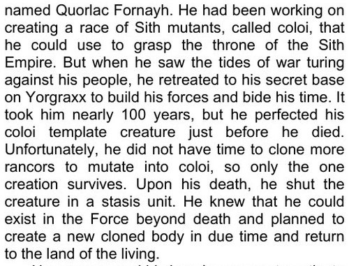

## p.4 (scan page 4)

Page contents: Summary continued; planet Yorgraxx; opening crawl (hand-read)

## p.5 (scan page 5)

Page contents: Opening cutaway (Imperial scout ship hit by asteroid, droids awaken, 'something smiles'); space battle setup (hand-read)

## p.6 (scan page 6)

Page contents: Crash; Cutaway 2: stasis units power up; the Emperor senses an old presence and sends his Hand Gollin; Force visions for the Bothan and Imperial scout (hand-read)

- **Palpatine (Darth Sidious); Jallar Golin** — entry/section: The Emperor feels an old presence awaken: "In a gravely voice, the Emperor says, “I feel a presence in the Force, as if something very old has awakened. Gollin, you will take a shuttle to this planet.” He points to a star display on a computer screen. “There, you will find whatever is the source of this disturbance and you will bring it to me.”" Source: *Shadows in the Force* (SWRPG d20 Revised Core), p.6
  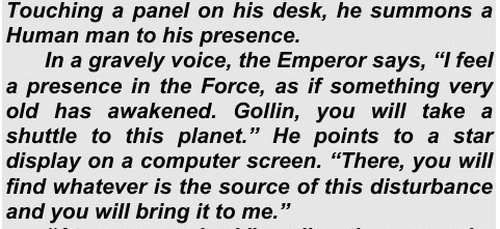

## p.7 (scan page 7)

Page contents: Scene 2 assessing the wreckage; Talva's Farseeing/See Force; Imperial camp (hand-read)

## p.8 (scan page 8)

Page contents: Predator's Beak camp, blaster cannon trap; repairing ships and vehicles (hand-read)

## p.9 (scan page 9)

Page contents: Healing (medpacs, Heal Self); Scene 3 Sith probe droid reports to Fornayh's spirit (hand-read)

## p.10 (scan page 10)

Page contents: Scene 4 Sith sentry droids; Cutaway 3 Jallar Golin lands (hand-read)

## p.11 (scan page 11)

Page contents: Scene 5: upper chamber; Fornayh's illusory sentry droids, Affect Mind, possession; coloi attacks (hand-read)

- **Quorlac Fornayh** — entry/section: Fornayh's illusory sentry droids: "These droids are illusions, created by Fornayh to attract the heroes’ attention so that the coloi can attack with surprise. Use the stats for the sentry droids in Appendix 2 with the following modifications." Source: *Shadows in the Force* (SWRPG d20 Revised Core), p.11
  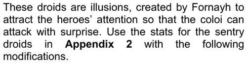
- **Quorlac Fornayh** — entry/section: Fornayh's Force powers in the fight: "Two rounds after the coloi attacks, the sentry droids disappear (Fornayh discontinues the illusion) and Fornayh starts using other Force powers that he can use to impede the heroes during the fight. If the coloi is close to death he tries to possess a weak-minded hero, but otherwise does not try his possession power on the heroes." Source: *Shadows in the Force* (SWRPG d20 Revised Core), p.11
  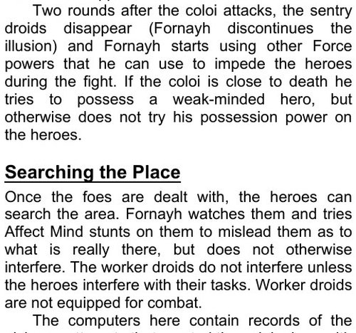
- **Quorlac Fornayh** — entry/section: Fornayh's Affect Mind stunts: "Searching the Place Once the foes are dealt with, the heroes can search the area. Fornayh watches them and tries Affect Mind stunts on them to mislead them as to what is really there, but does not otherwise interfere. The worker droids do not interfere unless the heroes interfere with their tasks. Worker droids are not equipped for combat." Source: *Shadows in the Force* (SWRPG d20 Revised Core), p.11
  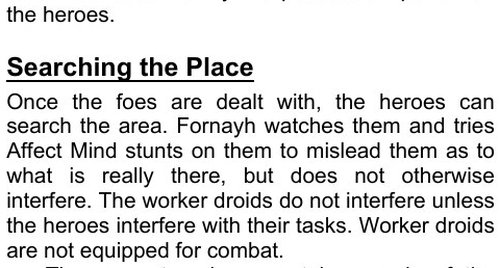

## p.12 (scan page 12)

Page contents: Computers, lower stasis chamber, cloning tanks; Scene 6 Jallar Golin confronts the heroes, his tactics (Hatred); Cutaway 4 the Emperor feels the Hand die and calls Vader (hand-read)

- **Jallar Golin** — entry/section: Golin's tactics and Hatred: "Tactics: If a fight breaks out, Golin uses his speeder to gain some distance on the heroes, and then use his blasters. He also uses his Force skills unless he runs too low on vitality. He is likely to use his Hatred feat on anyone who gets within range, especially if he is losing. If things go really badly, he retreats, follows the heroes, and strikes again when their guard is down." Source: *Shadows in the Force* (SWRPG d20 Revised Core), p.12
  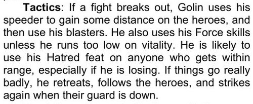
- **Palpatine (Darth Sidious); Darth Vader (Anakin Skywalker); Jallar Golin** — entry/section: The Emperor feels his Hand die: "Back on Coruscant, the Emperor pauses in the middle of a sentence and looks blankly as he feels the connection with his Hand cut. Gesturing to the two Grand Moffs before him, he dismisses them and turns to stare into space in the direction of Yorgraxx. “It is more powerful than I thought,” he muses, “and therefore it must be dealt with somehow.” He turns to his desk and waves his hand over a console. Communications are opened via the holonet, and a small image of a man in black armor and a black helmet appears. “Vader, the Rebels can wait. I have need of you for another task...”" Source: *Shadows in the Force* (SWRPG d20 Revised Core), p.12
  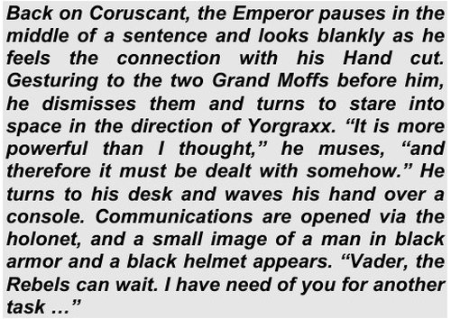

## p.13 (scan page 13)

Page contents: Conclusion; Imperial entanglements (hand-read)

## p.14 (scan page 14)

Page contents: Appendix 1: Quorlac Fornayh stats (Dark Jedi Guardian 6/Sith Lord 5), dark spirit traits, limited powers, possession, Sith Sorcery, Alchemy, Control Mind (hand-read)

- **Quorlac Fornayh** — entry/section: Fornayh's possession: "Possession: Fornayh can attempt to possess physical bodies at will as a full-round action. The target gets a Will save DC 8 to resist, and if the target succeeds Fornayh can never again attempt to possess it." Source: *Shadows in the Force* (SWRPG d20 Revised Core), p.14
  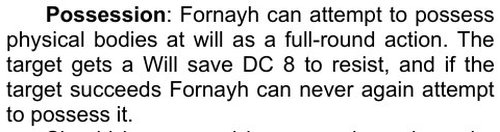
- **Quorlac Fornayh** — entry/section: Fornayh calls his lightsaber after possessing: "Should he succeed in possessing a hero, he gains the use of all his Force powers and will immediately use Move Object to call his lightsaber if one is in the room with him. The victim becomes a Dark Side spirit." Source: *Shadows in the Force* (SWRPG d20 Revised Core), p.14
  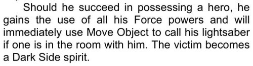

### Stat block notes (game mechanics, not feats)

- Quorlac Fornayh: Male Sith (near-Human) Dark Jedi Guardian 6/Sith Lord 5 (dark side spirit); VP/WP 82/13; FP 4, DSP 20; Affect Mind +10, Alchemy +18, Battlemind +13, Control Mind +13, Force Grip +18, Illusion +14; Force feats Alter, Control, Drain Energy, Force Mind, Lightsaber Defense, Mettle, Mind Trick, Rage, Sense, Sith Sorcery (Source: *Shadows in the Force* (SWRPG d20 Revised Core), p.14)

## p.15 (scan page 15)

Page contents: Jallar Golin stats (Scoundrel 4/Soldier 1/Emperor's Hand 3) and background (hand-read)

- **Jallar Golin; Palpatine (Darth Sidious)** — entry/section: Jallar Golin trained by the Emperor: "Born in the wilds of the Outer Rim, Jallar made his way as best as he could for most of the early years of his life. Chance brought him to Coruscant, and chance (or the Force) brought him to the attention of the Emperor. After some training in the army, he was trained by the Emperor to be a Hand." Source: *Shadows in the Force* (SWRPG d20 Revised Core), p.15
  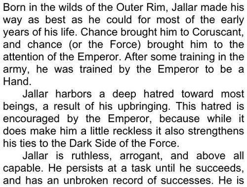
- **Jallar Golin; Palpatine (Darth Sidious)** — entry/section: Golin's hatred and the dark side: "Jallar harbors a deep hatred toward most beings, a result of his upbringing. This hatred is encouraged by the Emperor, because while it does make him a little reckless it also strengthens his ties to the Dark Side of the Force." Source: *Shadows in the Force* (SWRPG d20 Revised Core), p.15
  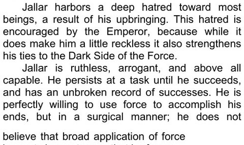

### Stat block notes (game mechanics, not feats)

- Jallar Golin: Male Human Scoundrel 4/Soldier 1/Emperor's Hand 3; VP/WP 35/13; FP 2, DSP 4; Affect Mind +7, Enhance Ability +7, Force Strike +2, Heal Self +1, Move Object +8; Force feats Alter, Control, Hatred (Source: *Shadows in the Force* (SWRPG d20 Revised Core), p.15)

## p.16 (scan page 16)

Page contents: Coloi stats and Sith alchemy origin (hand-read)

- **Quorlac Fornayh** — entry/section: The coloi, rancor mutated by Sith alchemy: "The coloi is a creature mutated from a rancor by Sith alchemy. The process for creating one is very involved, and takes a lot of time. All of the changes are genetic, though, and so the creatures should breed true if there were enough of them to breed." Source: *Shadows in the Force* (SWRPG d20 Revised Core), p.16
  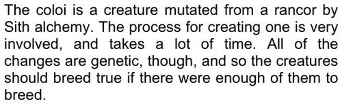

## p.17 (scan page 17)

Page contents: Appendix 2: Griffon's Wings, Guardian-class cruisers (hand-read)

## p.18 (scan page 18)

Page contents: Landspeeder, scout bike, Dark Eye Sith probe droid, Sith sentry droid, Lambda shuttle (hand-read)

## p.19 (scan page 19)

Page contents: Pregenerated hero Arran Flekk (hidden Force sensitivity) (hand-read)

## p.20 (scan page 20)

Page contents: Pregenerated hero Vor Harkass (hand-read)

## p.21 (scan page 21)

Page contents: Pregenerated hero Gorbacca (hand-read)

## p.22 (scan page 22)

Page contents: Pregenerated hero Kandar Vallan (hand-read)

## p.23 (scan page 23)

Page contents: Pregenerated hero Talva Ko'lib (untrained Bothan Force adept, fears Vader and the Emperor) (hand-read)

## p.24 (scan page 24)

Page contents: Pregenerated hero Vylanthar Merric (secretly reads Sith) (hand-read)

## p.25 (scan page 25)

Page contents: End of p24 text only (OCR blank; checked from page image) (hand-read)

## p.26 (scan page 26)

Page contents: Map of Quorlac Fornayh's base (hand-read)

