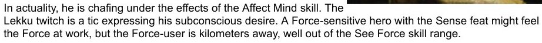
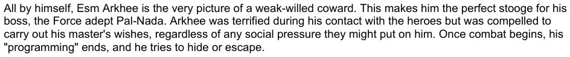
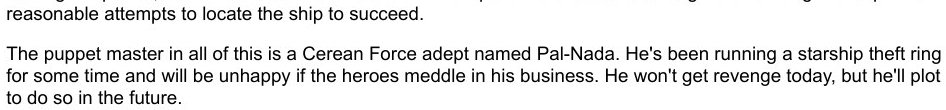
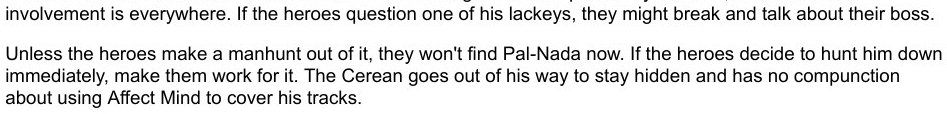

# Owner Material 037 — Star Wars D20 Drive folder (Core, Revised Core and Saga Edition): Adventures/Steal of a Deal.pdf [Star Wars Roleplaying Game Revised Core (d20, 2002)]

- **Source:** Wizards of the Coast Star Wars Roleplaying Game books, web enhancements, Living Force campaign modules and articles (2000–2010), from the owner's "Star Wars D20" Drive folder (only the three edition subfolders; "General" was not read, as instructed). Secondary source (licensed Legends reference). Scan OCR'd on the box; the scan stays box-only and is **not** published.
- **Method:** every scanned page was OCR'd and machine-screened sentence by sentence for power-relevant statements (fights, kills, defeats, Force feats, rankings, superweapons) that name a character on our roster; each kept sentence is quoted verbatim from the OCR text and has a crop of the printed passage directly under it. Pages with nothing power-relevant are still listed with what is on them.
- **Citation:** "*Steal of a Deal* (SWRPG d20 Revised Core), p.X" by printed page ("scan p.X" where no printed number applies). **Weight:** Licensed RPG material: a secondary source. Narrative text sums up Legends lore; game statistics are rules for players, not canon power levels, and rank lowest.

## scan p.1 (scan page 1)

Page contents: Intro, synopsis (dark side Force adept runs a chop-shop ring); Scene 1 Esm Arkhee's Lekku twitch from Affect Mind (hand-read)

- **Pal-Nada** — entry/section: Arkhee's twitch is Affect Mind at work: "In actuality, he is chafing under the effects of the Affect Mind skill. The Lekku twitch is a tic expressing his subconscious desire. A Force-sensitive hero with the Sense feat might feel the Force at work, but the Force-user is kilometers away, well out of the See Force skill range." Source: *Steal of a Deal* (SWRPG d20 Revised Core), scan p.1
  

## scan p.2 (scan page 2)

Page contents: Interplanetary Acquisitions office; Arkhee's offer and blaster; Arkhee stats; Scene 2 thugs (hand-read)

- **Pal-Nada** — entry/section: Arkhee, stooge of the Force adept Pal-Nada: "All by himself, Esm Arkhee is the very picture of a weak-willed coward. This makes him the perfect stooge for his boss, the Force adept Pal-Nada. Arkhee was terrified during his contact with the heroes but was compelled to carry out his master's wishes, regardless of any social pressure they might put on him. Once combat begins, his "programming" ends, and he tries to hide or escape." Source: *Steal of a Deal* (SWRPG d20 Revised Core), scan p.2
  

### Stat block notes (game mechanics, not feats)

- Esm Arkhee: Male Twi'lek Diplomat 2; non-Force stooge (Source: *Steal of a Deal* (SWRPG d20 Revised Core), scan p.2)

## scan p.3 (scan page 3)

Page contents: Port authority, Gorg Pomar's forged papers; Scene 3 Shurgg steals the ship; timeline; caption on Obi-Wan in the cantina (hand-read)

- **Obi-Wan Kenobi** — entry/section: Caption: Ben and the thugs: "Ben knew how to deal with a bunch of thugs..." Source: *Steal of a Deal* (SWRPG d20 Revised Core), scan p.3
  

## scan p.4 (scan page 4)

Page contents: Shurgg stats; wrap-up: Pal-Nada revealed, stats (hand-read)

- **Pal-Nada** — entry/section: Pal-Nada, puppet master of the theft ring: "The puppet master in all of this is a Cerean Force adept named Pal-Nada. He's been running a starship theft ring for some time and will be unhappy if the heroes meddle in his business. He won't get revenge today, but he'll plot to do so in the future." Source: *Steal of a Deal* (SWRPG d20 Revised Core), scan p.4
  
- **Pal-Nada** — entry/section: Pal-Nada covers his tracks with Affect Mind: "Unless the heroes make a manhunt out of it, they won't find Pal-Nada now. If the heroes decide to hunt him down immediately, make them work for it. The Cerean goes out of his way to stay hidden and has no compunction about using Affect Mind to cover his tracks." Source: *Steal of a Deal* (SWRPG d20 Revised Core), scan p.4
  

### Stat block notes (game mechanics, not feats)

- Pal-Nada: Male Cerean Force Adept 5; VP/WP 27/10; FP 2, DSP 6; Force-imbued club; Affect Mind +10, Illusion +10, Force Stealth +7, Force Strike +8; feats Alter, Burst of Speed, Control, Force-Sensitive, Low Profile, Mind Trick, Sense (Source: *Steal of a Deal* (SWRPG d20 Revised Core), scan p.4)
- Shurgg: Female Quarren Tech Specialist 4 (Source: *Steal of a Deal* (SWRPG d20 Revised Core), scan p.4)
