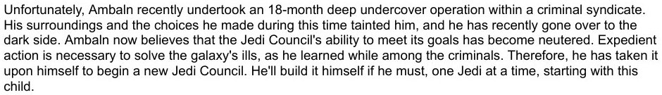
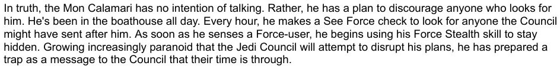
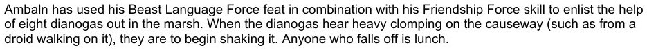
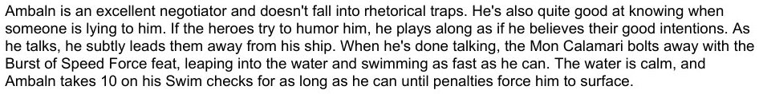
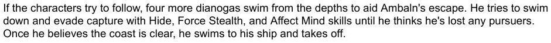
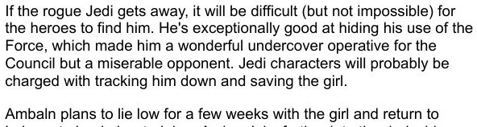
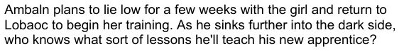

# Owner Material 037 — Star Wars D20 Drive folder (Core, Revised Core and Saga Edition): Adventures/Swim Meet.pdf [Star Wars Roleplaying Game Revised Core (d20, 2002)]

- **Source:** Wizards of the Coast Star Wars Roleplaying Game books, web enhancements, Living Force campaign modules and articles (2000–2010), from the owner's "Star Wars D20" Drive folder (only the three edition subfolders; "General" was not read, as instructed). Secondary source (licensed Legends reference). Scan OCR'd on the box; the scan stays box-only and is **not** published.
- **Method:** every scanned page was OCR'd and machine-screened sentence by sentence for power-relevant statements (fights, kills, defeats, Force feats, rankings, superweapons) that name a character on our roster; each kept sentence is quoted verbatim from the OCR text and has a crop of the printed passage directly under it. Pages with nothing power-relevant are still listed with what is on them.
- **Citation:** "*Swim Meet* (SWRPG d20 Revised Core), p.X" by printed page ("scan p.X" where no printed number applies). **Weight:** Licensed RPG material: a secondary source. Narrative text sums up Legends lore; game statistics are rules for players, not canon power levels, and rank lowest.

## scan p.1 (scan page 1)

Page contents: Background: Ambaln falls after undercover work and takes a Force-sensitive child to start his own Jedi Council; era conversion; hooks (hand-read)

- **Ambaln** — entry/section: Ambaln goes over to the dark side: "Unfortunately, Ambaln recently undertook an 18-month deep undercover operation within a criminal syndicate. His surroundings and the choices he made during this time tainted him, and he has recently gone over to the dark side. Ambaln now believes that the Jedi Council's ability to meet its goals has become neutered. Expedient action is necessary to solve the galaxy's ills, as he learned while among the criminals. Therefore, he has taken it upon himseIf to begin a new Jedi Council. He'll build it himseIf if he must, one Jedi at a time, starting with this child." Source: *Swim Meet* (SWRPG d20 Revised Core), scan p.1
  

## scan p.2 (scan page 2)

Page contents: Lobaoc and Koab; droid Z-NO with the smeared Jedi symbol; Z-NO stats; the plan (hand-read)

### Stat block notes (game mechanics, not feats)

- Z-NO: Walking labor droid, Expert 3/Noble 1 (Source: *Swim Meet* (SWRPG d20 Revised Core), scan p.2)

## scan p.3 (scan page 3)

Page contents: Ambaln's See Force watch and Force Stealth; Scene 2 dianoga causeway trap via Beast Language and Friendship; Scene 3 escape with Burst of Speed (hand-read)

- **Ambaln** — entry/section: Ambaln's See Force watch and trap: "In truth, the Mon Calamari has no intention of talking. Rather, he has a plan to discourage anyone who looks for him. He's been in the boathouse all day. Every hour, he makes a See Force check to look for anyone the Council might have sent after him. As soon as he senses a Force-user, he begins using his Force Stealth skill to stay hidden. Growing increasingly paranoid that the Jedi Council will attempt to disrupt his plans, he has prepared a trap as a message to the Council that their time is through." Source: *Swim Meet* (SWRPG d20 Revised Core), scan p.3
  
- **Ambaln** — entry/section: Beast Language and Friendship on the dianogas: "Ambaln has used his Beast Language Force feat in combination with his Friendship Force skill to enlist the help of eight dianogas out in the marsh. When the dianogas hear heavy clomping on the causeway (such as from a droid walking on it), they are to begin shaking it. Anyone who falls off is lunch." Source: *Swim Meet* (SWRPG d20 Revised Core), scan p.3
  
- **Ambaln** — entry/section: Ambaln escapes with Burst of Speed: "Ambaln is an excellent negotiator and doesn't fall into rhetorical traps. He's also quite good at knowing when someone is lying to him. If the heroes try to humor him, he plays along as if he believes their good intentions. As he talks, he subtly leads them away from his ship. When he's done talking, the Mon Calamari bolts away with the Burst of Speed Force feat, leaping into the water and swimming as fast as he can. The water is calm, and Ambaln takes 10 on his Swim checks for as long as he can until penalties force him to surface." Source: *Swim Meet* (SWRPG d20 Revised Core), scan p.3
  
- **Ambaln** — entry/section: Ambaln evades with Force Stealth and Affect Mind: "If the characters try to follow, four more dianogas swim from the depths to aid Ambaln's escape. He tries to swim down and evade capture with Hide, Force Stealth, and Affect Mind skills until he thinks he's lost any pursuers. Once he believes the coast is clear, he swims to his ship and takes off." Source: *Swim Meet* (SWRPG d20 Revised Core), scan p.3
  

## scan p.4 (scan page 4)

Page contents: Wrap-up; Ambaln stats (hand-read)

- **Ambaln** — entry/section: Ambaln hides his use of the Force: "If the rogue Jedi gets away, it will be difficult (but not impossible) for the heroes to find him. He's exceptionally good at hiding his use of the Force, which made him a wonderful undercover operative for the Council but a miserable opponent. Jedi characters will probably be charged with tracking him down and saving the girl." Source: *Swim Meet* (SWRPG d20 Revised Core), scan p.4
  
- **Ambaln** — entry/section: Ambaln's plan for his apprentice: "Ambaln plans to lie low for a few weeks with the girl and return to Lobaoc to begin her training. As he sinks further into the dark side, who knows what sort of lessons he'll teach his new apprentice?" Source: *Swim Meet* (SWRPG d20 Revised Core), scan p.4
  

### Stat block notes (game mechanics, not feats)

- Ambaln: Male Mon Calamari Jedi Consular 7/Jedi Investigator 5; VP/WP 68/10; FP 1, DSP 7; Affect Mind +10, Battlemind +8, Empathy +6, Enhance Sense +10, Farseeing +7, Force Stealth +10, Friendship +8, See Force +10; Force feats Aware, Alter, Beast Language, Burst of Speed, Control, Lightsaber Defense, Sense (Source: *Swim Meet* (SWRPG d20 Revised Core), scan p.4)
