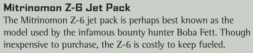

# Owner Material 037 — Star Wars D20 Drive folder (Core, Revised Core and Saga Edition): Adventures/Talnar's Rescue.pdf [Star Wars Roleplaying Game Revised Core (d20, 2002)]

- **Source:** Wizards of the Coast Star Wars Roleplaying Game books, web enhancements, Living Force campaign modules and articles (2000–2010), from the owner's "Star Wars D20" Drive folder (only the three edition subfolders; "General" was not read, as instructed). Secondary source (licensed Legends reference). Scan OCR'd on the box; the scan stays box-only and is **not** published.
- **Method:** every scanned page was OCR'd and machine-screened sentence by sentence for power-relevant statements (fights, kills, defeats, Force feats, rankings, superweapons) that name a character on our roster; each kept sentence is quoted verbatim from the OCR text and has a crop of the printed passage directly under it. Pages with nothing power-relevant are still listed with what is on them.
- **Citation:** "*Talnar's Rescue* (SWRPG d20 Revised Core), p.X" by printed page ("scan p.X" where no printed number applies). **Weight:** Licensed RPG material: a secondary source. Narrative text sums up Legends lore; game statistics are rules for players, not canon power levels, and rank lowest.

## scan p.1 (scan page 1)

Page contents: Cover (hand-read)

## scan p.2 (scan page 2)

Page contents: Credits; intro; background (Talnar crash-lands on Naalol, Oquan capture him); customizing (hand-read)

## scan p.3 (scan page 3)

Page contents: Scene 1 briefing by Captain Res Nels (hand-read)

## scan p.4 (scan page 4)

Page contents: Scene 2 arrival, stormtroopers; crash site map (hand-read)

## scan p.5 (scan page 5)

Page contents: PX-7 transport; crash site search; droid control pads; Imperial biker patrol (hand-read)

## scan p.6 (scan page 6)

Page contents: Biker scouts stats; Scene 3 the bridge, Oquan convoy; Oquan lieutenants (hand-read)

## scan p.7 (scan page 7)

Page contents: Oquan stats; Mitrinomon Z-6 jet pack (Boba Fett's model) (hand-read)

- **Boba Fett** — entry/section: Boba Fett's jet pack model: "The Mitrinomon Z-6 jet pack is perhaps best known as the model used by the infamous bounty hunter Boba Fett. Though inexpensive to purchase, the Z-6 is costly to keep fueled." Source: *Talnar's Rescue* (SWRPG d20 Revised Core), scan p.7
  

## scan p.8 (scan page 8)

Page contents: Convoy vehicles; Scene 4 Rigton; Gather Information table on the Oquan and Rel Acoi (hand-read)

## scan p.9 (scan page 9)

Page contents: Scene 5 Prit's Free Pit, Aveton Prit, Cotan (hand-read)

## scan p.10 (scan page 10)

Page contents: Cotan deals; Nir Rinit confronts heroes; map (hand-read)

## scan p.11 (scan page 11)

Page contents: Cotan stats; Scene 6 ejected; Nir Rinit, goons, the Miniad (hand-read)

## scan p.12 (scan page 12)

Page contents: Tunnel chase; Scene 7 meeting Rel Acoi; the swap at docking bay 22 (hand-read)

## scan p.13 (scan page 13)

Page contents: Bay map; the ambush (hand-read)

## scan p.14 (scan page 14)

Page contents: Controlling the droids; Baktoid Combat Automata stats (hand-read)

## scan p.15 (scan page 15)

Page contents: Droids activate; Rel Acoi, Oquan, stormtroopers, Talnar stats; aftermath (hand-read)

