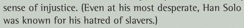
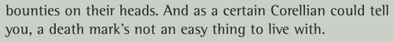

# Owner Material 037 — Star Wars D20 Drive folder (Core, Revised Core and Saga Edition): Adventures/Zygerrian Takedown.pdf [Star Wars Roleplaying Game Revised Core (d20, 2002)]

- **Source:** Wizards of the Coast Star Wars Roleplaying Game books, web enhancements, Living Force campaign modules and articles (2000–2010), from the owner's "Star Wars D20" Drive folder (only the three edition subfolders; "General" was not read, as instructed). Secondary source (licensed Legends reference). Scan OCR'd on the box; the scan stays box-only and is **not** published.
- **Method:** every scanned page was OCR'd and machine-screened sentence by sentence for power-relevant statements (fights, kills, defeats, Force feats, rankings, superweapons) that name a character on our roster; each kept sentence is quoted verbatim from the OCR text and has a crop of the printed passage directly under it. Pages with nothing power-relevant are still listed with what is on them.
- **Citation:** "*Zygerrian Takedown* (SWRPG d20 Revised Core), p.X" by printed page ("scan p.X" where no printed number applies). **Weight:** Licensed RPG material: a secondary source. Narrative text sums up Legends lore; game statistics are rules for players, not canon power levels, and rank lowest.

## scan p.1 (scan page 1)

Page contents: Cover (hand-read)

## scan p.2 (scan page 2)

Page contents: Credits; intro; background (Thanda clan, Brevis Taug sting, Clawdite courier) (hand-read)

## scan p.3 (scan page 3)

Page contents: Getting involved (Han Solo's hatred of slavers); Scene 1 Junction Grand Terminal; complications (hand-read)

- **Han Solo** — entry/section: Han Solo's hatred of slavers: "(Even at his most desperate, Han Solo was known for his hatred of slavers.)" Source: *Zygerrian Takedown* (SWRPG d20 Revised Core), scan p.3
  

## scan p.4 (scan page 4)

Page contents: Trianii kits, Chadra-Fan's cart; the bagman and Houk bodyguard; Scene 2 Bazarre, Docking Bay 117, Prit Kessek (hand-read)

## scan p.5 (scan page 5)

Page contents: Prit and Kloofus stats; Scene 3 Zygeria station, Liskran Dulce, the Scourge, 'Change.' (hand-read)

## scan p.6 (scan page 6)

Page contents: Firefight options; Atlee Thanda and Dulce stats; wrapping up (death mark allusion to Han); about the author (hand-read)

- **Han Solo** — entry/section: A certain Corellian and the death mark: "And as a certain Corellian could tell you, a death mark’s not an easy thing to live with." Source: *Zygerrian Takedown* (SWRPG d20 Revised Core), scan p.6
  
