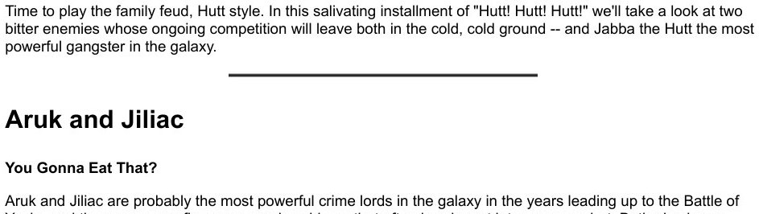
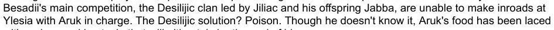
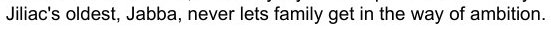

# Owner Material 037 — Star Wars D20 Drive folder (Core, Revised Core and Saga Edition): Characters/Hutts/Aruk and Jiliac.pdf [Star Wars Roleplaying Game Revised Core (d20, 2002)]

- **Source:** Wizards of the Coast Star Wars Roleplaying Game books, web enhancements, Living Force campaign modules and articles (2000–2010), from the owner's "Star Wars D20" Drive folder (only the three edition subfolders; "General" was not read, as instructed). Secondary source (licensed Legends reference). Scan OCR'd on the box; the scan stays box-only and is **not** published.
- **Method:** every scanned page was OCR'd and machine-screened sentence by sentence for power-relevant statements (fights, kills, defeats, Force feats, rankings, superweapons) that name a character on our roster; each kept sentence is quoted verbatim from the OCR text and has a crop of the printed passage directly under it. Pages with nothing power-relevant are still listed with what is on them.
- **Citation:** "*Aruk and Jiliac* (SWRPG d20 Revised Core), p.X" by printed page ("scan p.X" where no printed number applies). **Weight:** Licensed RPG material: a secondary source. Narrative text sums up Legends lore; game statistics are rules for players, not canon power levels, and rank lowest.

## scan p.1 (scan page 1)

Page contents: Intro; Aruk (Besadii, Ylesia spice) and Jiliac (Desilijic); Durga and Jabba; Aruk stats; Hutt Gambit sidebar (hand-read)

- **Jabba the Hutt** — entry/section: Family feud, Hutt style: "Time to play the family feud, Hutt style. In this salivating installment of "Hutt! Hutt! Hutt!" we'll take a look at two bitter enemies whose ongoing competition will leave both in the cold, cold ground -- and Jabba the Hutt the most powerful gangster in the galaxy." Source: *Aruk and Jiliac* (SWRPG d20 Revised Core), scan p.1
  
- **Jabba the Hutt** — entry/section: The Desilijic solution: poison: "Besadii's main competition, the Desilijic clan led by Jiliac and his offspring Jabba, are unable to make inroads at Ylesia with Aruk in charge. The Desilijic solution? Poison." Source: *Aruk and Jiliac* (SWRPG d20 Revised Core), scan p.1
  
- **Jabba the Hutt** — entry/section: Jabba never lets family get in the way: "Jiliac's oldest, Jabba, never lets family get in the way of ambition." Source: *Aruk and Jiliac* (SWRPG d20 Revised Core), scan p.1
  

### Stat block notes (game mechanics, not feats)

- Aruk: Male Hutt Noble 8/Scoundrel 2/Crime Lord 10, before Episode IV (Source: *Aruk and Jiliac* (SWRPG d20 Revised Core), scan p.1)

## scan p.2 (scan page 2)

Page contents: Aruk skills/feats; Jiliac stats; next-month teaser (Hoth Planet Hoppers) (hand-read)

### Stat block notes (game mechanics, not feats)

- Jiliac: Male Hutt Noble 6/Scoundrel 4/Crime Lord 10, before Episode IV (Source: *Aruk and Jiliac* (SWRPG d20 Revised Core), scan p.2)
