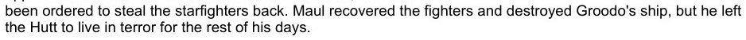
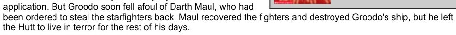
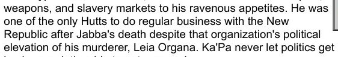
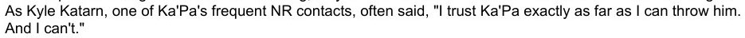

# Owner Material 037 — Star Wars D20 Drive folder (Core, Revised Core and Saga Edition): Characters/Hutts/Groodo and Ka'Pa.pdf [Star Wars Roleplaying Game Revised Core (d20, 2002)]

- **Source:** Wizards of the Coast Star Wars Roleplaying Game books, web enhancements, Living Force campaign modules and articles (2000–2010), from the owner's "Star Wars D20" Drive folder (only the three edition subfolders; "General" was not read, as instructed). Secondary source (licensed Legends reference). Scan OCR'd on the box; the scan stays box-only and is **not** published.
- **Method:** every scanned page was OCR'd and machine-screened sentence by sentence for power-relevant statements (fights, kills, defeats, Force feats, rankings, superweapons) that name a character on our roster; each kept sentence is quoted verbatim from the OCR text and has a crop of the printed passage directly under it. Pages with nothing power-relevant are still listed with what is on them.
- **Citation:** "*Groodo and Ka'Pa* (SWRPG d20 Revised Core), p.X" by printed page ("scan p.X" where no printed number applies). **Weight:** Licensed RPG material: a secondary source. Narrative text sums up Legends lore; game statistics are rules for players, not canon power levels, and rank lowest.

## scan p.1 (scan page 1)

Page contents: Intro; Groodo, Bartokk assassins, Darth Maul; Groodo stats; Ka'Pa holo in Riccix's dictionary (hand-read)

- **Darth Maul** — entry/section: Groodo and Ka'Pa: "Maul recovered the fighters and destroyed Groodo's ship, but he left the Hutt to live in terror for the rest of his days." Source: *Groodo and Ka'Pa* (SWRPG d20 Revised Core), scan p.1
  
- **Darth Maul** — entry/section: Maul leaves Groodo to live in terror: "But Groodo soon fell afoul of Darth Maul, who had been ordered to steal the starfighters back. Maul recovered the fighters and destroyed Groodo's ship, but he left the Hutt to live in terror for the rest of his days." Source: *Groodo and Ka'Pa* (SWRPG d20 Revised Core), scan p.1
  

### Stat block notes (game mechanics, not feats)

- Groodo: Male Hutt Diplomat 5/Crime Lord 6, circa Episode I (Source: *Groodo and Ka'Pa* (SWRPG d20 Revised Core), scan p.1)

## scan p.2 (scan page 2)

Page contents: Ka'Pa background, Kyle Katarn quote; Ka'Pa stats (contacts Kyle Katarn, Mara Jade); Wurrek teaser (hand-read)

- **Leia Organa Solo; Jabba the Hutt** — entry/section: Ka'Pa deals with the New Republic despite Leia: "He was one of the only Hutts to do regular business with the New Republic after Jabba's death despite that organization's political elevation of his murderer, Leia Organa." Source: *Groodo and Ka'Pa* (SWRPG d20 Revised Core), scan p.2
  
- **Kyle Katarn** — entry/section: Kyle Katarn on Ka'Pa: "As Kyle Katarn, one of Ka'Pa's frequent NR contacts, often said, "I trust Ka'Pa exactly as far as I can throw him. And I can't."" Source: *Groodo and Ka'Pa* (SWRPG d20 Revised Core), scan p.2
  

### Stat block notes (game mechanics, not feats)

- Ka'Pa: Male Hutt Noble 4/Scoundrel 4/Crime Lord 4, post Episode VI (Source: *Groodo and Ka'Pa* (SWRPG d20 Revised Core), scan p.2)
