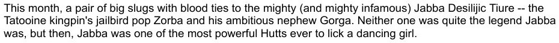
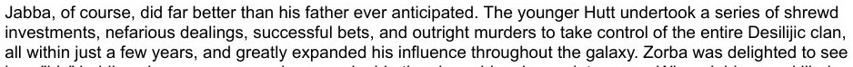
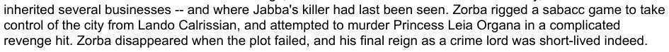
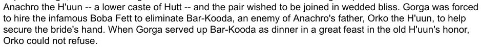
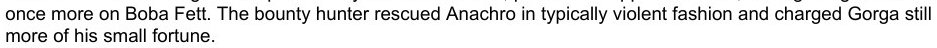
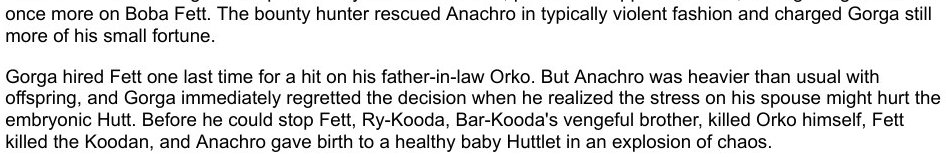

# Owner Material 037 — Star Wars D20 Drive folder (Core, Revised Core and Saga Edition): Characters/Hutts/Hutt! Hutt! Hutt!.pdf [Star Wars Roleplaying Game Revised Core (d20, 2002)]

- **Source:** Wizards of the Coast Star Wars Roleplaying Game books, web enhancements, Living Force campaign modules and articles (2000–2010), from the owner's "Star Wars D20" Drive folder (only the three edition subfolders; "General" was not read, as instructed). Secondary source (licensed Legends reference). Scan OCR'd on the box; the scan stays box-only and is **not** published.
- **Method:** every scanned page was OCR'd and machine-screened sentence by sentence for power-relevant statements (fights, kills, defeats, Force feats, rankings, superweapons) that name a character on our roster; each kept sentence is quoted verbatim from the OCR text and has a crop of the printed passage directly under it. Pages with nothing power-relevant are still listed with what is on them.
- **Citation:** "*Hutt! Hutt! Hutt!* (SWRPG d20 Revised Core), p.X" by printed page ("scan p.X" where no printed number applies). **Weight:** Licensed RPG material: a secondary source. Narrative text sums up Legends lore; game statistics are rules for players, not canon power levels, and rank lowest.

## scan p.1 (scan page 1)

Page contents: Intro; Zorba's history, imprisonment on Kip, Jabba's rise, secret will, Cloud City plot against Leia; sidebar (hand-read)

- **Jabba the Hutt** — entry/section: Jabba, one of the most powerful Hutts: "This month, a pair of big slugs with blood ties to the mighty (and mighty infamous) Jabba Desilijic Tiure -- the Tatooine kingpin's jailbird pop Zorba and his ambitious nephew Gorga. Neither one was quite the legend Jabba was, but then, Jabba was one of the most powerful Hutts ever to lick a dancing girl." Source: *Hutt! Hutt! Hutt!* (SWRPG d20 Revised Core), scan p.1
  
- **Jabba the Hutt** — entry/section: Jabba takes control of the Desilijic clan: "Jabba, of course, did far better than his father ever anticipated. The younger Hutt undertook a series of shrewd
investments, nefarious dealings, successful bets, and outright murders to take control of the entire Desilijic clan, all within just a few years, and greatly expanded his influence throughout the galaxy." Source: *Hutt! Hutt! Hutt!* (SWRPG d20 Revised Core), scan p.1
  
- **Lando Calrissian; Leia Organa Solo** — entry/section: Zorba vs Lando and Leia: "Zorba rigged a sabacc game to take control of the city from Lando Calrissian, and attempted to murder Princess Leia Organa in a complicated revenge hit." Source: *Hutt! Hutt! Hutt!* (SWRPG d20 Revised Core), scan p.1
  

## scan p.2 (scan page 2)

Page contents: Zorba stats; Gorga, Anachro, Boba Fett hired three times; Gorga stats (hand-read)

- **Boba Fett** — entry/section: Gorga hires Boba Fett: "Gorga was forced to hire the infamous Boba Fett to eliminate Bar-Kooda, an enemy of Anachro's father, Orko the H'uun, to help secure the bride's hand. When Gorga served up Bar-Kooda as dinner in a great feast in the old H'uun's honor, Orko could not refuse." Source: *Hutt! Hutt! Hutt!* (SWRPG d20 Revised Core), scan p.2
  
- **Boba Fett** — entry/section: Fett rescues Anachro: "The bounty hunter rescued Anachro in typically violent fashion and charged Gorga still more of his small fortune." Source: *Hutt! Hutt! Hutt!* (SWRPG d20 Revised Core), scan p.2
  
- **Boba Fett** — entry/section: Gorga's last hire of Fett: "Gorga hired Fett one last time for a hit on his father-in-law Orko. But Anachro was heavier than usual with offspring, and Gorga immediately regretted the decision when he realized the stress on his spouse might hurt the embryonic Hutt. Before he could stop Fett, Ry-Kooda, Bar-Kooda's vengeful brother, killed Orko himself, Fett killed the Koodan, and Anachro gave birth to a healthy baby Huttlet in an explosion of chaos." Source: *Hutt! Hutt! Hutt!* (SWRPG d20 Revised Core), scan p.2
  

### Stat block notes (game mechanics, not feats)

- Zorba: Male Hutt Noble 4/Scoundrel 4, circa Episode VI (Source: *Hutt! Hutt! Hutt!* (SWRPG d20 Revised Core), scan p.2)
- Gorga: Male Hutt Noble 6/Scoundrel 1/Crime Lord 2, circa Episode IV; contact Boba Fett (Source: *Hutt! Hutt! Hutt!* (SWRPG d20 Revised Core), scan p.2)

## scan p.3 (scan page 3)

Page contents: Lorian Nod teaser; copyright (hand-read)

