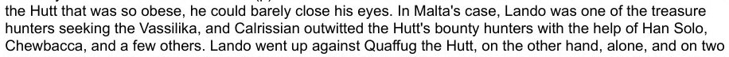
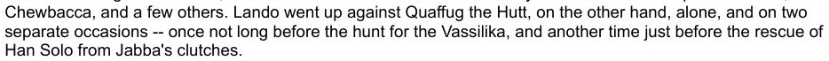
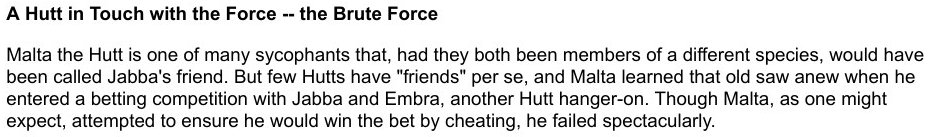
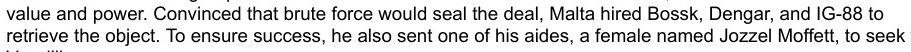
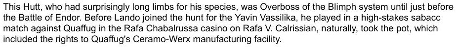
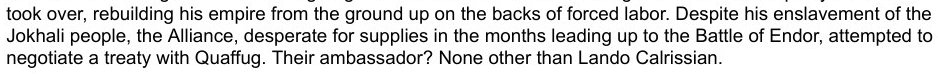

# Owner Material 037 — Star Wars D20 Drive folder (Core, Revised Core and Saga Edition): Characters/Hutts/Malta and Quaffug.pdf [Star Wars Roleplaying Game Revised Core (d20, 2002)]

- **Source:** Wizards of the Coast Star Wars Roleplaying Game books, web enhancements, Living Force campaign modules and articles (2000–2010), from the owner's "Star Wars D20" Drive folder (only the three edition subfolders; "General" was not read, as instructed). Secondary source (licensed Legends reference). Scan OCR'd on the box; the scan stays box-only and is **not** published.
- **Method:** every scanned page was OCR'd and machine-screened sentence by sentence for power-relevant statements (fights, kills, defeats, Force feats, rankings, superweapons) that name a character on our roster; each kept sentence is quoted verbatim from the OCR text and has a crop of the printed passage directly under it. Pages with nothing power-relevant are still listed with what is on them.
- **Citation:** "*Malta and Quaffug* (SWRPG d20 Revised Core), p.X" by printed page ("scan p.X" where no printed number applies). **Weight:** Licensed RPG material: a secondary source. Narrative text sums up Legends lore; game statistics are rules for players, not canon power levels, and rank lowest.

## scan p.1 (scan page 1)

Page contents: Intro; Malta, the Vassilika bet with Jabba and Embra, hires Bossk, Dengar, IG-88; Malta stats (hand-read)

- **Lando Calrissian; Han Solo; Chewbacca** — entry/section: Lando outwits Malta's hunters: "In Malta's case, Lando was one of the treasure hunters seeking the Vassilika, and Calrissian outwitted the Hutt's bounty hunters with the help of Han Solo, Chewbacca, and a few others." Source: *Malta and Quaffug* (SWRPG d20 Revised Core), scan p.1
  
- **Lando Calrissian; Han Solo; Jabba the Hutt** — entry/section: Lando vs Quaffug twice: "Lando went up against Quaffug the Hutt, on the other hand, alone, and on two separate occasions -- once not long before the hunt for the Vassilika, and another time just before the rescue of Han Solo from Jabba's clutches." Source: *Malta and Quaffug* (SWRPG d20 Revised Core), scan p.1
  
- **Jabba the Hutt** — entry/section: Malta, Jabba's 'friend': "Malta the Hutt is one of many sycophants that, had they both been members of a different species, would have been called Jabba's friend. But few Hutts have "friends" per se, and Malta learned that old saw anew when he entered a betting competition with Jabba and Embra, another Hutt hanger-on. Though Malta, as one might expect, attempted to ensure he would win the bet by cheating, he failed spectacularly." Source: *Malta and Quaffug* (SWRPG d20 Revised Core), scan p.1
  
- **Bossk; Dengar; IG-88** — entry/section: Malta hires Bossk, Dengar and IG-88: "Convinced that brute force would seal the deal, Malta hired Bossk, Dengar, and IG-88 to retrieve the object." Source: *Malta and Quaffug* (SWRPG d20 Revised Core), scan p.1
  

### Stat block notes (game mechanics, not feats)

- Malta: Male Hutt Diplomat 5/Crime Lord 4, circa Episode IV (Source: *Malta and Quaffug* (SWRPG d20 Revised Core), scan p.1)

## scan p.2 (scan page 2)

Page contents: Quaffug, Overboss of Blimph, sabacc loss to Lando, Alliance treaty; Quaffug stats; Darth Malak teaser (hand-read)

- **Lando Calrissian** — entry/section: Lando wins Quaffug's factory: "Before Lando joined the hunt for the Yavin Vassilika, he played in a high-stakes sabacc match against Quaffug in the Rafa Chabalrussa casino on Rafa V. Calrissian, naturally, took the pot, which included the rights to Quaffug's Ceramo-Werx manufacturing facility." Source: *Malta and Quaffug* (SWRPG d20 Revised Core), scan p.2
  
- **Lando Calrissian** — entry/section: Lando as Alliance ambassador to Quaffug: "Despite his enslavement of the Jokhali people, the Alliance, desperate for supplies in the months leading up to the Battle of Endor, attempted to negotiate a treaty with Quaffug. Their ambassador? None other than Lando Calrissian." Source: *Malta and Quaffug* (SWRPG d20 Revised Core), scan p.2
  

### Stat block notes (game mechanics, not feats)

- Quaffug: Male Hutt Diplomat 5/Crime Lord 10, circa Episode VI (Source: *Malta and Quaffug* (SWRPG d20 Revised Core), scan p.2)
