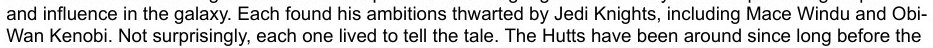
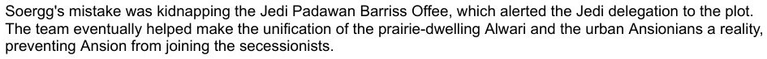
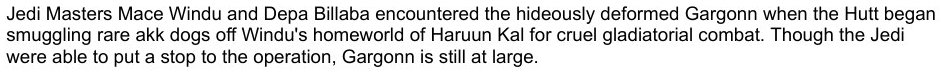
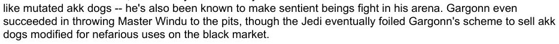

# Owner Material 037 — Star Wars D20 Drive folder (Core, Revised Core and Saga Edition): Characters/Hutts/Soergg and Gargonn.pdf [Star Wars Roleplaying Game Revised Core (d20, 2002)]

- **Source:** Wizards of the Coast Star Wars Roleplaying Game books, web enhancements, Living Force campaign modules and articles (2000–2010), from the owner's "Star Wars D20" Drive folder (only the three edition subfolders; "General" was not read, as instructed). Secondary source (licensed Legends reference). Scan OCR'd on the box; the scan stays box-only and is **not** published.
- **Method:** every scanned page was OCR'd and machine-screened sentence by sentence for power-relevant statements (fights, kills, defeats, Force feats, rankings, superweapons) that name a character on our roster; each kept sentence is quoted verbatim from the OCR text and has a crop of the printed passage directly under it. Pages with nothing power-relevant are still listed with what is on them.
- **Citation:** "*Soergg and Gargonn* (SWRPG d20 Revised Core), p.X" by printed page ("scan p.X" where no printed number applies). **Weight:** Licensed RPG material: a secondary source. Narrative text sums up Legends lore; game statistics are rules for players, not canon power levels, and rank lowest.

## scan p.1 (scan page 1)

Page contents: Intro; Soergg and the Ansion secession plot, Barriss Offee, Ogomoor; Soergg stats (hand-read)

- **Mace Windu; Obi-Wan Kenobi** — entry/section: Thwarted by Mace Windu and Obi-Wan: "Each found his ambitions thwarted by Jedi Knights, including Mace Windu and Obi-Wan Kenobi." Source: *Soergg and Gargonn* (SWRPG d20 Revised Core), scan p.1
  
- **Barriss Offee** — entry/section: Soergg kidnaps Barriss Offee: "Soergg's mistake was kidnapping the Jedi Padawan Barriss Offee, which alerted the Jedi delegation to the plot. The team eventually helped make the unification of the prairie-dwelling Alwari and the urban Ansionians a reality, preventing Ansion from joining the secessionists." Source: *Soergg and Gargonn* (SWRPG d20 Revised Core), scan p.1
  

### Stat block notes (game mechanics, not feats)

- Soergg: Male Hutt Noble 3/Scoundrel 5/Crime Lord 4, circa Episode II (Source: *Soergg and Gargonn* (SWRPG d20 Revised Core), scan p.1)

## scan p.2 (scan page 2)

Page contents: Soergg skills/feats; Gargonn, akk dogs of Haruun Kal, Mace Windu thrown to the pits; Gargonn stats (hand-read)

- **Mace Windu; Depa Billaba** — entry/section: Windu and Billaba vs Gargonn: "Jedi Masters Mace Windu and Depa Billaba encountered the hideously deformed Gargonn when the Hutt began smuggling rare akk dogs off Windu's homeworld of Haruun Kal for cruel gladiatorial combat. Though the Jedi were able to put a stop to the operation, Gargonn is still at large." Source: *Soergg and Gargonn* (SWRPG d20 Revised Core), scan p.2
  
- **Mace Windu** — entry/section: Gargonn throws Windu to the pits: "Gargonn even succeeded in throwing Master Windu to the pits, though the Jedi eventually foiled Gargonn's scheme to sell akk dogs modified for nefarious uses on the black market." Source: *Soergg and Gargonn* (SWRPG d20 Revised Core), scan p.2
  

### Stat block notes (game mechanics, not feats)

- Gargonn: Male Hutt Scoundrel 3/Scout 4/Noble 1/Big-Game Hunter 2/Crime Lord 3, circa Episode II (Source: *Soergg and Gargonn* (SWRPG d20 Revised Core), scan p.2)

## scan p.3 (scan page 3)

Page contents: Expert Stalker special quality; Jedi Counseling teaser (hand-read)

