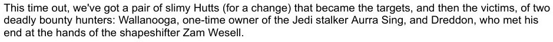
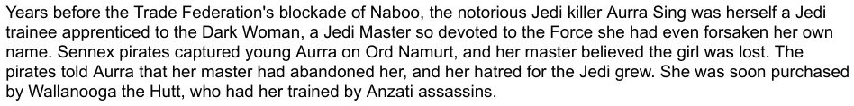
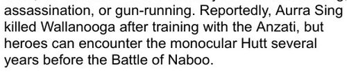
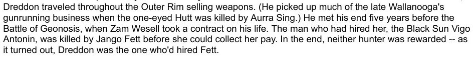

# Owner Material 037 — Star Wars D20 Drive folder (Core, Revised Core and Saga Edition): Characters/Hutts/Wallanooga and Dreddon.pdf [Star Wars Roleplaying Game Revised Core (d20, 2002)]

- **Source:** Wizards of the Coast Star Wars Roleplaying Game books, web enhancements, Living Force campaign modules and articles (2000–2010), from the owner's "Star Wars D20" Drive folder (only the three edition subfolders; "General" was not read, as instructed). Secondary source (licensed Legends reference). Scan OCR'd on the box; the scan stays box-only and is **not** published.
- **Method:** every scanned page was OCR'd and machine-screened sentence by sentence for power-relevant statements (fights, kills, defeats, Force feats, rankings, superweapons) that name a character on our roster; each kept sentence is quoted verbatim from the OCR text and has a crop of the printed passage directly under it. Pages with nothing power-relevant are still listed with what is on them.
- **Citation:** "*Wallanooga and Dreddon* (SWRPG d20 Revised Core), p.X" by printed page ("scan p.X" where no printed number applies). **Weight:** Licensed RPG material: a secondary source. Narrative text sums up Legends lore; game statistics are rules for players, not canon power levels, and rank lowest.

## scan p.1 (scan page 1)

Page contents: Intro; Wallanooga buys young Aurra Sing, Anzati training; Wallanooga stats (hand-read)

- **Aurra Sing; Zam Wesell** — entry/section: Two deadly bounty hunters: "This time out, we've got a pair of slimy Hutts (for a change) that became the targets, and then the victims, of two deadly bounty hunters: Wallanooga, one-time owner of the Jedi stalker Aurra Sing, and Dreddon, who met his end at the hands of the shapeshifter Zam Wesell." Source: *Wallanooga and Dreddon* (SWRPG d20 Revised Core), scan p.1
  
- **Aurra Sing; An'ya Kuro (Dark Woman)** — entry/section: Aurra Sing's capture and sale: "Years before the Trade Federation's blockade of Naboo, the notorious Jedi killer Aurra Sing was herself a Jedi trainee apprenticed to the Dark Woman, a Jedi Master so devoted to the Force she had even forsaken her own name. Sennex pirates captured young Aurra on Ord Namurt, and her master believed the girl was lost. The pirates told Aurra that her master had abandoned her, and her hatred for the Jedi grew. She was soon purchased by Wallanooga the Hutt, who had her trained by Anzati assassins." Source: *Wallanooga and Dreddon* (SWRPG d20 Revised Core), scan p.1
  
- **Aurra Sing** — entry/section: Aurra Sing kills Wallanooga: "Reportedly, Aurra Sing killed Wallanooga after training with the Anzati, but heroes can encounter the monocular Hutt several years before the Battle of Naboo." Source: *Wallanooga and Dreddon* (SWRPG d20 Revised Core), scan p.1
  

### Stat block notes (game mechanics, not feats)

- Wallanooga: Male Hutt Noble 3/Scoundrel 3/Crime Lord 8, circa Episode I; contact Aurra Sing (Source: *Wallanooga and Dreddon* (SWRPG d20 Revised Core), scan p.1)

## scan p.2 (scan page 2)

Page contents: Wallanooga skills; Dreddon, Zam Wesell, Vigo Antonin, Jango Fett; Dreddon stats; Nightsaber teaser (hand-read)

- **Zam Wesell; Jango Fett; Aurra Sing** — entry/section: The double double-cross: "(He picked up much of the late Wallanooga's gunrunning business when the one-eyed Hutt was killed by Aurra Sing.) He met his end five years before the Battle of Geonosis, when Zam Wesell took a contract on his life. The man who had hired her, the Black Sun Vigo Antonin, was killed by Jango Fett before she could collect her pay. In the end, neither hunter was rewarded -- as it turned out, Dreddon was the one who'd hired Fett." Source: *Wallanooga and Dreddon* (SWRPG d20 Revised Core), scan p.2
  

### Stat block notes (game mechanics, not feats)

- Dreddon: Male Hutt Diplomat 5/Tech Specialist 5/Crime Lord 4, circa Episode I; contact Jango Fett (Source: *Wallanooga and Dreddon* (SWRPG d20 Revised Core), scan p.2)
