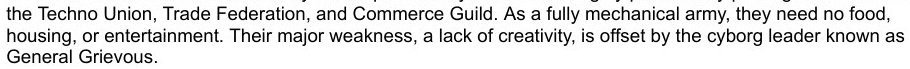
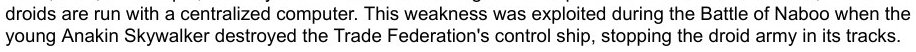

# Owner Material 037 — Star Wars D20 Drive folder (Core, Revised Core and Saga Edition): Characters/Miniatures/Artificial Armies.pdf [Star Wars Roleplaying Game Revised Core (d20, 2002)]

- **Source:** Wizards of the Coast Star Wars Roleplaying Game books, web enhancements, Living Force campaign modules and articles (2000–2010), from the owner's "Star Wars D20" Drive folder (only the three edition subfolders; "General" was not read, as instructed). Secondary source (licensed Legends reference). Scan OCR'd on the box; the scan stays box-only and is **not** published.
- **Method:** every scanned page was OCR'd and machine-screened sentence by sentence for power-relevant statements (fights, kills, defeats, Force feats, rankings, superweapons) that name a character on our roster; each kept sentence is quoted verbatim from the OCR text and has a crop of the printed passage directly under it. Pages with nothing power-relevant are still listed with what is on them.
- **Citation:** "*Artificial Armies* (SWRPG d20 Revised Core), p.X" by printed page ("scan p.X" where no printed number applies). **Weight:** Licensed RPG material: a secondary source. Narrative text sums up Legends lore; game statistics are rules for players, not canon power levels, and rank lowest.

## p.1 (scan page 1)

Page contents: Intro (General Grievous); encounter table (from image); B1 battle droid (Anakin destroyed the control ship); OOM officer (hand-read)

- **General Grievous** — entry/section: Grievous offsets the droids' lack of creativity: "As a fully mechanical army, they need no food, housing, or entertainment. Their major weakness, a lack of creativity, is offset by the cyborg leader known as General Grievous." Source: *Artificial Armies* (SWRPG d20 Revised Core), p.1
  
- **Darth Vader (Anakin Skywalker)** — entry/section: Young Anakin destroys the control ship: "This weakness was exploited during the Battle of Naboo when the young Anakin Skywalker destroyed the Trade Federation's control ship, stopping the droid army in its tracks." Source: *Artificial Armies* (SWRPG d20 Revised Core), p.1
  

### Stat block notes (game mechanics, not feats)

- Separatist droids: B1 Thug 1; OOM officer Soldier 2; OOM security Soldier 2; B2 Soldier 1; dwarf spider droid Thug 4; droideka Soldier 3/Thug 6 (Source: *Artificial Armies* (SWRPG d20 Revised Core), p.1)

## p.2 (scan page 2)

Page contents: OOM officer stats; security battle droid; battle droid on STAP and STAP vehicle stats (hand-read)

## p.3 (scan page 3)

Page contents: Super battle droid B2; dwarf spider droid; droideka (hand-read)

## p.4 (scan page 4)

Page contents: Droideka feats, cost; copyright (hand-read)

