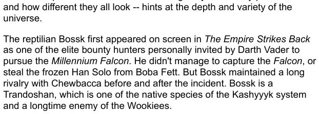
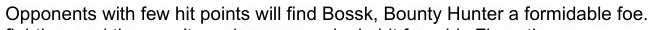

# Owner Material 037 — Star Wars D20 Drive folder (Core, Revised Core and Saga Edition): Characters/Miniatures/Bounty Hunters Preview 1.pdf [Star Wars Roleplaying Game Revised Core (d20, 2002)]

- **Source:** Wizards of the Coast Star Wars Roleplaying Game books, web enhancements, Living Force campaign modules and articles (2000–2010), from the owner's "Star Wars D20" Drive folder (only the three edition subfolders; "General" was not read, as instructed). Secondary source (licensed Legends reference). Scan OCR'd on the box; the scan stays box-only and is **not** published.
- **Method:** every scanned page was OCR'd and machine-screened sentence by sentence for power-relevant statements (fights, kills, defeats, Force feats, rankings, superweapons) that name a character on our roster; each kept sentence is quoted verbatim from the OCR text and has a crop of the printed passage directly under it. Pages with nothing power-relevant are still listed with what is on them.
- **Citation:** "*Bounty Hunters Preview 1* (SWRPG d20 Revised Core), p.X" by printed page ("scan p.X" where no printed number applies). **Weight:** Licensed RPG material: a secondary source. Narrative text sums up Legends lore; game statistics are rules for players, not canon power levels, and rank lowest.

## scan p.1 (scan page 1)

Page contents: Intro; Bossk history and miniatures tactics; stat card; Bossk RPG stats (hand-read)

- **Bossk; Chewbacca; Boba Fett** — entry/section: Bossk's screen history and rivalry with Chewbacca: "The reptilian Bossk first appeared on screen in The Empire Strikes Back as one of the elite bounty hunters personally invited by Darth Vader to pursue the Millennium Falcon. He didn't manage to capture the Falcon, or steal the frozen Han Solo from Boba Fett. But Bossk maintained a long rivalry with Chewbacca before and after the incident. Bossk is a Trandoshan, which is one of the native species of the Kashyyyk system and a longtime enemy of the Wookiees." Source: *Bounty Hunters Preview 1* (SWRPG d20 Revised Core), scan p.1
  
- **Bossk** — entry/section: Bossk, Bounty Hunter: "Opponents with few hit points will find Bossk, Bounty Hunter a formidable foe." Source: *Bounty Hunters Preview 1* (SWRPG d20 Revised Core), scan p.1
  

### Stat block notes (game mechanics, not feats)

- Roleplaying Game Statistics Bossk: Male Trandoshan scout 4/soldier 3/bounty hunter 1; Init +3 (+3 Dex); Defense 22 (+1 natural, + 8 class, +3 Dex); Spd 10 m; VP/WP 66/16; Atk +10/+5, melee (1d3+3, unarmed) or +10/+5 ranged (3d8/19-—20, blaster rifle) or +10/+5 ranged (3d6/1d6 stun grenade) or +10/+5 ranged (2d6, flamethrower); SQ darkvision 20 m, trailblazing, heart +1, uncanny dodge, target bonus +1; SV Fort +9 (Source: *Bounty Hunters Preview 1* (SWRPG d20 Revised Core), scan p.1)
- bossk: Bossk: Male Trandoshan scout 4/soldier 3/bounty hunter 1; Defense 22; VP/WP 66/16; DSP 8; Challenge Code D; Hound's Tooth (Source: *Bounty Hunters Preview 1* (SWRPG d20 Revised Core), scan p.1)

## scan p.2 (scan page 2)

Page contents: Bossk skills/feats; Mistryl Shadow Guard background (Emberlene), tactics, card, RPG stats (hand-read)

### Stat block notes (game mechanics, not feats)

- Mistryl Shadow Guard: Female Human scoundrel 4/scout 4/Mistryl Shadow Guard 3/bodyguard 1; Challenge Code D; shock whip (Source: *Bounty Hunters Preview 1* (SWRPG d20 Revised Core), scan p.2)

## scan p.3 (scan page 3)

Page contents: Author bios; copyright (hand-read)

