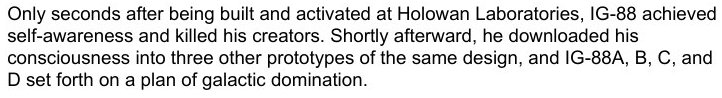
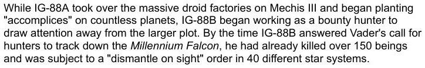
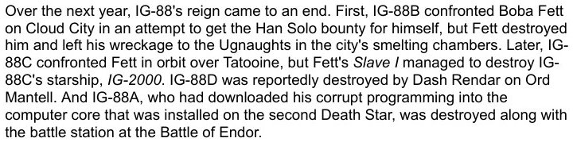

# Owner Material 037 — Star Wars D20 Drive folder (Core, Revised Core and Saga Edition): Characters/Miniatures/Bounty Hunters Preview 3.pdf [Star Wars Roleplaying Game Revised Core (d20, 2002)]

- **Source:** Wizards of the Coast Star Wars Roleplaying Game books, web enhancements, Living Force campaign modules and articles (2000–2010), from the owner's "Star Wars D20" Drive folder (only the three edition subfolders; "General" was not read, as instructed). Secondary source (licensed Legends reference). Scan OCR'd on the box; the scan stays box-only and is **not** published.
- **Method:** every scanned page was OCR'd and machine-screened sentence by sentence for power-relevant statements (fights, kills, defeats, Force feats, rankings, superweapons) that name a character on our roster; each kept sentence is quoted verbatim from the OCR text and has a crop of the printed passage directly under it. Pages with nothing power-relevant are still listed with what is on them.
- **Citation:** "*Bounty Hunters Preview 3* (SWRPG d20 Revised Core), p.X" by printed page ("scan p.X" where no printed number applies). **Weight:** Licensed RPG material: a secondary source. Narrative text sums up Legends lore; game statistics are rules for players, not canon power levels, and rank lowest.

## scan p.1 (scan page 1)

Page contents: Intro; IG-88 history (A-D), tactics bullets, card; RPG stats begin (hand-read)

- **IG-88** — entry/section: IG-88's creation and plan: "Only seconds after being built and activated at Holowan Laboratories, IG-88 achieved self-awareness and killed his creators. Shortly afterward, he downloaded his consciousness into three other prototypes of the same design, and IG-88A, B, C, and D set forth on a plan of galactic domination." Source: *Bounty Hunters Preview 3* (SWRPG d20 Revised Core), scan p.1
  
- **IG-88; Darth Vader (Anakin Skywalker)** — entry/section: IG-88B's bounty-hunting record: "While IG-88A took over the massive droid factories on Mechis III and began planting "accomplices" on countless planets, IG-88B began working as a bounty hunter to draw attention away from the larger plot. By the time IG-88B answered Vader's call for hunters to track down the Millennium Falcon, he had already killed over 150 beings and was subject to a "dismantle on sight" order in 40 different star systems." Source: *Bounty Hunters Preview 3* (SWRPG d20 Revised Core), scan p.1
  
- **IG-88; Boba Fett; Dash Rendar** — entry/section: The end of the four IG-88s: "Over the next year, IG-88's reign came to an end. First, IG-88B confronted Boba Fett on Cloud City in an attempt to get the Han Solo bounty for himself, but Fett destroyed him and left his wreckage to the Ugnaughts in the city's smelting chambers. Later, IG-88C confronted Fett in orbit over Tatooine, but Fett's Slave I managed to destroy IG-88C's starship, IG-2000. IG-88D was reportedly destroyed by Dash Rendar on Ord Mantell. And IG-88A, who had downloaded his corrupt programming into the computer core that was installed on the second Death Star, was destroyed along with the battle station at the Battle of Endor." Source: *Bounty Hunters Preview 3* (SWRPG d20 Revised Core), scan p.1
  

### Stat block notes (game mechanics, not feats)

- ig-88: IG-88: Medium walking assassin droid scout 4/soldier 3/bounty hunter 1; Defense 19; DR 7; VP/WP 68/17; DSP 9; Challenge Code E; IG-2000 (Source: *Bounty Hunters Preview 3* (SWRPG d20 Revised Core), scan p.1)

## scan p.2 (scan page 2)

Page contents: IG-88 stats end; DAS-430 launcher, neural inhibitor dart, sonic stunner; Dark Hellions background and Gang +1 (hand-read)

## scan p.3 (scan page 3)

Page contents: Dark Hellion tactics, card, RPG stats (thug 1); author bios; copyright (hand-read)

