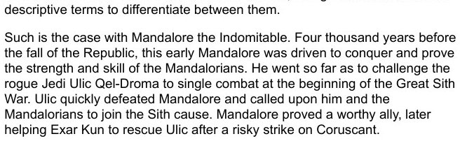
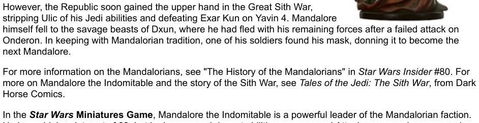
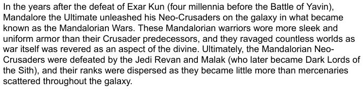
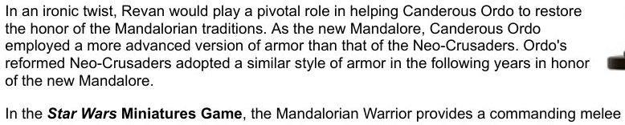

# Owner Material 037 — Star Wars D20 Drive folder (Core, Revised Core and Saga Edition): Characters/Miniatures/Bounty Hunters Preview 4.pdf [Star Wars Roleplaying Game Revised Core (d20, 2002)]

- **Source:** Wizards of the Coast Star Wars Roleplaying Game books, web enhancements, Living Force campaign modules and articles (2000–2010), from the owner's "Star Wars D20" Drive folder (only the three edition subfolders; "General" was not read, as instructed). Secondary source (licensed Legends reference). Scan OCR'd on the box; the scan stays box-only and is **not** published.
- **Method:** every scanned page was OCR'd and machine-screened sentence by sentence for power-relevant statements (fights, kills, defeats, Force feats, rankings, superweapons) that name a character on our roster; each kept sentence is quoted verbatim from the OCR text and has a crop of the printed passage directly under it. Pages with nothing power-relevant are still listed with what is on them.
- **Citation:** "*Bounty Hunters Preview 4* (SWRPG d20 Revised Core), p.X" by printed page ("scan p.X" where no printed number applies). **Weight:** Licensed RPG material: a secondary source. Narrative text sums up Legends lore; game statistics are rules for players, not canon power levels, and rank lowest.

## scan p.1 (scan page 1)

Page contents: Intro; Mandalorians and the Mandalore title; Mandalore the Indomitable vs Ulic, Exar Kun, death on Dxun; tactics; card (Cost 68, Attack +13 from image); RPG stats begin (hand-read)

- **Mandalore the Indomitable; Ulic Qel-Droma; Exar Kun** — entry/section: Mandalore the Indomitable and the Great Sith War: "Such is the case with Mandalore the Indomitable. Four thousand years before the fall of the Republic, this early Mandalore was driven to conquer and prove the strength and skill of the Mandalorians. He went so far as to challenge the rogue Jedi Ulic Qel-Droma to single combat at the beginning of the Great Sith War. Ulic quickly defeated Mandalore and called upon him and the Mandalorians to join the Sith cause. Mandalore proved a worthy ally, later helping Exar Kun to rescue Ulic after a risky strike on Coruscant." Source: *Bounty Hunters Preview 4* (SWRPG d20 Revised Core), scan p.1
  
- **Mandalore the Indomitable; Ulic Qel-Droma; Exar Kun** — entry/section: Mandalore falls on Dxun: "However, the Republic soon gained the upper hand in the Great Sith War, stripping Ulic of his Jedi abilities and defeating Exar Kun on Yavin 4. Mandalore himself fell to the savage beasts of Dxun, where he had fled with his remaining forces after a failed attack on Onderon. In keeping with Mandalorian tradition, one of his soldiers found his mask, donning it to become the next Mandalore." Source: *Bounty Hunters Preview 4* (SWRPG d20 Revised Core), scan p.1
  

### Stat block notes (game mechanics, not feats)

- mandalore-the-indomitable: Mandalore the Indomitable: Male Mandalorian soldier 6/elite trooper 5; Defense 19; DR 11; VP/WP 104/16; DSP 5; Challenge Code E; Crusader armor, mythosaur axe, force pike, basilisk war droid (Source: *Bounty Hunters Preview 4* (SWRPG d20 Revised Core), scan p.1)

## scan p.2 (scan page 2)

Page contents: Mandalore stats end; Crusader armor; mythosaur axe; Mandalorian Warrior: Mandalore the Ultimate, Neo-Crusaders, Revan and Malak, Canderous Ordo; tactics (hand-read)

- **Revan; Darth Malak; Mandalore the Ultimate** — entry/section: Mandalore the Ultimate's Neo-Crusaders: "In the years after the defeat of Exar Kun (four millennia before the Battle of Yavin), Mandalore the Ultimate unleashed his Neo-Crusaders on the galaxy in what became known as the Mandalorian Wars. These Mandalorian warriors wore more sleek and uniform armor than their Crusader predecessors, and they ravaged countless worlds as war itself was revered as an aspect of the divine. Ultimately, the Mandalorian Neo-Crusaders were defeated by the Jedi Revan and Malak (who later became Dark Lords of the Sith), and their ranks were dispersed as they became little more than mercenaries scattered throughout the galaxy." Source: *Bounty Hunters Preview 4* (SWRPG d20 Revised Core), scan p.2
  
- **Revan; Canderous Ordo** — entry/section: Revan helps Canderous Ordo restore Mandalorian honor: "In an ironic twist, Revan would play a pivotal role in helping Canderous Ordo to restore the honor of the Mandalorian traditions. As the new Mandalore, Canderous Ordo employed a more advanced version of armor than that of the Neo-Crusaders. Ordo's reformed Neo-Crusaders adopted a similar style of armor in the following years in honor of the new Mandalore." Source: *Bounty Hunters Preview 4* (SWRPG d20 Revised Core), scan p.2
  

## scan p.3 (scan page 3)

Page contents: Warrior card and RPG stats (soldier 4); author bios; copyright (hand-read)

### Stat block notes (game mechanics, not feats)

- Mandalorian warrior: Male Human soldier 4; Challenge Code C; great force pike (Source: *Bounty Hunters Preview 4* (SWRPG d20 Revised Core), scan p.3)
