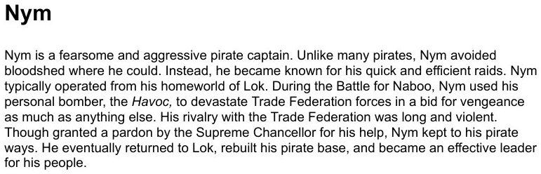

# Owner Material 037 — Star Wars D20 Drive folder (Core, Revised Core and Saga Edition): Characters/Miniatures/Bounty Hunters Preview 5.pdf [Star Wars Roleplaying Game Revised Core (d20, 2002)]

- **Source:** Wizards of the Coast Star Wars Roleplaying Game books, web enhancements, Living Force campaign modules and articles (2000–2010), from the owner's "Star Wars D20" Drive folder (only the three edition subfolders; "General" was not read, as instructed). Secondary source (licensed Legends reference). Scan OCR'd on the box; the scan stays box-only and is **not** published.
- **Method:** every scanned page was OCR'd and machine-screened sentence by sentence for power-relevant statements (fights, kills, defeats, Force feats, rankings, superweapons) that name a character on our roster; each kept sentence is quoted verbatim from the OCR text and has a crop of the printed passage directly under it. Pages with nothing power-relevant are still listed with what is on them.
- **Citation:** "*Bounty Hunters Preview 5* (SWRPG d20 Revised Core), p.X" by printed page ("scan p.X" where no printed number applies). **Weight:** Licensed RPG material: a secondary source. Narrative text sums up Legends lore; game statistics are rules for players, not canon power levels, and rank lowest.

## scan p.1 (scan page 1)

Page contents: Intro; Nym history (Lok, Havoc, Battle of Naboo, pardon) and sources; tactics; card; RPG stats (hand-read)

- **Nym** — entry/section: Nym the pirate captain: "Nym is a fearsome and aggressive pirate captain. Unlike many pirates, Nym avoided bloodshed where he could. Instead, he became known for his quick and efficient raids. Nym typically operated from his homeworld of Lok. During the Battle for Naboo, Nym used his personal bomber, the Havoc, to devastate Trade Federation forces in a bid for vengeance as much as anything else. His rivalry with the Trade Federation was long and violent. Though granted a pardon by the Supreme Chancellor for his help, Nym kept to his pirate ways. He eventually returned to Lok, rebuilt his pirate base, and became an effective leader for his people." Source: *Bounty Hunters Preview 5* (SWRPG d20 Revised Core), scan p.1
  

### Stat block notes (game mechanics, not feats)

- nym: Nym: Male Feeorin Soldier 7; Defense 18; VP/WP 84/16; FP 3; DSP 0; Challenge Code D; Havoc (Scurrg H-6 bomber) (Source: *Bounty Hunters Preview 5* (SWRPG d20 Revised Core), scan p.1)

## scan p.2 (scan page 2)

Page contents: ISP Speeder description, tactics, card, vehicle stats; author bio (hand-read)

## scan p.3 (scan page 3)

Page contents: Author bio; copyright (hand-read)

