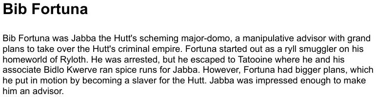
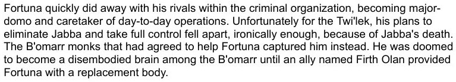

# Owner Material 037 — Star Wars D20 Drive folder (Core, Revised Core and Saga Edition): Characters/Miniatures/Bounty Hunters Preview 6.pdf [Star Wars Roleplaying Game Revised Core (d20, 2002)]

- **Source:** Wizards of the Coast Star Wars Roleplaying Game books, web enhancements, Living Force campaign modules and articles (2000–2010), from the owner's "Star Wars D20" Drive folder (only the three edition subfolders; "General" was not read, as instructed). Secondary source (licensed Legends reference). Scan OCR'd on the box; the scan stays box-only and is **not** published.
- **Method:** every scanned page was OCR'd and machine-screened sentence by sentence for power-relevant statements (fights, kills, defeats, Force feats, rankings, superweapons) that name a character on our roster; each kept sentence is quoted verbatim from the OCR text and has a crop of the printed passage directly under it. Pages with nothing power-relevant are still listed with what is on them.
- **Citation:** "*Bounty Hunters Preview 6* (SWRPG d20 Revised Core), p.X" by printed page ("scan p.X" where no printed number applies). **Weight:** Licensed RPG material: a secondary source. Narrative text sums up Legends lore; game statistics are rules for players, not canon power levels, and rank lowest.

## scan p.1 (scan page 1)

Page contents: Intro; Defel species (Af'El, light-absorbing fur, visors); Defel Spy tactics, card, RPG stats (scoundrel 3) (hand-read)

### Stat block notes (game mechanics, not feats)

- Defel spy: Male Defel scoundrel 3; Challenge Code C (Source: *Bounty Hunters Preview 6* (SWRPG d20 Revised Core), scan p.1)

## scan p.2 (scan page 2)

Page contents: Footnotes; Bib Fortuna history (Ryloth, Bidlo Kwerve, majordomo, B'omarr monks, Firth Olan); tactics; card (Cost 8); RPG stats (hand-read)

- **Bib Fortuna; Jabba the Hutt** — entry/section: Bib Fortuna's rise in Jabba's service: "Bib Fortuna was Jabba the Hutt's scheming major-domo, a manipulative advisor with grand plans to take over the Hutt's criminal empire. Fortuna started out as a ryll smuggler on his homeworld of Ryloth. He was arrested, but he escaped to Tatooine where he and his associate Bidlo Kwerve ran spice runs for Jabba. However, Fortuna had bigger plans, which he put in motion by becoming a slaver for the Hutt. Jabba was impressed enough to make him an advisor." Source: *Bounty Hunters Preview 6* (SWRPG d20 Revised Core), scan p.2
  
- **Bib Fortuna; Jabba the Hutt** — entry/section: Bib Fortuna's fall to the B'omarr monks: "Fortuna quickly did away with his rivals within the criminal organization, becoming majordomo and caretaker of day-to-day operations. Unfortunately for the Twi'lek, his plans to eliminate Jabba and take full control fell apart, ironically enough, because of Jabba's death. The B'omarr monks that had agreed to help Fortuna captured him instead. He was doomed to become a disembodied brain among the B'omarr until an ally named Firth Olan provided Fortuna with a replacement body." Source: *Bounty Hunters Preview 6* (SWRPG d20 Revised Core), scan p.2
  

### Stat block notes (game mechanics, not feats)

- bib-fortuna: Bib Fortuna: Male Twi'lek diplomat 2/scoundrel 3; Defense 13; VP/WP 20/12; DSP 6; Challenge Code D; Twi'lek dagger, poisons (Source: *Bounty Hunters Preview 6* (SWRPG d20 Revised Core), scan p.2)

## scan p.3 (scan page 3)

Page contents: Author bios; copyright (hand-read)

