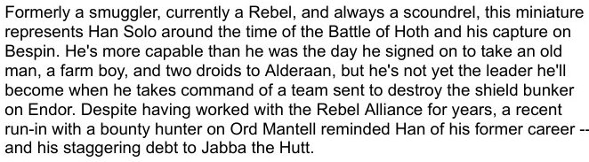

# Owner Material 037 — Star Wars D20 Drive folder (Core, Revised Core and Saga Edition): Characters/Miniatures/Bounty Hunters Preview 7.pdf [Star Wars Roleplaying Game Revised Core (d20, 2002)]

- **Source:** Wizards of the Coast Star Wars Roleplaying Game books, web enhancements, Living Force campaign modules and articles (2000–2010), from the owner's "Star Wars D20" Drive folder (only the three edition subfolders; "General" was not read, as instructed). Secondary source (licensed Legends reference). Scan OCR'd on the box; the scan stays box-only and is **not** published.
- **Method:** every scanned page was OCR'd and machine-screened sentence by sentence for power-relevant statements (fights, kills, defeats, Force feats, rankings, superweapons) that name a character on our roster; each kept sentence is quoted verbatim from the OCR text and has a crop of the printed passage directly under it. Pages with nothing power-relevant are still listed with what is on them.
- **Citation:** "*Bounty Hunters Preview 7* (SWRPG d20 Revised Core), p.X" by printed page ("scan p.X" where no printed number applies). **Weight:** Licensed RPG material: a secondary source. Narrative text sums up Legends lore; game statistics are rules for players, not canon power levels, and rank lowest.

## scan p.1 (scan page 1)

Page contents: Intro; Han Solo, Scoundrel era (Hoth/Bespin), comparison with earlier Han figures, Twin Attack damage odds, card (hand-read)

- **Han Solo; Jabba the Hutt** — entry/section: Han Solo between Alderaan and Endor: "Formerly a smuggler, currently a Rebel, and always a scoundrel, this miniature represents Han Solo around the time of the Battle of Hoth and his capture on Bespin. He's more capable than he was the day he signed on to take an old man, a farm boy, and two droids to Alderaan, but he's not yet the leader he'll become when he takes command of a team sent to destroy the shield bunker on Endor. Despite having worked with the Rebel Alliance for years, a recent run-in with a bounty hunter on Ord Mantell reminded Han of his former career -- and his staggering debt to Jabba the Hutt." Source: *Bounty Hunters Preview 7* (SWRPG d20 Revised Core), scan p.1
  

## scan p.2 (scan page 2)

Page contents: Han RPG stats; Black Sun and the Vigos (Xizor named); Bith Vigo tactics, card, RPG stats begin (hand-read)

### Stat block notes (game mechanics, not feats)

- han-solo: Han Solo, Scoundrel: Male Human scoundrel 6/soldier 2; Def 17; VP/WP 61/14; FP 3; Rep +2; Challenge Code D; mastercraft heavy blaster pistol, Millennium Falcon (Source: *Bounty Hunters Preview 7* (SWRPG d20 Revised Core), scan p.2)
- Bith Black Sun Vigo: Male Bith scoundrel 7/crime lord 3; Challenge Code E (Source: *Bounty Hunters Preview 7* (SWRPG d20 Revised Core), scan p.2)

## scan p.3 (scan page 3)

Page contents: Vigo stats end (scoundrel 7/crime lord 3); author bios; copyright (hand-read)

